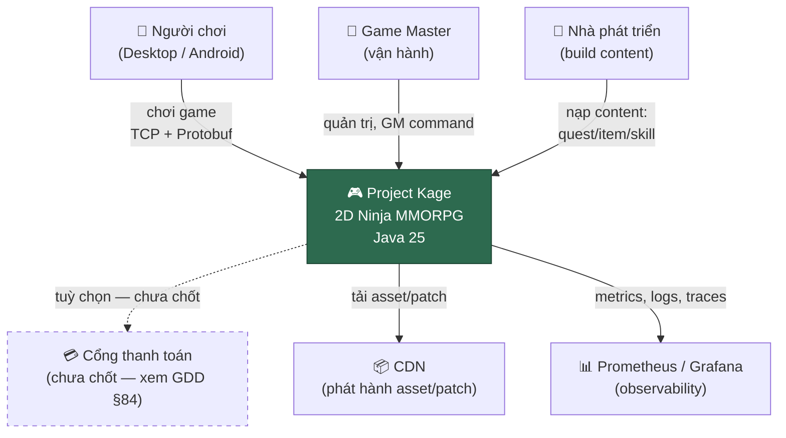
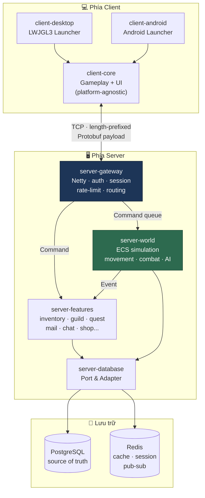
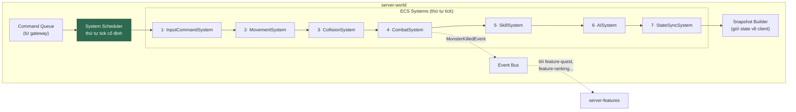
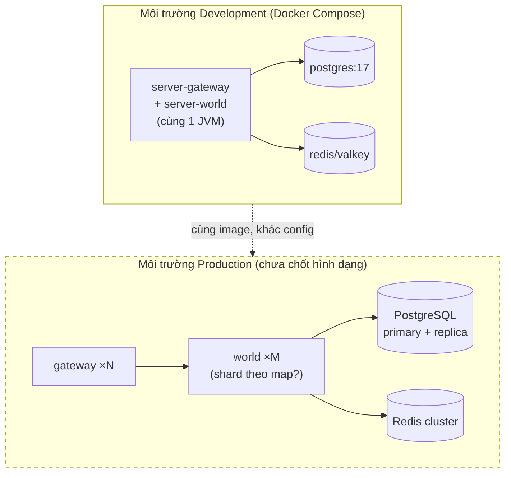
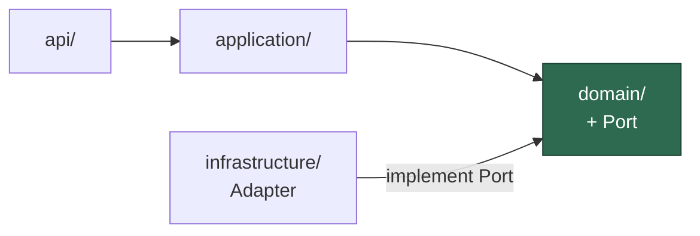
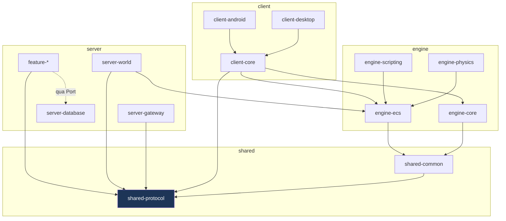
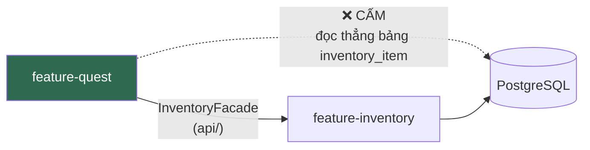
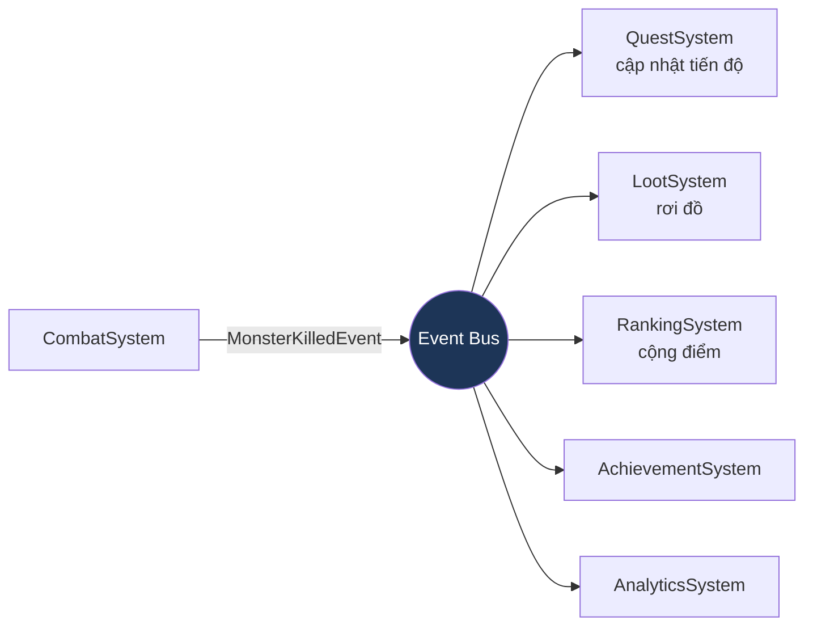
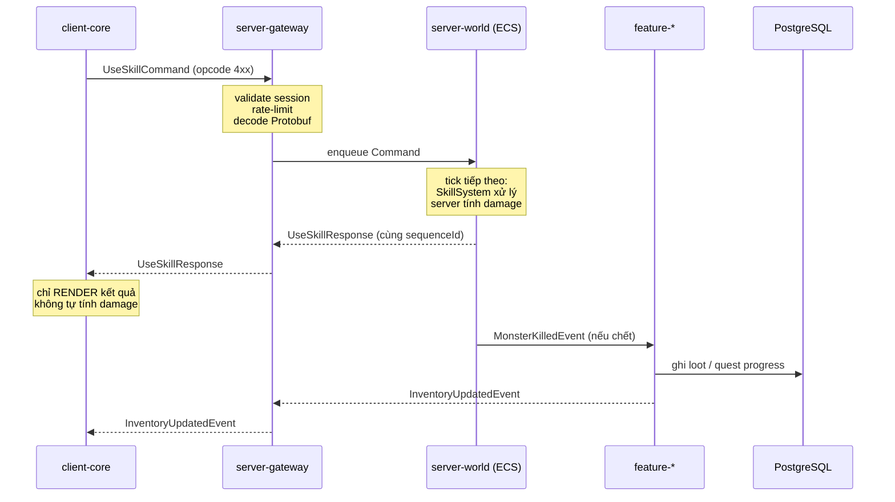
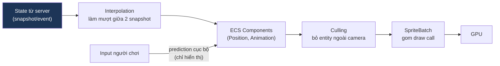

# ARCHITECTURE.md

**Kiến trúc tổng thể Project Kage**

| | |
|---|---|
| Version | 1.0.0 |
| Status | Draft |
| Luật gốc | [KAGE-CONSTITUTION.md — Chương V](../00-governance/KAGE-CONSTITUTION.md#chương-v--nguyên-tắc-kiến-trúc) |

> Tài liệu này là **chi tiết triển khai** của Chương V Hiến pháp. Hiến pháp nói *nguyên tắc*, tài liệu này nói *hình dạng cụ thể*.
> Đây là tài liệu quan trọng nhất trong bộ docs. Đọc trước khi đụng vào bất kỳ module nào.

---

## 1. Vision kiến trúc

Kiến trúc Kage phải trả lời được câu hỏi: **"5 năm nữa, thay Ashley ECS bằng ECS tự viết, có phải viết lại gameplay không?"**

Câu trả lời bắt buộc: **Không.**

Toàn bộ thiết kế dưới đây tồn tại để bảo đảm điều đó — mọi thành phần bên ngoài (ECS framework, network library, database, script engine) đều nằm sau một ranh giới có thể thay thế.

---

## 2. Kiến trúc Hybrid — dùng mô hình nào ở đâu

Không áp dụng duy nhất một mô hình (Điều 25). Lý do: gameplay realtime và nghiệp vụ giao dịch có yêu cầu ngược nhau.

| Vùng | Mô hình | Vì sao |
|---|---|---|
| Login, Account, Character, Inventory, Shop, Guild, Mail, Quest, Auction, Friend, Chat, Ranking | **Clean + Hexagonal** | Nghiệp vụ phức tạp, cần test dễ, cần thay adapter (DB/cache), tần suất gọi thấp → abstraction đáng giá |
| Movement, Combat, Skill, AI, Animation, Rendering, Physics | **ECS + Data-Oriented** | Chạy 30–60 lần/giây trên hàng nghìn entity → abstraction là chi phí không chấp nhận được |
| Giao tiếp giữa các hệ thống gameplay | **Event-Driven** | Tránh coupling hình sao (MonsterKilled phải gọi 5 hệ thống) |
| Ranh giới với thế giới bên ngoài | **Port & Adapter** | Thay PostgreSQL/Redis/Netty không đụng gameplay |

**Ranh giới quan trọng nhất**: Clean Architecture **không** áp dụng cho Rendering / Physics / ECS Update Loop. Hiệu năng thắng abstraction ở vùng này — đây là quyết định có chủ đích, không phải thiếu sót.

---

## 3. C4 Model — Level 1: System Context

Ai dùng hệ thống, hệ thống nói chuyện với cái gì.



**Lưu ý**: Cổng thanh toán vẽ nét đứt vì mô hình kinh doanh **chưa chốt** ([GDD §84](../13-game-design/GAME-DESIGN-DOCUMENT.md)). Không thiết kế tích hợp thanh toán khi chưa có quyết định.

---

## 4. C4 Model — Level 2: Container

Các tiến trình chạy độc lập và cách chúng nói chuyện.



**Quyết định then chốt**: `server-gateway` là **module duy nhất** được import Netty. `server-world` và `feature-*` không biết Netty tồn tại — chúng chỉ thấy Command/Event đã được decode.

---

## 5. C4 Model — Level 3: Component (bên trong server-world)



**Thứ tự tick là cố định và có ý nghĩa** — không được đổi tuỳ tiện. Chi tiết: [ECS.md](../03-engine/ECS.md), [SERVER.md](../05-server/SERVER.md).

---

## 6. C4 Model — Level 4: Deployment



⚠️ **Production topology vẽ nét đứt — chưa chốt.** Phụ thuộc câu hỏi single-realm vs multi-realm ([docs/README.md](../README.md)). **Không xây Kubernetes manifest khi chưa có quyết định này** — xem [KUBERNETES.md](../07-infrastructure/KUBERNETES.md) (đang là stub, có chủ đích).

---

## 7. Architecture Layers

```
┌──────────────────────────────────────────┐
│  api/            ← module khác gọi vào   │  Public API — ổn định, có JavaDoc
├──────────────────────────────────────────┤
│  application/    ← use case              │  Điều phối, không chứa quy tắc nghiệp vụ
├──────────────────────────────────────────┤
│  domain/         ← quy tắc nghiệp vụ     │  Thuần Java. KHÔNG import gì bên ngoài.
│                    + Port (interface)    │  Test được không cần mock.
├──────────────────────────────────────────┤
│  infrastructure/ ← Adapter               │  Implement Port. Biết PostgreSQL/Redis.
└──────────────────────────────────────────┘
```

Chiều dependency:



**`domain/` là tâm. Mọi mũi tên chỉ vào trong.** `domain/` không import `infrastructure/` — đó là Dependency Inversion, và là thứ khiến ta thay PostgreSQL bằng thứ khác mà không đụng nghiệp vụ.

---

## 8. Module Dependencies



**Quy tắc kiểm chứng được bằng máy** (Điều 23):

| Module | ❌ Cấm import |
|---|---|
| `engine-*`, `client-core`, `server-world` | Netty, PostgreSQL driver, Redis client, Spring, Docker/K8s SDK |
| `shared-*` | Bất kỳ business logic nào |
| `domain/` (trong mọi feature) | `infrastructure/` |
| Mọi module ngoài `server-gateway` | Netty |
| Mọi module ngoài `server-database` | JDBC / Redis client |

→ Phải cấu hình Gradle để **vi phạm = build fail** ở Phase 0. Xem [AI-WORKING-RULES.md §15](../00-governance/AI-WORKING-RULES.md).

---

## 9. Domain Boundaries

Mỗi feature là một **bounded context**. Không feature nào đọc bảng DB của feature khác.



Muốn dữ liệu của feature khác → gọi `api/` Facade của feature đó. Muốn phản ứng với việc gì đó xảy ra → **lắng nghe Event**, không hỏi trực tiếp.

---

## 10. Event Flow

Điều 26 — các hệ thống không gọi trực tiếp lẫn nhau.



**Vì sao**: nếu `CombatSystem` gọi trực tiếp 5 hệ thống kia, thêm hệ thống thứ 6 phải sửa `CombatSystem`. Với Event, thêm hệ thống thứ 6 **không đụng** code chiến đấu.

**Đánh đổi phải biết**: Event làm luồng khó trace hơn. Vì vậy:
- Event **chỉ dùng cho fan-out** (1 nguồn → nhiều đích không quan tâm lẫn nhau).
- Cần kết quả trả về ngay → **gọi trực tiếp qua Facade**, không dùng Event.
- Không dùng Event để "gọi hàm cho có vẻ decoupled".

Chi tiết + ADR: [ADR-008](adr/ADR-008-Why-EventDriven.md).

---

## 11. Data Flow — một hành động của người chơi

Ví dụ: người chơi dùng skill.



**Điểm bất khả xâm phạm**: client gửi *ý định* ("tôi muốn dùng skill"), **không** gửi *kết quả* ("tôi gây 500 damage"). Server tính, server quyết (Điều 15).

---

## 12. Rendering Flow (client)



**Client prediction chỉ để làm mượt hình ảnh.** Server nói khác → client **sửa theo server**, không tranh cãi. Chi tiết: [RENDERING.md](../03-engine/RENDERING.md), [CLIENT.md](../04-client/CLIENT.md).

---

## 13. Networking Flow

Chi tiết đầy đủ: [NETWORK.md](../05-server/NETWORK.md). Ở mức kiến trúc:

```
Client                Gateway                    World / Features
  │                     │                              │
  │  Command ──────────▶│ decode · validate · limit    │
  │                     │──── enqueue ────────────────▶│
  │                     │                         tick xử lý
  │◀───── Response ─────│◀─────────────────────────────│
  │◀───── Event ────────│◀──── fan-out ────────────────│
```

Ba loại packet: **Command** (client→server, cần Response) · **Response** (trả lời 1 Command) · **Event** (server→client, không cần trả lời).

---

## 14. Scalability

Chiến lược mở rộng **theo thứ tự áp dụng** — không nhảy cóc (Điều 9 vs Điều 19):

| Bước | Cách | Khi nào |
|---|---|---|
| 0 | 1 process, 1 DB | MVP. **Điểm bắt đầu.** |
| 1 | Tách gateway ↔ world thành 2 process | Khi gateway I/O cạnh tranh CPU với game tick |
| 2 | Nhiều `world` instance, mỗi instance giữ vài map | Khi 1 JVM không kham nổi số entity |
| 3 | PostgreSQL read replica | Khi đọc lấn át ghi |
| 4 | Redis cluster / pub-sub liên instance | Khi cần đồng bộ event xuyên instance |
| 5 | Sharding theo realm/character | Khi ghi vượt khả năng 1 primary |

**Không triển khai bước N+1 khi chưa có số liệu chứng minh bước N đã hết dư địa** (Điều 30). Đây là lý do [KUBERNETES.md](../07-infrastructure/KUBERNETES.md) đang là stub.

---

## 15. Fault Tolerance

| Thành phần chết | Hệ quả | Thiết kế phải đảm bảo |
|---|---|---|
| Redis | Mất cache/session | **Không mất dữ liệu người chơi.** Người chơi phải đăng nhập lại, không mất item/gold. Redis không bao giờ là nơi duy nhất chứa dữ liệu sở hữu (Điều 15 + [DATABASE.md](../05-server/DATABASE.md)) |
| PostgreSQL | Không ghi được | Server **từ chối giao dịch**, không cho chơi tiếp rồi mất dữ liệu sau. Fail Fast (Điều 16) |
| 1 world instance | Map do nó giữ offline | Người chơi ở map đó bị trả về hub, không sập toàn server |
| Gateway | Mất kết nối | Client tự reconnect, session còn hạn thì vào lại được |
| Script lỗi | Quest/NPC lỗi | **Sandbox bắt được**, không sập server (Điều 27) |

**Nguyên tắc**: thà từ chối phục vụ còn hơn phục vụ sai rồi mất dữ liệu người chơi.

---

## 16. Future Evolution — thứ đã tính trước để thay

Kiến trúc này cố tình để ngỏ các điểm thay thế sau:

| Thay gì | Thay được nhờ | Điều kiện kích hoạt |
|---|---|---|
| Ashley ECS → Kage ECS tự viết | `engine-ecs` bọc kín, gameplay không import `com.badlogic.ashley.*` | Benchmark Phase 9 cho thấy bottleneck — [ADR-006](adr/ADR-006-Why-ECS.md) |
| Redis → Valkey | Adapter trong `server-database`, API tương thích | Phân phối/host bản Redis sửa đổi cho bên thứ ba (network copyleft AGPLv3) — [ADR-005](adr/ADR-005-Why-Redis.md) ✅ Accepted (Redis) |
| TCP → TCP + UDP cho movement | `server-gateway` cô lập transport | Đo được latency movement không đạt |
| 1 world → nhiều world shard | World không giữ state toàn cục, chỉ giữ map của mình | §14 bước 2 |
| Thêm nền tảng (iOS/Web) | `client-core` platform-agnostic, launcher tách riêng | Sau khi Android ổn định |

**Đây không phải YAGNI vi phạm** — ta không *xây* các thứ này, ta chỉ *không chặn đường* tới chúng. Chi phí bằng 0, giá trị rất lớn.

---

## Technical Decisions

| # | Quyết định | Lý do | Trạng thái |
|---|---|---|---|
| 1 | Kiến trúc Hybrid, không dùng một mô hình duy nhất | Gameplay realtime và nghiệp vụ có yêu cầu ngược nhau | Accepted |
| 2 | Clean Architecture **không** áp dụng cho Rendering/Physics/ECS loop | Hiệu năng thắng abstraction ở hot path | Accepted |
| 3 | `server-gateway` là module duy nhất biết Netty | Cô lập transport để thay được | Accepted — [ADR-003](adr/ADR-003-Why-Netty.md) |
| 4 | Gameplay không import `com.badlogic.ashley.*` trực tiếp, phải qua `engine-ecs` | Điều kiện để thay ECS sau này không phải viết lại gameplay | Accepted — [ADR-006](adr/ADR-006-Why-ECS.md) |
| 5 | Event chỉ dùng cho fan-out; cần kết quả ngay thì gọi Facade | Event bừa bãi làm mất khả năng trace | Accepted — [ADR-008](adr/ADR-008-Why-EventDriven.md) |
| 6 | Feature không đọc bảng DB của feature khác | Giữ bounded context | Accepted |
| 7 | Scalability đi tuần tự bước 0→5, không nhảy cóc | Cân bằng Điều 9 (Simplicity) vs Điều 19 (Scalability) | Accepted |
| 8 | Production topology **chưa chốt** | Phụ thuộc quyết định single-realm vs multi-realm | ⏳ Chờ quyết định |

## ADR cần tạo

| ADR | Nội dung | Trạng thái |
|---|---|---|
| [ADR-003](adr/ADR-003-Why-Netty.md) | Vì sao Netty | ✅ Đã có |
| [ADR-006](adr/ADR-006-Why-ECS.md) | Vì sao ECS + vì sao Ashley trước | ✅ Đã có |
| [ADR-008](adr/ADR-008-Why-EventDriven.md) | Vì sao Event-Driven, và giới hạn của nó | ✅ Đã có |
| [ADR-010](adr/ADR-010-Realm-Model.md) | Single-realm + `realm_id` dự phòng — §6, §14 | ✅ Accepted |
| **ADR-011** | Cách enforce dependency rule (§8) bằng Gradle | ❌ Cần tạo đầu Phase 0 |

## Tài liệu liên quan

- [KAGE-CONSTITUTION.md](../00-governance/KAGE-CONSTITUTION.md) — Chương V là luật gốc của tài liệu này
- [REPOSITORY-STRUCTURE.md](REPOSITORY-STRUCTURE.md) — §8 ở dạng cây thư mục cụ thể
- [TECHNOLOGY-STACK.md](TECHNOLOGY-STACK.md) — công nghệ nào lấp vào từng ô
- [ECS.md](../03-engine/ECS.md) — chi tiết §5
- [SERVER.md](../05-server/SERVER.md) — chi tiết §4, §5
- [NETWORK.md](../05-server/NETWORK.md) — chi tiết §13
- [RENDERING.md](../03-engine/RENDERING.md) — chi tiết §12

## Việc cần làm tiếp theo

1. ✅ ADR-010 đã chốt: **single-realm + `realm_id` dự phòng**. §6 Deployment giữ nét đứt (production topology vẫn tuỳ tải), nhưng schema không còn treo.
2. Tạo ADR-011 và triển khai enforce dependency rule bằng Gradle **đầu Phase 0** — không dựa vào con người/AI nhớ §8.
3. Sau khi có code Phase 1, cập nhật §5 (Component diagram) theo thực tế thay vì thiết kế dự kiến.
