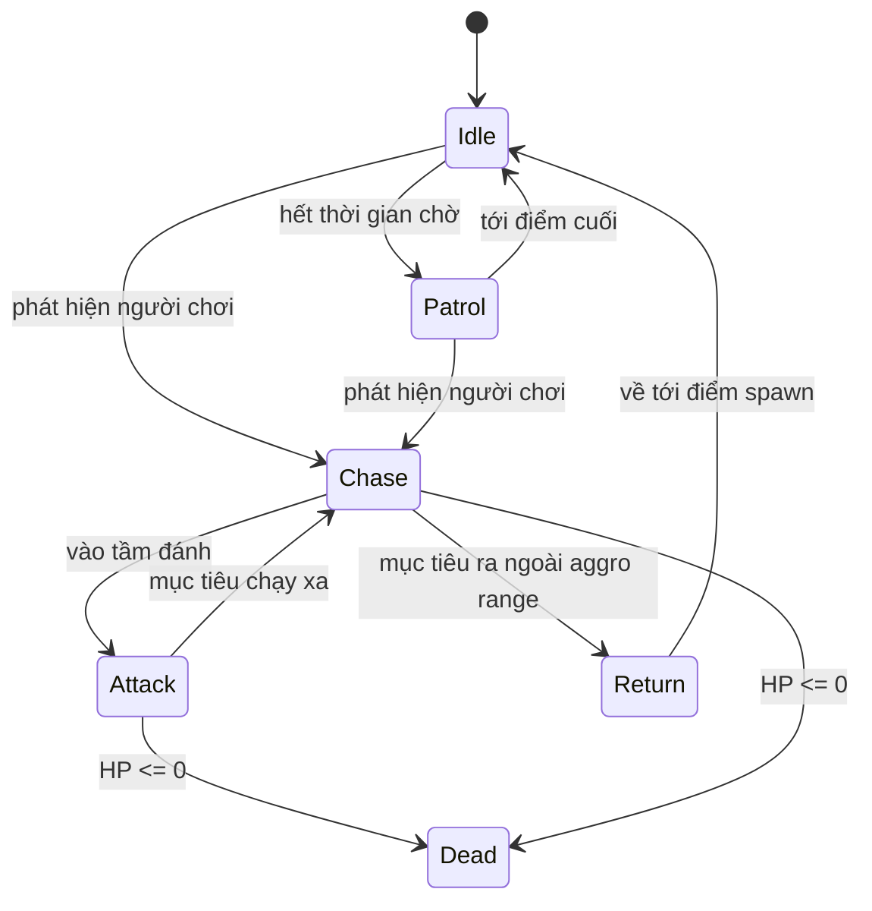

# AI.md

**AI của NPC, quái, boss**

| | |
|---|---|
| Version | 1.0.0 |
| Status | Draft |
| Liên quan | [ECS.md](ECS.md), [SCRIPTING.md](../06-plugin/SCRIPTING.md), [GAMEPLAY.md](../05-server/GAMEPLAY.md) |

> AI **chỉ chạy ở server** (Điều 15). Client không quyết định quái làm gì — client chỉ nhận kết quả và render.

---

## 1. Nguyên tắc

| Nguyên tắc | Nghĩa là |
|---|---|
| **AI chạy server-side** | Client hack không điều khiển được quái |
| **AI không hardcode** | Điều 27 — hành vi cấu hình được, không phải `if (monsterType == 5)` |
| **Bắt đầu đơn giản nhất có thể** | Điều 9 — quái thường không cần Behavior Tree |
| **AI có ngân sách CPU** | Hàng nghìn quái × mỗi tick → phải rẻ |

---

## 2. Chọn kỹ thuật theo nhu cầu — không dùng một thứ cho mọi thứ

Đây là quyết định quan trọng nhất của tài liệu này.

| Đối tượng | Kỹ thuật | Vì sao |
|---|---|---|
| **Quái thường** (95% entity) | **FSM** đơn giản | Chỉ có 4–5 trạng thái; FSM rẻ và đủ |
| **NPC** (đứng yên, bán hàng) | Không cần AI | Chỉ phản ứng khi người chơi tương tác |
| **Quái tinh anh (Elite)** | FSM + vài điều kiện | Đủ |
| **Boss** | **Behavior Tree** hoặc **Script** | Nhiều pha, nhiều điều kiện phức tạp |
| **Pet đồng hành** | FSM | Theo chủ, tấn công mục tiêu của chủ |

⚠️ **KHÔNG dùng GOAP.** Xem §6.

---

## 3. FSM — mặc định cho quái thường



**Tại sao FSM đủ cho 95% quái**: yêu thú trong một game side-view không cần thông minh. Nó cần: đứng yên → thấy người → đuổi → đánh → mất mục tiêu thì về. Hết. Behavior Tree cho việc này là over-engineering (Điều 9).

```java
public final class AiStateComponent implements Component {
    public AiState state = AiState.IDLE;
    public long targetEntityId = -1;     // ID, không phải tham chiếu (ECS.md §2)
    public float stateTimer;
    public float spawnX, spawnY;         // để Return
}
```

---

## 4. Behavior Tree — chỉ cho Boss

Boss cần: nhiều pha theo % HP, chuỗi skill có điều kiện, phản ứng theo số người trong phòng.

```
Selector (Boss)
├─ Sequence: Phase 3 (HP < 30%)
│  ├─ Condition: HP < 30%
│  └─ Selector
│     ├─ Sequence: Ultimate (nếu cooldown xong)
│     └─ Action: Enrage attack
├─ Sequence: Phase 2 (HP < 70%)
│  ├─ Condition: HP < 70%
│  └─ Action: Summon minions
└─ Sequence: Phase 1
   └─ Action: Basic attack pattern
```

✅ **Đã chốt** (xác nhận lại 2026-07-25, khớp Technical Decisions #9 — bản trước đây của mục này còn
ghi "chưa chốt" dù bảng quyết định đã Accepted, đã sửa cho khớp): Behavior Tree viết bằng
**Script**, không phải Java thuần/gdx-ai.

| | Ưu | Nhược |
|---|---|---|
| Java (gdx-ai) | Nhanh; type-safe | Sửa boss = rebuild + redeploy; trái Điều 27 (hardcode boss) |
| Script (JS) | Designer tự chỉnh; hot-reload; đúng Điều 27 | Chậm hơn; cần sandbox |

**Lý do chọn Script**: Điều 27 cấm hardcode Boss, và số boss ít nên chi phí script không đáng kể.
Engine đã chốt [ADR-016](../01-architecture/adr/ADR-016-Scripting-Engine.md) — GraalJS, hạ tầng
`ScriptSandbox` đã có thật từ Phase 4 (`SkillSystem` dùng để tính damage skill) — Boss AI tái dùng
NGUYÊN hạ tầng đó, không xây engine script mới.

---

## 5. gdx-ai — dùng hay không?

libGDX có thư viện `gdx-ai` (FSM, Behavior Tree, pathfinding, steering).

| Ủng hộ | Phản đối |
|---|---|
| Có sẵn, khỏi viết | ⚠️ **Bảo trì rất chậm** — còn chậm hơn Ashley |
| API quen thuộc | Kéo thêm dependency cho thứ FSM đơn giản có thể tự viết < 100 dòng |

**Đề xuất**: **KHÔNG dùng gdx-ai cho FSM** — FSM quái thường quá đơn giản, tự viết rẻ hơn thêm dependency đang thoi thóp. **Cân nhắc** gdx-ai cho A* pathfinding (phần đó phức tạp hơn).

✅ **[ADR-022](../01-architecture/adr/ADR-022-Custom-FSM-No-Gdx-Ai.md) Accepted 2026-08-01** — khớp đúng
code `AiSystem` đã chạy thật từ Phase 4 (tự viết FSM bằng `enum`/`switch`, không `gdx-ai`). Pathfinding
vẫn hoãn — chưa có map/chướng ngại vật thật để cần né.

---

## 6. GOAP — vì sao KHÔNG dùng

GOAP (Goal-Oriented Action Planning) được nhắc trong đề xuất tài liệu gốc. Đánh giá trung thực:

| GOAP hợp với | Kage có không? |
|---|---|
| NPC mô phỏng đời sống phức tạp (Sims) | ❌ |
| Đối thủ chiến thuật cần lập kế hoạch nhiều bước (F.E.A.R.) | ❌ |
| Ít NPC, mỗi NPC rất thông minh | ❌ — ta có **nhiều** NPC, mỗi cái **ngu** |

**Chi phí GOAP**: mỗi lần lập kế hoạch là một cuộc tìm kiếm trên không gian action → **đắt gấp nhiều lần FSM**. Với hàng nghìn quái mỗi tick, đây là tự sát về hiệu năng.

**Kết luận**: **không dùng GOAP.** Ghi lại ở đây để không ai đề xuất lại. Nếu sau này có nội dung cần NPC lập kế hoạch thật (hiếm) → dùng Script cho riêng NPC đó.

---

## 7. Pathfinding

| Nhu cầu | Giải pháp |
|---|---|
| **MVP**: quái đuổi theo người chơi trên địa hình đơn giản | **Đi thẳng + tránh vật cản đơn giản** — không cần pathfinding |
| Địa hình nhiều tầng, platform | A* trên grid |
| Bản đồ lớn, nhiều quái | A* + cache đường đi + giới hạn số lần tìm/tick |

⚠️ **Không làm A* ở MVP nếu chưa cần** (Điều 9). Side-view khoá trục X ([ADR-033](../01-architecture/adr/ADR-033-Ninja-School-Style-Movement.md)): quái phần lớn đi thẳng tới người chơi trên mặt đất phẳng. A* là chi phí không cần thiết.

**Nếu cần A*:**
- Grid dựa trên collision map, **không** tính lại mỗi tick.
- **Giới hạn số lần tìm đường mỗi tick** — VD tối đa 10 quái tìm đường/tick, còn lại chờ tick sau. Không giới hạn = spike CPU.
- Cache đường đi, chỉ tìm lại khi mục tiêu di chuyển đủ xa.

---

## 8. Navigation — side-view

Game side-view có bài toán riêng mà top-down không có:

| Vấn đề | Xử lý |
|---|---|
| Quái phải nhảy lên platform | Đánh dấu "jump link" giữa các platform trong dữ liệu map |
| Quái không nên nhảy xuống vực | Đánh dấu vùng cấm trong map data |
| Quái bay vs quái đi bộ | Component khác nhau → System xử lý khác nhau |

Dữ liệu navigation là **một phần của map data** (HyperLap2D export), không tính runtime.

---

## 9. Ngân sách CPU cho AI

AI chạy trên **hàng nghìn entity mỗi tick** → phải rẻ.

| Kỹ thuật | Chi phí |
|---|---|
| **Time-slicing**: không phải quái nào cũng nghĩ mỗi tick | Quái xa người chơi → nghĩ mỗi 10 tick |
| **LOD AI**: quái ngoài tầm nhìn → tắt AI hoàn toàn | Quái ở map không có người chơi → không chạy |
| **Giới hạn aggro check** | Dùng spatial grid, không kiểm tra n×m |

```java
// Time-slicing: chia quái thành nhóm theo entityId % N
if (entityId % AI_TICK_DIVISOR != currentTick % AI_TICK_DIVISOR) return;
```

⚠️ **Đây là tối ưu, chỉ làm khi đo thấy cần** (Điều 30). Nhưng thiết kế AI phải **cho phép** time-slicing từ đầu (AI không giả định chạy mỗi tick).

---

## 10. AI và Script

Theo Điều 27, hành vi AI **không hardcode**:

| Phần | Ở đâu |
|---|---|
| FSM engine (chuyển trạng thái) | Java — `engine-ecs` / `server-world` |
| **Tham số mô tả TÍNH CÁCH một loài** (aggro, leash, tốc độ đuổi/tuần tra, bán kính tuần tra, thời gian đứng yên) | **Config data** — sáu cột trên `monster_template` ([DATABASE.md §2.4](../05-server/DATABASE.md)), tới `AiSystem` qua `AiParamsComponent`. ✅ Đúng kể từ [ADR-039](../01-architecture/adr/ADR-039-Per-Species-AI-Parameters.md) (trước đó [ADR-037](../01-architecture/adr/ADR-037-Monster-Template-And-Spawn-Tables.md) D7 hoãn có chủ đích) |
| **Con số giữ BẤT BIẾN của FSM** (epsilon "đã tới nơi", van chống kẹt tuần tra) | **Java** — `AiConstants`, cạnh chính FSM. Cố ý **KHÔNG** vào DB: xem §10.1 |
| Hành vi Boss phức tạp | **Script** ([SCRIPTING.md](../06-plugin/SCRIPTING.md)) |

**Phân định**: FSM là *cơ chế* (Java, nhanh). Tham số và hành vi đặc biệt là *nội dung* (data/script, sửa không rebuild).

### 10.1 Ranh giới "nội dung" và "cơ chế" — hai con số ở lại code

⚠️ Bản trước của mục này ghi gọn *"tham số AI là config"*, và câu đó **nói quá**: ba ví dụ nó liệt kê
đều là nội dung, nhưng câu tổng quát thì phủ lên **mọi** con số trong `AiSystem`.
[ADR-039](../01-architecture/adr/ADR-039-Per-Species-AI-Parameters.md) D1 thu hẹp lại:

| Con số | Ở đâu | Vì sao |
|---|---|---|
| aggro / leash / tốc độ đuổi / tốc độ tuần tra / bán kính tuần tra / thời gian đứng yên | **DB** | Mô tả **tính cách một loài** — câu hỏi thiết kế trò chơi. `aggro = 0` nghĩa là loài thụ động, không bao giờ gây hấn (đó là cách `training_dummy` thôi đuổi theo người chơi) |
| `ARRIVAL_THRESHOLD_METERS` | **Java** | **Epsilon hình học**: giá trị đúng là hàm của `FIXED_DT` và tốc độ, không phải của loài. Đặt 0 ⇒ quái không bao giờ "tới nơi", rung quanh điểm spawn vĩnh viễn, **không có gì báo lỗi** |
| `MAX_PATROL_DURATION_SECONDS` | **Java** | **Van an toàn** chống kẹt. Van mà người dùng chỉnh được thì không còn là van |

⚠️ **Tương tác đã biết, cố ý không dựng `CHECK`**: `patrol_radius_meters / patrol_speed_mps` vượt
`MAX_PATROL_DURATION_SECONDS` (5s) thì quái không bao giờ TỚI điểm tuần tra — nó luôn hết giờ giữa
đường rồi về Idle. Hỏng lành. Không viết `CHECK` vì `CHECK` đó phải nhúng hằng số Java vào schema.

---

## Technical Decisions

| # | Quyết định | Lý do | Trạng thái |
|---|---|---|---|
| 1 | AI **chỉ** chạy server | Điều 15 | Accepted |
| 2 | **FSM cho quái thường**, Behavior Tree/Script **chỉ cho Boss** | Điều 9 — 95% quái không cần BT | Accepted |
| 3 | **KHÔNG dùng GOAP** | Sai use case; đắt; ta cần nhiều NPC ngu, không phải ít NPC thông minh | Accepted |
| 4 | **Không A* ở MVP** — đi thẳng + tránh vật cản đơn giản | Điều 9, 30 | Accepted |
| 5 | Nếu có A*: **bắt buộc giới hạn số lần tìm/tick** | Chống spike CPU | Accepted |
| 6 | Navigation data là **một phần của map data**, không tính runtime | Rẻ hơn | Accepted |
| 7 | AI thiết kế để **cho phép time-slicing** ngay từ đầu | Không giả định chạy mỗi tick | Accepted |
| 8 | Tham số mô tả **tính cách loài** là config (DB); con số giữ **bất biến FSM** ở lại code | Điều 27 — nhưng có ranh giới, xem §10.1 | Accepted — thu hẹp bởi [ADR-039](../01-architecture/adr/ADR-039-Per-Species-AI-Parameters.md) D1b (câu cũ "tham số AI là config" nói quá) |
| 9 | Boss AI dùng **Script** (GraalJS) | Điều 27; số boss ít nên chi phí script không đáng | Accepted — [ADR-016](../01-architecture/adr/ADR-016-Scripting-Engine.md) |
| 10 | **Không dùng gdx-ai cho FSM** | Bảo trì chậm; FSM tự viết < 100 dòng | ✅ [ADR-022](../01-architecture/adr/ADR-022-Custom-FSM-No-Gdx-Ai.md) Accepted (2026-08-01) |

## ADR cần tạo

| ADR | Nội dung | Ưu tiên |
|---|---|---|
| ~~**ADR-022**~~ | ✅ **Accepted 2026-08-01 (tự viết FSM)** — [ADR-022](../01-architecture/adr/ADR-022-Custom-FSM-No-Gdx-Ai.md). Bảng §10 phía trên đã ghi đúng từ lâu, chỉ mục này sót lại | Hết chặn |

## Tài liệu liên quan

- [ECS.md](ECS.md) — AISystem trong thứ tự tick
- [SCRIPTING.md](../06-plugin/SCRIPTING.md) — Boss script chạy thế nào
- [GAMEPLAY.md](../05-server/GAMEPLAY.md) — quái, boss trong gameplay
- [DATABASE.md §2.4](../05-server/DATABASE.md) — `monster_template` chứa tham số AI (sáu cột, V25)
- [ADR-039](../01-architecture/adr/ADR-039-Per-Species-AI-Parameters.md) — tham số AI theo loài;
  ranh giới nội dung/cơ chế ở §10.1
- [PERFORMANCE.md](../09-performance/PERFORMANCE.md) — ngân sách AI

## Việc cần làm tiếp theo

1. Chốt **ADR-022** (gdx-ai hay tự viết) trước Phase 2.
2. Phase 4: làm FSM đơn giản nhất chạy được — **không** làm A*, **không** làm Behavior Tree cho tới khi có boss thật (Phase 8).
3. ✅ Phase 8 lát cắt 2 (2026-07-25): Boss AI bằng script GraalJS đã code xong (`BossAiSystem`, 2 pha `heavy_strike`/`enrage`) — xem [ROADMAP.md Phase 8](../11-process/ROADMAP.md). Summon minion (Phase 2 trong sơ đồ §4) để dành lát cắt sau.
4. Phase 9: đo chi phí AI, áp dụng §9 time-slicing **nếu** số liệu cho thấy cần.
5. ✅ Tham số AI theo loài — [ADR-039](../01-architecture/adr/ADR-039-Per-Species-AI-Parameters.md)
   (migration V25, sáu cột trên `monster_template`). Món nợ còn lại đã đặt tên: **tầm đánh theo
   loài** (`CombatConstants.ATTACK_RANGE_METERS`, cho quái bắn xa) — đụng cả tầm đánh của nhân vật
   nên là một ADR riêng.
