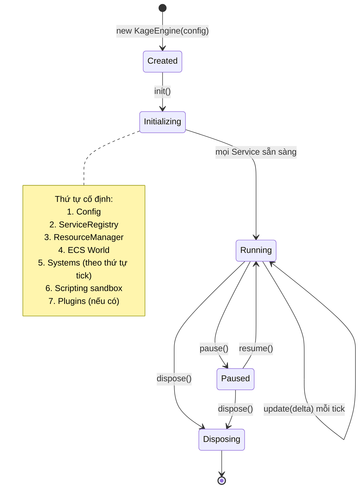
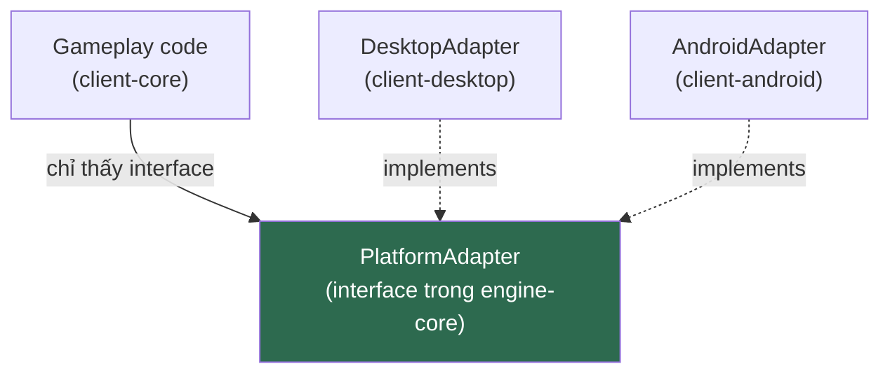

# ENGINE.md

**Kiến trúc Kage Engine**

| | |
|---|---|
| Version | 1.0.0 |
| Status | Draft |
| Liên quan | [ARCHITECTURE.md](../01-architecture/ARCHITECTURE.md), [ADR-002](../01-architecture/adr/ADR-002-Why-libGDX.md) |

> Điều 10: **Engine tồn tại để phục vụ gameplay, không phải ngược lại.**
> Mỗi tính năng engine phải trả lời được: *gameplay nào đang cần nó?* Không có câu trả lời → không xây.

---

## 1. Engine là gì trong dự án này

Kage Engine = **lớp mỏng trên libGDX**, cung cấp thứ libGDX không có, và **cô lập thứ ta muốn thay được**.

| Kage Engine **LÀM** | Kage Engine **KHÔNG LÀM** |
|---|---|
| Bọc ECS framework để thay được sau ([ADR-006](../01-architecture/adr/ADR-006-Why-ECS.md)) | Bọc libGDX (thay libGDX không phải mục tiêu — [ADR-002](../01-architecture/adr/ADR-002-Why-libGDX.md)) |
| Quản lý vòng đời Screen/State | Viết lại rendering từ OpenGL |
| Service Registry tường minh | DI container |
| Resource Manager trên AssetManager | Thay AssetManager |
| Sandbox cho script | Viết ngôn ngữ script mới |

**Ranh giới quan trọng**: ta bọc **Ashley** (vì muốn thay), ta **không** bọc **libGDX** (vì không định thay, và bọc sẽ mất chính lợi ích của nó). Đây là quyết định có chủ đích, không phải thiếu nhất quán.

---

## 2. Module Engine

| Module | Trách nhiệm | Chi tiết |
|---|---|---|
| `engine-core` | Rendering, asset, Screen/State lifecycle, Service Registry | Tài liệu này + [RENDERING.md](RENDERING.md) |
| `engine-ecs` | Bọc ECS, Event Bus, Scheduler | [ECS.md](ECS.md) |
| `engine-physics` | Bọc Box2D | [PHYSICS.md](PHYSICS.md) |
| `engine-scripting` | Script sandbox | [SCRIPTING.md](../06-plugin/SCRIPTING.md) |
| `engine-plugin-api` | Plugin interface | [PLUGIN.md](../06-plugin/PLUGIN.md) |

---

## 3. Engine Lifecycle



**Quy tắc**: `init()` **fail fast** (Điều 16). Thiếu asset, thiếu config, script lỗi cú pháp → **ném exception ngay lúc khởi động**, không để chạy rồi chết giữa trận.

⚠️ `pause()`/`resume()` **bắt buộc** cho Android (app bị đưa xuống nền). Desktop cũng phải hỗ trợ để test được.

---

## 4. Update Loop vs Render Loop — tách biệt

Đây là quyết định thiết kế quan trọng nhất của engine.

```
┌─────────────────────────────────────────────────┐
│  Fixed Update (logic)    — tick rate cố định     │
│  ├─ Xác định (deterministic)                     │
│  ├─ Không phụ thuộc FPS                          │
│  └─ Server và Client dùng CÙNG tick rate         │
├─────────────────────────────────────────────────┤
│  Render (hình ảnh)       — theo FPS máy          │
│  ├─ Nội suy giữa 2 tick để mượt                  │
│  └─ KHÔNG chứa logic gameplay                    │
└─────────────────────────────────────────────────┘
```

```java
// Mô hình fixed timestep — accumulator pattern
private float accumulator = 0f;
private static final float FIXED_DT = 1f / TICK_RATE;

public void loop(float frameTime) {
    // Chống "spiral of death": frame quá chậm thì bỏ bớt tick,
    // thà giật hình còn hơn treo hẳn
    accumulator += Math.min(frameTime, MAX_FRAME_TIME);

    while (accumulator >= FIXED_DT) {
        fixedUpdate(FIXED_DT);   // logic — luôn cùng delta
        accumulator -= FIXED_DT;
    }

    float alpha = accumulator / FIXED_DT;
    render(alpha);               // nội suy giữa tick trước và tick hiện tại
}
```

**Vì sao bắt buộc fixed timestep:**
- Logic phụ thuộc FPS → máy mạnh chạy nhanh hơn máy yếu → **client và server bất đồng bộ**.
- Physics variable timestep → không xác định, không tái hiện được bug.
- Server tick rate phải cố định để tính băng thông.

⚠️ **`MAX_FRAME_TIME` là bắt buộc.** Không có nó, một frame chậm (GC pause, load asset) làm accumulator dồn → chạy 50 tick liên tiếp → càng chậm → dồn thêm → **treo vĩnh viễn**.

Tick rate: **60Hz** ([ADR-018](../01-architecture/adr/ADR-018-Tick-Rate.md)) → `FIXED_DT = 1/60 ≈ 16.6ms`.

---

## 5. Module System (nội bộ engine)

Engine gồm các **Service** khởi tạo theo thứ tự phụ thuộc tường minh:

```java
public final class KageEngine {
    private final ServiceRegistry services;

    public KageEngine(EngineConfig config) {
        this.services = new ServiceRegistry();
        // Thứ tự KHÔNG tuỳ tiện — phụ thuộc lẫn nhau
        services.register(ResourceManager.class, new ResourceManager(config.assetPath()));
        services.register(EcsWorld.class,        new EcsWorld());
        services.register(EventBus.class,        new EventBus());
        // ...
    }
}
```

---

## 6. Service Registry — và ranh giới của nó

`ServiceRegistry` **trông giống** Service Locator — anti-pattern bị cấm ở [CODE-REVIEW.md §3](../02-coding-standards/CODE-REVIEW.md). Đây là mâu thuẫn cần giải quyết rõ ràng, không lấp liếm.

**Quy tắc phân định:**

| ✅ Được | ❌ Cấm |
|---|---|
| `ServiceRegistry` dùng **lúc khởi động (composition root)** để lấy service rồi **truyền qua constructor** | Gọi `services.get(Foo.class)` **giữa gameplay code** |
| Registry là nơi *chứa*, không phải nơi *tra cứu ở khắp nơi* | Truyền `ServiceRegistry` vào constructor của System |

```java
// ✅ Đúng — lấy ở composition root, truyền qua constructor
var world = services.get(EcsWorld.class);
var bus   = services.get(EventBus.class);
world.addSystem(new CombatSystem(bus, combatConfig));   // System nhận đúng thứ nó cần

// ❌ Sai — System tự đi tìm phụ thuộc
class CombatSystem {
    CombatSystem(ServiceRegistry services) {          // phụ thuộc ẩn!
        this.bus = services.get(EventBus.class);      // vi phạm Điều 12
    }
}
```

**Nếu không giữ được ranh giới này, Registry sẽ thoái hoá thành Service Locator thật.** → cần ArchUnit test chặn: cấm `ServiceRegistry` xuất hiện trong tham số constructor của System.

---

## 7. Resource Manager

Bọc `AssetManager` của libGDX, thêm:

| Tính năng | Vì sao AssetManager không đủ |
|---|---|
| Load theo **zone** | Cần unload atlas của zone cũ khi đổi map ([RESOURCE.md](../04-client/RESOURCE.md)) |
| Kiểm tra `asset-manifest.json` | Phục vụ patch asset không rebuild client |
| Fail fast khi thiếu asset | AssetManager mặc định lỗi muộn |

**Quy tắc**: **không load asset trong game loop** (Điều 31). Load ở màn hình loading, hoặc async ở luồng riêng.

---

## 8. Platform Layer

Điều 28 — gameplay không biết mình chạy ở đâu.



Thứ **phải** qua adapter: đường dẫn lưu file · loại input (bàn phím vs cảm ứng) · độ phân giải/DPI · vòng đời app (Android pause/resume) · chia sẻ/đăng nhập nền tảng.

**Cấm** `if (Gdx.app.getType() == ApplicationType.Android)` trong gameplay.

---

## 9. Engine dùng chung giữa Client và Server?

Câu hỏi quan trọng thường bị bỏ sót.

| Module | Client | Server |
|---|---|---|
| `engine-ecs` | ✅ | ✅ **dùng chung** |
| `engine-physics` | ✅ | ✅ **dùng chung** (server cần va chạm để chống hack di chuyển) |
| `engine-scripting` | ❌ | ✅ chỉ server (script chạy server-side — Điều 15) |
| `engine-core` (rendering, asset) | ✅ | ❌ **server không render** |

→ **`engine-core` phải tách rendering ra khỏi phần dùng chung.** Server không được kéo theo LWJGL/OpenGL.

⚠️ Đây là ràng buộc thiết kế thật: nếu `engine-ecs` lỡ phụ thuộc `engine-core`, server sẽ kéo theo toàn bộ stack rendering. → `engine-ecs` **không được** phụ thuộc `engine-core`. Cần enforce bằng ADR-011.

---

## 10. Xác định (Determinism)

Server và client chạy cùng logic → phải cho **cùng kết quả**.

| Nguồn bất định | Cách xử lý |
|---|---|
| Số thực (float) khác nhau giữa CPU | Chấp nhận sai số nhỏ; **server luôn đúng** (Điều 15), client sửa theo server |
| `HashMap` thứ tự lặp không đảm bảo | Dùng `LinkedHashMap` / mảng khi thứ tự ảnh hưởng kết quả |
| Random | **Server sinh random, gửi kết quả cho client.** Client không tự random thứ ảnh hưởng gameplay |
| Delta time thay đổi | Fixed timestep (§4) |
| Thứ tự System | Cố định, khai báo tường minh ([ECS.md](ECS.md)) |

**Kage không dùng lockstep determinism** (kiểu RTS) — ta dùng **server authority**. Nghĩa là ta **không cần** determinism tuyệt đối, chỉ cần server nói gì client nghe nấy. Đây là lựa chọn đơn giản hơn nhiều và phù hợp MMORPG.

---

## Technical Decisions

| # | Quyết định | Lý do | Trạng thái |
|---|---|---|---|
| 1 | Bọc Ashley, **không** bọc libGDX | Muốn thay ECS, không định thay libGDX | Accepted |
| 2 | **Fixed timestep** cho logic, render riêng theo FPS | Client/server đồng bộ; physics xác định | Accepted |
| 3 | `MAX_FRAME_TIME` chống spiral of death | Không có = treo game khi frame chậm | Accepted |
| 4 | `ServiceRegistry` **chỉ** dùng ở composition root | Tránh thoái hoá thành Service Locator | Accepted — cần ArchUnit enforce |
| 5 | `engine-ecs` **không** phụ thuộc `engine-core` | Server không được kéo theo rendering | Accepted — cần enforce |
| 6 | Không lockstep determinism; dùng server authority | Đơn giản hơn, hợp MMORPG | Accepted |
| 7 | Random ảnh hưởng gameplay **chỉ** sinh ở server | Điều 15 | Accepted |
| 8 | Engine không xây tính năng nếu không có gameplay đang cần | Điều 10 | Accepted |

## ADR cần tạo

| ADR | Nội dung | Ưu tiên |
|---|---|---|
| ✅ **ADR-018** | **Tick rate 60Hz** — §4 fixed timestep | Accepted |
| **ADR-011** | Enforce dependency rule — cần cho §6 và §9 | 🔴 Cao — chặn Phase 0 |

## Tài liệu liên quan

- [ECS.md](ECS.md) · [RENDERING.md](RENDERING.md) · [PHYSICS.md](PHYSICS.md) · [AI.md](AI.md)
- [ARCHITECTURE.md](../01-architecture/ARCHITECTURE.md) — engine nằm ở đâu trong tổng thể
- [SERVER.md](../05-server/SERVER.md) — server dùng engine thế nào
- [JAVA-GUIDELINES.md §5](../02-coding-standards/JAVA-GUIDELINES.md) — game tick single-thread

## Việc cần làm tiếp theo

1. ✅ ADR-018 đã chốt **60Hz** — `FIXED_DT = 1/60s`.
2. Phase 1: dựng `engine-core` + `engine-ecs`, xác lập §4 (fixed timestep) và §9 (tách rendering) ngay từ commit đầu — hai thứ này cực đắt để sửa sau.
3. Viết ArchUnit test cho §6 và §9 cùng lúc với code, không để sau.
