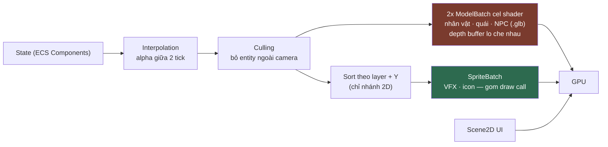

# RENDERING.md

**Rendering pipeline của Kage Engine**

| | |
|---|---|
| Version | 2.1.0 |
| Status | Draft |
| Liên quan | [ENGINE.md](ENGINE.md), [ADR-002](../01-architecture/adr/ADR-002-Why-libGDX.md), [ADR-031](../01-architecture/adr/ADR-031-25D-Realtime-3D-Rendering.md), [ADR-032](../01-architecture/adr/ADR-032-JitPack-Dependency-Defence.md) |

> Rendering **chỉ chạy ở client**. Server không render ([ENGINE.md §9](ENGINE.md)).
> Rendering là vùng **Clean Architecture không áp dụng** (Điều 25) — hiệu năng thắng abstraction.

> **Bản 2.0.0 (2026-08-07)** viết lại theo [ADR-031](../01-architecture/adr/ADR-031-25D-Realtime-3D-Rendering.md)
> (Accepted 2026-08-03): **nhân vật · quái · NPC** render 3D thời gian thực qua camera orthographic
> khoá góc; **VFX kỹ năng · icon · UI** vẫn là sprite 2D. Tài liệu này mô tả **cả hai nhánh** và nói rõ
> chỗ nào đã có code, chỗ nào mới chỉ là hợp đồng thiết kế.
>
> **Bản 2.1.0 (2026-08-08)** — cel shader + viền inverted-hull ở §12.2 **đã viết và đã nhìn thấy chạy
> thật** (ảnh chụp `Lwjgl3Application` thật): `CelOutlineShader` + `CelBodyShader` (+ 2
> `ShaderProvider` tương ứng) thay hẳn ánh sáng mặc định gdx-gltf từng dùng tạm, và `SceneManager` bị
> bỏ khỏi đường vẽ (§6.2). Cùng ngày, animation clip (§11.1) và phép đo frame time 20 nhân vật (§6.5
> mục 6, [ART-PIPELINE §4.4](../14-art/ART-PIPELINE.md)) cũng xong — ba việc chạy **song song** trên 3
> worktree tách biệt rồi hoà thủ công vào nhau, vì cel shader bỏ `SceneManager` trong khi animation
> vẫn cần `Scene#update()` chạy `AnimationController` mỗi khung — hai việc tưởng xung đột nhưng **hoà
> được sạch**: `Scene#update()` (không phải `SceneManager` bọc ngoài) mới là thứ thật sự advance
> animation, nên bỏ `SceneManager` không đụng gì tới animation. Đã build lại + chạy benchmark thật
> trên bản hoà: p95 tăng nhẹ từ ~0.31ms lên **0.52ms/khung** (2 lượt vẽ thay vì 1), vẫn cách xa ngưỡng
> 8ms hơn 15 lần.

---

## 1. Nguyên tắc

| Nguyên tắc | Nghĩa là |
|---|---|
| **Rendering không chứa gameplay logic** | RenderingSystem chỉ đọc Component, không sửa |
| **Ít draw call nhất có thể** | Draw call là chi phí chính của **nhánh 2D** (§8) |
| **Ít texture switch nhất có thể** | Đổi texture = flush batch |
| **Trong ngân sách tam giác** | Chi phí chính của **nhánh 3D** — 5k/10k/20k mỗi nhân vật theo tier, số đã đo ở [ART-PIPELINE §4.4](../14-art/ART-PIPELINE.md) (§7) |
| **Không allocation mỗi frame** | Điều 31 — **không nới ra cho nhánh 3D**, xem §16 |

---

## 2. Hai nhánh render và ranh giới giữa chúng

| | Nhánh 3D | Nhánh 2D |
|---|---|---|
| Đối tượng | Nhân vật · quái · NPC | VFX kỹ năng · icon vật phẩm · UI |
| Định dạng tài sản | glTF 2.0 (`.glb`) | PNG đóng vào `TextureAtlas` |
| Nạp bằng | `gdx-gltf` (§6.2) | `AssetManager` / `TextureAtlas` |
| Vẽ bằng | 2 `ModelBatch` thô + `ShaderProvider` tự viết (§12.2 — không phải `SceneManager.render()`, xem lý do ở đó) | `SpriteBatch` |
| Animation | Skeletal, nội suy theo FPS thật (§11.1) | Frame-based 12 fps (§11.2) |
| Thứ tự che nhau | **Depth buffer** (§9) | Sort theo layer + Y (§9) |

Ranh giới này là **quyết định của ADR-031**, không phải chi tiết triển khai: VFX và icon **không** bị
chuyển sang hệ hạt 3D, và [ADR-029](../01-architecture/adr/ADR-029-Asset-Pipeline-Tool.md)
(`tools:asset-pipeline` + TexturePacker) **vẫn cần** cho nhánh 2D — ADR-031 chỉ thu hẹp phạm vi của nó.

⚠️ Hai đường vẽ **không trộn lẫn được**: mỗi lần đổi qua lại là một lần flush. Nhân vật vẽ trước, VFX
vẽ đè sau — **gom theo nhánh, đừng gom theo entity**.

---

## 3. Pipeline tổng thể



**Thứ tự bắt buộc**: Culling **trước** Sort — sort ít phần tử rẻ hơn nhiều.

Lưu ý sort **không** còn nằm trên đường của nhánh 3D: hình học 3D thật che nhau bằng depth buffer,
không bằng thứ tự vẽ (§9).

---

## 4. Camera & Viewport

| Thành phần | Chọn | Vì sao |
|---|---|---|
| Camera | `OrthographicCamera` | **Vẫn đúng sau ADR-031** — 2.5D là 3D thật nhìn qua camera ortho khoá góc, không phải phối cảnh |
| Viewport | `FitViewport` | ✅ [ADR-020](../01-architecture/adr/ADR-020-Viewport-Strategy.md) **Accepted 2026-08-01**, khớp code `WorldScreen` đã dùng từ Phase 1 |

**Vì sao FitViewport** (chi tiết ở ADR-020): game chạy trên tỉ lệ màn hình rất khác nhau (16:9 desktop,
20:9 điện thoại, tablet 4:3).

| Viewport | Ưu | Nhược |
|---|---|---|
| **`FitViewport`** ✅ | Mọi người thấy **đúng cùng vùng chơi** → công bằng PvP | Có viền đen |
| `ExtendViewport` | Không viền đen, dùng hết màn hình | **Màn hình rộng thấy nhiều hơn** → lợi thế PvP không công bằng |
| `ScreenViewport` | Sắc nét 1:1 | Màn hình lớn thấy nhiều hơn hẳn |

Đây là **quyết định gameplay** (ảnh hưởng cân bằng PvP) nên viền đen được chấp nhận có chủ đích. ADR-020
đã chốt, **không mở lại** nếu không có ADR revisit.

### 4.1 Góc camera là hằng số runtime

Trước ADR-031, góc nhìn bị **nướng vào tài sản** (sprite chỉ render 1 hướng, trái = lật ảnh). Giờ model
là 3D thật nên góc nhìn chỉ là tham số của camera:

- Đổi góc = đổi **một hằng số**, không phải render lại 33 khung × 15 nhân vật.
- Nhân vật **xoay tự do**; hết trò lật ngang ảnh.
- Câu hỏi "nghiêng thuần 90° hay 3/4 35°" từng treo ở phiên art **tự tan** — nó không còn là thuộc
  tính của tài sản.

Giá trị hiện có trong code (`CharacterModelRenderer.VIEW_YAW_DEGREES` / `VIEW_PITCH_DEGREES`):
**yaw 35°, pitch 30°**. 35° là **góc nghiệm thu** đã duyệt ở
[ART-QUALITY-STANDARD §7.1](../14-art/ART-QUALITY-STANDARD.md) — mesh Text→3D có khối tóc lớn, ở góc
nghiêng thuần nó che kín mặt. Chọn đúng số đó cho runtime là để **vẻ ngoài trong game khớp ảnh đã
duyệt**, không phải vì ADR-031 khoá con số này; ADR-031 để ngỏ góc runtime đúng như thiết kế.

⚠️ Model vẫn phải quay mặt **+X** trong không gian gốc, nhưng vì rig/bảng pose giả định trục đó,
**không** vì đó là hướng nhìn trên màn ([ART-PIPELINE §4.3](../14-art/ART-PIPELINE.md)).

**Camera follow**: `CharacterModelRenderer.follow()` đặt camera lùi khỏi nhân vật một khoảng cố định
dọc theo hướng nhìn đã khoá. Với phép chiếu orthographic, **khoảng cách không đổi khung hình** — nó chỉ
cần đủ để hình học nằm giữa `near` và `far`. Deadzone + lerp làm mượt (không bám cứng nhân vật, gây
chóng mặt) **chưa được nối** — hiện camera bám tuyệt đối.

### 4.2 Hai camera, đúng một vùng chơi

`WorldScreen` giữ một `OrthographicCamera` 2D (do `FitViewport` quản lý) còn `CharacterModelRenderer`
giữ camera 3D riêng. Chúng **không** độc lập: `resize()` chép `viewportWidth`/`viewportHeight` **tính
bằng world unit** từ camera 2D sang camera 3D.

Đây là điều giữ cho [ADR-020](../01-architecture/adr/ADR-020-Viewport-Strategy.md) còn hiệu lực sau
ADR-031: công bằng PvP được đo bằng **số world unit nhìn thấy**, và cả hai camera nhìn cùng một số đó.
⚠️ Ai đó đặt kích thước camera 3D theo pixel màn hình thay vì world unit sẽ **âm thầm phá công bằng
PvP** mà hình vẫn trông bình thường.

---

## 5. Đơn vị thế giới (World Units)

**Không dùng pixel làm đơn vị thế giới.**

```
1 world unit = 1 mét (quy ước)
Sprite 32px  = 1 world unit  →  PIXELS_PER_UNIT = 32   (chỉ còn áp dụng cho nhánh 2D)
```

**Vì sao**: dùng pixel → đổi độ phân giải asset là đổi toàn bộ số liệu gameplay (tốc độ, tầm đánh).
Dùng world unit → asset đổi, gameplay không đổi.

Va chạm địa hình (`TerrainCollisionSystem`) cũng dùng chung world unit này cho `Aabb` — xem
[PHYSICS.md §5](PHYSICS.md).

**Model 3D quy về chiều cao 1.0, không phải pixel.** `kage_text3d_kit.normalise()` ép **mọi** nhân vật
cao đúng `1.0` đơn vị Blender, chân ở `z=0` ([ART-PIPELINE §4.1](../14-art/ART-PIPELINE.md)) — nên
chúng nhất quán với nhau theo thiết kế, không phụ thuộc mesh gốc to nhỏ ra sao. Bước E của pipeline art
đảm bảo điều đó, nên `CharacterModelRenderer.setCharacterPosition()` **chỉ tịnh tiến**, không phải chỉnh
độ cao.

Nối hai hệ với nhau là **đúng một hệ số nhân, đặt một lần**:

```
chiều cao thế giới của nhân vật (world unit) = 1.0 (model) × CHARACTER_WORLD_HEIGHT
```

⚠️ **Hệ số đó phải dùng chung với hộp va chạm.** Nếu render scale một đằng, `Aabb` ở
[PHYSICS.md §5](PHYSICS.md) một nẻo, nhân vật sẽ đứng lún hoặc lơ lửng so với địa hình — và lỗi kiểu
này chỉ lộ ra khi có bản đồ thật. Đặt hằng số ở một chỗ, hai bên cùng đọc. **Giá trị cụ thể chưa chốt**:
nó phụ thuộc kích thước tile bản đồ thật, mà chưa có bản đồ nào. Code hiện tại **chưa có hằng số này** —
model được đặt thẳng vào toạ độ thế giới với tỉ lệ 1:1.

Điều **không** đổi: gốc toạ độ model = **chân, giữa** — cùng quy ước pivot với sprite, nên baseline
chung cho cả hai nhánh vẫn đúng.

---

## 6. Nhánh 3D — code hiện có và tình trạng thật

> Mục này mô tả **code đang có trong repo**, không phải thiết kế mong muốn. Đọc kèm
> [`CharacterModelRenderer.java`](../../client/client-core/src/main/java/dev/kage/client/core/world/CharacterModelRenderer.java)
> và [`WorldScreen.java`](../../client/client-core/src/main/java/dev/kage/client/core/world/WorldScreen.java).

### 6.1 Trạng thái: đã nối, **chưa ai nhìn thấy nó chạy**

`WorldScreen.render()` xoá cả color buffer lẫn **depth buffer** rồi rẽ nhánh:

```
models.isEnabled()  →  renderModels(alpha)          (nhánh 3D)
       ngược lại    →  renderPlaceholderBoxes(alpha) (ShapeRenderer, hình hộp)
```

Nhánh 3D **compile được và đã nối** (commit `df5ace2`). Nhưng tính tới lúc đóng ledger ADR-031,
**chưa có ai nhìn thấy nó vẽ ra model thật**: `assets/exported/models/` là sản phẩm sinh ra và
**không commit** ([ART-PIPELINE §7](../14-art/ART-PIPELINE.md)), nên một bản checkout sạch không có
file `.glb` nào ⇒ `CharacterModelRenderer` tự tắt và **hình hộp mới là thứ thật sự chạy**.

Đừng đọc tài liệu này thành "3D đã hoạt động". Trạng thái đúng là: **đường code đã có, kết quả hình ảnh
chưa được kiểm chứng**.

### 6.2 Thư viện: `gdx-gltf`, lấy từ kho trong repo chứ không từ JitPack

`com.github.mgsx-dev.gdx-gltf:gltf:2.3.0` (Apache-2.0) **đã có** trong
[`gradle/libs.versions.toml`](../../gradle/libs.versions.toml). Nó **không** lấy qua JitPack:
[ADR-032](../01-architecture/adr/ADR-032-JitPack-Dependency-Defence.md) (Accepted 2026-08-06) đóng gói
jar vào [`third-party/m2/`](../../third-party/m2/README.md) như một kho Maven cục bộ, và bỏ hẳn
`jitpack.io` khỏi cấu hình Gradle. Lý do là **rủi ro sẵn có**, không phải toàn vẹn: checksum không cứu
được một build khi repo gốc biến mất.

⚠️ **Không nâng libGDX tuỳ tiện.** `1.14.2` là phiên bản đã **hoàn tác** các thay đổi collection từng
làm gdx-gltf crash lúc chạy. Cảnh báo này nằm ngay cạnh khai báo trong `libs.versions.toml` — đọc nó
trước khi bump.

Client dùng `GLBLoader` → `SceneAsset` → `Scene` của gdx-gltf để nạp asset + quản trạng thái skin/
animation. ⚠️ **Khác bản trước 2026-08-08**: KHÔNG còn bọc thêm `SceneManager` — cel shader ở §12.2
cần 2 lượt vẽ mà `SceneManager.render()` không có chỗ chèn, nên `CharacterModelRenderer` tự dựng
`ModelBatch` trần + `ShaderProvider` riêng, xem lý do đầy đủ ở §12.2 câu hỏi runtime #2. Animation
KHÔNG bị ảnh hưởng bởi việc này — `Scene#update()` (không phải `SceneManager`) mới là thứ thật sự
chạy `AnimationController`, và `CharacterModelRenderer` vẫn gọi nó mỗi khung (§11.1).

### 6.3 Chia sẻ model giữa các entity (Flyweight)

Cạm bẫy Flyweight vẫn nguyên như thời sprite, chỉ đổi kiểu dữ liệu:

| Dùng chung | Riêng từng entity |
|---|---|
| `SceneAsset` (mesh, texture, clip animation) — cache theo `assetKey` | `Scene` (transform, trạng thái phát animation) |

`addCharacter()` nạp `SceneAsset` **một lần cho mỗi `assetKey`** rồi tạo `Scene` mới trỏ vào đó. Nạp
glTF là **đọc đĩa + dựng texture** nên chỉ được gọi lúc spawn, tuyệt đối không nằm trong game loop
(/CLAUDE.md §6).

`assetKey` có dạng `char_thuy-b1`, khớp cột `asset_key` của bảng `art_asset`
([ART-PIPELINE §8](../14-art/ART-PIPELINE.md)).

### 6.4 Cơ chế tự tắt — vì sao nó phải tồn tại

Lần đầu không tìm thấy file `.glb`, `CharacterModelRenderer` **tắt hẳn nhánh 3D** (không cảnh báo lại
mỗi lần spawn) và trả quyền vẽ về cho hình hộp. Đây không phải phòng thủ thừa:

- Model **không commit** — checkout sạch chưa chạy pipeline art thì không có file nào.
- Thiếu một model gần như luôn có nghĩa là **chưa chạy pipeline**, không phải hỏng một file lẻ.
- Crash lúc khởi động ở tình huống đó là sai: bản checkout chưa có art vẫn phải chơi được, không phải
  màn hình đen.

### 6.5 Hạn chế đã biết (chưa sửa, và có cái **không được** tự sửa)

| # | Hạn chế | Vì sao chưa sửa |
|---|---|---|
| 1 | ~~Mọi nhân vật nạp cùng một model~~ ✅ **Nạp đúng model theo hệ phái** (2026-08-07) | `CharacterSpawnedEvent` giờ mang `faction` + `costume_tier` (chủ dự án duyệt đổi protocol 2026-08-07, commit `92e9f15`). `WorldScreen` ghép hai trường đó qua `CharacterModelKey.of()` thành `assetKey` đúng hệ phái — cho cả nhân vật khác (`onCharacterSpawned`) lẫn chính mình lúc vào world. `costume_tier` vẫn hằng số B1 ở tầng gateway: gameplay chưa có khái niệm bậc trang phục để suy ra bậc thật |
| 2 | ~~Tier hình học bị hardcode ở `models/med/`~~ ✅ **Hết hardcode phía đọc file** (2026-08-08) | `CharacterModelRenderer` giờ nhận `GraphicsTier` (LOW/MEDIUM/HIGH) qua constructor và suy thư mục từ đó (`WorldScreen` truyền tường minh MEDIUM, khớp "bản cài đóng gói đúng 1 tier mặc định" của [ADR-028](../01-architecture/adr/ADR-028-Graphics-Tier-Asset-Delivery.md)) — cả 3 thư mục `assets/exported/models/{low,med,high}/` đã có sẵn trên đĩa dev nên việc này có ý nghĩa thật ngay cả khi chưa có tải-theo-mạng. **Chưa xong**: `ensureAssetsAvailable(tier)`, đổi tier LÚC CHẠY (không UI, không lưu Preferences), và tải-theo-mạng của ADR-028 **vẫn chưa có ở bất kỳ đâu trong repo — kể cả nhánh sprite 2D** ([ART-PIPELINE §8.4](../14-art/ART-PIPELINE.md) mới là thiết kế, chưa code). Đừng đọc dòng này mà tưởng ADR-028 đã "xong" ở client — chỉ mới xong đúng phần đọc-tier-từ-đĩa |
| 3 | 🔴 **Nhân vật đứng/di chuyển/hit đều hiện ra NẰM NGANG, không đứng thẳng** | Kiểm chứng bằng mắt thật lần đầu (2026-08-08, cùng phiên với việc #10 của ADR-031) phát hiện bug thật — xem §11.1 "Kiểm chứng bằng mắt 2026-08-08" để biết chi tiết + ảnh mô tả + nghi vấn nguyên nhân. **KHÔNG phải** vấn đề cel shader (viền + shading render đúng, chỉ riêng tư thế sai) |
| 4 | ~~Chưa có cel shader, chưa có lượt vẽ viền~~ ✅ **Đã viết** (2026-08-08) | `CelOutlineShader` + `CelBodyShader`, xem §12.2. `CharacterModelRenderer` không còn dùng ánh sáng mặc định gdx-gltf |
| 5 | **Camera bám tuyệt đối**, chưa có deadzone/lerp (§4.1) | Chưa có gameplay nào ép phải làm; làm sớm là đoán |
| 6 | ~~Chưa đo frame time~~ | ✅ **Đo xong 2026-08-08** (`CharacterModelFrameBenchmarkTool`) — điều kiện Revisit Trigger #1 của ADR-031 (20 nhân vật trên màn) **không** kích hoạt, xem [ART-PIPELINE §4.4](../14-art/ART-PIPELINE.md) cho số liệu + giới hạn của phép đo. ⚠️ Số ban đầu (p95 0,30ms) đo TRƯỚC khi hoà cel shader + animation; **đo lại sau khi hoà cả ba** cho p95 **0,52ms** (2 lượt vẽ/nhân vật thay vì 1) — vẫn cách xa ngưỡng 8ms hơn 15 lần, chưa có máy tham chiếu chính thức |

---

## 7. Ngân sách tam giác & tier đồ hoạ

Số **đã đo thật** 2026-08-05 trên mesh pilot (93.165 tam giác gốc), không phải ước lượng — nguồn:
[ART-PIPELINE §4.4](../14-art/ART-PIPELINE.md).

| Tier | Tam giác | Texture | `.glb` |
|---|---|---|---|
| Low | **5.000** | 512 | 0,59 MB |
| Medium (đóng gói trong bản cài) | **10.000** | 1024 | 1,38 MB |
| High | **20.000** | 2048 | 3,60 MB |

Ba kết luận có ảnh hưởng trực tiếp tới rendering:

- **20 nhân vật × 10k = 200k tam giác/khung** ở tier Medium — thay vì 1,9 triệu nếu dùng mesh gốc.
- **Hạ texture rẻ hơn hạ mesh** về mặt chất lượng hình: cùng mức lệch trung bình, hạ texture làm mờ
  đều còn hạ mesh **vỡ silhouette cục bộ**. Khi cần cắt dung lượng, cắt texture trước.
- Dung lượng hình học ≈ **35 byte/tam giác**, tuyến tính trong toàn dải đo.

⚠️ **Khi ước tính chi phí vẽ, nhân đôi số tam giác** — lượt vẽ viền ở §12.2 **đã có trong code**
(2026-08-08): vỏ lật normal là một bản sao đầy đủ của chính mesh đó, vẽ thêm một lượt `ModelBatch`
riêng mỗi khung. Con số 200k ở trên vẫn là chi phí CHỈ của thân — cộng thêm ~200k cho viền ở tier
Medium. [ART-PIPELINE §4.4](../14-art/ART-PIPELINE.md) đã đo lại với cả 2 lượt vẽ này (p95 0,52ms) —
vẫn trong ngân sách.

Ý nghĩa của tier **đổi** theo ADR-031 (từ "độ phân giải sprite" sang "mức LOD của model + kích thước
texture") nhưng **cơ chế không đổi**: [ADR-028](../01-architecture/adr/ADR-028-Graphics-Tier-Asset-Delivery.md)
vẫn đứng vững, bản cài vẫn chỉ đóng gói MEDIUM, LOW/HIGH tải theo yêu cầu. Bảng tier đầy đủ (particle
cap, FPS mục tiêu, post-processing) ở [ART-PIPELINE §5](../14-art/ART-PIPELINE.md).

---

## 8. Nhánh 2D — SpriteBatch & Draw Call

```java
batch.begin();
//  Mọi sprite CÙNG texture atlas vẽ liên tiếp → 1 draw call
//  Đổi texture → batch tự flush → +1 draw call
batch.end();
```

| Quy tắc | Vì sao |
|---|---|
| **Gom sprite cùng atlas vẽ liền nhau** | Mỗi lần đổi texture = 1 draw call |
| 1 atlas cho 1 zone | [RESOURCE.md](../04-client/RESOURCE.md) |
| UI atlas **tách riêng** gameplay atlas | UI luôn nằm trong bộ nhớ, gameplay atlas unload theo zone |
| Không `begin()`/`end()` nhiều lần mỗi frame | Mỗi cặp = flush |

⚠️ Sắp xếp theo Y (depth side-view) **xung đột** với gom theo atlas. Nếu 2 entity chồng nhau dùng 2
atlas khác → buộc phải switch. → Giải pháp: **gom asset cùng zone vào 1 atlas** để hiếm khi phải switch.

📌 Xung đột này **nhẹ đi sau ADR-031**: nhân vật — thứ đông nhất và hay chồng nhau nhất — không còn nằm
trong `SpriteBatch` nữa. Cái còn lại phải sort là VFX, vốn ít hơn hẳn.

---

## 9. Layer, thứ tự vẽ và depth buffer

Thứ tự khái niệm không đổi:

```
Layer 0: Background xa      (parallax chậm)
Layer 1: Background gần     (parallax)
Layer 2: Địa hình
Layer 3: Entity             ← nhân vật/quái/NPC — nhánh 3D
Layer 4: Hiệu ứng (particle, skill)
Layer 5: Foreground         (parallax nhanh)
Layer 6: UI (Scene2D)       ← camera riêng
```

**Cái đổi là cách Layer 3 tự sắp xếp bên trong.**

| | Trước ADR-031 | Sau ADR-031 |
|---|---|---|
| Nhân vật che nhau | Sort `y` giảm dần rồi vẽ đè | **Depth buffer** — hình học 3D thật, GPU quyết định |
| Chi phí | Sort mỗi frame | Một lần xoá depth buffer mỗi frame |

⚠️ **Depth buffer là bắt buộc, không phải tuỳ chọn.** `WorldScreen.render()` phải xoá
`GL_DEPTH_BUFFER_BIT` cùng với color buffer. Thiếu nó thì thứ tự vẽ lại quyết định cái nào che cái nào —
đúng thứ mà 2.5D phải bỏ, và triệu chứng là nhân vật đứng sau lại hiện trước một cách ngẫu nhiên.

**Layer 4 (VFX 2D) vẫn sort như cũ** — sprite không ghi depth, nên thứ tự vẽ vẫn là thứ duy nhất quyết
định. Và vì VFX vẽ **sau** nhân vật, nó luôn nằm đè lên; muốn VFX bị nhân vật che thì phải giải bằng
depth test chứ không phải bằng thứ tự — **chưa có nhu cầu gameplay nào cần đến, đừng xây trước**.

---

## 10. Interpolation

Logic chạy fixed timestep (60Hz), render chạy theo FPS (VD 144Hz) → **không nội suy sẽ thấy giật**.

```java
// alpha = phần dư accumulator / FIXED_DT  (từ ENGINE.md §4)
renderX = prevX + (currX - prevX) * alpha;
renderY = prevY + (currY - prevY) * alpha;
```

→ Component cần lưu **cả vị trí tick trước và tick hiện tại**:

```java
public final class PositionComponent implements Component {
    public float x, y;           // tick hiện tại
    public float prevX, prevY;   // tick trước — cho interpolation
}
```

⚠️ Đây là chi phí bộ nhớ thật (8 byte/entity), chấp nhận có ý thức để đổi lấy hình mượt.

**Không đổi sau ADR-031** — nội suy áp lên **vị trí**, độc lập với việc vẽ bằng sprite hay model.
`WorldScreen.renderModels()` tính vị trí nội suy y hệt nhánh hộp cũ rồi đẩy vào
`setCharacterPosition()`.

⚠️ **Hai đồng hồ khác nhau, đừng trộn.** Vị trí đi theo `alpha` (fixed timestep), còn animation của
model đi theo `Gdx.graphics.getDeltaTime()` (thời gian thực). Đó là **có chủ đích**: animation mượt
theo FPS thật chính là thứ ADR-031 mua được.

---

## 11. Animation

Hai kiểu, chọn theo loại đối tượng ([ADR-031](../01-architecture/adr/ADR-031-25D-Realtime-3D-Rendering.md)).

### 11.1 Nhân vật · quái · NPC — **skeletal, 3D**

| Khía cạnh | Quyết định |
|---|---|
| Kiểu | **Skeletal** — rig 11 xương, 7 action, nạp từ glTF 2.0 |
| Nguồn | Blender → `.glb` qua `export_character_lods.py` ([ART-PIPELINE §6.4](../14-art/ART-PIPELINE.md)) |
| Nạp bằng | `gdx-gltf` (§6.2) |
| Cập nhật | `Scene#update(camera, deltaTime)` gọi trực tiếp (không qua `SceneManager` — bỏ từ 2026-08-08, xem §6.2/§12.2) — **thời gian thực**, không phải `alpha` |

Client **nội suy giữa các khoá theo tần số khung hình thật** thay vì phát ảnh cố định ở 12 fps. Đây là
lý do chính đổi sang 2.5D — bảng tier ở [ART-PIPELINE §5](../14-art/ART-PIPELINE.md) giờ mới có "FPS
mục tiêu" thật.

✅ **Đã nối** (2026-08-08, §6.5 mục 3 đóng). `Scene.animationController` (kiểu
`com.badlogic.gdx.graphics.g3d.utils.AnimationController`, thư viện gốc chứ không phải lớp riêng của
Kage) được điều khiển trực tiếp bằng `setAnimation`/`animate` — đã xác nhận bằng cách đọc bytecode
`gltf-2.3.0.jar` thật (không suy đoán từ tài liệu thư viện) rằng field này được đăng ký vào
`Scene.animations` (`AnimationsPlayer`) và được `update()` mỗi khung. Việc này ban đầu code qua
`SceneManager.update(deltaTime)` (gọi hộ mỗi `Scene` đã đăng ký), nhưng §12.2 (cel shader, xong cùng
ngày) bỏ hẳn `SceneManager` — `CharacterModelRenderer.render()` giờ tự gọi thẳng
`scene.update(camera, deltaTime)` cho từng `Scene` (§6.2), **kết quả giống hệt** vì đó luôn là method
thật sự chạy animation, `SceneManager` chỉ là lớp bọc lặp hộ.

Ánh xạ trạng thái gameplay → tên clip nằm **ngoài** rendering như tài liệu này từng yêu cầu — 3 lớp
thuần, không phụ thuộc GL, ở `client-core/world/`:

| Lớp | Vai trò |
|---|---|
| `CharacterAnimationClips` | Hàm thuần: vận tốc → `idle`/`run`, có test |
| `RemoteMotionTracker` | Suy "đang di chuyển" cho nhân vật KHÁC từ độ lệch vị trí giữa 2 `CharacterMovedEvent` + timeout 0.2s (giao thức không có field vận tốc cho ai ngoài chính mình, cũng không có gói "đã dừng") — có test |
| `CombatAnimationTrigger` | Dịch `AttackResultEvent`/`SkillResultEvent` → `attack`/`hit`/`skill_cast`/`die` cho CẢ nhân vật của mình lẫn người khác (event broadcast cho mọi người thấy mục tiêu trong AoI, không chỉ người gây ra) |

`CharacterModelRenderer` sở hữu việc thật sự gọi `AnimationController` (state machine
idle/run/one-shot per nhân vật, transition 0.15s qua `animate(..., transitionTime)`, one-shot dùng
`AnimationListener` để tự quay lại clip loop khi xong — riêng `die` giữ nguyên tư thế cuối tới
`resetAfterRespawn`). `jump` **không dùng** — `GameAction` chưa có ý định nhảy nào, tự thêm là việc AI
không được tự quyết ([/CLAUDE.md §4](../../CLAUDE.md)).

⚠️ **Nhân vật KHÁC hồi sinh không có tín hiệu tường minh**: `CharacterRespawnedEvent` chỉ gửi cho
CHÍNH người hồi sinh (§ constructor/`onCharacterRespawned`), không broadcast cho ai khác đang thấy họ.
`WorldScreen.onCharacterMoved` suy luận: nếu nhân vật đó đang ở tư thế `die`
(`CharacterModelRenderer.isDead`) và có gói di chuyển mới tới, coi đó là hồi sinh. Đây là suy luận từ
ràng buộc giao thức hiện có, không phải xác nhận trực tiếp — nếu sau này có nhu cầu gameplay khác cần
biết chính xác thời điểm người khác hồi sinh, đây là chỗ cần một field/event tường minh hơn (đổi
protocol ⇒ hỏi chủ dự án).

🟡 **Kiểm chứng một phần (trước 2026-08-08, xem bản cập nhật ngay dưới).** Đã build/test/checkstyle/
PMD/SpotBugs xanh và xác minh cơ chế bằng cách đọc bytecode
`AnimationController`/`Scene`/`SceneManager`/`AnimationsPlayer` thật trong `third-party/m2/`. Sau khi
hoà chung với cel shader (§12.2) và chạy lại `CharacterModelFrameBenchmarkTool` trên GPU thật (20 nhân
vật, `addCharacter()` tự đặt `idle` cho mỗi Scene) — **không crash, không exception**, animation loop
chạy hết 6000 khung không lỗi. Nhưng benchmark đó KHÔNG gọi `setCharacterMoving`/`playAttack`/... nên
chưa xác nhận bằng mắt việc chuyển đổi clip mượt hay đúng.

🔴 **Kiểm chứng bằng mắt 2026-08-08 — PHÁT HIỆN BUG THẬT, chưa sửa.** Dựng môi trường dev đầy đủ
(client + server-gateway TLS thật + Postgres/Redis dev container, dev container riêng cổng 15432/56379
không đụng container dự án khác), tạo nhân vật hệ Hỏa thật qua UI, quan sát trong `WorldScreen` thật
(không phải benchmark tool). Kết quả: viền cel-shading + shading thân đều render đúng (silhouette rõ
nét, không vỡ shader), nhưng **nhân vật hiện ra nằm ngang/úp sấp thay vì đứng thẳng** — xác nhận ở CẢ
BA trạng thái quan sát được (idle lúc mới spawn HP 100/100, đang di chuyển, và sau khi bị hình nộm
luyện tập đánh trúng tụt xuống HP 30/100) — cùng một hướng nằm ngang bất kể clip nào đang chạy, tức
đây là lỗi tư thế GỐC, không phải lỗi riêng một clip. Khác hẳn ảnh chụp đã xác nhận 2026-08-07
("nhân vật Hoả đứng thẳng") — ảnh đó chụp TRƯỚC khi animation được nối (`addCharacter` khi đó CHƯA gọi
`setAnimation`, nhân vật hiện ra ở bind pose tĩnh của mesh, không phải qua `AnimationController`).

Nghi vấn (chưa xác nhận, cần điều tra thêm — không đoán mò sửa): đọc thẳng chunk JSON của
`char_hoa-b1.glb` thấy node gốc `hoa_d_Rig` (cha của mesh + toàn bộ xương) mang sẵn một quaternion xoay
quanh trục Y ≈ 35° — trùng đúng `CharacterModelRenderer.VIEW_YAW_DEGREES`. Một mình phép xoay
quanh trục đứng không đủ để giải thích dáng "nằm ngang" (chỉ xoay hướng nhìn, không đổ nhân vật), nên
đây là MỘT đầu mối khả nghi, không phải nguyên nhân đã xác nhận — không loại trừ animation clip tự nó
(dữ liệu keyframe) mới là nơi có trục sai, hoặc dữ liệu skin/bind-pose bị hỏng ở lần xuất lại 45 file
2026-08-08 (`b774932`, mục #8/#9 ADR-031). Bind pose KHÔNG animation (đã xác nhận 2026-08-07) đứng
đúng; MỌI trạng thái CÓ animation (đã xác nhận 2026-08-08) đều sai — thu hẹp nghi vấn về phía animation
clip hoặc cách áp animation lên bind pose, nhưng chưa đủ bằng chứng để kết luận chắc.

Môi trường verify đã dọn sạch (dừng+xoá `kage-pg-dev`/`kage-redis-dev`, kill client/server) — không để
lại state. `WorldConstants.VIEWPORT_HEIGHT_UNITS` có sửa tạm xuống `2.5f` để phóng to quan sát rõ dáng
nhân vật, đã revert lại `10f`, KHÔNG commit.

**Không dùng Spine** — lý do license phí vẫn đúng, và giờ càng không cần: skeletal đã có sẵn trong
glTF, không tốn thêm dependency thương mại nào.

### 11.2 VFX kỹ năng · icon · UI — **frame-based** *(không đổi)*

| Khía cạnh | Quyết định |
|---|---|
| Kiểu | **Frame-based** (sprite sheet), playback 12 fps |
| Nguồn | Blender pre-render → `tools/asset-pipeline` pack atlas ([ART-PIPELINE §3.3](../14-art/ART-PIPELINE.md)); HyperLap2D chỉ cho scene/map ([RESOURCE.md](../04-client/RESOURCE.md)) |
| Lưu ở đâu | `AnimationComponent` giữ **tham chiếu** tới `Animation` dùng chung + `stateTime` riêng |

⚠️ **Cạm bẫy**: `Animation` object phải **chia sẻ giữa các entity cùng loại** (Flyweight). Mỗi entity
chỉ giữ `stateTime` riêng. Nếu mỗi entity giữ `Animation` riêng → nhân bản dữ liệu frame → tốn bộ nhớ
vô ích. Cùng một cạm bẫy với `SceneAsset`/`Scene` ở §6.3.

---

## 12. Shader

### 12.1 Nhánh 2D — shader mặc định là đủ

**Dùng shader mặc định của `SpriteBatch`.** Chỉ viết GLSL khi có nhu cầu gameplay thật:

| Nhu cầu | Shader |
|---|---|
| Nhân vật nhấp nháy trắng khi trúng đòn | Tint/flash shader (đơn giản) |
| Hiệu ứng độc/băng (đổi màu) | Color matrix |
| Outline khi hover | Outline shader |
| Lighting động | Xem §13 |

### 12.2 Nhánh 3D — hợp đồng cel shader (**đã chốt, ĐÃ viết** 2026-08-08)

Sau [ADR-031](../01-architecture/adr/ADR-031-25D-Realtime-3D-Rendering.md) đây không còn là "viết khi
cần": model xuất ra **cố tình không mang** vẻ ngoài cel. `export_character_lods.py` bỏ vật liệu toon,
far-shade và viền, chỉ giữ **base-color texture** ([ART-PIPELINE §6.4](../14-art/ART-PIPELINE.md)).
Không có shader thì nhân vật hiện ra như model PBR bán-tả-thực, lệch hẳn khỏi VFX 2D vẽ đè lên nó.

Hợp đồng vẻ ngoài là **chung cho cả hai nhánh**
([ART-QUALITY-STANDARD §4](../14-art/ART-QUALITY-STANDARD.md)) — VFX sprite và nhân vật 3D nằm cùng một
khung hình nên phải cùng một ngôn ngữ hình ảnh.

**Hai lượt vẽ, cả hai đã chứng minh được ở Blender nên không phải phát minh lại:**

| Lượt | Làm gì | Bản Blender tương ứng |
|---|---|---|
| 1 — **viền** | Nhân bản mesh, đẩy đỉnh dọc pháp tuyến một khoảng, **lật normal + cull mặt trước**, tô đen phẳng | `add_inverted_hull_outline()` |
| 2 — **thân** | `baseColor` texture **×** giá trị `N·L` đã **lượng tử hoá** thành 2–3 nấc (bậc thang, không nội suy) | `toon_textured()` |

⚠️ **Bảng nấc ramp không dùng chung được giữa hai loại mesh.** Mesh có texture vẽ sẵn bóng dùng nấc
đáy **0.80** (`TEXTURED_SHADE_STEPS`); dùng nhầm bảng của mesh phẳng màu (đáy 0.55) là **tối hai lần**
và nhân vật xỉn hẳn. Đây là lỗi đã gặp thật ở khâu art.

⚠️ **Không port `add_far_shade()`.** Nó làm tối chi ở phía xa để giả chiều sâu cho **một góc nhìn cố
định** — vô nghĩa (và sai) khi nhân vật xoay được. Ánh sáng thật của lượt 2 đã lo phần đó.

**Vì sao viền phải là hình học, không phải hậu kỳ**: viền hậu kỳ theo cạnh (Sobel trên depth/normal) sẽ
vẽ viền cho **cả cảnh**; ta chỉ muốn viền quanh nhân vật. Vỏ lật normal chỉ tốn thêm 1 lượt vẽ trên
đúng mesh đó — và đó cũng là lý do ngân sách tam giác ở §7 **phải nhân đôi** khi ước tính chi phí vẽ.

⚠️ **Freestyle không tồn tại lúc runtime** — đó là bộ lọc render của Blender. May là khâu art đã bỏ
Freestyle sang inverted hull vì lý do khác (nó vẽ viền cho **từng lọn tóc** trên mesh Text→3D), nên thứ
đang dùng ở Blender vốn đã là thứ chuyển thẳng sang GLSL được.

✅ **Đã thi hành** (2026-08-08): `dev.kage.client.core.world` có thêm 5 class —
[`CelOutlineShader`](../../client/client-core/src/main/java/dev/kage/client/core/world/CelOutlineShader.java)
+ [`CelOutlineShaderProvider`](../../client/client-core/src/main/java/dev/kage/client/core/world/CelOutlineShaderProvider.java)
cho lượt viền,
[`CelBodyShader`](../../client/client-core/src/main/java/dev/kage/client/core/world/CelBodyShader.java)
+ [`CelBodyShaderProvider`](../../client/client-core/src/main/java/dev/kage/client/core/world/CelBodyShaderProvider.java)
cho lượt thân, cộng
[`CelShadingConstants`](../../client/client-core/src/main/java/dev/kage/client/core/world/CelShadingConstants.java)
gom hằng số dùng chung. `CharacterModelRenderer` **không còn** `DirectionalLightEx`/`Environment` của
gdx-gltf — ánh sáng giờ là hằng số uniform đọc thẳng từ `CelShadingConstants.LIGHT_DIRECTION` (cùng
giá trị hướng cũ, chỉ đổi chỗ đọc).

**Hai lỗi thật gặp lúc viết** (cả hai đều KHÔNG báo lỗi/không crash — chỉ render sai hoặc render ra
hư không, bắt được nhờ chụp ảnh màn hình thật qua một harness `Lwjgl3Application` tạm, không phải
đọc code suy luận):

1. **Tham số cuối của `ShaderProgram.setUniformMatrix4fv(name, buffer, offset, count)` là TỔNG SỐ
   FLOAT, không phải số ma trận.** Đoán theo đúng chữ ký `glUniformMatrix4fv` gốc của OpenGL (count =
   số ma trận) là SAI cho wrapper Java này — truyền `RIG_BONE_COUNT` (11) thay vì `boneMatrices.length`
   (176) chỉ nạp 11/176 float đầu, phần còn lại giữ nguyên 0 từ mảng CPU, sụp ma trận skin của hầu hết
   xương về ma trận không, và nhân vật **biến mất hoàn toàn** — không log, không exception, chỉ là
   một khung hình trống.
2. **Đừng nhân thêm `u_worldTrans` sau khi skin.** `Renderable.bones[i]` do gdx-gltf tính
   (`Node#calculateBoneTransforms`) đã LÀ world space — mỗi `jointNode.globalTransform` tự nó nhân
   dồn từ gốc `ModelInstance.transform` (root) xuống rồi. Nhân thêm `u_worldTrans` (chính là root
   transform đó) sau khi skin là áp gấp đôi phép xoay Y-up→Z-up: nhân vật lộn ngược và méo hẳn hình,
   lại không hề lỗi biên dịch hay runtime — chỉ sai hình. Sửa bằng cách bỏ hẳn `u_worldTrans` khỏi
   pipeline vị trí/pháp tuyến của phần skin (xem GLSL trong `CelBodyShader`/`CelOutlineShader`).

📌 **Phát hiện thêm lúc chạy thật**: material xuất từ pipeline art đều đánh dấu `"doubleSided": true`
(đo từ JSON của `.glb`, cả 2 material mỗi file) — `CelBodyShader` tôn trọng đúng cờ đó
(`context.setCullFace(GL20.GL_NONE)`) thay vì áp `GL_BACK` mặc định, để không khoét lỗ xuyên phụ
kiện/tóc mỏng khi xoay góc. Lượt viền (`CelOutlineShader`) vẫn cull `GL_FRONT` như hợp đồng — kỹ
thuật vỏ lật normal cần đúng một mặt hiện ra, không liên quan tới cờ doubleSided của vật liệu gốc.

📌 **Phát hiện lúc chạy thật, không có trong mô tả hợp đồng ban đầu**: mở thật các file
`assets/exported/models/med/char_*.glb` (parse JSON chunk, không đoán) cho thấy **một file `.glb`
nhân vật trộn cả hai loại mesh** — 4 mesh primitive mỗi file, nhưng chỉ **một** (thân người) có
`TEXCOORD_0` + `baseColorTexture`; ba primitive còn lại (phụ kiện — VD "Gourd" của hệ Thuỷ) chỉ có
`baseColorFactor` phẳng, không UV. `CelBodyShader` chọn bảng ramp VÀ nguồn màu (texture hay factor)
theo **material của từng primitive lúc render**, không theo cả file. Xem
`CelShadingConstants.FLAT_SHADE_STEPS` (đáy 0.55, khớp `kage_sprite_render.SHADE_STEPS[3]`).

**Ba thứ chỉ biết được khi chạy thật — đã đo, câu trả lời thật:**

1. **Độ dày viền quy đổi thế nào sang world unit khi camera zoom.** Runtime hiện **không có khái
   niệm zoom**: `CharacterModelRenderer.CAMERA_DISTANCE` là hằng số (20), và kích thước ống nhìn
   ortho lấy world unit cố định từ `FitViewport` (§4.2), không tính theo khung hình riêng từng nhân
   vật như lúc render art (`add_inverted_hull_outline()` quy đổi qua `ortho_scale`/`resolution_x`
   của MỘT camera fit-theo-khung, `kage_text3d_kit.py:600`). Vì vậy một **hằng số world-unit cố
   định** (`CelShadingConstants.OUTLINE_THICKNESS_WORLD_UNITS = 0.012`) là lựa chọn đúng cho hiện
   trạng — không có gì để "quy đổi theo zoom" vì không có zoom. Giá trị 0.012 hiệu chỉnh bằng mắt qua
   ảnh chụp thật (nhìn rõ ở cả khung nhìn cận và khung nhìn gameplay thật `VIEWPORT_HEIGHT_UNITS=10`).
   Nếu sau này có zoom thật, độ dày phải chia cho hệ số zoom để giữ bề rộng không đổi trên màn hình —
   cùng công thức khâu art đã dùng.
2. **`SceneManager`/`ModelBatch` có cho chèn lượt vẽ thứ hai gọn không, hay phải tự quản
   `ShaderProgram`?** KHÔNG gọn — `SceneManager.render()` là một lượt vẽ nguyên khối qua một
   `ShaderProvider` duy nhất, không có điểm chèn lượt thứ hai mà không fork nội bộ nó.
   `CharacterModelRenderer` bỏ `SceneManager` khỏi đường VẼ (kể cả bookkeeping Scene — dùng thẳng
   `com.badlogic.gdx.utils.Array<Scene>` của riêng nó để tránh 2 nguồn sự thật) và tự quản **2**
   `ModelBatch` thô, mỗi cái một `ShaderProvider` tự viết. `net.mgsx.gltf.scene3d.scene.Scene`/
   `SceneAsset`/`GLBLoader` của gdx-gltf **vẫn giữ nguyên** cho nạp asset + skin/animation bookkeeping
   — chỉ RENDER là tự quản, không phải toàn bộ pipeline. Vì `Scene#update()` (không phải
   `SceneManager`) mới là thứ chạy `AnimationController`, bỏ `SceneManager` **không** đụng tới
   animation (§11.1) — xác nhận bằng benchmark thật chạy lại sau khi hoà cả hai việc.
3. 🟡 `AnimationController` cấp phát bao nhiêu mỗi khung (§16) — **trả lời một phần**: phép đo JFR
   gốc (`jdk.ObjectAllocationSample`, 2026-08-08) chạy TRƯỚC khi cel shader và animation clip được
   hoà vào nhau — ở thời điểm đó chưa có clip nào thật sự phát (chỉ bind pose tĩnh) và vẫn còn dùng
   `SceneManager` gốc. Kết quả: qua 6000 khung/20 nhân vật, KHÔNG bắt được mẫu cấp phát nào rơi vào
   `SceneManager`/`AnimationController` trong vòng lặp render — toàn bộ mẫu cấp phát nằm trong
   `GLBLoader.load` (nạp asset một lần lúc khởi động). Sau khi hoà cả cel shader (bỏ `SceneManager`)
   lẫn animation clip thật (`setAnimation`/`animate` gọi thật ở `addCharacter`/one-shot), benchmark
   được chạy lại **chức năng** (không crash, không exception qua 6000 khung, animation loop `idle`
   chạy hết) nhưng **chưa phân tích lại mẫu JFR riêng cho bản hoà cuối** — số liệu p95 (0.52ms) đã
   cập nhật, nhưng câu trả lời cấp phát vẫn dựa trên phép đo TRƯỚC khi hoà. Vì lấy mẫu theo tốc độ cấp
   phát (TLAB refill) chứ không theo thời gian, đây là tín hiệu thật cho "thấp hơn hẳn pha nạp asset",
   **không** phải chứng minh "0 cấp phát tuyệt đối". Số liệu đầy đủ + giới hạn phép đo ở
   [ART-PIPELINE §4.4](../14-art/ART-PIPELINE.md).

⚠️ **Shader phải viết cho cả OpenGL ES** (Android) — cú pháp GLSL khác desktop. GLSL viết theo phong
cách ES 1.00 (không `#version`, `attribute`/`varying`, `gl_FragColor`) — cùng quy ước mọi shader mặc
định của libGDX dùng, chạy được cả desktop GL lẫn ES mà không cần rẽ nhánh theo platform. **Chưa test
trên thiết bị/emulator Android thật** trong lát cắt này — môi trường triển khai không có Android SDK
kết nối thiết bị. Việc còn thiếu là test thật, không phải cú pháp.

📌 **Xác nhận đã nhìn thấy chạy thật**: ảnh chụp `Lwjgl3Application` thật (không phải mô phỏng) qua
một harness tạm dựng `CharacterModelRenderer` trực tiếp (bỏ qua server/login, gọi thẳng API public)
cho thấy nhân vật hiện ra đúng hướng, có texture body cùng bảng ramp bậc thang (thấy rõ ranh giới
sáng-tối, không mượt), và đường viền đen quanh silhouette — cả ở khung nhìn cận lẫn khung nhìn
gameplay thật (`VIEWPORT_HEIGHT_UNITS=10`). Harness đó KHÔNG committed (chỉ để xác minh). Đây là xác
nhận cho **cel shader**; xác nhận bằng mắt cho **chuyển đổi clip animation** vẫn còn mở (§11.1).

---

## 13. Lighting

**MVP: KHÔNG có lighting động.** [ADR-031](../01-architecture/adr/ADR-031-25D-Realtime-3D-Rendering.md)
**không** đổi điều này — 2.5D không kéo theo lighting engine.

Lý do: game side-view kiểu Ninja School không cần. Thêm lighting = thêm render pass + shader phức tạp +
chi phí mobile. Điều 9 (Simplicity) + Điều 10 (gameplay nào cần?).

⚠️ **Đừng nhầm "không lighting động" với "không tính ánh sáng".** Cel shader ở §12.2 **có** tính `N·L`
rồi lượng tử hoá — nhưng từ **một hướng sáng cố định là hằng số**, không phải nguồn sáng đặt được trong
cảnh, không đổ bóng, không có render pass riêng. Chi phí bằng một phép nhân trong pixel shader. Đó là
lý do bảng tier ở [ART-PIPELINE §5](../14-art/ART-PIPELINE.md) không có dòng shadow map / GI / SSR nào:
**không có gì để bật thêm**.

Nếu sau này cần lighting động thật (VD: bản đồ hang động tối): với nhánh 3D thì đã có sẵn pháp tuyến để
làm, nhưng vẫn phải đo chi phí mobile và phải có ADR — **Box2DLights không dùng được cho model 3D** (nó
là hệ thống 2D), nên phương án cũ ghi ở đây không còn áp dụng cho nhân vật.

---

## 14. Particle

| Quyết định | Chi tiết |
|---|---|
| Nguồn | libGDX Particle Editor hoặc HyperLap2D |
| **Bắt buộc pool** | Particle effect tạo/huỷ liên tục → không pool = rác mỗi frame |
| Giới hạn số particle đồng thời | Mobile không kham nổi particle không giới hạn — cap theo tier ở [ART-PIPELINE §5](../14-art/ART-PIPELINE.md) |

```java
// ✅ Pool bắt buộc
ParticleEffectPool.PooledEffect effect = effectPool.obtain();
// ... khi xong
effect.free();   // ⚠️ quên = leak
```

Particle vẫn **hoàn toàn thuộc nhánh 2D** — ADR-031 không đổi gì ở đây.

---

## 15. Culling

**Không vẽ thứ ngoài camera.**

```java
// Kiểm tra AABB entity vs camera frustum
if (!cameraBounds.overlaps(entityBounds)) continue;
```

Với map lớn nhiều entity: cân nhắc **spatial partition** (grid đơn giản) thay vì kiểm tra từng entity.

⚠️ **Nhưng**: đừng làm spatial partition ở MVP nếu chưa đo thấy cần (Điều 30). Kiểm tra tuyến tính vài
trăm entity là rất rẻ.

⚠️ **Culling đắt hơn ở nhánh 3D.** Một nhân vật ngoài màn hình mà vẫn nằm trong danh sách vẽ thì tốn
cả cập nhật xương lẫn nộp `Renderable` — **gấp đôi** từ 2026-08-08 vì mỗi `Scene` giờ vẽ **2 lượt**
(viền + thân, §12.2), không chỉ một quad bị bỏ như thời sprite. Hiện `CharacterModelRenderer` **chưa
cull gì cả** — mọi `Scene` đã thêm đều được cập nhật VÀ vẽ cả 2 lượt mỗi khung. Đã đo với 20 nhân vật
+ cả 2 lượt vẽ (§6.5 mục 6, [ART-PIPELINE §4.4](../14-art/ART-PIPELINE.md)) — vẫn trong ngân sách ở
quy mô hiện tại, culling chưa cần thiết.

---

## 16. Rendering không được làm gì

| ❌ Cấm | Vì sao |
|---|---|
| Sửa Component gameplay | Rendering chỉ đọc |
| Gửi packet | Không phải việc của rendering |
| Load asset giữa frame | Gây khựng (Điều 31) — kể cả nạp `.glb`, xem §6.3 |
| `new` object mỗi frame | Điều 31 |
| Tính toán gameplay (damage, va chạm) | Đó là System khác |

**RenderingSystem là System cuối cùng trong tick, và chỉ đọc.**

⚠️ **`ModelBatch` và `AnimationController` có nhiều bẫy cấp phát mỗi khung hơn `SpriteBatch`**
([ADR-031](../01-architecture/adr/ADR-031-25D-Realtime-3D-Rendering.md) Consequences) — `Renderable`,
ma trận biến đổi và mảng xương rất dễ sinh rác mỗi khung nếu dùng ngây thơ. Luật "không `new` mỗi frame"
([/CLAUDE.md §6](../../CLAUDE.md)) **không** được nới ra cho nhánh 3D.

🟡 **Benchmark thật đã chạy 2026-08-08** (`CharacterModelFrameBenchmarkTool`, §6.5 việc #3) — JFR
(`jdk.ObjectAllocationSample`) qua 6000 khung/20 nhân vật không bắt được mẫu cấp phát nào trong vòng
lặp render (toàn bộ mẫu nằm trong pha nạp `.glb` một lần). Tín hiệu tốt nhưng **không** phải chứng minh
tuyệt đối (lấy mẫu theo tốc độ cấp phát, có thể bỏ sót cấp phát nhỏ/hiếm) — xem giới hạn đầy đủ ở
[ART-PIPELINE §4.4](../14-art/ART-PIPELINE.md). Không đổi luật: vẫn cấm `new` mỗi khung trong code thật,
đây chỉ là bằng chứng đo được, không phải giấy phép suy đoán ngược lại.

---

## Technical Decisions

| # | Quyết định | Lý do | Trạng thái |
|---|---|---|---|
| 1 | World unit = mét, không dùng pixel | Đổi asset không đổi gameplay | Accepted |
| 2 | 1 atlas / 1 zone; UI atlas tách riêng (nhánh 2D) | Giảm texture switch + unload theo zone | Accepted |
| 3 | ~~Sort Y trong layer entity~~ → **depth buffer cho nhánh 3D**, sort Y giữ nguyên cho VFX 2D | Hình học 3D thật che nhau bằng depth, không bằng thứ tự vẽ | 🔀 Thay bởi [ADR-031](../01-architecture/adr/ADR-031-25D-Realtime-3D-Rendering.md) |
| 4 | Position lưu cả `prev` để interpolation | Đổi 8 byte/entity lấy hình mượt | Accepted |
| 5 | ~~Animation **frame-based** cho mọi thứ~~ → **skeletal (glTF) cho nhân vật/quái/NPC; frame-based cho VFX/icon/UI**; dữ liệu dùng chung (Flyweight) ở cả hai nhánh | Bỏ trần 12 fps; skeletal có sẵn trong glTF nên không tốn license Spine | 🔀 Thay bởi [ADR-031](../01-architecture/adr/ADR-031-25D-Realtime-3D-Rendering.md) (Accepted 2026-08-03) |
| 6 | **Không lighting động ở MVP** | Điều 9, 10 — chưa gameplay nào cần | Accepted |
| 7 | Particle **bắt buộc pool** + giới hạn số lượng | Mobile | Accepted |
| 8 | Không spatial partition ở MVP cho tới khi đo thấy cần | Điều 30 | Accepted |
| 9 | **`FitViewport`** — ảnh hưởng công bằng PvP | Là quyết định gameplay | ✅ [ADR-020](../01-architecture/adr/ADR-020-Viewport-Strategy.md) Accepted (2026-08-01) |
| 10 | **Cel shader + viền inverted hull là BẮT BUỘC cho nhánh 3D** (§12.2) | Model xuất ra cố tình không mang vẻ ngoài cel | **Chốt** theo ADR-031; ✅ **GLSL đã viết** (2026-08-08) — `CelOutlineShader`/`CelBodyShader`, đã nhìn thấy chạy thật |
| 11 | Viền làm bằng **hình học** (vỏ lật normal), không phải hậu kỳ theo cạnh | Hậu kỳ vẽ viền cho cả cảnh; ta chỉ muốn viền quanh nhân vật. Đổi lại: chi phí vẽ **gấp đôi** số tam giác | **Chốt** — đã chứng minh ở khâu art |
| 12 | **Không port `add_far_shade()`** sang runtime | Giả chiều sâu cho một góc nhìn cố định — sai khi nhân vật xoay được | **Chốt** |
| 13 | Góc camera là **hằng số runtime** (§4.1); giá trị hiện tại yaw 35° / pitch 30° | Đổi góc = đổi 1 hằng số thay vì render lại toàn bộ; 35° là góc nghiệm thu đã duyệt | **Chốt** cơ chế — con số để ngỏ |
| 14 | Hệ số quy đổi chiều cao model (1.0) → world unit đặt **một chỗ**, dùng chung với `Aabb` va chạm | Lệch nhau = nhân vật lún đất hoặc lơ lửng, chỉ lộ khi có bản đồ thật | ⏳ Giá trị **chưa chốt** — chờ có tile bản đồ thật |
| 15 | Camera 3D lấy kích thước **theo world unit** từ `FitViewport`, không theo pixel (§4.2) | Giữ công bằng PvP của ADR-020 sau khi đổi sang 3D | **Chốt** — đã có trong code |
| 16 | `SceneAsset` dùng chung theo `assetKey`, `Scene` riêng từng entity (§6.3) | Flyweight — mesh/texture nạp một lần, trạng thái phát riêng | **Chốt** — đã có trong code |
| 17 | Thiếu `.glb` ⇒ **tự tắt nhánh 3D**, rơi về hình hộp, không crash (§6.4) | Model là sản phẩm sinh ra, không commit — checkout sạch vẫn phải chạy được | **Chốt** — đã có trong code |
| 18 | `gdx-gltf` lấy từ kho Maven **trong repo**, không qua JitPack | Rủi ro **sẵn có**, không phải toàn vẹn — checksum không cứu được build khi repo gốc biến mất | ✅ [ADR-032](../01-architecture/adr/ADR-032-JitPack-Dependency-Defence.md) Accepted 2026-08-06, **đã thi hành** |
| 19 | **Khoá libGDX ở 1.14.2** | Bản đã hoàn tác thay đổi collection từng làm gdx-gltf crash lúc chạy | **Chốt** theo ADR-031 |

## ADR cần tạo

Không có. Cả [ADR-020](../01-architecture/adr/ADR-020-Viewport-Strategy.md) (viewport),
[ADR-028](../01-architecture/adr/ADR-028-Graphics-Tier-Asset-Delivery.md) (tier),
[ADR-031](../01-architecture/adr/ADR-031-25D-Realtime-3D-Rendering.md) (2.5D) và
[ADR-032](../01-architecture/adr/ADR-032-JitPack-Dependency-Defence.md) (phòng vệ JitPack) đều đã
**Accepted**.

Việc còn thiếu của nhánh 3D là **code và phép đo**, không phải quyết định kiến trúc. Ngoại lệ trước đây
cần chủ dự án — thêm trường mô tả ngoại hình vào `CharacterSpawnedEvent` — **đã duyệt và cài đặt**
2026-08-07 (commit `92e9f15`, §6.5 mục 1).

## Tài liệu liên quan

- [ENGINE.md](ENGINE.md) — §4 fixed timestep (nguồn của `alpha` ở §10)
- [RESOURCE.md](../04-client/RESOURCE.md) — atlas, manifest, tier asset
- [CLIENT.md](../04-client/CLIENT.md) — vòng đời Screen, ngân sách hiệu năng client
- [UI.md](../04-client/UI.md) — Scene2D layer riêng
- [PHYSICS.md](PHYSICS.md) — world unit dùng chung
- [PERFORMANCE.md](../09-performance/PERFORMANCE.md) — ngân sách render
- [ART-PIPELINE.md](../14-art/ART-PIPELINE.md) — §4.4 ngân sách tam giác, §5 tier, §7 `.glb` không commit
- [ART-QUALITY-STANDARD.md](../14-art/ART-QUALITY-STANDARD.md) — §4 hợp đồng vẻ ngoài, §7.1 góc nghiệm thu
- [third-party/m2/README.md](../../third-party/m2/README.md) — nguồn, checksum và cách cập nhật `gdx-gltf`

## Việc cần làm tiếp theo

1. ✅ **Nhìn thấy nhánh 3D chạy thật** — xong 2026-08-07 (bind pose, không animation) và lặp lại
   2026-08-08 (có animation, cùng phiên đóng mục 4/8/9/10 của ADR-031). Model hiện ra thật, không phải
   hình hộp. 🔴 Nhưng lần chạy 2026-08-08 lộ bug tư thế thật — xem mục 4 ngay dưới, KHÔNG đóng mục này
   hoàn toàn tới khi bug đó được sửa và xác nhận lại.
2. ✅ **Viết GLSL cel + lượt vẽ viền** theo hợp đồng §12.2 — xong 2026-08-08, ba câu hỏi runtime ở
   cuối mục đó đã có câu trả lời thật (câu hỏi #3 — cấp phát `AnimationController` — chỉ trả lời một
   phần, xem §12.2). Còn mở: test trên thiết bị/emulator Android thật (chỉ viết GLSL kiểu
   ES-tương-thích, chưa chạy thử trên GPU ES thật).
3. ✅ **Đo frame time với 20 nhân vật trên màn — xong 2026-08-08** —
   [ART-PIPELINE §4.4](../14-art/ART-PIPELINE.md): xa dưới ngưỡng 8ms của Revisit Trigger #1 (ADR-031),
   kèm giới hạn thật (chưa có máy tham chiếu chính thức). Số đo lại **sau khi hoà cel shader (mục 2) +
   animation (mục 4)**: p95 0.52ms (2 lượt vẽ/nhân vật thay vì 1), vẫn xa dưới ngưỡng. **Cấp phát mỗi
   khung** của `AnimationController` (§16) đo bằng JFR TRƯỚC khi hoà — 🟡 trả lời một phần, không phải
   bằng chứng "0 cấp phát" tuyệt đối, và chưa đo lại JFR riêng cho bản đã hoà, xem §12.2 mục 3 và
   ART-PIPELINE §4.4.
4. 🔴 **Nối trạng thái gameplay → clip animation** (§11.1) — dây nối xong 2026-08-08.
   `CharacterAnimationClips` (vận tốc → idle/run, thuần hàm) + `RemoteMotionTracker` (suy di chuyển của
   người khác từ độ lệch vị trí, không có field vận tốc trong giao thức) + `CombatAnimationTrigger`
   (attack/hit/skill_cast/die từ `AttackResultEvent`/`SkillResultEvent`) đẩy vào
   `CharacterModelRenderer`, nơi thật sự điều khiển `AnimationController` (crossfade 0.15s, one-shot tự
   quay lại loop qua `AnimationListener`, `die` giữ tư thế cuối). **Xác nhận bằng mắt 2026-08-08 —
   BUG THẬT**: nhân vật hiện ra nằm ngang thay vì đứng thẳng ở CẢ BA trạng thái quan sát được (idle,
   moving, hit) — chi tiết + nghi vấn nguyên nhân ở §11.1 "Kiểm chứng bằng mắt 2026-08-08". Bind pose
   không animation (xác nhận đứng đúng 2026-08-07) vẫn đúng; lỗi chỉ xuất hiện khi có animation áp vào
   — thu hẹp nghi vấn về animation clip/cách áp animation, chưa xác nhận chắc chắn. `jump` cố ý bỏ qua
   — `GameAction` chưa có ý định nhảy.
5. ✅ **Hết hardcode `models/med/` phía đọc file — 2026-08-08** (§6.5 mục 2) — `GraphicsTier` +
   `CharacterModelRenderer(GraphicsTier)`, `WorldScreen` truyền tường minh MEDIUM. **Còn mở, việc LỚN
   HƠN, để dành**: `ensureAssetsAvailable(tier)`, UI/Preferences đổi tier lúc chạy, và tải-theo-mạng
   thật của [ADR-028](../01-architecture/adr/ADR-028-Graphics-Tier-Asset-Delivery.md) — cần hạ tầng
   chưa dựng (server phát asset qua nginx, [ART-PIPELINE §8.4](../14-art/ART-PIPELINE.md)) và quyết
   định UI/UX của chủ dự án, không phải việc kỹ thuật nhỏ tự quyết được.
6. ✅ **`CharacterSpawnedEvent` mang `faction` + `costume_tier`** — chủ dự án duyệt đổi protocol
   2026-08-07, cài đặt ở commit `92e9f15` (§6.5 mục 1). Client dùng cả hai trường qua
   `CharacterModelKey.of()` để nạp đúng model theo hệ phái, cho cả nhân vật khác
   (`WorldScreen.onCharacterSpawned`) lẫn chính mình. `costume_tier` vẫn hằng số B1 ở tầng gateway —
   gameplay chưa có khái niệm bậc trang phục để suy ra bậc thật.
7. Test shader (§12) trên Android **sớm**, không để tới cuối.
</content>
