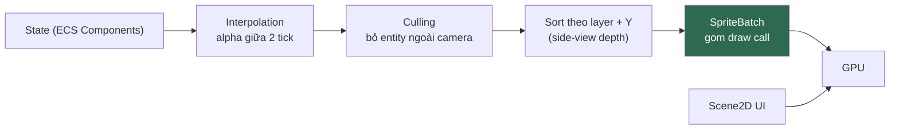

# RENDERING.md

**Rendering pipeline của Kage Engine**

| | |
|---|---|
| Version | 1.0.0 |
| Status | Draft |
| Liên quan | [ENGINE.md](ENGINE.md), [ADR-002](../01-architecture/adr/ADR-002-Why-libGDX.md) |

> Rendering **chỉ chạy ở client**. Server không render ([ENGINE.md §9](ENGINE.md)).
> Rendering là vùng **Clean Architecture không áp dụng** (Điều 25) — hiệu năng thắng abstraction.

---

## 1. Nguyên tắc

| Nguyên tắc | Nghĩa là |
|---|---|
| **Rendering không chứa gameplay logic** | RenderingSystem chỉ đọc Component, không sửa |
| **Ít draw call nhất có thể** | Draw call là chi phí chính của 2D rendering |
| **Ít texture switch nhất có thể** | Đổi texture = flush batch |
| **Không allocation mỗi frame** | Điều 31 |

---

## 2. Pipeline tổng thể



**Thứ tự bắt buộc**: Culling **trước** Sort — sort ít phần tử rẻ hơn nhiều.

---

## 3. Camera & Viewport

| Thành phần | Chọn | Vì sao |
|---|---|---|
| Camera | `OrthographicCamera` | Game 2D side-view |
| Viewport | `FitViewport` | ✅ [ADR-020](../01-architecture/adr/ADR-020-Viewport-Strategy.md) *(Proposed 2026-08-01, khớp code `WorldScreen` đã dùng từ Phase 1)* |

**Vấn đề đã quyết định** (xem ADR-020 để biết vì sao): game phải chạy trên tỉ lệ màn hình rất khác nhau (16:9 desktop, 20:9 điện thoại, tablet 4:3).

| Viewport | Ưu | Nhược |
|---|---|---|
| `FitViewport` | Mọi người thấy **đúng cùng vùng chơi** → công bằng PvP | Có viền đen |
| `ExtendViewport` | Không viền đen, dùng hết màn hình | **Màn hình rộng thấy nhiều hơn** → lợi thế PvP không công bằng |
| `ScreenViewport` | Sắc nét 1:1 | Màn hình lớn thấy nhiều hơn hẳn |

⚠️ **Đây là quyết định gameplay, không phải kỹ thuật.** Ảnh hưởng cân bằng PvP. Cần chốt cùng [GDD](../13-game-design/GAME-DESIGN-DOCUMENT.md).

**Đề xuất**: `ExtendViewport` với **giới hạn max** — mở rộng có kiểm soát, không cho màn hình siêu rộng thấy quá nhiều.

**Camera follow**: có deadzone + lerp làm mượt, **không** bám cứng nhân vật (gây chóng mặt).

---

## 4. Đơn vị thế giới (World Units)

**Không dùng pixel làm đơn vị thế giới.**

```
1 world unit = 1 mét (quy ước)
Sprite 32px  = 1 world unit  →  PIXELS_PER_UNIT = 32
```

**Vì sao**: dùng pixel → đổi độ phân giải asset là đổi toàn bộ số liệu gameplay (tốc độ, tầm đánh). Dùng world unit → asset đổi, gameplay không đổi.

Va chạm địa hình (`TerrainCollisionSystem`) cũng dùng chung world unit này cho `Aabb` — xem [PHYSICS.md §5](PHYSICS.md).

---

## 5. SpriteBatch & Draw Call

```java
batch.begin();
//  Mọi sprite CÙNG texture atlas vẽ liên tiếp → 1 draw call
//  Đổi texture → batch tự flush → +1 draw call
batch.end();
```

| Quy tắc | Vì sao |
|---|---|
| **Gom sprite cùng atlas vẽ liền nhau** | Mỗi lần đổi texture = 1 draw call |
| 1 atlas cho 1 zone | [RESOURCE.md](../04-client/RESOURCE.md) |
| UI atlas **tách riêng** gameplay atlas | UI luôn nằm trong bộ nhớ, gameplay atlas unload theo zone |
| Không `begin()`/`end()` nhiều lần mỗi frame | Mỗi cặp = flush |

⚠️ Sắp xếp theo Y (depth side-view) **xung đột** với gom theo atlas. Nếu 2 entity chồng nhau dùng 2 atlas khác → buộc phải switch. → Giải pháp: **gom asset cùng zone vào 1 atlas** để hiếm khi phải switch.

---

## 6. Layer & Depth Sorting

Game side-view cần thứ tự vẽ đúng:

```
Layer 0: Background xa      (parallax chậm)
Layer 1: Background gần     (parallax)
Layer 2: Địa hình
Layer 3: Entity             ← sort theo Y (Y thấp = gần camera = vẽ sau)
Layer 4: Hiệu ứng (particle, skill)
Layer 5: Foreground         (parallax nhanh)
Layer 6: UI (Scene2D)       ← camera riêng
```

**Trong Layer 3**: sort theo `y` giảm dần. Nhân vật đứng thấp hơn (y nhỏ) được vẽ **sau** → che nhân vật đứng cao hơn.

---

## 7. Interpolation

Logic chạy fixed timestep (60Hz), render chạy theo FPS (VD 144Hz) → **không nội suy sẽ thấy giật**.

```java
// alpha = phần dư accumulator / FIXED_DT  (từ ENGINE.md §4)
renderX = prevX + (currX - prevX) * alpha;
renderY = prevY + (currY - prevY) * alpha;
```

→ Component cần lưu **cả vị trí tick trước và tick hiện tại**:

```java
public final class PositionComponent implements Component {
    public float x, y;           // tick hiện tại
    public float prevX, prevY;   // tick trước — cho interpolation
}
```

⚠️ Đây là chi phí bộ nhớ thật (8 byte/entity), chấp nhận có ý thức để đổi lấy hình mượt.

---

## 8. Animation

| Khía cạnh | Quyết định |
|---|---|
| Kiểu | **Frame-based** (sprite sheet), không skeletal |
| Nguồn | HyperLap2D export ([RESOURCE.md](../04-client/RESOURCE.md)) |
| Lưu ở đâu | `AnimationComponent` giữ **tham chiếu** tới `Animation` dùng chung + `stateTime` riêng |

⚠️ **Cạm bẫy**: `Animation` object phải **chia sẻ giữa các entity cùng loại** (Flyweight). Mỗi entity chỉ giữ `stateTime` riêng. Nếu mỗi entity giữ `Animation` riêng → nhân bản dữ liệu frame → tốn bộ nhớ vô ích.

**Không dùng Spine/skeletal ở MVP** — thêm dependency thương mại (Spine có license phí), và frame-based đủ cho phong cách 2D anime ninja.

---

## 9. Shader

**MVP: dùng shader mặc định của SpriteBatch.**

Chỉ viết GLSL khi có nhu cầu gameplay thật:

| Nhu cầu | Shader |
|---|---|
| Nhân vật nhấp nháy trắng khi trúng đòn | Tint/flash shader (đơn giản) |
| Hiệu ứng độc/băng (đổi màu) | Color matrix |
| Outline khi hover | Outline shader |
| Lighting động | Xem §10 |

⚠️ **Shader phải viết cho cả OpenGL ES** (Android) — cú pháp GLSL khác desktop. Test trên Android sớm, không để tới cuối.

---

## 10. Lighting

**MVP: KHÔNG có lighting động.**

Lý do: game 2D side-view kiểu Ninja School không cần. Thêm lighting = thêm render pass + shader phức tạp + chi phí mobile. Điều 9 (Simplicity) + Điều 10 (gameplay nào cần?).

Nếu sau này cần (VD: bản đồ hang động tối): dùng **Box2DLights** (tích hợp sẵn libGDX) — đánh giá lại ở Phase 8 (dungeon), cần đo chi phí mobile.

---

## 11. Particle

| Quyết định | Chi tiết |
|---|---|
| Nguồn | libGDX Particle Editor hoặc HyperLap2D |
| **Bắt buộc pool** | Particle effect tạo/huỷ liên tục → không pool = rác mỗi frame |
| Giới hạn số particle đồng thời | Mobile không kham nổi particle không giới hạn |

```java
// ✅ Pool bắt buộc
ParticleEffectPool.PooledEffect effect = effectPool.obtain();
// ... khi xong
effect.free();   // ⚠️ quên = leak
```

---

## 12. Culling

**Không vẽ thứ ngoài camera.**

```java
// Kiểm tra AABB entity vs camera frustum
if (!cameraBounds.overlaps(entityBounds)) continue;
```

Với map lớn nhiều entity: cân nhắc **spatial partition** (grid đơn giản) thay vì kiểm tra từng entity.

⚠️ **Nhưng**: đừng làm spatial partition ở MVP nếu chưa đo thấy cần (Điều 30). Kiểm tra tuyến tính vài trăm entity là rất rẻ.

---

## 13. Rendering không được làm gì

| ❌ Cấm | Vì sao |
|---|---|
| Sửa Component gameplay | Rendering chỉ đọc |
| Gửi packet | Không phải việc của rendering |
| Load asset giữa frame | Gây khựng (Điều 31) |
| `new` object mỗi frame | Điều 31 |
| Tính toán gameplay (damage, va chạm) | Đó là System khác |

**RenderingSystem là System cuối cùng trong tick, và chỉ đọc.**

---

## Technical Decisions

| # | Quyết định | Lý do | Trạng thái |
|---|---|---|---|
| 1 | World unit = mét, không dùng pixel | Đổi asset không đổi gameplay | Accepted |
| 2 | 1 atlas / 1 zone; UI atlas tách riêng | Giảm texture switch + unload theo zone | Accepted |
| 3 | Sort Y trong layer entity (side-view depth) | Đúng thị giác 2D side-view | Accepted |
| 4 | Position lưu cả `prev` để interpolation | Đổi 8 byte/entity lấy hình mượt | Accepted |
| 5 | Animation **frame-based**, `Animation` object chia sẻ (Flyweight) | Không tốn license Spine; không nhân bản frame data | Accepted |
| 6 | **Không lighting động ở MVP** | Điều 9, 10 — chưa gameplay nào cần | Accepted |
| 7 | Particle **bắt buộc pool** + giới hạn số lượng | Mobile | Accepted |
| 8 | Không spatial partition ở MVP cho tới khi đo thấy cần | Điều 30 | Accepted |
| 9 | **`FitViewport`** — ảnh hưởng công bằng PvP | Là quyết định gameplay | ✅ [ADR-020](../01-architecture/adr/ADR-020-Viewport-Strategy.md) Accepted (2026-08-01) |

## ADR cần tạo

✅ **ADR-020 đã viết** (2026-08-01, Status: Proposed) — xem §3 và
[ADR-020](../01-architecture/adr/ADR-020-Viewport-Strategy.md). Không còn nằm trong danh sách "cần
tạo" — chờ chủ dự án Accept, không phải chờ viết.

## Tài liệu liên quan

- [ENGINE.md](ENGINE.md) — §4 fixed timestep (nguồn của `alpha` ở §7)
- [RESOURCE.md](../04-client/RESOURCE.md) — atlas, animation export
- [UI.md](../04-client/UI.md) — Scene2D layer riêng
- [PHYSICS.md](PHYSICS.md) — world unit dùng chung
- [PERFORMANCE.md](../09-performance/PERFORMANCE.md) — ngân sách render

## Việc cần làm tiếp theo

1. ✅ **ADR-020 (Viewport) đã viết** (2026-08-01) — chờ chủ dự án Accept.
2. Phase 1: xác lập §4 (world unit) ngay từ đầu — đổi sau = đổi mọi số liệu gameplay.
3. Test shader (§9) trên Android **sớm**, không để tới Phase 8 mới phát hiện GLSL không tương thích.
