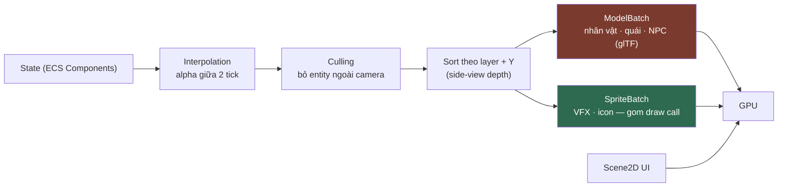

# RENDERING.md

**Rendering pipeline của Kage Engine**

| | |
|---|---|
| Version | 1.2.0 |
| Status | Draft |
| Liên quan | [ENGINE.md](ENGINE.md), [ADR-002](../01-architecture/adr/ADR-002-Why-libGDX.md), [ADR-031](../01-architecture/adr/ADR-031-25D-Realtime-3D-Rendering.md) |

> Rendering **chỉ chạy ở client**. Server không render ([ENGINE.md §9](ENGINE.md)).
> Rendering là vùng **Clean Architecture không áp dụng** (Điều 25) — hiệu năng thắng abstraction.

> ⚠️ **Đổi lớn 2026-08-03 — [ADR-031](../01-architecture/adr/ADR-031-25D-Realtime-3D-Rendering.md) (Accepted).**
> Tài liệu này viết khi **mọi thứ** đi qua `SpriteBatch`. Từ ADR-031, **nhân vật · quái · NPC**
> render 3D thời gian thực (`ModelBatch` + glTF có skin) qua camera orthographic khoá góc; **VFX
> kỹ năng · icon · UI** vẫn `SpriteBatch` y như mô tả ở đây.
> Mọi mục dưới đây **vẫn đúng cho nhánh 2D**. Chỗ nào ADR-031 phủ định thì đã ghi rõ tại chỗ —
> đáng chú ý nhất là **§8 và quyết định #5**, vốn ghi "frame-based, không skeletal".

---

## 1. Nguyên tắc

| Nguyên tắc | Nghĩa là |
|---|---|
| **Rendering không chứa gameplay logic** | RenderingSystem chỉ đọc Component, không sửa |
| **Ít draw call nhất có thể** | Draw call là chi phí chính của **nhánh 2D** |
| **Ít texture switch nhất có thể** | Đổi texture = flush batch |
| **Trong ngân sách tam giác** | Chi phí chính của **nhánh 3D** — 5k/10k/20k mỗi nhân vật theo tier ([ART-PIPELINE §4.4](../14-art/ART-PIPELINE.md)), **nhân đôi** khi ước tính vì lượt vẽ viền (§9.2) |
| **Không allocation mỗi frame** | Điều 31 |

---

## 2. Pipeline tổng thể



⚠️ Hai batch **không trộn lẫn được**: mỗi lần đổi qua lại là một lần flush. Nhân vật vẽ trước,
VFX vẽ đè sau — gom theo nhánh, đừng gom theo entity.

**Thứ tự bắt buộc**: Culling **trước** Sort — sort ít phần tử rẻ hơn nhiều.

---

## 3. Camera & Viewport

| Thành phần | Chọn | Vì sao |
|---|---|---|
| Camera | `OrthographicCamera` | Trình bày side-view; **vẫn đúng sau [ADR-031](../01-architecture/adr/ADR-031-25D-Realtime-3D-Rendering.md)** — 2.5D là 3D thật nhìn qua camera ortho khoá góc |
| Viewport | `FitViewport` | ✅ [ADR-020](../01-architecture/adr/ADR-020-Viewport-Strategy.md) **Accepted 2026-08-01**, khớp code `WorldScreen` đã dùng từ Phase 1 |

**Vì sao FitViewport** (chi tiết ở ADR-020): game chạy trên tỉ lệ màn hình rất khác nhau (16:9 desktop, 20:9 điện thoại, tablet 4:3).

| Viewport | Ưu | Nhược |
|---|---|---|
| **`FitViewport`** ✅ | Mọi người thấy **đúng cùng vùng chơi** → công bằng PvP | Có viền đen |
| `ExtendViewport` | Không viền đen, dùng hết màn hình | **Màn hình rộng thấy nhiều hơn** → lợi thế PvP không công bằng |
| `ScreenViewport` | Sắc nét 1:1 | Màn hình lớn thấy nhiều hơn hẳn |

Đây là **quyết định gameplay** (ảnh hưởng cân bằng PvP) nên viền đen được chấp nhận có chủ đích — công
bằng thắng tận dụng hết màn hình. ADR-020 đã chốt, **không mở lại** nếu không có ADR revisit.

### 3.1 Góc camera là hằng số runtime (ADR-031)

Trước ADR-031, góc nhìn bị **nướng vào tài sản** (sprite chỉ render 1 hướng, trái = lật ảnh). Giờ model
là 3D thật nên góc nhìn chỉ là tham số của camera:

- Đổi góc = đổi **một hằng số**, không phải render lại 33 khung × 15 nhân vật.
- Nhân vật **xoay tự do**; hết trò lật ngang ảnh.
- Câu hỏi "nghiêng thuần 90° hay 3/4 35°" từng treo ở phiên art **tự tan** — nó không còn là thuộc
  tính của tài sản.
- ⚠️ Model vẫn phải quay mặt **+X** trong không gian gốc, nhưng vì rig/bảng pose giả định trục đó,
  **không** vì đó là hướng nhìn trên màn ([ART-PIPELINE §4.3](../14-art/ART-PIPELINE.md)).

**Camera follow**: có deadzone + lerp làm mượt, **không** bám cứng nhân vật (gây chóng mặt).

---

## 4. Đơn vị thế giới (World Units)

**Không dùng pixel làm đơn vị thế giới.**

```
1 world unit = 1 mét (quy ước)
Sprite 32px  = 1 world unit  →  PIXELS_PER_UNIT = 32
```

**Vì sao**: dùng pixel → đổi độ phân giải asset là đổi toàn bộ số liệu gameplay (tốc độ, tầm đánh). Dùng world unit → asset đổi, gameplay không đổi.

Va chạm địa hình (`TerrainCollisionSystem`) cũng dùng chung world unit này cho `Aabb` — xem [PHYSICS.md §5](PHYSICS.md).

**Model 3D quy về chiều cao 1.0, không phải pixel.** `kage_text3d_kit.normalise()` ép **mọi** nhân vật
cao đúng `1.0` đơn vị Blender, chân ở `z=0` ([ART-PIPELINE §4.1](../14-art/ART-PIPELINE.md)) — nên
chúng nhất quán với nhau theo thiết kế, không phụ thuộc mesh gốc to nhỏ ra sao.

Nối hai hệ với nhau là **đúng một hệ số nhân, đặt một lần**:

```
chiều cao thế giới của nhân vật (world unit) = 1.0 (model) × CHARACTER_WORLD_HEIGHT
```

⚠️ **Hệ số đó phải dùng chung với hộp va chạm.** Nếu render scale một đằng, `Aabb` ở
[PHYSICS.md §5](PHYSICS.md) một nẻo, nhân vật sẽ đứng lún hoặc lơ lửng so với địa hình — và lỗi kiểu
này chỉ lộ ra khi có bản đồ thật. Đặt hằng số ở một chỗ, hai bên cùng đọc. **Giá trị cụ thể chưa chốt**:
nó phụ thuộc kích thước tile bản đồ thật, mà chưa có bản đồ nào.

Điều **không** đổi: gốc toạ độ model = **chân, giữa** — cùng quy ước pivot với sprite, nên baseline
chung cho cả hai nhánh vẫn đúng.

---

## 5. SpriteBatch & Draw Call

```java
batch.begin();
//  Mọi sprite CÙNG texture atlas vẽ liên tiếp → 1 draw call
//  Đổi texture → batch tự flush → +1 draw call
batch.end();
```

| Quy tắc | Vì sao |
|---|---|
| **Gom sprite cùng atlas vẽ liền nhau** | Mỗi lần đổi texture = 1 draw call |
| 1 atlas cho 1 zone | [RESOURCE.md](../04-client/RESOURCE.md) |
| UI atlas **tách riêng** gameplay atlas | UI luôn nằm trong bộ nhớ, gameplay atlas unload theo zone |
| Không `begin()`/`end()` nhiều lần mỗi frame | Mỗi cặp = flush |

⚠️ Sắp xếp theo Y (depth side-view) **xung đột** với gom theo atlas. Nếu 2 entity chồng nhau dùng 2 atlas khác → buộc phải switch. → Giải pháp: **gom asset cùng zone vào 1 atlas** để hiếm khi phải switch.

---

## 6. Layer & Depth Sorting

Game side-view cần thứ tự vẽ đúng:

```
Layer 0: Background xa      (parallax chậm)
Layer 1: Background gần     (parallax)
Layer 2: Địa hình
Layer 3: Entity             ← sort theo Y (Y thấp = gần camera = vẽ sau)
Layer 4: Hiệu ứng (particle, skill)
Layer 5: Foreground         (parallax nhanh)
Layer 6: UI (Scene2D)       ← camera riêng
```

**Trong Layer 3**: sort theo `y` giảm dần. Nhân vật đứng thấp hơn (y nhỏ) được vẽ **sau** → che nhân vật đứng cao hơn.

---

## 7. Interpolation

Logic chạy fixed timestep (60Hz), render chạy theo FPS (VD 144Hz) → **không nội suy sẽ thấy giật**.

```java
// alpha = phần dư accumulator / FIXED_DT  (từ ENGINE.md §4)
renderX = prevX + (currX - prevX) * alpha;
renderY = prevY + (currY - prevY) * alpha;
```

→ Component cần lưu **cả vị trí tick trước và tick hiện tại**:

```java
public final class PositionComponent implements Component {
    public float x, y;           // tick hiện tại
    public float prevX, prevY;   // tick trước — cho interpolation
}
```

⚠️ Đây là chi phí bộ nhớ thật (8 byte/entity), chấp nhận có ý thức để đổi lấy hình mượt.

---

## 8. Animation

Hai kiểu, chọn theo loại đối tượng ([ADR-031](../01-architecture/adr/ADR-031-25D-Realtime-3D-Rendering.md)).

### 8.1 Nhân vật · quái · NPC — **skeletal, 3D**

| Khía cạnh | Quyết định |
|---|---|
| Kiểu | **Skeletal** — rig 11 xương, 7 action, nạp từ glTF 2.0 |
| Nguồn | Blender → glTF ([ART-PIPELINE §6.4](../14-art/ART-PIPELINE.md)) |
| Nạp bằng | `gdx-gltf` — ⚠️ **chưa thêm vào `libs.versions.toml`**, xem [TECHNOLOGY-STACK](../01-architecture/TECHNOLOGY-STACK.md) |

Client **nội suy giữa các khoá theo tần số khung hình thật** thay vì phát ảnh cố định ở 12 fps.
Đây là lý do chính đổi sang 2.5D — bảng tier §5 của ART-PIPELINE giờ mới có "FPS mục tiêu" thật.

⚠️ Cạm bẫy Flyweight vẫn nguyên: dữ liệu `Model` và clip animation phải **dùng chung giữa các
entity cùng loại**, mỗi entity chỉ giữ trạng thái phát riêng.

**Không dùng Spine** — lý do license phí vẫn đúng, và giờ càng không cần: skeletal đã có sẵn trong
glTF, không tốn thêm dependency thương mại nào.

### 8.2 VFX kỹ năng · icon · UI — **frame-based** *(không đổi)*

| Khía cạnh | Quyết định |
|---|---|
| Kiểu | **Frame-based** (sprite sheet), playback 12 fps |
| Nguồn | Blender pre-render → `tools/asset-pipeline` pack atlas ([ART-PIPELINE §3.3](../14-art/ART-PIPELINE.md)); HyperLap2D chỉ cho scene/map ([RESOURCE.md](../04-client/RESOURCE.md)) |
| Lưu ở đâu | `AnimationComponent` giữ **tham chiếu** tới `Animation` dùng chung + `stateTime` riêng |

⚠️ **Cạm bẫy**: `Animation` object phải **chia sẻ giữa các entity cùng loại** (Flyweight). Mỗi entity chỉ giữ `stateTime` riêng. Nếu mỗi entity giữ `Animation` riêng → nhân bản dữ liệu frame → tốn bộ nhớ vô ích.

---

## 9. Shader

### 9.1 Nhánh 2D — shader mặc định là đủ

**Dùng shader mặc định của `SpriteBatch`.** Chỉ viết GLSL khi có nhu cầu gameplay thật:

| Nhu cầu | Shader |
|---|---|
| Nhân vật nhấp nháy trắng khi trúng đòn | Tint/flash shader (đơn giản) |
| Hiệu ứng độc/băng (đổi màu) | Color matrix |
| Outline khi hover | Outline shader |
| Lighting động | Xem §10 |

### 9.2 Nhánh 3D — cel shader là **bắt buộc**, không phải tuỳ chọn

Sau [ADR-031](../01-architecture/adr/ADR-031-25D-Realtime-3D-Rendering.md) đây không còn là "viết khi
cần": model xuất ra **cố tình không mang** vẻ ngoài cel. `export_character_lods.py` bỏ vật liệu toon,
far-shade và viền, chỉ giữ **base-color texture** ([ART-PIPELINE §6.4](../14-art/ART-PIPELINE.md) bước 9).
Không có shader thì nhân vật hiện ra như model PBR bán-tả-thực, lệch hẳn khỏi VFX 2D vẽ đè lên nó.

Hợp đồng vẻ ngoài là **chung cho cả hai nhánh** ([ART-QUALITY-STANDARD §4](../14-art/ART-QUALITY-STANDARD.md)) —
VFX sprite và nhân vật 3D nằm cùng một khung hình nên phải cùng một ngôn ngữ hình ảnh.

**Hai lượt vẽ, cả hai đã chứng minh được ở Blender nên không phải phát minh lại:**

| Lượt | Làm gì | Bản Blender tương ứng |
|---|---|---|
| 1 — **viền** | Nhân bản mesh, đẩy đỉnh dọc pháp tuyến một khoảng, **lật normal + cull mặt trước**, tô đen phẳng | `add_inverted_hull_outline()` |
| 2 — **thân** | `baseColor` texture **×** giá trị `N·L` đã **lượng tử hoá** thành 2–3 nấc (bậc thang, không nội suy) | `toon_textured()` |

⚠️ **Bảng nấc ramp không dùng chung được giữa hai loại mesh.** Mesh có texture vẽ sẵn bóng dùng nấc
đáy **0.80** (`TEXTURED_SHADE_STEPS`); dùng nhầm bảng của mesh phẳng màu (đáy 0.55) là **tối hai lần**
và nhân vật xỉn hẳn. Đây là lỗi đã gặp thật ở khâu art.

⚠️ **Không port `add_far_shade()`.** Nó làm tối chi ở phía xa để giả chiều sâu cho **một góc nhìn cố
định** — vô nghĩa (và sai) khi nhân vật xoay được. Ánh sáng thật của lượt 2 đã lo phần đó.

**Vì sao viền phải là hình học, không phải hậu kỳ**: viền hậu kỳ theo cạnh (Sobel trên depth/normal)
sẽ vẽ viền cho **cả cảnh**; ta chỉ muốn viền quanh nhân vật. Vỏ lật normal chỉ tốn thêm 1 lượt vẽ trên
đúng mesh đó, và đó cũng là lý do **ngân sách tam giác ở [ART-PIPELINE §4.4](../14-art/ART-PIPELINE.md)
phải nhân đôi khi ước tính chi phí vẽ** (10k tam giác = 20k thực vẽ).

⚠️ **Freestyle không tồn tại lúc runtime** — đó là bộ lọc render của Blender. May là khâu art đã bỏ
Freestyle sang inverted hull vì lý do khác (nó vẽ viền cho **từng lọn tóc** trên mesh Text→3D), nên
thứ đang dùng ở Blender vốn đã là thứ chuyển thẳng sang GLSL được.

**Chưa verify được** cho tới khi có `gdx-gltf` ([ADR-032](../01-architecture/adr/ADR-032-JitPack-Dependency-Defence.md)
đang chờ duyệt): độ dày viền quy đổi thế nào sang world unit khi camera zoom, và `ModelBatch` có cho
chèn lượt vẽ thứ hai gọn không hay phải tự quản `ShaderProgram`.

⚠️ **Shader phải viết cho cả OpenGL ES** (Android) — cú pháp GLSL khác desktop. Test trên Android sớm, không để tới cuối.

---

## 10. Lighting

**MVP: KHÔNG có lighting động.** [ADR-031](../01-architecture/adr/ADR-031-25D-Realtime-3D-Rendering.md)
**không** đổi điều này — 2.5D không kéo theo lighting engine.

Lý do: game side-view kiểu Ninja School không cần. Thêm lighting = thêm render pass + shader phức tạp + chi phí mobile. Điều 9 (Simplicity) + Điều 10 (gameplay nào cần?).

⚠️ **Đừng nhầm "không lighting động" với "không tính ánh sáng".** Cel shader ở §9.2 **có** tính `N·L`
rồi lượng tử hoá — nhưng từ **một hướng sáng cố định là hằng số**, không phải nguồn sáng đặt được
trong cảnh, không đổ bóng, không có render pass riêng. Chi phí bằng một phép nhân trong pixel shader.
Đó là lý do bảng tier ở [ART-PIPELINE §5](../14-art/ART-PIPELINE.md) không có dòng shadow map / GI /
SSR nào: **không có gì để bật thêm**.

Nếu sau này cần lighting động thật (VD: bản đồ hang động tối): với nhánh 3D thì đã có sẵn pháp tuyến
để làm, nhưng vẫn phải đo chi phí mobile và phải có ADR — **Box2DLights không dùng được cho model 3D**
(nó là hệ thống 2D), nên phương án cũ ghi ở đây không còn áp dụng cho nhân vật.

---

## 11. Particle

| Quyết định | Chi tiết |
|---|---|
| Nguồn | libGDX Particle Editor hoặc HyperLap2D |
| **Bắt buộc pool** | Particle effect tạo/huỷ liên tục → không pool = rác mỗi frame |
| Giới hạn số particle đồng thời | Mobile không kham nổi particle không giới hạn |

```java
// ✅ Pool bắt buộc
ParticleEffectPool.PooledEffect effect = effectPool.obtain();
// ... khi xong
effect.free();   // ⚠️ quên = leak
```

---

## 12. Culling

**Không vẽ thứ ngoài camera.**

```java
// Kiểm tra AABB entity vs camera frustum
if (!cameraBounds.overlaps(entityBounds)) continue;
```

Với map lớn nhiều entity: cân nhắc **spatial partition** (grid đơn giản) thay vì kiểm tra từng entity.

⚠️ **Nhưng**: đừng làm spatial partition ở MVP nếu chưa đo thấy cần (Điều 30). Kiểm tra tuyến tính vài trăm entity là rất rẻ.

---

## 13. Rendering không được làm gì

| ❌ Cấm | Vì sao |
|---|---|
| Sửa Component gameplay | Rendering chỉ đọc |
| Gửi packet | Không phải việc của rendering |
| Load asset giữa frame | Gây khựng (Điều 31) |
| `new` object mỗi frame | Điều 31 |
| Tính toán gameplay (damage, va chạm) | Đó là System khác |

**RenderingSystem là System cuối cùng trong tick, và chỉ đọc.**

⚠️ **`ModelBatch` và `AnimationController` có nhiều bẫy cấp phát mỗi khung hơn `SpriteBatch`**
([ADR-031](../01-architecture/adr/ADR-031-25D-Realtime-3D-Rendering.md) Consequences) — `Renderable`,
ma trận biến đổi và mảng xương rất dễ sinh rác mỗi khung nếu dùng ngây thơ. Luật "không `new` mỗi
frame" (CLAUDE.md §6) **không** được nới ra cho nhánh 3D. Phải soi bằng benchmark thật khi nối
`WorldScreen`, không suy đoán — đây là một trong những thứ chỉ đo được sau khi
[ADR-032](../01-architecture/adr/ADR-032-JitPack-Dependency-Defence.md) được duyệt.

---

## Technical Decisions

| # | Quyết định | Lý do | Trạng thái |
|---|---|---|---|
| 1 | World unit = mét, không dùng pixel | Đổi asset không đổi gameplay | Accepted |
| 2 | 1 atlas / 1 zone; UI atlas tách riêng | Giảm texture switch + unload theo zone | Accepted |
| 3 | Sort Y trong layer entity (side-view depth) | Đúng thị giác 2D side-view | Accepted |
| 4 | Position lưu cả `prev` để interpolation | Đổi 8 byte/entity lấy hình mượt | Accepted |
| 5 | ~~Animation **frame-based** cho mọi thứ~~ → **skeletal (glTF) cho nhân vật/quái/NPC; frame-based cho VFX/icon/UI**. `Animation`/`Model` chia sẻ (Flyweight) ở cả hai nhánh | Bỏ trần 12 fps; vẫn không tốn license Spine (skeletal có sẵn trong glTF); vẫn không nhân bản dữ liệu | 🔀 **Thay bởi [ADR-031](../01-architecture/adr/ADR-031-25D-Realtime-3D-Rendering.md)** (Accepted 2026-08-03) |
| 6 | **Không lighting động ở MVP** | Điều 9, 10 — chưa gameplay nào cần | Accepted |
| 7 | Particle **bắt buộc pool** + giới hạn số lượng | Mobile | Accepted |
| 8 | Không spatial partition ở MVP cho tới khi đo thấy cần | Điều 30 | Accepted |
| 9 | **`FitViewport`** — ảnh hưởng công bằng PvP | Là quyết định gameplay | ✅ [ADR-020](../01-architecture/adr/ADR-020-Viewport-Strategy.md) Accepted (2026-08-01) |
| 10 | **Cel shader + viền inverted hull là BẮT BUỘC cho nhánh 3D**, không phải "viết khi cần" (§9.2) | Model xuất ra cố tình không mang vẻ ngoài cel — không có shader thì nhân vật hiện ra bán-tả-thực, lệch khỏi VFX 2D vẽ đè cùng khung | **Chốt** theo [ADR-031](../01-architecture/adr/ADR-031-25D-Realtime-3D-Rendering.md); GLSL **chưa viết** |
| 11 | Viền làm bằng **hình học** (vỏ lật normal), không phải hậu kỳ theo cạnh | Hậu kỳ vẽ viền cho cả cảnh; ta chỉ muốn viền quanh nhân vật. Đổi lại: chi phí vẽ **gấp đôi** số tam giác | **Chốt** — đã chứng minh ở khâu art |
| 12 | **Không port `add_far_shade()`** sang runtime | Nó giả chiều sâu cho một góc nhìn cố định — sai khi nhân vật xoay được | **Chốt** |
| 13 | Góc camera là **hằng số runtime**, không nướng vào tài sản (§3.1) | Đổi góc = đổi 1 hằng số thay vì render lại toàn bộ | **Chốt** — [ADR-031](../01-architecture/adr/ADR-031-25D-Realtime-3D-Rendering.md) |
| 14 | Hệ số quy đổi chiều cao model (1.0) → world unit đặt **một chỗ**, dùng chung với `Aabb` va chạm | Lệch nhau = nhân vật lún đất hoặc lơ lửng, chỉ lộ khi có bản đồ thật | ⏳ Giá trị **chưa chốt** — chờ có tile bản đồ thật |

## ADR cần tạo

Không còn. ✅ **[ADR-020](../01-architecture/adr/ADR-020-Viewport-Strategy.md) Accepted 2026-08-01** — xem §3.

⚠️ Tài liệu này mô tả đường render **2D**. Từ [ADR-031](../01-architecture/adr/ADR-031-25D-Realtime-3D-Rendering.md)
(Accepted 2026-08-03) nhân vật/quái/NPC render **3D thời gian thực** bằng `ModelBatch` + shader cel tự
viết, VFX/icon/UI vẫn 2D — §"Việc cần làm tiếp theo" mục 4 là chỗ viết lại phần đó.

## Tài liệu liên quan

- [ENGINE.md](ENGINE.md) — §4 fixed timestep (nguồn của `alpha` ở §7)
- [RESOURCE.md](../04-client/RESOURCE.md) — atlas, animation export
- [UI.md](../04-client/UI.md) — Scene2D layer riêng
- [PHYSICS.md](PHYSICS.md) — world unit dùng chung
- [PERFORMANCE.md](../09-performance/PERFORMANCE.md) — ngân sách render

## Việc cần làm tiếp theo

1. ✅ **ADR-020 (Viewport) Accepted 2026-08-01** — hết treo.
2. Phase 1: xác lập §4 (world unit) ngay từ đầu — đổi sau = đổi mọi số liệu gameplay.
3. Test shader (§9) trên Android **sớm**, không để tới Phase 8 mới phát hiện GLSL không tương thích.
4. ✅ **Xong 2026-08-05** — tài liệu này đã phủ nhánh 3D ([ADR-031](../01-architecture/adr/ADR-031-25D-Realtime-3D-Rendering.md)
   "Việc cần làm" #4): §3.1 góc camera hằng số · §4 quy đổi chiều cao model · §8.1 skeletal ·
   **§9.2 hợp đồng cel shader 2 lượt vẽ** · §10 phân biệt "không lighting động" với "không tính ánh
   sáng" · §13 bẫy cấp phát của `ModelBatch`.
5. 🔴 **Viết GLSL thật + đo** — cái còn thiếu giờ là **code**, không phải tài liệu. Ba thứ chỉ biết
   được khi chạy: độ dày viền quy đổi sang world unit lúc camera zoom, `ModelBatch` có cho chèn lượt
   vẽ thứ hai gọn không, và `AnimationController` cấp phát bao nhiêu mỗi khung. **Chặn bởi**
   [ADR-032](../01-architecture/adr/ADR-032-JitPack-Dependency-Defence.md) — chưa có `gdx-gltf` thì
   chưa chạy được gì.
