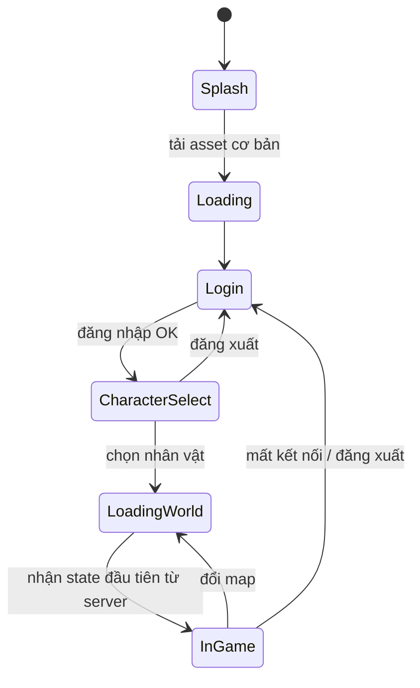
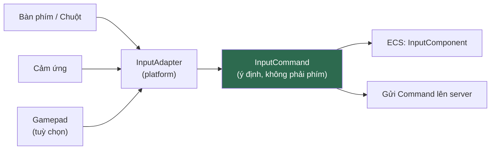
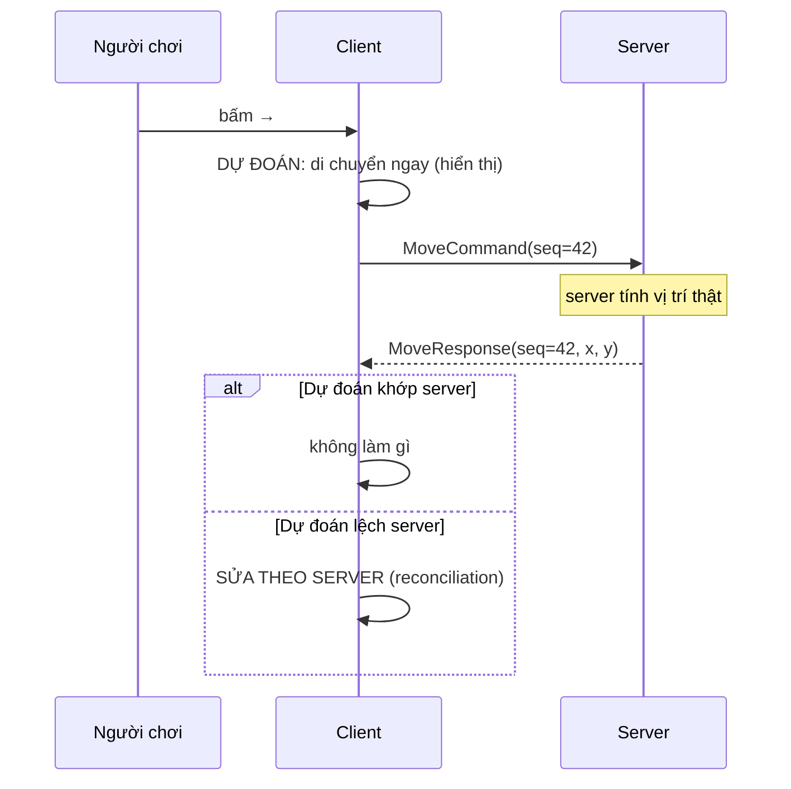

# CLIENT.md

**Kiến trúc Client**

| | |
|---|---|
| Version | 1.0.0 |
| Status | Draft |
| Liên quan | [ARCHITECTURE.md](../01-architecture/ARCHITECTURE.md), [ENGINE.md](../03-engine/ENGINE.md) |

> **Client chỉ hiển thị. Client không bao giờ quyết định gameplay** (Điều 15).
> Mọi thứ trong tài liệu này phải đọc dưới ánh sáng của câu đó.

---

## 1. Client làm gì và không làm gì

| ✅ Client LÀM | ❌ Client KHÔNG LÀM |
|---|---|
| Gửi **ý định** ("tôi muốn dùng skill") | Gửi **kết quả** ("tôi gây 500 damage") |
| Render state nhận từ server | Tự tính damage |
| Dự đoán cục bộ để mượt hình | Coi dự đoán là sự thật |
| Validate input để UX tốt (nút xám khi thiếu Khí) | **Tin** validate của mình |
| Phát nhạc, hiệu ứng | Quyết định item rơi ra |

**Validate ở client là để UX, không phải để bảo mật.** Server luôn validate lại — client validate chỉ để người chơi không phải chờ round-trip mới biết mình bấm sai.

---

## 2. Cấu trúc module

```
client-core/          ← 95% code ở đây, platform-agnostic
├── screen/           ← Loading, Login, CharacterSelect, Game
├── ecs/              ← Component + System đặc thù client (rendering, input, prediction)
├── net/              ← Kết nối, gửi/nhận packet
├── ui/               ← Scene2D (xem UI.md)
└── platform/         ← PlatformAdapter interface

client-desktop/       ← CHỈ launcher LWJGL3 + DesktopAdapter
client-android/       ← CHỈ launcher Android + AndroidAdapter
client-ios/           ← CHỈ launcher RoboVM (giai đoạn sau)
```

**Quy tắc**: `client-desktop/android/ios` **chỉ chứa launcher + adapter**. Bất kỳ dòng gameplay nào lọt vào đó = vi phạm Điều 28.

```java
// client-desktop — đúng phạm vi
public final class DesktopLauncher {
    public static void main(String[] args) {
        var config = new Lwjgl3ApplicationConfiguration();
        config.setTitle("Project Kage");
        config.setWindowedMode(1280, 720);
        new Lwjgl3Application(new KageGame(new DesktopPlatformAdapter()), config);
    }
}
```

---

## 3. Screen / State



**Quy tắc**:
- Mỗi Screen tự `dispose()` tài nguyên riêng của nó.
- Asset **dùng chung** (UI atlas, font) do `ResourceManager` giữ, không dispose theo Screen.
- **Không load asset trong `render()`** — dùng LoadingScreen.

---

## 4. Asset Loading

Chi tiết: [RESOURCE.md](RESOURCE.md). Ở mức client:

```
Splash          → load asset tối thiểu (logo, font, thanh loading)
Loading         → load UI atlas + asset dùng chung
LoadingWorld    → load atlas + model .glb của zone sắp vào, unload zone cũ
```

⚠️ **Không** load toàn bộ asset lúc khởi động — mobile không đủ RAM, và thời gian khởi động sẽ tệ.

⚠️ **Từ [ADR-031](../01-architecture/adr/ADR-031-25D-Realtime-3D-Rendering.md) (Accepted 2026-08-03) có hai loại tài sản phải nạp, không phải một**: atlas cho VFX/icon/UI, và **model glTF (`.glb`) cho nhân vật · quái · NPC**. Nạp `.glb` là **đọc đĩa + dựng texture** nên tuyệt đối không được nằm trong game loop — cùng luật với atlas. Chi tiết vòng đời model: [RENDERING.md §6](../03-engine/RENDERING.md).

---

## 5. Input



**Quy tắc quan trọng**: gameplay code **không biết phím nào được bấm**. Nó biết **ý định**:

```java
// ❌ Sai — gameplay biết phím cụ thể
if (Gdx.input.isKeyPressed(Keys.SPACE)) jump();

// ✅ Đúng — gameplay biết ý định
if (input.isPressed(GameAction.JUMP)) jump();
```

→ Đổi từ bàn phím sang cảm ứng = đổi ánh xạ, **không đụng gameplay** (Điều 28).

**Ánh xạ THẬT** (đọc từ `DesktopInputMapper` — [ADR-023](../01-architecture/adr/ADR-023-Desktop-First-Input.md): desktop là sơ đồ CHÍNH):

| Action | Phím | Ghi chú |
|---|---|---|
| `MOVE_LEFT` / `MOVE_RIGHT` | **A** / **D** (hoặc ← / →) | Chỉ trục X — [ADR-033](../01-architecture/adr/ADR-033-Ninja-School-Style-Movement.md) bỏ MOVE_UP/DOWN |
| `JUMP` | **W** (hoặc ↑, Space) | ADR-033 — nhảy có tác dụng gameplay thật |
| `ATTACK` | **Z** (hoặc nút Đánh trên HUD) | Giữ được, tự lặp — [ADR-034](../01-architecture/adr/ADR-034-Manual-Attack-And-Click-Target.md) |
| `USE_SKILL` | **Enter** (hoặc numpad Enter) | Một nút skill, không phải dãy 1–6 |
| Chọn mục tiêu | **Chuột trái** vào quái/NPC | ADR-034 — KHÔNG có tương đương cảm ứng một-đổi-một. Trong đấu trường: **tự nhắm đối thủ** (xem dưới); click người chơi vẫn chỉ là chọn để thách đấu |
| Mở 11 cửa sổ HUD | **T** chat · **I** túi đồ · **B** mua bán · **N** giao dịch · **J** nhiệm vụ · **M** thư · **P** nhóm · **F** bạn · **G** bang · **K** luận kiếm · **H** hệ phái | Phím chữ, không đi qua `GameAction`: đây không phải ý định gameplay |

⚠️ Bảng cũ ở đây từng ghi `Space`/`J`/`SKILL_1..6` — **sai so với code** kể từ ADR-033/034. Sửa 2026-09-05.

**Gửi lại khi chưa được xác nhận (`AttackInputController`, 2026-10-01).** Server bỏ **im lặng** lệnh
đánh thường khi mục tiêu ngoài tầm 2 m hoặc còn cooldown, và không nhớ lại ý định
(`CombatSystem.tryAttackNow`). Trước đây bấm Z lúc quái còn ở 2,1 m (đang lao tới) là mất trọn ~1 s
không có gì xảy ra; cooldown thật 61 tick (~1,017 s) cũng làm nhịp giữ phím 1 s đôi khi tới sớm một
tick và bị bỏ. Nay mỗi lần gửi do người chơi (nhấn, click nút, nhịp lặp khi giữ) mở một **cửa sổ chờ
xác nhận**: tới khi thấy `AttackResultEvent` do **chính mình** ra (trúng hay hụt), client gửi lại im
lặng (không chữ nổi, không lặp animation) mỗi `ATTACK_CONFIRM_RETRY_SECONDS` = 100 ms, tối đa
`ATTACK_CONFIRM_WINDOW_SECONDS` = 1 s. Cửa sổ đóng khi nhả phím (cửa sổ mở bằng click thì sống hết
1 s), đổi/mất mục tiêu, chết, hoặc mở hội thoại. Sau xác nhận, nhịp lặp kế tiếp đo từ lúc thấy xác
nhận. Trần ~10 gói/giây và chỉ khi đang chờ — chi phí server tính theo gói ([BENCHMARK §5.1](../09-performance/BENCHMARK.md)).
Chỉ client: không đổi server/protocol. Cùng cơ chế với `AttackCadence` của gameProbe.

**Hoàn Khí/hồi chiêu khi server bỏ im lặng một lần thi triển (`CombatHudController`, 2026-10-03).**
`SkillSystem` bỏ không trả lời những lần thi triển không hợp lệ (ngoài tầm, đang choáng, mục tiêu đã
chết, hồi chiêu phía server chưa xong) và chỉ trừ Khí cho lần thi triển THẬT; client thì trừ Khí +
bắt đầu hồi chiêu ở MỌI lần bấm và không bao giờ trả lại. Vì ngoài hồi sinh/đổi World không có gói
nào đồng bộ Khí, bấm ngoài tầm vài lần là nút skill xám hẳn trong khi server vẫn giữ đầy Khí. Nay vẫn
trừ lạc quan, nhưng chờ `SkillResultEvent` do **chính mình** ra trong `SKILL_CONFIRM_WINDOW_SECONDS`
(= `ATTACK_CONFIRM_WINDOW_SECONDS`, 1 s); không tới thì hoàn Khí + hồi chiêu, tới muộn thì trừ lại.
Chỉ client, không đổi protocol. Kèm: gỡ hai lượt cấp phát mỗi khung ở HUD (`monsters()` trả một view
chỉ-đọc dùng lại; nhãn hồi chiêu chỉ định dạng lại khi phần mười giây hiển thị đổi — `CooldownText`).
Bản vá trên (`0553aeb`) **CHƯA kiểm sống.**
Bản vá nằm trong `CombatHudController` (client desktop), còn `gameProbe` không chạy code HUD và cũng
không có đường gửi lệnh skill (chỉ giải mã `SkillResultEvent`), nên không có cách đo bằng probe.
Chỉ có `CombatHudControllerTest`; kiểm sống thật cần client desktop (bấm Enter ngoài tầm/khi bị
choáng rồi đọc thanh Khí). Đợt kiểm sống cùng ngày cho AoI/NaN: [SERVER.md §6](../05-server/SERVER.md#6-state-sync--gửi-gì-cho-client).

**Tự nhắm đối thủ đấu trường (`DuelTargeting`, 2026-10-04 — dòng 32 bảng chờ, phương án a).**
Trước đây mục tiêu chỉ có thể là QUÁI (tự chọn lúc quái spawn, hoặc click quái); click người chơi khác
đi sang `DuelCoordinator.onCharacterPicked` (chọn để thách đấu). Đấu trường không có quái ⇒ không bao
giờ có mục tiêu ⇒ bấm Đánh báo "chưa chọn mục tiêu", nút skill xám. Nay client tự gửi
`SetTargetCommand(opponent_character_id)` — id lấy từ `DuelStartedEvent`, client không tự chọn ai —
khi đủ **cả ba**: đang có trận, đang ở World ARENA (gói 308), và đối thủ đã spawn trong World đó. Ba
gói này tới theo thứ tự KHÔNG cố định (`DuelStartedEvent` gửi ngay sau `acceptDuel`; 308 + attach chạy
trên executor riêng sau khi world chính xả hàng đợi), nên chờ đủ cả ba; spawn trong đấu trường cũng
là bằng chứng entity đối thủ đã attach phía server, tức `WorldFacade#handleSetTarget` sẽ không bỏ qua
lệnh. Bỏ mục tiêu khi: `DuelResultEvent`, đổi World (308 nào cũng dọn), đối thủ despawn (spawn lại thì
nhắm lại), hoặc người chơi click một con quái. `CombatHudController` giữ mục tiêu nhân vật (id dương)
cạnh mục tiêu quái (id âm): máu lấy từ `AttackResultEvent`/`SkillResultEvent`, máu TỐI ĐA chỉ từ
`HealthChangedEvent`. ⚠️ **Khoảng trống giao thức**: `CharacterSpawnedEvent`/`AttackResultEvent`
không mang máu tối đa của người khác ⇒ trong một trận ngắn HUD mục tiêu thường chỉ hiện `88 / ?`
(vạch máu ẩn — vẽ tỉ lệ đoán mò là client bịa số). Lấp thật cần thêm field vào protocol — quyết định
của chủ dự án. Số sát thương nay neo lên nhân vật đang là mục tiêu (`CombatFeedbackPresenter`); số của
người khác vẫn không hiện. Chưa có dấu mục tiêu vẽ dưới chân nhân vật (chỉ quái có). Phương án (b) —
click người chơi để nhắm khi đang trong trận — CHƯA làm. Test: `DuelTargetingTest` (đỏ trước, xanh
sau), `FrameAllocationTest#characterTargetHudPath_isAllocationFree`. **CHƯA kiểm sống bằng client
desktop thật** — `gameProbe` không chạy code HUD/`DuelTargeting` nên không đo được đường này.

✅ **Nền tảng đã chốt: desktop-first** ([ADR-023](../01-architecture/adr/ADR-023-Desktop-First-Input.md), Accepted 2026-09-05). Sơ đồ cảm ứng KHÔNG thiết kế trước (Điều 9) — khi nào làm mobile thật thì cần một ADR riêng, phạm vi tối thiểu: sơ đồ nhập liệu cảm ứng, bố cục lại HUD theo vùng chạm tối thiểu, và xem lại [ADR-024](../01-architecture/adr/ADR-024-Asset-Distribution-Strategy.md)/[ADR-028](../01-architecture/adr/ADR-028-Asset-Delivery-Tiers.md).

---

## 6. Client Prediction — và ranh giới của nó

Không dự đoán → mỗi lần bấm phím phải chờ round-trip (50–200ms) mới thấy nhân vật nhúc nhích. Không chấp nhận được.



**Chỉ dự đoán những thứ này:**

| ✅ Dự đoán được | ❌ KHÔNG dự đoán |
|---|---|
| Di chuyển của chính mình | Damage gây ra |
| Animation của chính mình | Item rơi |
| Hiệu ứng hình ảnh khi bấm skill | Trúng/trượt |
| | Vị trí người chơi khác (nội suy, không dự đoán) |
| | Bất cứ thứ gì ảnh hưởng state của người khác |

⚠️ **Quy tắc vàng**: dự đoán **chỉ** cho thứ mà sai cũng không ai bị thiệt. Dự đoán damage rồi server nói trượt = người chơi thấy số damage rồi mất → tệ hơn là chờ.

**Reconciliation**: server nói sai → **client sửa theo server ngay**, không tranh cãi (Điều 15). Nếu lệch nhỏ → lerp mượt. Lệch lớn (teleport, bị hack) → snap thẳng.

⚠️ **Số không hữu hạn** (sửa 2026-10-03, `LocalPositionReconciler`): bản cũ so `sqrt(drift) > ngưỡng`
— luôn `false` khi vị trí dự đoán là NaN, nên không `MoveResponse` nào kéo được người chơi về và
camera bám theo NaN tới lần hồi sinh sau. Nay snap bất cứ khi nào **không chứng minh được** độ lệch
nằm trong ngưỡng (`!(drift <= RECONCILE_SNAP_THRESHOLD)`), và các lần snap lúc spawn/hồi sinh/đổi
World bỏ qua toạ độ không hữu hạn từ server. Phía server cũng đã chặn nguồn NaN đã lưu DB — xem
[feature-character/CLAUDE.md](../../server/server-features/feature-character/CLAUDE.md).

---

## 7. Entity Interpolation (người chơi khác)

Người chơi khác: **không dự đoán, chỉ nội suy**.

```
Server tick 60Hz, gửi snapshot có thể thấp hơn (VD 20–30Hz cho entity xa)
Client render ở 60–144 FPS
→ Nội suy giữa 2 snapshot gần nhất
→ Render CHẬM HƠN server ~100ms (interpolation buffer)
```

⚠️ **Đánh đổi phải biết**: interpolation buffer làm ta luôn nhìn thấy quá khứ ~100ms. Đây là chuẩn ngành (mọi game online đều vậy) và **tốt hơn** là nhìn thấy hiện tại nhưng giật.

---

## 8. Network Layer

```java
// client-core/net/
public final class GameConnection {
    private final Map<Integer, CompletableFuture<Response>> pending;  // theo sequenceId

    public CompletableFuture<Response> send(Command cmd) { ... }
    public void onEvent(Consumer<Event> handler) { ... }
}
```

**Quy tắc**:
- Network I/O chạy trên **thread riêng**, không block render thread.
- Packet nhận về đưa vào **queue**, xử lý ở đầu tick tiếp theo (không xử lý giữa render).
- Timeout mặc định 5s → coi là lỗi mạng.
- **Không tự retry Command có side-effect** (mua đồ, trade) khi chưa có idempotency ở server.

**Reconnect — tự đăng nhập lại** (quyết định chủ dự án **2026-09-29**): mạng đứt thật (KHÔNG phải bị đá) ⇒
`GameConnection` tự dựng lại socket như cũ, rồi `WorldScreen` giao cho `SessionRecovery` (lớp thuần, có test)
chạy lại đúng chuỗi đăng nhập trên socket mới: `ConnectRequest` → `ListCharactersRequest` → `SelectCharacterRequest`
cho **đúng nhân vật cũ** (không bao giờ chọn nhân vật khác), rồi `WorldEntry` dựng một `WorldScreen` MỚI, sạch
thực thể — server phát lại spawn/máu như lần vào world bình thường. Không đổi protocol.

- **Đăng nhập lại bằng gì**: giao thức chỉ đăng nhập bằng `username` (ADR-017 — không mật khẩu);
  `ConnectRequest.token` còn dự phòng và server chưa đọc, `session_id` không có đường trình lại. Nên client giữ
  `username` **trong bộ nhớ** của tiến trình (`AccountSession`), không ghi ra đĩa. Khi có token resume thật thì đổi ở
  `SessionRecovery` là đủ.
- **Phát hiện đứt**: so `GameConnection.connectionGeneration()` với số lúc phiên vào world (phiên trên server gắn
  với đúng một channel) — không phụ thuộc việc lấy mẫu kịp lằn ranh `isConnected()`.
- **Giới hạn**: **một hạn TỔNG 60 giây** cho cả lần tự vào lại (`SessionRecovery.TOTAL_DEADLINE_SECONDS`, quyết
  định chủ dự án 2026-10-01 — thay cho 45 giây chờ socket MỖI lượt, xem đoạn kiểm sống bên dưới); trong hạn đó tối
  đa 4 lượt bắt tay, nghỉ 1/2/4 giây giữa các lượt, mỗi Response ≤ 5 giây. Response/lỗi khớp theo `sequenceId` — lỗi `not_authenticated` của lệnh gameplay lỡ gửi lên
  socket mới không bị hiểu nhầm là "đăng nhập bị từ chối". Server từ chối (có `error_key`) ⇒ dừng ngay, không thử
  lại. Hỏng hẳn ⇒ về `LoginScreen`, hiện lý do (`login.error.relog_failed` hoặc khoá của server), ô tên điền sẵn.
- **Bị đá KHÔNG BAO GIỜ tự vào lại**: server gửi `error.logged_in_elsewhere` rồi mới đóng socket, nên `WorldScreen`
  xử lý hết gói TRƯỚC rồi mới xét socket đứt — lời đá luôn thắng. Lời đá tới giữa lúc đang vào lại cũng dừng hẳn.
  Không vậy thì hai client đá nhau mãi.
- **Luồng**: mọi thứ chạy trên render thread trong `fixedUpdate`; gói vẫn đi qua hàng đợi của `GameConnection`.
  Gói tới sau `SelectCharacterResponse` được để lại hàng đợi cho màn world mới. `WorldScreen` dọn `EcsWorld` TRƯỚC
  khi màn mới được dựng (`KageEngine.setScreen` dispose màn cũ SAU khi màn mới đã dựng) và `dispose` không dọn lần
  hai.
- **Đã kiểm sống 2026-09-29** (client desktop thật + server `installDist`, giết/dựng lại tiến trình server để tạo
  đứt mạng thật; chọn nhân vật THỨ HAI trong danh sách để bắt lỗi "chọn nhầm người đầu"):
  - *Vào lại*: server chết 17 giây ⇒ socket nối lại ở lần thử 6, vào lại world **đúng nhân vật 8005 sau 136 ms**,
    thế giới chạy tiếp (quái đánh, máu cập nhật, ping hồi). Ô chat trống sau đó ~12 giây là hành vi tự ẩn
    `IDLE_HIDE_SECONDS`, không phải lỗi.
  - *Bị đá* (gameProbe vào cùng nhân vật): về `LoginScreen` với câu `error.logged_in_elsewhere`, **không** có dòng
    `AutoRelog` nào, và `GameConnection` không thử nối lại thêm lần nào.
  - *Hỏng hẳn* (server chết không dựng lại): 4 lượt đều "socket không dựng lại kịp", về `LoginScreen` với
    `login.error.relog_failed` sau **3 phút 07 giây** — vì 4 lượt × 45 giây chờ socket cộng dồn, trong khi lượt 2–4
    không làm gì mới (`GameConnection` vốn vẫn tự thử lại). ⇒ 2026-10-01 chủ dự án chốt một hạn tổng (45–60 giây,
    chọn 60 để vẫn phủ năm lần thử nối lại đầu của `GameConnection`).
- **Kiểm sống lại hạn tổng 2026-10-01** (commit `d1ac2ef`, cùng cách: client desktop thật, giết tiến trình server):
  - *Hỏng hẳn*: phát hiện đứt 10:52:55.587 ⇒ `Hết hạn tổng 60.0s` + `login.error.relog_failed` lúc 10:53:55.600 —
    **đúng 60,0 giây** (trước: 3 phút 07 giây). Sau đó `GameConnection` không thử nối lại thêm lần nào (lần 7 lẽ ra
    rơi ~10:53:56).
  - *Vào lại*: server chết ~15 giây ⇒ socket nối lại ở lần thử 5, `Đã vào lại world với nhân vật 3` sau 110 ms —
    hạn tổng không chặn đường vào lại.

**Bị đá vì đăng nhập nơi khác** (2026-09-25, [SERVER.md §5.1](../05-server/SERVER.md)): `ErrorResponse` mang
`error.logged_in_elsewhere` ⇒ `ConnectionCoordinator` báo `WorldScreen` kết thúc phiên ⇒ dừng HẲN
`GameConnection` (kể cả vòng tự nối lại), về `LoginScreen` và hiện câu i18n đó. `WorldScreen.dispose`
dọn `EcsWorld` của engine (`EcsWorld.clear()`) để lần vào world sau không đăng ký System di chuyển lần hai.

---

## 9. Audio

| Loại | Xử lý |
|---|---|
| BGM | 1 track mỗi zone, crossfade khi đổi zone |
| SFX | Pool, giới hạn số âm thanh đồng thời |
| Voice | Không có ở MVP |

⚠️ **Android**: audio latency cao hơn desktop đáng kể. Không dựa vào âm thanh cho phản hồi cần chính xác thời gian.

**Giới hạn SFX đồng thời** là bắt buộc — 50 người chơi cùng dùng skill = 50 âm thanh cùng lúc = vỡ tiếng + tốn CPU.

---

## 10. Cấu hình client

| Loại | Ví dụ | Lưu ở đâu |
|---|---|---|
| Người chơi chỉnh | Âm lượng, keybind, độ phân giải | File local (qua `PlatformAdapter`) |
| Kỹ thuật | Server address, timeout | Config file đóng gói |
| **Không bao giờ** | Tỉ lệ drop, damage, cooldown | **Server** — client không được biết/sửa |

⚠️ Bất cứ giá trị gameplay nào nằm ở client = có thể sửa = hack. Client **có thể** nhận bản sao để hiển thị (VD: hiện cooldown), nhưng server luôn là nguồn chân lý.

---

## 11. Platform Adapter

Điều 28. Thứ **phải** qua adapter:

| Việc | Vì sao khác nhau |
|---|---|
| Đường dẫn lưu file | Desktop: thư mục user. Android: internal storage |
| Vòng đời app | Android có pause/resume/destroy; desktop không |
| Input type | Bàn phím vs cảm ứng |
| DPI / độ phân giải | Rất khác nhau |
| Thoát app | Desktop có nút X; Android có nút Back |
| Mở URL | Khác API |

```java
public interface PlatformAdapter {
    Path savePath();
    InputType inputType();
    float uiScale();
    void openUrl(String url);
    void vibrate(int millis);      // Android có, desktop no-op
}
```

**Cấm** trong `client-core`: `Gdx.app.getType() == ApplicationType.Android`.

---

## 12. Ngân sách hiệu năng client

| Mục tiêu | Desktop | Android |
|---|---|---|
| FPS | 60 ổn định | 30 ổn định (60 nếu máy cho phép) |
| Frame time | ≤ 16.6ms | ≤ 33ms |
| Draw call | ≤ 100/frame | ≤ 50/frame |
| RAM | ≤ 1GB | ≤ 400MB |
| Thời gian khởi động | ≤ 5s | ≤ 8s |

⚠️ **Đây là mục tiêu đề xuất, chưa verify.** Phải đo thật ở Phase 3 và điều chỉnh — không coi số này là sự thật ([AI-WORKING-RULES.md §14](../00-governance/AI-WORKING-RULES.md)).

⚠️ **Dòng "draw call" chỉ còn đo được nửa vấn đề.** Sau [ADR-031](../01-architecture/adr/ADR-031-25D-Realtime-3D-Rendering.md), nhân vật · quái · NPC không đi qua `SpriteBatch` nữa nên chi phí của chúng là **số tam giác**, không phải số draw call — ngân sách 5k/10k/20k tam giác mỗi nhân vật theo tier ở [RENDERING.md §7](../03-engine/RENDERING.md). Frame time GPU với 20 nhân vật trên màn **chưa ai đo**.

**Cấp phát mỗi khung — ĐÃ ĐO (2026-10-03, `FrameAllocationTest`, [BENCHMARK §5.11](../09-performance/BENCHMARK.md)).**
Cảnh 20 người chơi khác + 15 quái + 3 NPC, sau warm-up C2: `RemoteCharacterPresenter.sync`
2.400 → **0** B/khung, `MonsterPresenter.sync` 2.520 → **0**, `NpcPresenter.sync` 320 → **32**; các
`tick` + model người chơi local **0**; `CombatHudController` **24**. Gốc là boxing khoá `Long` khi tra
`HashMap<Long, …>` (không phải iterator) — đã sang `LongMap` ở `WorldModelRenderer` và
`RemoteMotionTracker`. Hệ quả thực tế cho code mới trong vòng render: kho tra theo id thực thể nên dùng
`LongMap`, không `HashMap<Long, …>` (C2 không khử được boxing). Test là cổng — đường `LongMap` phải **đúng 0**, Monster/Npc/HUD
≤ 64 B. Số 0 của đường còn `HashMap` phụ thuộc C2 (chỉ C1: `MonsterPresenter.sync` = 296 B). Npc 32 B
+ HUD 24 B còn lại chờ chủ dự án ([README dòng 57](../README.md)). Chưa đo được phần cần GPU
(`WorldModelRenderer.render`, `CombatHud`).

---

## Technical Decisions

| # | Quyết định | Lý do | Trạng thái |
|---|---|---|---|
| 1 | `client-desktop/android/ios` **chỉ** chứa launcher + adapter | Điều 28 | Accepted |
| 2 | Gameplay biết **ý định** (`GameAction`), không biết phím | Đổi input không đụng gameplay | Accepted |
| 3 | **Dự đoán chỉ cho di chuyển/animation của chính mình** | Dự đoán damage rồi sai = UX tệ hơn chờ | Accepted |
| 4 | Người chơi khác: **nội suy**, không dự đoán | Chuẩn ngành | Accepted |
| 5 | Interpolation buffer ~100ms — chấp nhận nhìn quá khứ | Đổi lấy hình mượt | Accepted |
| 6 | Network I/O **thread riêng**, packet xử lý ở đầu tick | Không block render | Accepted |
| 7 | **Không tự retry Command có side-effect** | Tránh mua đồ 2 lần | Accepted |
| 8 | Giá trị gameplay **không** lưu ở client | Điều 15 — sửa được = hack | Accepted |
| 9 | Giới hạn SFX đồng thời | Tránh vỡ tiếng khi đông người | Accepted |
| 10 | ~~Mobile input scheme chưa chốt~~ **Desktop-first** | ADR-023 Accepted 2026-09-05 | ✅ Accepted |
| 11 | Ngân sách §12 **chưa verify** | Phải đo thật ở Phase 3 | ⏳ Tạm thời |

## ADR cần tạo

| ADR | Nội dung | Ưu tiên |
|---|---|---|
| ~~**ADR-023**~~ | ✅ **Desktop-first — Accepted 2026-09-05**, xem [ADR-023](../01-architecture/adr/ADR-023-Desktop-First-Input.md). Sơ đồ cảm ứng để dành cho ADR riêng khi làm mobile thật | Hết chặn |
| ~~**ADR-020**~~ | ✅ Viewport strategy — **Accepted 2026-08-01** (`FitViewport`), xem [RENDERING.md §4](../03-engine/RENDERING.md) | Hết chặn |

## Tài liệu liên quan

- [UI.md](UI.md) — Scene2D, HUD, i18n
- [RESOURCE.md](RESOURCE.md) — asset loading, patch
- [RENDERING.md](../03-engine/RENDERING.md) — pipeline render
- [NETWORK.md](../05-server/NETWORK.md) — protocol chi tiết
- [ENGINE.md](../03-engine/ENGINE.md) — fixed timestep, PlatformAdapter

## Việc cần làm tiếp theo

1. ~~Chốt desktop-first hay mobile-first~~ ✅ **XONG 2026-09-05 — desktop-first** ([ADR-023](../01-architecture/adr/ADR-023-Desktop-First-Input.md)); §5 đã cập nhật theo ánh xạ THẬT.
2. Phase 1: xác lập §5 (input abstraction) và §11 (PlatformAdapter) ngay — nhét `if (Android)` vào gameplay là thứ rất khó gỡ sau.
3. Phase 3: **đo thật** §12 trên thiết bị Android tầm trung, cập nhật lại số liệu.
