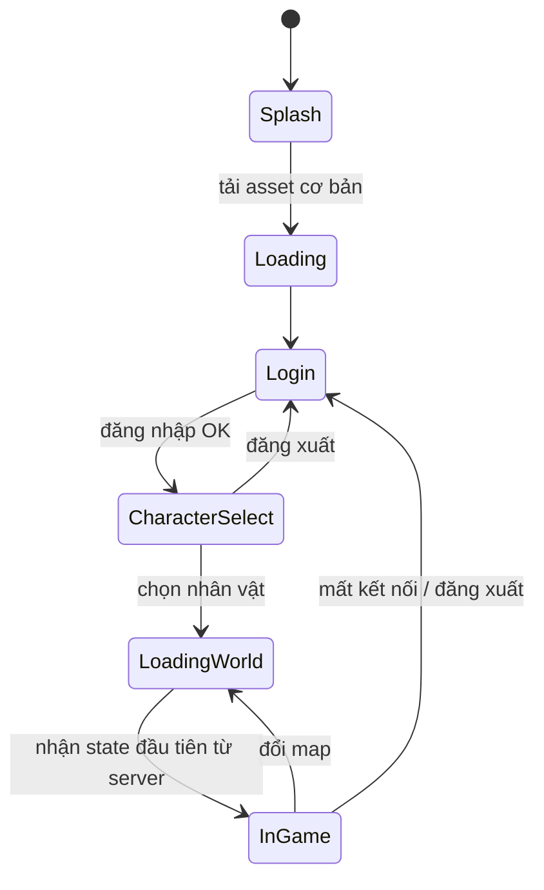
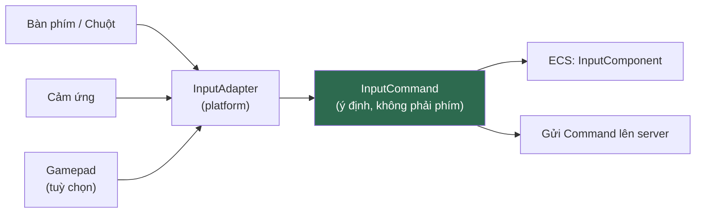
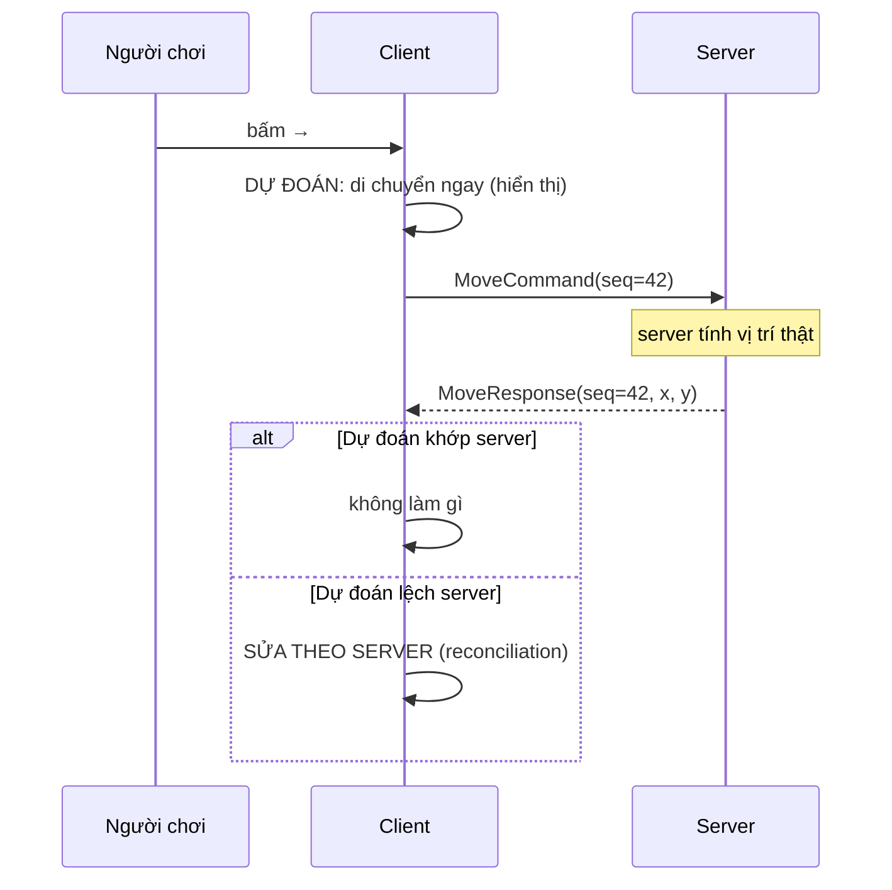

# CLIENT.md

**Kiến trúc Client**

| | |
|---|---|
| Version | 1.0.0 |
| Status | Draft |
| Liên quan | [ARCHITECTURE.md](../01-architecture/ARCHITECTURE.md), [ENGINE.md](../03-engine/ENGINE.md) |

> **Client chỉ hiển thị. Client không bao giờ quyết định gameplay** (Điều 15).
> Mọi thứ trong tài liệu này phải đọc dưới ánh sáng của câu đó.

---

## 1. Client làm gì và không làm gì

| ✅ Client LÀM | ❌ Client KHÔNG LÀM |
|---|---|
| Gửi **ý định** ("tôi muốn dùng skill") | Gửi **kết quả** ("tôi gây 500 damage") |
| Render state nhận từ server | Tự tính damage |
| Dự đoán cục bộ để mượt hình | Coi dự đoán là sự thật |
| Validate input để UX tốt (nút xám khi thiếu Khí) | **Tin** validate của mình |
| Phát nhạc, hiệu ứng | Quyết định item rơi ra |

**Validate ở client là để UX, không phải để bảo mật.** Server luôn validate lại — client validate chỉ để người chơi không phải chờ round-trip mới biết mình bấm sai.

---

## 2. Cấu trúc module

```
client-core/          ← 95% code ở đây, platform-agnostic
├── screen/           ← Loading, Login, CharacterSelect, Game
├── ecs/              ← Component + System đặc thù client (rendering, input, prediction)
├── net/              ← Kết nối, gửi/nhận packet
├── ui/               ← Scene2D (xem UI.md)
└── platform/         ← PlatformAdapter interface

client-desktop/       ← CHỈ launcher LWJGL3 + DesktopAdapter
client-android/       ← CHỈ launcher Android + AndroidAdapter
client-ios/           ← CHỈ launcher RoboVM (giai đoạn sau)
```

**Quy tắc**: `client-desktop/android/ios` **chỉ chứa launcher + adapter**. Bất kỳ dòng gameplay nào lọt vào đó = vi phạm Điều 28.

```java
// client-desktop — đúng phạm vi
public final class DesktopLauncher {
    public static void main(String[] args) {
        var config = new Lwjgl3ApplicationConfiguration();
        config.setTitle("Project Kage");
        config.setWindowedMode(1280, 720);
        new Lwjgl3Application(new KageGame(new DesktopPlatformAdapter()), config);
    }
}
```

---

## 3. Screen / State



**Quy tắc**:
- Mỗi Screen tự `dispose()` tài nguyên riêng của nó.
- Asset **dùng chung** (UI atlas, font) do `ResourceManager` giữ, không dispose theo Screen.
- **Không load asset trong `render()`** — dùng LoadingScreen.

---

## 4. Asset Loading

Chi tiết: [RESOURCE.md](RESOURCE.md). Ở mức client:

```
Splash          → load asset tối thiểu (logo, font, thanh loading)
Loading         → load UI atlas + asset dùng chung
LoadingWorld    → load atlas của zone sắp vào, unload atlas zone cũ
```

⚠️ **Không** load toàn bộ asset lúc khởi động — mobile không đủ RAM, và thời gian khởi động sẽ tệ.

---

## 5. Input



**Quy tắc quan trọng**: gameplay code **không biết phím nào được bấm**. Nó biết **ý định**:

```java
// ❌ Sai — gameplay biết phím cụ thể
if (Gdx.input.isKeyPressed(Keys.SPACE)) jump();

// ✅ Đúng — gameplay biết ý định
if (input.isPressed(GameAction.JUMP)) jump();
```

→ Đổi từ bàn phím sang cảm ứng = đổi ánh xạ, **không đụng gameplay** (Điều 28).

**Ánh xạ mặc định:**

| Action | Desktop | Mobile |
|---|---|---|
| MOVE_LEFT/RIGHT | A/D hoặc ←/→ | Joystick ảo |
| JUMP | Space | Nút |
| ATTACK | J hoặc chuột trái | Nút |
| SKILL_1..6 | 1–6 | Nút vòng |
| INVENTORY | I | Nút HUD |

⚠️ **Mobile input là quyết định thiết kế lớn chưa chốt** — joystick ảo? tap-to-move? Ảnh hưởng cả UI lẫn gameplay. Phụ thuộc câu hỏi "desktop-first hay mobile-first" ([GDD](../13-game-design/GAME-DESIGN-DOCUMENT.md)).

---

## 6. Client Prediction — và ranh giới của nó

Không dự đoán → mỗi lần bấm phím phải chờ round-trip (50–200ms) mới thấy nhân vật nhúc nhích. Không chấp nhận được.



**Chỉ dự đoán những thứ này:**

| ✅ Dự đoán được | ❌ KHÔNG dự đoán |
|---|---|
| Di chuyển của chính mình | Damage gây ra |
| Animation của chính mình | Item rơi |
| Hiệu ứng hình ảnh khi bấm skill | Trúng/trượt |
| | Vị trí người chơi khác (nội suy, không dự đoán) |
| | Bất cứ thứ gì ảnh hưởng state của người khác |

⚠️ **Quy tắc vàng**: dự đoán **chỉ** cho thứ mà sai cũng không ai bị thiệt. Dự đoán damage rồi server nói trượt = người chơi thấy số damage rồi mất → tệ hơn là chờ.

**Reconciliation**: server nói sai → **client sửa theo server ngay**, không tranh cãi (Điều 15). Nếu lệch nhỏ → lerp mượt. Lệch lớn (teleport, bị hack) → snap thẳng.

---

## 7. Entity Interpolation (người chơi khác)

Người chơi khác: **không dự đoán, chỉ nội suy**.

```
Server tick 60Hz, gửi snapshot có thể thấp hơn (VD 20–30Hz cho entity xa)
Client render ở 60–144 FPS
→ Nội suy giữa 2 snapshot gần nhất
→ Render CHẬM HƠN server ~100ms (interpolation buffer)
```

⚠️ **Đánh đổi phải biết**: interpolation buffer làm ta luôn nhìn thấy quá khứ ~100ms. Đây là chuẩn ngành (mọi game online đều vậy) và **tốt hơn** là nhìn thấy hiện tại nhưng giật.

---

## 8. Network Layer

```java
// client-core/net/
public final class GameConnection {
    private final Map<Integer, CompletableFuture<Response>> pending;  // theo sequenceId

    public CompletableFuture<Response> send(Command cmd) { ... }
    public void onEvent(Consumer<Event> handler) { ... }
}
```

**Quy tắc**:
- Network I/O chạy trên **thread riêng**, không block render thread.
- Packet nhận về đưa vào **queue**, xử lý ở đầu tick tiếp theo (không xử lý giữa render).
- Timeout mặc định 5s → coi là lỗi mạng.
- **Không tự retry Command có side-effect** (mua đồ, trade) khi chưa có idempotency ở server.

**Reconnect**: mất kết nối → thử kết nối lại với session cũ. Session còn hạn → vào lại đúng chỗ. Hết hạn → về Login.

---

## 9. Audio

| Loại | Xử lý |
|---|---|
| BGM | 1 track mỗi zone, crossfade khi đổi zone |
| SFX | Pool, giới hạn số âm thanh đồng thời |
| Voice | Không có ở MVP |

⚠️ **Android**: audio latency cao hơn desktop đáng kể. Không dựa vào âm thanh cho phản hồi cần chính xác thời gian.

**Giới hạn SFX đồng thời** là bắt buộc — 50 người chơi cùng dùng skill = 50 âm thanh cùng lúc = vỡ tiếng + tốn CPU.

---

## 10. Cấu hình client

| Loại | Ví dụ | Lưu ở đâu |
|---|---|---|
| Người chơi chỉnh | Âm lượng, keybind, độ phân giải | File local (qua `PlatformAdapter`) |
| Kỹ thuật | Server address, timeout | Config file đóng gói |
| **Không bao giờ** | Tỉ lệ drop, damage, cooldown | **Server** — client không được biết/sửa |

⚠️ Bất cứ giá trị gameplay nào nằm ở client = có thể sửa = hack. Client **có thể** nhận bản sao để hiển thị (VD: hiện cooldown), nhưng server luôn là nguồn chân lý.

---

## 11. Platform Adapter

Điều 28. Thứ **phải** qua adapter:

| Việc | Vì sao khác nhau |
|---|---|
| Đường dẫn lưu file | Desktop: thư mục user. Android: internal storage |
| Vòng đời app | Android có pause/resume/destroy; desktop không |
| Input type | Bàn phím vs cảm ứng |
| DPI / độ phân giải | Rất khác nhau |
| Thoát app | Desktop có nút X; Android có nút Back |
| Mở URL | Khác API |

```java
public interface PlatformAdapter {
    Path savePath();
    InputType inputType();
    float uiScale();
    void openUrl(String url);
    void vibrate(int millis);      // Android có, desktop no-op
}
```

**Cấm** trong `client-core`: `Gdx.app.getType() == ApplicationType.Android`.

---

## 12. Ngân sách hiệu năng client

| Mục tiêu | Desktop | Android |
|---|---|---|
| FPS | 60 ổn định | 30 ổn định (60 nếu máy cho phép) |
| Frame time | ≤ 16.6ms | ≤ 33ms |
| Draw call | ≤ 100/frame | ≤ 50/frame |
| RAM | ≤ 1GB | ≤ 400MB |
| Thời gian khởi động | ≤ 5s | ≤ 8s |

⚠️ **Đây là mục tiêu đề xuất, chưa verify.** Phải đo thật ở Phase 3 và điều chỉnh — không coi số này là sự thật ([AI-WORKING-RULES.md §14](../00-governance/AI-WORKING-RULES.md)).

---

## Technical Decisions

| # | Quyết định | Lý do | Trạng thái |
|---|---|---|---|
| 1 | `client-desktop/android/ios` **chỉ** chứa launcher + adapter | Điều 28 | Accepted |
| 2 | Gameplay biết **ý định** (`GameAction`), không biết phím | Đổi input không đụng gameplay | Accepted |
| 3 | **Dự đoán chỉ cho di chuyển/animation của chính mình** | Dự đoán damage rồi sai = UX tệ hơn chờ | Accepted |
| 4 | Người chơi khác: **nội suy**, không dự đoán | Chuẩn ngành | Accepted |
| 5 | Interpolation buffer ~100ms — chấp nhận nhìn quá khứ | Đổi lấy hình mượt | Accepted |
| 6 | Network I/O **thread riêng**, packet xử lý ở đầu tick | Không block render | Accepted |
| 7 | **Không tự retry Command có side-effect** | Tránh mua đồ 2 lần | Accepted |
| 8 | Giá trị gameplay **không** lưu ở client | Điều 15 — sửa được = hack | Accepted |
| 9 | Giới hạn SFX đồng thời | Tránh vỡ tiếng khi đông người | Accepted |
| 10 | **Mobile input scheme chưa chốt** | Quyết định thiết kế lớn | ⏳ Chờ |
| 11 | Ngân sách §12 **chưa verify** | Phải đo thật ở Phase 3 | ⏳ Tạm thời |

## ADR cần tạo

| ADR | Nội dung | Ưu tiên |
|---|---|---|
| **ADR-023** | **Mobile input scheme** (joystick ảo / tap-to-move / D-pad) — ảnh hưởng cả UI lẫn gameplay | 🟡 Chặn Phase 2 nếu mobile-first |
| **ADR-020** | Viewport strategy — [RENDERING.md §3](../03-engine/RENDERING.md) | 🟡 Chặn Phase 1 |

## Tài liệu liên quan

- [UI.md](UI.md) — Scene2D, HUD, i18n
- [RESOURCE.md](RESOURCE.md) — asset loading, patch
- [RENDERING.md](../03-engine/RENDERING.md) — pipeline render
- [NETWORK.md](../05-server/NETWORK.md) — protocol chi tiết
- [ENGINE.md](../03-engine/ENGINE.md) — fixed timestep, PlatformAdapter

## Việc cần làm tiếp theo

1. Chốt **desktop-first hay mobile-first** — đang chặn ADR-023 và ảnh hưởng toàn bộ §5, §12.
2. Phase 1: xác lập §5 (input abstraction) và §11 (PlatformAdapter) ngay — nhét `if (Android)` vào gameplay là thứ rất khó gỡ sau.
3. Phase 3: **đo thật** §12 trên thiết bị Android tầm trung, cập nhật lại số liệu.
