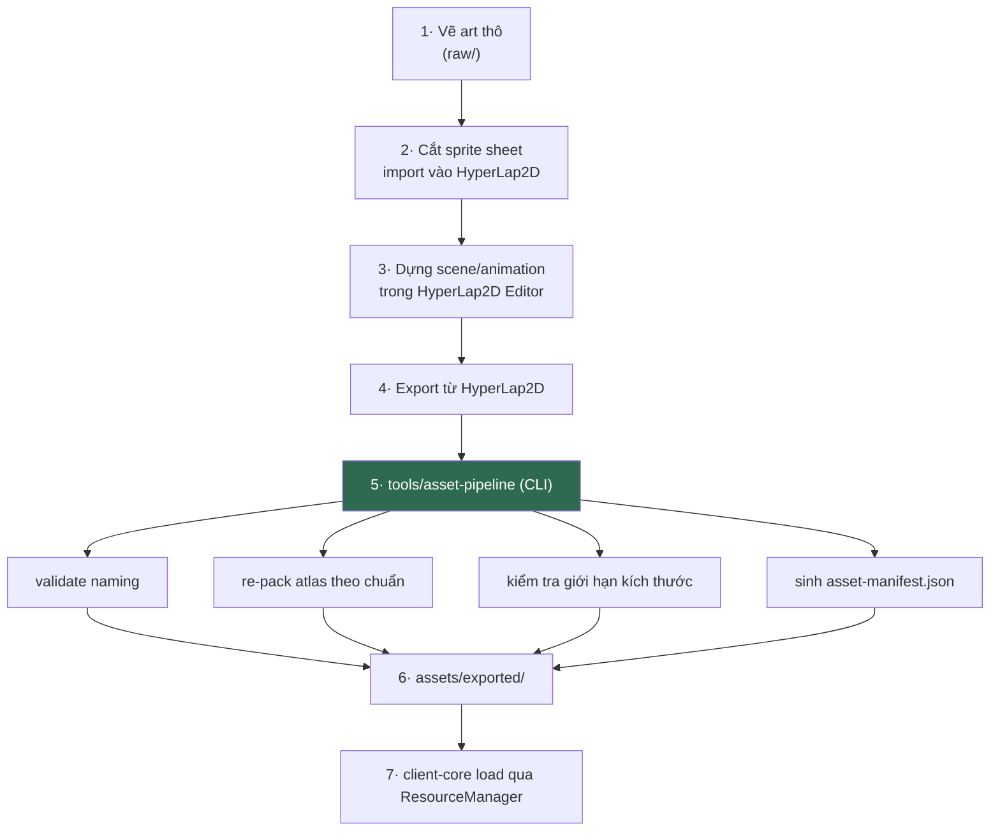

# RESOURCE.md

**Asset pipeline, quản lý tài nguyên, patch**

| | |
|---|---|
| Version | 1.0.0 |
| Status | Draft |
| Liên quan | [CLIENT.md](CLIENT.md), [RENDERING.md](../03-engine/RENDERING.md), [ADR-002](../01-architecture/adr/ADR-002-Why-libGDX.md) |

---

## 1. Vai trò của HyperLap2D

HyperLap2D là **editor độc lập** (không phải thư viện Gradle), xuất project mà runtime `h2d-common` đọc được trong libGDX.

| ✅ Dùng cho | ❌ Không dùng cho |
|---|---|
| Bố cục màn chơi (composite, parallax) | Logic gameplay |
| Sắp xếp animation frame-based | Hitbox chiến đấu (đó là gameplay — [PHYSICS.md §1](../03-engine/PHYSICS.md)) |
| Particle đơn giản, light layer | UI HUD (dùng Scene2D — [UI.md](UI.md)) |
| Đánh dấu vùng: spawn point, trigger zone, jump link | AI |

**Ranh giới**: HyperLap2D nói *cái gì ở đâu, trông thế nào*. Code nói *nó làm gì*.

---

## 2. Cấu trúc thư mục

```
assets/
├── hyperlap2d-projects/       # Project gốc (.dt) — KHÔNG đóng gói vào game
│   ├── academy-hub/
│   └── faction-fire-zone/
├── raw/                       # Art nguồn (PSD/AI/SVG) — KHÔNG đóng gói vào game
│   ├── characters/
│   ├── environment/
│   └── ui/
└── exported/                  # Runtime asset — ĐƯỢC đóng gói
    ├── atlases/
    ├── animations/
    ├── maps/
    ├── audio/
    ├── fonts/
    └── asset-manifest.json
```

⚠️ **`hyperlap2d-projects/` và `raw/` phải bị loại khỏi bản build** (Gradle resource filter). Nếu không, bản game sẽ chứa file PSD hàng trăm MB.

---

## 3. Workflow



Bước 5 (`tools/asset-pipeline`) chạy **build-time/dev-time**, không nằm trong game.

---

## 4. Naming Convention

| Loại | Convention | Ví dụ |
|---|---|---|
| Sprite | `<category>_<name>_<variant>.png` | `char_ninja-fire_idle.png` |
| Animation | `<entity>_<action>.anim` | `ninja-fire_attack-01.anim` |
| Atlas | `<zone-or-feature>.atlas` | `faction-fire-zone.atlas` |
| Map | `<zone>.h2d` | `academy-hub.h2d` |
| SFX | `sfx_<name>.ogg` | `sfx_skill-fireball.ogg` |
| BGM | `bgm_<zone>.ogg` | `bgm_academy-hub.ogg` |

**Cấm**: khoảng trắng · tiếng Việt có dấu · chữ hoa (một số filesystem phân biệt hoa/thường, một số không → lỗi chỉ xuất hiện trên Linux/CI).

---

## 5. Texture Atlas

| Quy tắc | Vì sao |
|---|---|
| **1 atlas / 1 zone** | Giới hạn texture switch trong zone; unload được khi rời zone |
| **UI atlas tách riêng** | UI luôn resident, gameplay atlas thay đổi |
| **Tối đa 2048×2048** | An toàn cho Android tầm trung |
| Không pack toàn game vào 1 atlas | Load thừa asset không dùng (Điều 32) |

⚠️ **Giới hạn 2048 là ràng buộc thật của phần cứng**, không phải sở thích. Một số GPU Android cũ chỉ hỗ trợ tối đa 2048. Vượt ngưỡng = texture không load được, màn hình đen — **và chỉ phát hiện trên thiết bị thật**, không phát hiện trên desktop.

**Ép kiểu nén**: cân nhắc ETC2 (Android) — nhưng chỉ khi đo thấy RAM là vấn đề. MVP dùng PNG.

---

## 6. Audio

| Loại | Format | Vì sao |
|---|---|---|
| SFX ngắn | `.ogg` | Nén tốt, libGDX hỗ trợ mọi nền tảng |
| BGM dài | `.ogg` streaming | Không load hết vào RAM |

⚠️ **Không dùng `.mp3`** — vấn đề license lịch sử + libGDX hỗ trợ không đồng đều giữa nền tảng.

---

## 7. Font

- Dùng **`gdx-freetype`** sinh font runtime từ `.ttf`, **không** dùng bitmap font tĩnh.
- **Vì sao**: bitmap font phải sinh sẵn cho mỗi cỡ chữ; FreeType sinh theo cỡ cần → hỗ trợ `uiScale` ([UI.md §6](UI.md)).

⚠️ **Tiếng Việt**: font `.ttf` **phải chứa đủ glyph tiếng Việt có dấu** (ế, ộ, ữ...). Nhiều font miễn phí thiếu. **Test ở Phase 1**, không để tới cuối.

⚠️ **Chưa chốt**: license font. Font dùng trong game thương mại cần license thương mại. Phải kiểm tra trước khi chốt font.

---

## 8. Resource Manager

Bọc `AssetManager` của libGDX ([ENGINE.md §7](../03-engine/ENGINE.md)), thêm:

```java
public interface ResourceManager {
    void loadZone(String zoneId);        // load atlas + map + audio của zone
    void unloadZone(String zoneId);      // giải phóng
    boolean isLoaded(String zoneId);
    float progress();                     // cho LoadingScreen
    <T> T get(String path, Class<T> type);
}
```

**Quy tắc**:
- **Không load asset trong game loop** (Điều 31) — dùng LoadingScreen.
- Asset dùng chung (UI atlas, font) load một lần, **không** unload theo zone.
- Zone cũ unload **sau khi** zone mới load xong (tránh màn hình trắng).

⚠️ **Cạm bẫy**: unload atlas khi vẫn còn `Sprite` tham chiếu tới texture trong đó → texture bị dispose → hiển thị texture trắng/rác. Phải đảm bảo mọi entity của zone cũ đã bị huỷ trước khi unload.

---

## 9. Asset Versioning & Manifest

Điều 40 — asset có version riêng, tách biệt code.

```json
{
  "assetVersion": 42,
  "generatedAt": "2026-07-16T10:00:00Z",
  "entries": [
    { "path": "atlases/academy-hub.atlas", "hash": "sha256:abc...", "size": 1048576 },
    { "path": "atlases/academy-hub.png",   "hash": "sha256:def...", "size": 4194304 }
  ]
}
```

**Dùng để**:
- Client biết cần tải lại asset nào (patch không cần build lại client).
- Phát hiện asset hỏng (hash không khớp).
- Rollback: giữ tối thiểu **1 version trước**.

---

## 10. Patch & CDN

⚠️ **Đây là phần chưa chốt và không thuộc MVP.**

| Câu hỏi chưa trả lời | Ảnh hưởng |
|---|---|
| Asset đóng gói trong bản cài hay tải về sau? | Kích thước bản cài; thời gian chờ lần đầu |
| Có CDN không? Ai trả tiền? | Chi phí vận hành |
| Patch từng file hay tải nguyên atlas? | Băng thông |
| Android: asset trong APK hay OBB/Play Asset Delivery? | Giới hạn 150MB của Google Play |

**MVP**: đóng gói toàn bộ asset trong bản build. Đơn giản nhất (Điều 9).

**Sau MVP**: xem [LAUNCHER.md](../12-devtools/LAUNCHER.md) (stub) — cần ADR khi tới lúc.

---

## 11. Automation

Điều 41. Pipeline §3 phải chạy được:

| Môi trường | Cách |
|---|---|
| Dev local | `./gradlew packAssets` |
| CI | Tự động khi `assets/hyperlap2d-projects/` hoặc `assets/raw/` thay đổi |

**CI phải FAIL nếu:**
- Naming convention (§4) vi phạm.
- Atlas vượt 2048×2048 (§5).
- File audio không phải `.ogg` (§6).
- Asset được tham chiếu trong map nhưng không tồn tại.

**Vì sao bắt buộc tự động**: "nhớ export lại rồi copy tay" là nguồn lỗi phổ biến nhất của asset pipeline. Ai đó quên export → build thiếu asset → phát hiện lúc chạy, không lúc build.

---

## 12. Rủi ro HyperLap2D

Trung thực về rủi ro:

| Rủi ro | Mức độ | Giảm thiểu |
|---|---|---|
| Dự án nhỏ, ít người bảo trì | 🔴 Cao | Giữ `tools/asset-pipeline` như một lớp đệm — đổi editor chỉ đụng bước 4→5 |
| Không tương thích libGDX version mới | 🟡 Trung bình | Không nâng libGDX vội; test trước |
| Format `.dt` độc quyền | 🟡 Trung bình | Asset gốc (`raw/`) vẫn là PSD/PNG — mất HyperLap2D không mất art |

**Nếu HyperLap2D chết**: thay bằng **Tiled** (map editor phổ biến, format TMX mở) hoặc editor tự viết. Chi phí: viết lại bước 4→5 + chuyển đổi map hiện có. **Không** mất art gốc.

---

## Technical Decisions

| # | Quyết định | Lý do | Trạng thái |
|---|---|---|---|
| 1 | `hyperlap2d-projects/` và `raw/` **không** đóng gói vào build | Kích thước bản game | Accepted |
| 2 | 1 atlas / 1 zone; UI atlas riêng | Texture switch + vòng đời | Accepted |
| 3 | **Atlas tối đa 2048×2048** | Ràng buộc phần cứng Android | Accepted |
| 4 | Audio `.ogg`, không `.mp3` | License + hỗ trợ đồng đều | Accepted |
| 5 | Font qua **FreeType**, không bitmap font | Hỗ trợ uiScale | Accepted |
| 6 | Tên file: không dấu, không hoa, không space | Lỗi cross-platform | Accepted |
| 7 | Unload zone cũ **sau khi** zone mới load xong | Tránh màn hình trắng | Accepted |
| 8 | **MVP: đóng gói toàn bộ asset**, không patch/CDN | Điều 9 | Accepted |
| 9 | `tools/asset-pipeline` là lớp đệm để thay editor được | Giảm rủi ro HyperLap2D | Accepted |
| 10 | CI **fail** nếu vi phạm §4, §5, §6 | Điều 41 — máy kiểm, không dựa vào người nhớ | Accepted |
| 11 | **License font chưa kiểm tra** | Cần trước khi chốt font | ⏳ **Rủi ro pháp lý** |

## ADR cần tạo

| ADR | Nội dung | Ưu tiên |
|---|---|---|
| **ADR-024** | Chiến lược phát hành asset: đóng gói / patch / CDN / Play Asset Delivery (§10) | 🟢 Chặn Phase 10 |

## Tài liệu liên quan

- [RENDERING.md](../03-engine/RENDERING.md) — atlas, animation dùng thế nào
- [UI.md](UI.md) — UI atlas, font scale
- [CLIENT.md](CLIENT.md) — loading screen
- [ENGINE.md §7](../03-engine/ENGINE.md) — ResourceManager
- [LAUNCHER.md](../12-devtools/LAUNCHER.md) — patch (stub)

## Việc cần làm tiếp theo

1. 🔴 **Kiểm tra license font trước khi chốt** (§7) — rủi ro pháp lý, không phải kỹ thuật.
2. **Phase 1: test glyph tiếng Việt** trên font đã chọn.
3. **Phase 1: test atlas 2048 trên thiết bị Android thật** — không tin desktop.
4. Phase 0: dựng `tools/asset-pipeline` với validate §11 ngay từ đầu.
