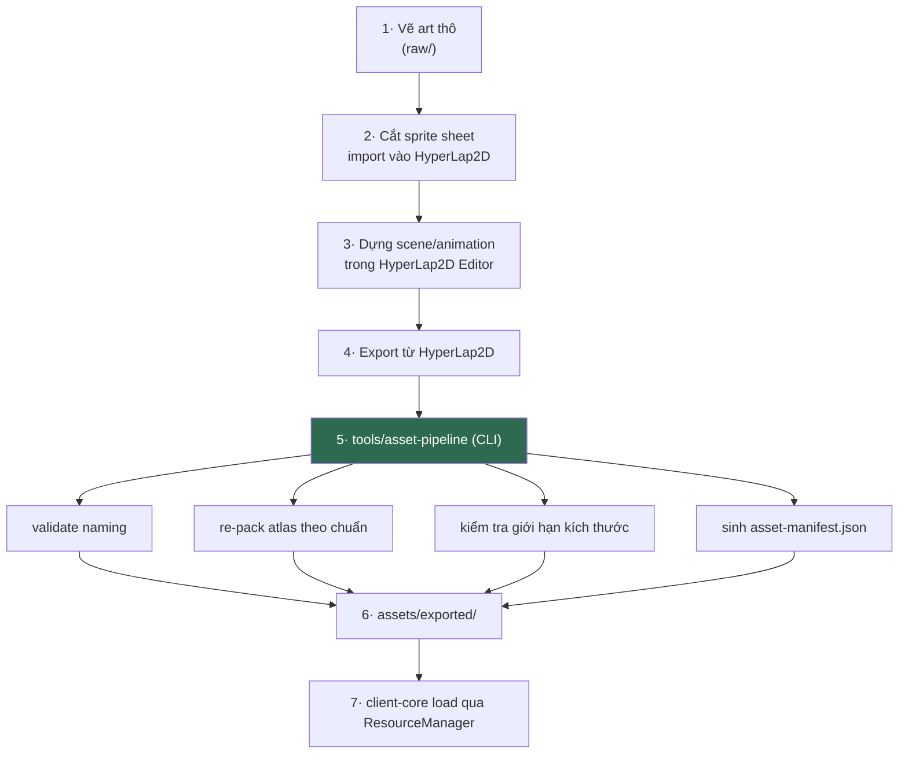

# RESOURCE.md

**Asset pipeline, quản lý tài nguyên, patch**

| | |
|---|---|
| Version | 1.0.0 |
| Status | Draft |
| Liên quan | [CLIENT.md](CLIENT.md), [RENDERING.md](../03-engine/RENDERING.md), [ADR-002](../01-architecture/adr/ADR-002-Why-libGDX.md) |

---

## 1. Vai trò của HyperLap2D

HyperLap2D là **editor độc lập** (không phải thư viện Gradle), xuất project mà runtime `h2d-common` đọc được trong libGDX.

| ✅ Dùng cho | ❌ Không dùng cho |
|---|---|
| Bố cục màn chơi (composite, parallax) | Logic gameplay |
| Sắp xếp animation frame-based | Hitbox chiến đấu (đó là gameplay — [PHYSICS.md §1](../03-engine/PHYSICS.md)) |
| Particle đơn giản, light layer | UI HUD (dùng Scene2D — [UI.md](UI.md)) |
| Đánh dấu vùng: spawn point, trigger zone, jump link | AI |

**Ranh giới**: HyperLap2D nói *cái gì ở đâu, trông thế nào*. Code nói *nó làm gì*.

---

## 2. Cấu trúc thư mục

```
assets/
├── hyperlap2d-projects/       # Project gốc (.dt) — KHÔNG đóng gói vào game
│   ├── academy-hub/
│   └── faction-fire-zone/
├── raw/                       # Art nguồn (PSD/AI/SVG) — KHÔNG đóng gói vào game
│   ├── characters/
│   ├── environment/
│   └── ui/
└── exported/                  # Runtime asset — ĐƯỢC đóng gói
    ├── atlases/
    ├── animations/
    ├── maps/
    ├── audio/
    ├── fonts/
    └── asset-manifest.json
```

⚠️ **`hyperlap2d-projects/` và `raw/` phải bị loại khỏi bản build** (Gradle resource filter). Nếu không, bản game sẽ chứa file PSD hàng trăm MB.

---

## 3. Workflow



Bước 5 (`tools/asset-pipeline`) chạy **build-time/dev-time**, không nằm trong game.

Bước 1–2 (art thô → sprite sheet) được sản xuất bằng Blender pre-render qua AI — xem [ART-PIPELINE.md](../14-art/ART-PIPELINE.md).

⚠️ **Từ [ADR-031](../01-architecture/adr/ADR-031-25D-Realtime-3D-Rendering.md) (Accepted 2026-08-03), luồng này chỉ còn cho VFX kỹ năng · icon · UI.** Nhân vật · quái · NPC **không đi qua sprite sheet nữa**: chúng xuất glTF từ Blender và client render 3D thời gian thực. Chúng vẫn dùng chung cơ chế 3 tier và `ensureAssetsAvailable(tier)` ở §9 — chỉ khác nội dung tier là **model LOD + cỡ texture** thay vì độ phân giải atlas.

---

## 4. Naming Convention

| Loại | Convention | Ví dụ |
|---|---|---|
| Sprite | `<category>_<name>_<variant>.png` | `char_ninja-fire_idle.png` |
| Animation | `<entity>_<action>.anim` | `ninja-fire_attack-01.anim` |
| Atlas | `<zone-or-feature>.atlas` | `faction-fire-zone.atlas` |
| Map | `<zone>.h2d` | `academy-hub.h2d` |
| SFX | `sfx_<name>.ogg` | `sfx_skill-fireball.ogg` |
| BGM | `bgm_<zone>.ogg` | `bgm_academy-hub.ogg` |

**Cấm**: khoảng trắng · tiếng Việt có dấu · chữ hoa (một số filesystem phân biệt hoa/thường, một số không → lỗi chỉ xuất hiện trên Linux/CI).

---

## 5. Texture Atlas

| Quy tắc | Vì sao |
|---|---|
| **1 atlas / 1 zone** | Giới hạn texture switch trong zone; unload được khi rời zone |
| **UI atlas tách riêng** | UI luôn resident, gameplay atlas thay đổi |
| **Tối đa 2048×2048** | An toàn cho Android tầm trung |
| Không pack toàn game vào 1 atlas | Load thừa asset không dùng (Điều 32) |

⚠️ **Giới hạn 2048 là ràng buộc thật của phần cứng**, không phải sở thích. Một số GPU Android cũ chỉ hỗ trợ tối đa 2048. Vượt ngưỡng = texture không load được, màn hình đen — **và chỉ phát hiện trên thiết bị thật**, không phát hiện trên desktop.

**Ép kiểu nén**: cân nhắc ETC2 (Android) — nhưng chỉ khi đo thấy RAM là vấn đề. MVP dùng PNG.

---

## 6. Audio

| Loại | Format | Vì sao |
|---|---|---|
| SFX ngắn | `.ogg` | Nén tốt, libGDX hỗ trợ mọi nền tảng |
| BGM dài | `.ogg` streaming | Không load hết vào RAM |

⚠️ **Không dùng `.mp3`** — vấn đề license lịch sử + libGDX hỗ trợ không đồng đều giữa nền tảng.

---

## 7. Font

- Dùng **`gdx-freetype`** sinh font runtime từ `.ttf`, **không** dùng bitmap font tĩnh.
- **Vì sao**: bitmap font phải sinh sẵn cho mỗi cỡ chữ; FreeType sinh theo cỡ cần → hỗ trợ `uiScale` ([UI.md §6](UI.md)).

⚠️ **Tiếng Việt**: font `.ttf` **phải chứa đủ glyph tiếng Việt có dấu** (ế, ộ, ữ...). Nhiều font miễn phí thiếu. **Test ở Phase 1**, không để tới cuối.

✅ **Font đã chọn (đề xuất phiên làm việc 2026-08-02, chủ dự án có thể đổi)**: **Be Vietnam Pro**,
weight Regular, bundle tại `assets/raw/fonts/BeVietnamPro-Regular.ttf` (kèm `OFL.txt` cạnh đó).

| Tiêu chí | Kết quả kiểm chứng |
|---|---|
| Coverage tiếng Việt | Thiết kế **riêng cho tiếng Việt** bởi Lâm Bảo, Tony Le, ViệtAnh Nguyễn; `METADATA.pb` chính thức của Google Fonts (`google/fonts` repo, `ofl/bevietnampro/METADATA.pb`) khai subset `latin`, `latin-ext`, **`vietnamese`**, `menu`. Kiểm chứng lại bằng test tự động (§ dưới) — không chỉ tin metadata: `FreeTypeFontGenerator.hasGlyph()` tra cmap thật của chính file `.ttf` đã tải, PASS cho toàn bộ ký tự trong `FontFactory.VIETNAMESE_CHARACTERS` (6 thanh điệu × nguyên âm/phụ âm riêng tiếng Việt). |
| License | **SIL Open Font License (OFL) 1.1** — lấy nguyên văn từ nguồn gốc `raw.githubusercontent.com/google/fonts/main/ofl/bevietnampro/OFL.txt` (không qua bên thứ ba tóm tắt). Cho phép dùng/sửa/nhúng/phân phối lại kể cả trong sản phẩm thương mại; chỉ cấm bán riêng lẻ chính font đó và bắt buộc bản phái sinh giữ nguyên license. → dùng được cho game thương mại, không cần license trả phí riêng. |

**Rủi ro pháp lý (§Technical Decisions #11 cũ) coi như đã đóng** với lựa chọn này — vẫn là đề xuất
của phiên làm việc này (Điều 1: AI đề xuất, con người quyết định), không phải khoá cứng kiến trúc;
đổi font khác (VD Noto Sans, Inter — cũng OFL, cũng đủ coverage Latin Extended Additional) chỉ tốn
công tải lại file + chạy lại test, không đụng kiến trúc.

**Wiring thật** (không chỉ chọn — đã kích hoạt `gdx-freetype`/`gdx-freetype-platform` vốn nằm sẵn
trong `libs.versions.toml` nhưng chưa từng dùng tới):
- `client-core`: `api(libs.gdx.freetype)` — API thuần Java, không kéo native.
- `client-desktop`: `implementation(variantOf(libs.gdx.freetype.platform) { classifier("natives-desktop") })` — cùng pattern `gdx-platform natives-desktop` đã có.
- `dev.kage.client.core.render.FontFactory` — bọc `FreeTypeFontGenerator` tối thiểu: `generate(FileHandle, sizePx)` sinh `BitmapFont` thật (cần GL, dùng lúc chạy game); `hasGlyph(FileHandle, codePoint)` tra cmap FreeType KHÔNG cần GL (dùng để test coverage headless). CHƯA tích hợp `AssetManager`/cache — chưa có màn hình UI nào tiêu thụ (ngoài phạm vi việc này).
- Test: `FontFactoryVietnameseGlyphTest` (`client-core`) — assert `hasGlyph()` cho từng code point của câu mẫu đủ 6 thanh điệu VÀ toàn bộ `FontFactory.VIETNAMESE_CHARACTERS`, dùng thẳng file `.ttf` đã bundle. Không cần GL context nên chạy được trên CI (`ubuntu-latest`, không Xvfb) — khác với việc render thật ra màn hình (chưa test, vì chưa có UI consumer).

---

## 8. Resource Manager

Bọc `AssetManager` của libGDX ([ENGINE.md §7](../03-engine/ENGINE.md)), thêm:

```java
public interface ResourceManager {
    void loadZone(String zoneId);        // load atlas + map + audio của zone
    void unloadZone(String zoneId);      // giải phóng
    boolean isLoaded(String zoneId);
    float progress();                     // cho LoadingScreen
    <T> T get(String path, Class<T> type);
}
```

**Quy tắc**:
- **Không load asset trong game loop** (Điều 31) — dùng LoadingScreen.
- Asset dùng chung (UI atlas, font) load một lần, **không** unload theo zone.
- Zone cũ unload **sau khi** zone mới load xong (tránh màn hình trắng).

⚠️ **Cạm bẫy**: unload atlas khi vẫn còn `Sprite` tham chiếu tới texture trong đó → texture bị dispose → hiển thị texture trắng/rác. Phải đảm bảo mọi entity của zone cũ đã bị huỷ trước khi unload.

---

## 9. Asset Versioning & Manifest

Điều 40 — asset có version riêng, tách biệt code.

```json
{
  "assetVersion": 42,
  "generatedAt": "2026-07-16T10:00:00Z",
  "entries": [
    { "path": "atlases/academy-hub.atlas", "hash": "sha256:abc...", "size": 1048576 },
    { "path": "atlases/academy-hub.png",   "hash": "sha256:def...", "size": 4194304 }
  ]
}
```

**Dùng để**:
- Client biết cần tải lại asset nào (patch không cần build lại client).
- Phát hiện asset hỏng (hash không khớp).
- Rollback: giữ tối thiểu **1 version trước**.

---

## 10. Patch & CDN

✅ **[ADR-024](../01-architecture/adr/ADR-024-Asset-Distribution-Strategy.md) đề xuất 2026-08-01**
(Status: Proposed, chờ chủ dự án chốt): đóng gói toàn bộ asset trong bản build cho suốt Closed Beta
Desktop, hoãn patch/CDN/Play Asset Delivery tới khi có Revisit Trigger cụ thể (Android được chốt là
target thật, hoặc dung lượng asset thật đo được vượt ngưỡng gây trải nghiệm tệ). Lý do hoãn: repo hiện
chưa có `assets/` thật nào để đo, và Android chưa phải target đã chốt — quyết định CDN/OBB/Play Asset
Delivery trước khi có 2 dữ kiện đó sẽ chỉ là đoán (Điều 30).

| Câu hỏi (xem ADR-024 để biết vì sao hoãn) | Ảnh hưởng |
|---|---|
| Asset đóng gói trong bản cài hay tải về sau? | Kích thước bản cài; thời gian chờ lần đầu |
| Có CDN không? Ai trả tiền? | Chi phí vận hành |
| Patch từng file hay tải nguyên atlas? | Băng thông |
| Android: asset trong APK hay OBB/Play Asset Delivery? | Giới hạn 150MB của Google Play |

**Closed Beta (hiện tại)**: đóng gói toàn bộ asset trong bản build. Đơn giản nhất (Điều 9).

**Sau khi chạm Revisit Trigger của ADR-024**: xem [LAUNCHER.md](../12-devtools/LAUNCHER.md) (stub).

---

## 11. Automation

Điều 41. Pipeline §3 phải chạy được:

| Môi trường | Cách |
|---|---|
| Dev local | `./gradlew packAssets` |
| CI | Tự động khi `assets/hyperlap2d-projects/` hoặc `assets/raw/` thay đổi |

**CI phải FAIL nếu:**
- Naming convention (§4) vi phạm.
- Atlas vượt 2048×2048 (§5).
- File audio không phải `.ogg` (§6).
- Asset được tham chiếu trong map nhưng không tồn tại.

**Vì sao bắt buộc tự động**: "nhớ export lại rồi copy tay" là nguồn lỗi phổ biến nhất của asset pipeline. Ai đó quên export → build thiếu asset → phát hiện lúc chạy, không lúc build.

---

## 12. Rủi ro HyperLap2D

Trung thực về rủi ro:

| Rủi ro | Mức độ | Giảm thiểu |
|---|---|---|
| Dự án nhỏ, ít người bảo trì | 🔴 Cao | Giữ `tools/asset-pipeline` như một lớp đệm — đổi editor chỉ đụng bước 4→5 |
| Không tương thích libGDX version mới | 🟡 Trung bình | Không nâng libGDX vội; test trước |
| Format `.dt` độc quyền | 🟡 Trung bình | Asset gốc (`raw/`) vẫn là PSD/PNG — mất HyperLap2D không mất art |

**Nếu HyperLap2D chết**: thay bằng **Tiled** (map editor phổ biến, format TMX mở) hoặc editor tự viết. Chi phí: viết lại bước 4→5 + chuyển đổi map hiện có. **Không** mất art gốc.

---

## Technical Decisions

| # | Quyết định | Lý do | Trạng thái |
|---|---|---|---|
| 1 | `hyperlap2d-projects/` và `raw/` **không** đóng gói vào build | Kích thước bản game | Accepted |
| 2 | 1 atlas / 1 zone; UI atlas riêng | Texture switch + vòng đời | Accepted |
| 3 | **Atlas tối đa 2048×2048** | Ràng buộc phần cứng Android | Accepted |
| 4 | Audio `.ogg`, không `.mp3` | License + hỗ trợ đồng đều | Accepted |
| 5 | Font qua **FreeType**, không bitmap font | Hỗ trợ uiScale | Accepted |
| 6 | Tên file: không dấu, không hoa, không space | Lỗi cross-platform | Accepted |
| 7 | Unload zone cũ **sau khi** zone mới load xong | Tránh màn hình trắng | Accepted |
| 8 | **Đóng gói toàn bộ asset**, không patch/CDN, cho Closed Beta | Điều 9; chính thức hoá ở [ADR-024](../01-architecture/adr/ADR-024-Asset-Distribution-Strategy.md) | ⏳ Proposed (ADR-024) |
| 9 | `tools/asset-pipeline` là lớp đệm để thay editor được | Giảm rủi ro HyperLap2D | Accepted |
| 10 | CI **fail** nếu vi phạm §4, §5, §6 | Điều 41 — máy kiểm, không dựa vào người nhớ | Accepted |
| 11 | Font **Be Vietnam Pro** (OFL 1.1), bundle `assets/raw/fonts/BeVietnamPro-Regular.ttf` | Coverage tiếng Việt + license thương mại đã kiểm chứng tại nguồn (§7) | ✅ Đề xuất phiên 2026-08-02, chờ chủ dự án xác nhận |

## ADR cần tạo

✅ **ADR-024 đã viết** (2026-08-01, Status: Proposed) — xem §10 và
[ADR-024](../01-architecture/adr/ADR-024-Asset-Distribution-Strategy.md). Không còn nằm trong danh
sách "cần tạo" — chờ chủ dự án Accept, không phải chờ viết.

## Tài liệu liên quan

- [RENDERING.md](../03-engine/RENDERING.md) — atlas, animation dùng thế nào
- [UI.md](UI.md) — UI atlas, font scale
- [CLIENT.md](CLIENT.md) — loading screen
- [ENGINE.md §7](../03-engine/ENGINE.md) — ResourceManager
- [LAUNCHER.md](../12-devtools/LAUNCHER.md) — patch (stub)

## Việc cần làm tiếp theo

1. ✅ ~~Kiểm tra license font trước khi chốt~~ (§7) — Be Vietnam Pro (OFL 1.1) đã kiểm chứng tại nguồn 2026-08-02, chờ chủ dự án xác nhận cuối.
2. ✅ ~~Phase 1: test glyph tiếng Việt~~ — `FontFactoryVietnameseGlyphTest` (client-core), PASS 2026-08-02.
3. **Phase 1: test atlas 2048 trên thiết bị Android thật** — không tin desktop.
4. Phase 0: dựng `tools/asset-pipeline` với validate §11 ngay từ đầu.
5. Chưa có màn hình UI nào tiêu thụ `FontFactory` — khi có (Login/HUD...), quyết định lúc đó có cần cache font theo `ResourceManager` (§8) hay không, đừng xây trước khi có consumer thật.
