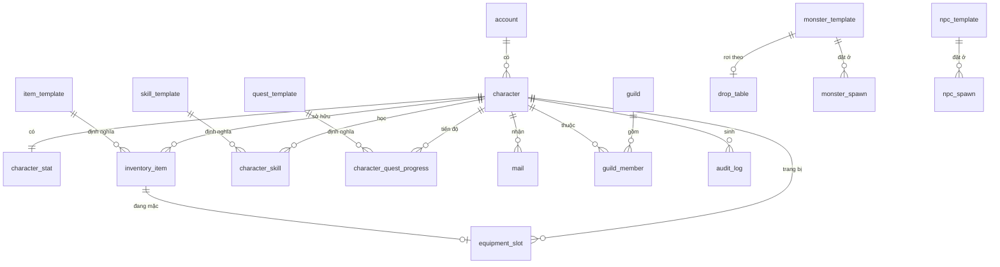

# DATABASE.md

**Schema, truy cập dữ liệu, cache**

| | |
|---|---|
| Version | 1.2.0 |
| Status | Draft |
| Liên quan | [ADR-004](../01-architecture/adr/ADR-004-Why-PostgreSQL.md), [ADR-005](../01-architecture/adr/ADR-005-Why-Redis.md) |

> Tài liệu này mô tả schema ở mức **khái niệm (ERD-level)**, không phải migration script thật.
> Migration thật nằm trong `server-database`, chạy qua Flyway ([ADR-013](../01-architecture/adr/ADR-013-Flyway-vs-Liquibase.md) ✅ Accepted), có version + rollback (Điều 40).

---

## 1. Nguyên tắc

| Nguyên tắc | Chi tiết |
|---|---|
| **PostgreSQL là source of truth** | Redis chỉ cache. **Mất Redis không được mất dữ liệu người chơi** |
| **Tách dữ liệu tĩnh và động** | `item_template` (thiết kế) ≠ `inventory_item` (ai đang sở hữu) — Điều 27 |
| **Feature không đọc bảng của feature khác** | Qua `api/` Facade ([ARCHITECTURE.md §9](../01-architecture/ARCHITECTURE.md)) |
| **Khoá chính `BIGINT`**, không UUID | UUID tốn index ở bảng ghi nhiều |
| **UTF-8 collation từ đầu** | ⚠️ Tiếng Việt có dấu — sửa sau khi có dữ liệu rất khó |

---

## 2. Bảng cốt lõi (MVP)

### 2.1 Account & Character

| Bảng | Cột chính | Ghi chú |
|---|---|---|
| `account` | `id, username, password_hash, email, created_at, status` | `status`: ACTIVE/BANNED/SUSPENDED. **Bcrypt/Argon2**, không bao giờ plaintext |
| `character` | `id, account_id, realm_id, name, faction, level, exp, rebirth_count, created_at` | `realm_id` mặc định 1 (§ dưới). `faction` = 1 trong 5 hệ ([GDD](../13-game-design/GAME-DESIGN-DOCUMENT.md)). MVP chỉ dùng 1 giá trị faction nhưng **cột phải có sẵn** |
| `character_stat` | `character_id (PK/FK), str, agi, int_, vit, current_hp, current_chi, gold` | **Tách khỏi `character`** vì ghi/đọc tần suất cao hơn nhiều. `gold` thêm ở migration V7 (2026-07-23, nền tảng cường hoá — GAMEPLAY.md §7) |

✅ **`realm_id` — CÓ** ([ADR-010](../01-architecture/adr/ADR-010-Realm-Model.md)): bảng `character` (và các bảng dữ liệu nhân vật cấp cao) có cột `realm_id` (mặc định = 1). MVP chạy single-realm nhưng schema sẵn sàng multi-realm, không cần migration sau. ⚠️ **Không hardcode "realm = 1"** — đọc từ dữ liệu/config.

### 2.2 Item & Inventory

| Bảng | Cột chính | Ghi chú |
|---|---|---|
| `item_template` | `id, code, name_key, max_stack, equip_slot, bonus_atk, bonus_def, bonus_res, bonus_hp, required_level` | **Tĩnh** — sửa qua migration, không qua gameplay. `name_key` cho i18n. ⚠️ **Cột thật khác thiết kế gốc**: không có `category` (chưa ai cần) và **không có `base_stats_json`** — 4 chỉ số là 4 CỘT (ADR-036 D1 loại phương án JSON vì dự án chưa có thư viện JSON nào trong TECHNOLOGY-STACK; cùng lập luận đã dùng cho `drop_table_entry`). Migration: V4 → V5 (`equip_slot`) → V6 (`bonus_atk`) → **V22** (3 chỉ số còn lại + `required_level`) |
| `inventory_item` | `id, character_id, item_template_id, quantity, enhance_level, slot_index` | **Động** — 1 dòng = 1 stack |
| `equipment_slot` | `character_id, slot_type, inventory_item_id (nullable)` | `slot_type`: WEAPON/ARMOR/HELMET/GLOVE/BOOT/ACCESSORY_1/ACCESSORY_2 |

### 2.3 Skill

| Bảng | Cột chính | Ghi chú |
|---|---|---|
| `skill_template` | `id, code, faction, tier, cooldown_ms, chi_cost, effect_script_ref` | `effect_script_ref` trỏ script ([SCRIPTING.md](../06-plugin/SCRIPTING.md)) — **không hardcode công thức damage trong Java** |
| `character_skill` | `character_id, skill_template_id, skill_level, unlocked_at` | |

### 2.4 Monster & AI

| Bảng | Cột chính | Ghi chú |
|---|---|---|
| `monster_template` | `id, code, name_key, model_key, level, max_hp, atk, skill_dmg, def, res, hit_percent, dodge_percent, crit_percent, element, exp_reward, drop_table_id` **+ 6 cột AI**: `aggro_radius_meters, leash_radius_meters, chase_speed_mps, patrol_speed_mps, patrol_radius_meters, idle_duration_seconds` | **Tĩnh**, nạp lúc khởi động. ⚠️ **CỘT QUAN HỆ, KHÔNG JSON** — đặc tả gốc ghi `base_stats_json`/`ai_params_json` nhưng dự án không có thư viện JSON nào; [ADR-037](../01-architecture/adr/ADR-037-Monster-Template-And-Spawn-Tables.md) D1 quyết ngược lại, cùng lập luận đã dùng cho `drop_table_entry` và ADR-036. Sáu cột AI vào từ migration **V25** ([ADR-039](../01-architecture/adr/ADR-039-Per-Species-AI-Parameters.md)) — `aggro_radius_meters = 0` nghĩa là **loài thụ động, không bao giờ gây hấn**. `CHECK` gác `leash >= aggro` (nhỏ hơn ⇒ quái dao động Chase/Return vô hạn) và `patrol_radius <= leash`. ⚠️ **Chỉ 6/8 hằng của `AiConstants` vào bảng**: epsilon "đã tới nơi" và van chống kẹt tuần tra là **cơ chế**, cố ý ở lại code — [AI.md §10.1](../03-engine/AI.md) |
| `monster_spawn` | `id, monster_template_id (FK), world_code, pos_x, pos_y, respawn_seconds` | **Tĩnh** — loài nào đứng ở đâu. `CHECK pos_y = 0` (ADR-033 khoá di chuyển vào trục X). Migration V23 |
| `drop_table` | `id, entries_json` | Tỉ lệ rơi đồ — **config, không code** |

### 2.5 Quest

| Bảng | Cột chính | Ghi chú |
|---|---|---|
| `quest_template` | `id, code, type, script_ref, prerequisite_quest_id` | `type`: MAIN/DAILY/GUILD/EVENT |
| `character_quest_progress` | `character_id, quest_template_id, status, progress_json, updated_at` | `status`: NOT_STARTED/IN_PROGRESS/COMPLETED/CLAIMED |

### 2.6 Social (shell MVP)

| Bảng | Cột chính | Ghi chú |
|---|---|---|
| `guild` | `id, name, level, created_by_character_id, treasury_gold` | MVP: chỉ tạo/tham gia |
| `guild_member` | `guild_id, character_id, role, joined_at` | `role`: LEADER/OFFICER/MEMBER |
| `friend` | `character_id, friend_character_id, status` | Lưu **1 dòng**, không lưu ngược 2 lần |
| `mail` | `id, receiver_character_id, sender_character_id (nullable), title_key, body_key, attached_item_json, gold, is_read, expires_at` | Mail hệ thống: `sender = NULL` |

### 2.7 Audit (bắt buộc)

| Bảng | Cột chính | Ghi chú |
|---|---|---|
| `audit_log` | `id, character_id, action, detail_json, created_at` | ⚠️ **Bắt buộc** cho: trade, gold, item, cường hoá. Không có audit = không điều tra được gian lận/mất đồ. ✅ Migrate V7 (2026-07-23), `detail_json` là `TEXT` (chưa có thư viện JSON, cùng lý do `drop_table_entry`) |

### 2.8 Shop

| Bảng | Cột chính | Ghi chú |
|---|---|---|
| `shop_item` | `item_template_id (PK, FK item_template), buy_price, sell_price` | **Tĩnh** — danh mục shop toàn cục (chưa gắn NPC/vị trí). `buy_price`/`sell_price` độc lập nhau, không phải % cố định. ✅ Migrate V8 (2026-07-23) |

### 2.9 NPC

| Bảng | Cột chính | Ghi chú |
|---|---|---|
| `npc_template` | `id, code, name_key, dialogue_script_ref` | **Tĩnh** — NPC này LÀ AI và NÓI GÌ. `code` là danh tính trên dây (`TalkToNpcCommand.npc_code`). `dialogue_script_ref` là **đường dẫn classpath resource** tới cây hội thoại trong jar `feature-dialogue`, KHÔNG phải FK: không có bảng script để trỏ tới, và cái gác đã có thật — `ScriptValidator` nạp mọi ref lúc khởi động, ref sai ⇒ **server không boot** (SCRIPTING.md §8). ✅ Migrate V10 (2026-07-23) |
| `npc_spawn` | `id, npc_template_id (FK), world_code, pos_x, pos_y` | **Tĩnh** — NPC nào đứng ở đâu. `CHECK pos_y = 0` ([ADR-033](../01-architecture/adr/ADR-033-Ninja-School-Style-Movement.md) khoá di chuyển vào trục X). ⚠️ **KHÔNG có `respawn_seconds`** — khác `monster_spawn` có chủ đích: NPC không chết. ⚠️ **KHÔNG có cột `role`** — vai trò (giao nhiệm vụ / mở cửa hàng) do **cây hội thoại** phát biểu, không nhân đôi vào DB ([ADR-040](../01-architecture/adr/ADR-040-NPC-Template-And-Placement.md) D3). Migration V26 |

⚠️ **`model_key` CHƯA có** cho NPC (ADR-040 D5 — khác `monster_template`): client tự suy khoá art
bằng phép biến đổi thuần (`NpcModelKey`: `town_elder` → `char_town-elder`). Thêm cột chỉ có nghĩa khi
đồng thời gửi nó qua dây, tức **đổi protocol** — chưa có nhu cầu nào đòi điều đó.

### 2.10 World geometry

| Bảng | Cột chính | Ghi chú |
|---|---|---|
| `safe_zone` | `id, code, world_code, min_x, min_y, max_x, max_y` | **Tĩnh** — vùng an toàn hình chữ nhật. Bước VÀO ⇒ đầy máu ngay ([ADR-046](../01-architecture/adr/ADR-046-Health-Recovery.md) D3). `code` UNIQUE; `CHECK safe_zone_bounds_not_inverted (min_x <= max_x AND min_y <= max_y)`; index trên `world_code`. World không khai vùng nào (dungeon/arena) ⇒ trả rỗng, KHÔNG phải lỗi. Chủ bảng là module **`feature-world`** — `server-world` không đọc DB (Điều 23), `server-gateway` dịch sang `SafeZoneCatalogSnapshot` rồi đổ vào `TriggerZoneSystem`. Migration V35 (2026-09-07) |

⚠️ **Tên "safe_zone" chứ không phải "heal_zone" là có chủ đích**: cùng vùng đó sau này là chỗ cấm PvP
([STORY §7](../13-game-design/STORY.md) — "trong tông không thể động thủ"). Tới 2026-09-17 bảng mới có
ĐÚNG một luật (hồi máu) nên **chưa có cột "vùng này làm gì"** — [ADR-050](../01-architecture/adr/ADR-050-Safe-Zones-Along-The-Trunk.md)
(Proposed) là chỗ đề xuất cột `heals` đầu tiên, đúng như Revisit Trigger của ADR-046 đã đặt tên trước.

⚠️ **Bệ nhảy (`DEMO_PLATFORMS`) và dải nền đất vẫn HARDCODE** — bệ ở Java, nền đất ở CLIENT
(`DemoPlatforms.GROUND_MAX_X`). Đó là nguồn của bug "quái đứng lơ lửng" 2026-09-06 và của luật
"nền đất phải phủ hết mọi điểm spawn". `feature-world` là chỗ ở tương lai của cả hai (ADR-046 D3).

---

## 3. ERD



---

## 4. Bảng Post-MVP (thiết kế trước, chưa migrate)

Dự trù để không phải thiết kế lại schema. **Chỉ migrate khi tính năng thật sự bắt đầu.**

| Bảng | Tính năng |
|---|---|
| `guild_territory` | Chiếm lãnh địa |
| `auction_listing` | Đấu giá |
| `pvp_rating` | Xếp hạng PvP (MMR theo mùa) |
| `ranking_snapshot` | Bảng xếp hạng định kỳ |
| `pet` / `character_pet` | Thú cưng |
| `gem` / `equipment_gem_slot` | Khảm ngọc |

---

## 5. Transaction

⚠️ Không có `@Transactional` của Spring ([ADR-009](../01-architecture/adr/ADR-009-Why-No-Spring-Boot.md)) → quản lý tường minh.

```java
// Transaction tường minh — thấy rõ ranh giới
transactionManager.inTransaction(tx -> {
    inventoryPort.removeItem(tx, sellerId, itemId);
    inventoryPort.addItem(tx, buyerId, itemId);
    accountPort.transferGold(tx, buyerId, sellerId, price);
    auditPort.log(tx, TRADE, detail);
});
```

**Bắt buộc transaction cho:**

| Thao tác | Vì sao |
|---|---|
| Trade giữa 2 người chơi | Mất một nửa = mất item thật |
| Mua/bán ở shop | Trừ tiền nhưng không nhận item = mất tiền — ✅ `BuyItemUseCase`/`SellItemUseCase` (2026-07-23) |
| Cường hoá | Tốn nguyên liệu nhưng không lên cấp — ✅ `EnhanceItemUseCase` (2026-07-23) |
| Chuyển gold | Hiển nhiên |
| Nhận thưởng quest | Đánh dấu xong nhưng không nhận thưởng |

**Không cần transaction**: cập nhật vị trí, HP, exp (ghi định kỳ, mất được — [SERVER.md §8](SERVER.md)).

⚠️ **Không giữ transaction mở trong khi chờ I/O khác** — giữ transaction ngắn nhất có thể, tránh lock contention.

---

## 6. Redis

Dùng Redis ([ADR-005](../01-architecture/adr/ADR-005-Why-Redis.md) ✅ Accepted).

**Ràng buộc bắt buộc bất kể chọn bên nào**: chỉ dùng **lệnh chuẩn**, **không** dùng Redis Stack module độc quyền (RedisJSON, RediSearch) → giữ chi phí đổi ≈ 0.

| Key pattern | Mục đích | TTL |
|---|---|---|
| `session:{sessionId}` | Phiên đăng nhập | Theo hạn session |
| `char:online:{characterId}` | Trạng thái online (Friend/Guild) | Refresh theo heartbeat |
| `leaderboard:pvp:{season}` | Sorted Set — xếp hạng tạm | Theo season |
| `ratelimit:{characterId}:{opcode}` | Đếm rate limit ([NETWORK.md §13](NETWORK.md)) | Vài giây |
| `pubsub:world-event` | Pub/sub giữa instance (nếu multi-realm) | — |

⚠️ **Tuyệt đối**: không lưu dữ liệu **chỉ tồn tại ở Redis** cho bất cứ thứ gì người chơi sở hữu (item, gold, exp). Mất Redis = mất session, **không** mất tài sản (Điều 15).

---

## 7. Cache Strategy

| Dữ liệu | Cache? | Chiến lược |
|---|---|---|
| `item_template`, `skill_template` (tĩnh) | ✅ | **In-process** (Caffeine) — load lúc khởi động, không đổi khi chạy |
| Trạng thái online | ✅ Redis | TTL theo heartbeat |
| Inventory người chơi | ⚠️ Cẩn thận | Cache trong bộ nhớ world khi online; ghi DB khi thay đổi |
| Gold | ❌ **Không cache lỏng lẻo** | Nguồn chân lý là DB |

**Cache invalidation** là bài toán khó nhất. Nguyên tắc:
- Dữ liệu **tĩnh** → cache thoải mái (không bao giờ invalidate lúc chạy).
- Dữ liệu **động có giá trị** → không cache, hoặc cache có ghi-xuyên (write-through).

---

## 8. Index

✅ **Đã verify thật** (2026-08-02) — Testcontainers `postgres:17`, migrate qua `FlywayMigrator` (schema
thật, không giả lập), seed dữ liệu quy mô thực tế (5.000 `character` trên 1.000 `account`, 20.000
`inventory_item`, 5.000 `character_quest_progress`, 300 `guild` × 3.000 `guild_member`, 20.000 `mail`,
50.000 `audit_log`), `ANALYZE` để planner có thống kê thật, rồi chạy `EXPLAIN (ANALYZE, BUFFERS)`
với **đúng câu SQL các adapter thật sự phát ra** (đọc trực tiếp `Postgres*Adapter.java`, không bịa
query). Mỗi index test theo cặp: xoá tạm (`DROP INDEX`/`DROP CONSTRAINT`) đo trước, tạo lại đúng
định nghĩa migration đo sau.

| Bảng | Index đề xuất ban đầu | Kết quả | Bằng chứng |
|---|---|---|---|
| `character` | `account_id` | ✅ **Đã có sẵn** (V2 `idx_character_account_id`) | `LIST_BY_ACCOUNT`: Seq Scan 0.160ms (quét 4995/5000 dòng thừa) → Index Scan 0.013ms |
| `character` | `UNIQUE(name)` | ✅ **Đã có sẵn** (V2, cột `name ... UNIQUE` → constraint `character_name_key`) | `FIND_BY_NAME`/`EXISTS_BY_NAME`: Seq Scan 0.200ms → Index Scan 0.015ms |
| `inventory_item` | `character_id` | ✅ **Đã có sẵn** (V4 `idx_inventory_item_character_id`) | `FIND_BY_CHARACTER`: Seq Scan 0.582ms (20.000 dòng) → Index Scan 0.010ms |
| `inventory_item` | `(character_id, slot_index)` | ❌ **Từ chối** | Grep toàn bộ adapter đụng `inventory_item` (Inventory/Equipment/Trade/Shop/Mail/Quest) — `slot_index` **chỉ** xuất hiện ở `UPDATE SET`/`INSERT VALUES`, KHÔNG BAO GIỜ ở `WHERE`. Không có query thật để đo, không có lý do thêm |
| `character_quest_progress` | `(character_id, status)` | ✅ **Đã có sẵn** (V11 `idx_character_quest_progress_status`) — nhưng ⚠️ query thật duy nhất (`FIND`) lọc theo PK `(character_id, quest_template_id)`, KHÔNG lọc `status`. Planner vẫn tận dụng được (cột `character_id` đứng đầu cả 2 index) nên không gây hại, nhưng index này hiện **thừa so với nhu cầu thật** — giữ nguyên vì đã migrate, không xoá lại (Điều 40) | `EXPLAIN`: Index Scan dùng `idx_character_quest_progress_status`, 0.008ms |
| `guild_member` | `guild_id` | ✅ **Đã có sẵn** — là cột đầu PK composite `(guild_id, character_id)` (V14) | `LIST_MEMBERS`: Seq Scan 0.076ms → Index Scan (`guild_member_pkey`) 0.009ms |
| `guild_member` | `character_id` | ✅ **Đã có sẵn** — `UNIQUE (character_id)` (V14, ràng buộc "1 nhân vật tối đa 1 bang") | `FIND_MEMBERSHIP`: Seq Scan 0.075ms → Index Scan (`guild_member_character_id_key`) 0.009ms |
| `mail` | `(receiver_character_id, is_read)` | ❌ **Đề xuất sai ngay từ tên cột** — schema thật (V13) là `recipient_id`/`claimed_at` (nullable = chưa nhận), không có cột `is_read`. Cột `recipient_id` đơn đã có sẵn (V13 `idx_mail_recipient_id`) và đủ dùng — thử thêm composite `(recipient_id, created_at DESC)` cho `ORDER BY created_at DESC` (`listForRecipient`) nhưng planner **vẫn chọn index đơn cột cũ**, thời gian giống hệt (0.018ms cả 2 case) vì số thư/người chơi thực tế nhỏ (~4 dòng/`recipient_id`, sort trong RAM không đáng kể) | `listForRecipient`: Seq Scan 0.620ms → Index đơn cột 0.018ms; composite thêm vào KHÔNG cải thiện gì thêm (planner bỏ qua) |
| `mail` | `expires_at` | ❌ **Từ chối — cột không tồn tại** | V13 không có cột `expires_at` (chỉ có `claimed_at`). Grep toàn repo "expire" — không có job quét thư hết hạn nào implement. Đề xuất cũ dựa trên schema chưa từng có thật |
| `audit_log` | `(character_id, created_at)` | ❌ **Từ chối — chưa có query thật nào cần** | Grep toàn bộ `Postgres*AuditAdapter` — chỉ có `INSERT`, **0 SELECT** trong production code. Query duy nhất từng thấy là trong TEST (`EnhanceItemUseCaseIntegrationTest`, lọc `character_id + action`, không dùng `created_at`) |
| `audit_log` | `created_at` (đơn) | ❌ **Từ chối — cùng lý do trên** | Không có admin/audit-viewer feature nào đọc bảng này theo thời gian; index đơn `character_id` sẵn có (V7 `idx_audit_log_character_id`) đã đủ cho pattern test duy nhất tồn tại (Seq Scan 1.267ms → Index Scan 0.019ms) |

**Kết luận**: **không tạo migration mới** — mọi index thật sự cần đều đã được thêm ad-hoc ở các migration
trước (V2/V4/V7/V11/V13/V14) mà chưa bao giờ cập nhật lại bảng này; phần đề xuất KHÔNG được các
index có sẵn phủ (composite `inventory_item`, `mail.is_read`/`expires_at`, composite/đơn `audit_log`)
đều bị bác bỏ vì không khớp query thật hoặc cột không tồn tại.

**Nguyên tắc** (Điều 30): **không thêm index theo cảm tính.** Index tăng tốc đọc, **làm chậm ghi**, tốn dung lượng. Chỉ thêm khi `EXPLAIN ANALYZE` chứng minh cần.

---

## 9. Partition

**MVP: KHÔNG partition.** (Điều 9)

Ứng viên tương lai — chỉ khi bảng thật sự lớn:

| Bảng | Partition theo | Khi nào |
|---|---|---|
| `audit_log` | `created_at` (theo tháng) | Bảng này lớn nhanh nhất — ứng viên đầu tiên |
| `mail` | `created_at` | Khi mail cũ nhiều |

⚠️ Partition **không** phải giải pháp cho "DB chậm". Đo trước (Điều 30).

---

## 10. Migration

Điều 40. Công cụ: Flyway ([ADR-013](../01-architecture/adr/ADR-013-Flyway-vs-Liquibase.md) ✅ Accepted).

| Quy tắc | Chi tiết |
|---|---|
| Mọi thay đổi schema qua migration script có version | Không sửa DB bằng tay |
| Migration **phải có rollback plan** | Hoặc rollback script, hoặc kế hoạch tường minh |
| Migration **không phá client cũ** | Thêm cột nullable trước, backfill, rồi mới bắt buộc |
| Test migration trên bản sao dữ liệu thật | Không test trên DB rỗng |

**Quy trình thêm cột NOT NULL an toàn:**
```
1. Thêm cột nullable
2. Backfill dữ liệu
3. Deploy code ghi cột đó
4. (Release sau) Đặt NOT NULL
```

---

## 11. Repository / Adapter

```java
// domain/ — không biết PostgreSQL
public interface InventoryPort {
    Optional<Inventory> findByCharacter(long characterId);
    void save(Transaction tx, Inventory inventory);
}

// infrastructure/ — biết PostgreSQL
public final class PostgresInventoryAdapter implements InventoryPort { ... }
```

**Quy tắc**: SQL **chỉ** xuất hiện trong `infrastructure/`. `domain/` và `application/` không được biết SQL tồn tại.

**Dùng `PreparedStatement`**, không nối chuỗi SQL — SQL injection ([SECURITY.md](../08-security/SECURITY.md)).

**Text block cho SQL dài:**
```java
private static final String FIND_INVENTORY = """
    SELECT i.id, i.item_template_id, i.quantity, i.enhance_level, i.slot_index
      FROM inventory_item i
     WHERE i.character_id = ?
     ORDER BY i.slot_index
    """;
```

---

## Technical Decisions

| # | Quyết định | Lý do | Trạng thái |
|---|---|---|---|
| 1 | PostgreSQL = source of truth; Redis = cache | Điều 15 | Accepted |
| 2 | Tách `character` và `character_stat` | Tần suất ghi khác nhau | Accepted |
| 3 | Tách template (tĩnh) và instance (động) | Điều 27 — data driven | Accepted |
| 4 | `BIGINT` PK, không UUID | Chi phí index | Accepted |
| 5 | **UTF-8 collation từ đầu** | Tiếng Việt — sửa sau rất khó | Accepted |
| 6 | **`audit_log` bắt buộc** cho trade/gold/item | Không có = không điều tra được | Accepted |
| 7 | Transaction tường minh, bắt buộc cho thao tác có giá trị | Không có Spring `@Transactional` | Accepted |
| 8 | Redis: **chỉ lệnh chuẩn**, không Redis Stack module | Giữ chi phí đổi Redis↔Valkey ≈ 0 | Accepted |
| 9 | Template cache **in-process**; gold **không cache lỏng lẻo** | Tĩnh vs có giá trị | Accepted |
| 10 | **MVP không partition** | Điều 9, 30 | Accepted |
| 11 | SQL **chỉ** trong `infrastructure/`; luôn `PreparedStatement` | Kiến trúc + bảo mật | Accepted |
| 12 | **`realm_id` = có, mặc định 1** (single-realm MVP) | Sẵn sàng multi-realm không migration | ✅ [ADR-010](../01-architecture/adr/ADR-010-Realm-Model.md) |
| 13 | Index §8 **đã verify thật** qua Testcontainers + `EXPLAIN ANALYZE` (2026-08-02) | Mọi index cần thiết đều đã tồn tại sẵn (V2/V4/V7/V11/V13/V14); phần đề xuất còn lại bị bác bỏ có bằng chứng — không cần migration mới | ✅ Đã đóng |

## ADR cần tạo

| ADR | Nội dung | Ưu tiên |
|---|---|---|
| **ADR-010** | Single-realm + `realm_id` dự phòng (§2.1) | ✅ Accepted |
| **ADR-013** | Flyway vs Liquibase (§10) | ✅ Accepted (Flyway) |
| **ADR-005** | Dùng Redis làm cache (§6) | ✅ Accepted |

## Tài liệu liên quan

- [ADR-004](../01-architecture/adr/ADR-004-Why-PostgreSQL.md) — vì sao PostgreSQL, vì sao không ORM
- [SERVER.md §8](SERVER.md) — persistence strategy (ghi khi nào)
- [ARCHITECTURE.md §9](../01-architecture/ARCHITECTURE.md) — bounded context
- [SECURITY.md](../08-security/SECURITY.md) — audit log, SQL injection
- [GAMEPLAY.md](GAMEPLAY.md) — nghiệp vụ dùng bảng nào

## Việc cần làm tiếp theo

1. ✅ ADR-010 đã chốt — tạo bảng `character` **có cột `realm_id`** (mặc định 1) ngay từ migration đầu.
2. Phase 0: tạo database với **UTF-8 collation** (§1) — đây là thứ dễ quên và rất khó sửa.
3. Phase 3: thiết kế `audit_log` (§2.7) cùng lúc với trade, không để sau.
4. ✅ `EXPLAIN ANALYZE` query thật → chốt index §8 (2026-08-02, xem bảng bằng chứng ở §8 — không cần migration mới).
