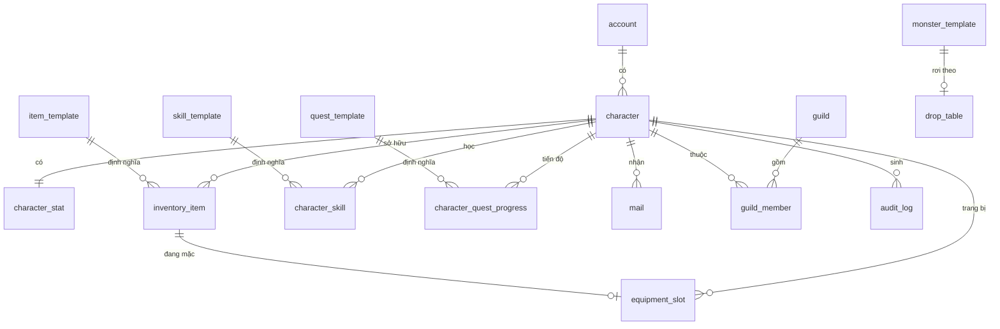

# DATABASE.md

**Schema, truy cập dữ liệu, cache**

| | |
|---|---|
| Version | 1.1.0 |
| Status | Draft |
| Liên quan | [ADR-004](../01-architecture/adr/ADR-004-Why-PostgreSQL.md), [ADR-005](../01-architecture/adr/ADR-005-Why-Redis.md) |

> Tài liệu này mô tả schema ở mức **khái niệm (ERD-level)**, không phải migration script thật.
> Migration thật nằm trong `server-database`, chạy qua Flyway ([ADR-013](../01-architecture/adr/ADR-013-Flyway-vs-Liquibase.md) ✅ Accepted), có version + rollback (Điều 40).

---

## 1. Nguyên tắc

| Nguyên tắc | Chi tiết |
|---|---|
| **PostgreSQL là source of truth** | Redis chỉ cache. **Mất Redis không được mất dữ liệu người chơi** |
| **Tách dữ liệu tĩnh và động** | `item_template` (thiết kế) ≠ `inventory_item` (ai đang sở hữu) — Điều 27 |
| **Feature không đọc bảng của feature khác** | Qua `api/` Facade ([ARCHITECTURE.md §9](../01-architecture/ARCHITECTURE.md)) |
| **Khoá chính `BIGINT`**, không UUID | UUID tốn index ở bảng ghi nhiều |
| **UTF-8 collation từ đầu** | ⚠️ Tiếng Việt có dấu — sửa sau khi có dữ liệu rất khó |

---

## 2. Bảng cốt lõi (MVP)

### 2.1 Account & Character

| Bảng | Cột chính | Ghi chú |
|---|---|---|
| `account` | `id, username, password_hash, email, created_at, status` | `status`: ACTIVE/BANNED/SUSPENDED. **Bcrypt/Argon2**, không bao giờ plaintext |
| `character` | `id, account_id, realm_id, name, faction, level, exp, rebirth_count, created_at` | `realm_id` mặc định 1 (§ dưới). `faction` = 1 trong 5 hệ ([GDD](../13-game-design/GAME-DESIGN-DOCUMENT.md)). MVP chỉ dùng 1 giá trị faction nhưng **cột phải có sẵn** |
| `character_stat` | `character_id (PK/FK), str, agi, int_, vit, current_hp, current_chi` | **Tách khỏi `character`** vì ghi/đọc tần suất cao hơn nhiều |

✅ **`realm_id` — CÓ** ([ADR-010](../01-architecture/adr/ADR-010-Realm-Model.md)): bảng `character` (và các bảng dữ liệu nhân vật cấp cao) có cột `realm_id` (mặc định = 1). MVP chạy single-realm nhưng schema sẵn sàng multi-realm, không cần migration sau. ⚠️ **Không hardcode "realm = 1"** — đọc từ dữ liệu/config.

### 2.2 Item & Inventory

| Bảng | Cột chính | Ghi chú |
|---|---|---|
| `item_template` | `id, code, name_key, category, base_stats_json, max_stack` | **Tĩnh** — sửa qua tool thiết kế, không qua gameplay. `name_key` cho i18n |
| `inventory_item` | `id, character_id, item_template_id, quantity, enhance_level, slot_index` | **Động** — 1 dòng = 1 stack |
| `equipment_slot` | `character_id, slot_type, inventory_item_id (nullable)` | `slot_type`: WEAPON/ARMOR/HELMET/GLOVE/BOOT/ACCESSORY_1/ACCESSORY_2 |

### 2.3 Skill

| Bảng | Cột chính | Ghi chú |
|---|---|---|
| `skill_template` | `id, code, faction, tier, cooldown_ms, chi_cost, effect_script_ref` | `effect_script_ref` trỏ script ([SCRIPTING.md](../06-plugin/SCRIPTING.md)) — **không hardcode công thức damage trong Java** |
| `character_skill` | `character_id, skill_template_id, skill_level, unlocked_at` | |

### 2.4 Monster & AI

| Bảng | Cột chính | Ghi chú |
|---|---|---|
| `monster_template` | `id, code, name_key, level, base_stats_json, ai_params_json, drop_table_id` | `ai_params_json`: aggro range, tốc độ đuổi... ([AI.md §10](../03-engine/AI.md)) |
| `drop_table` | `id, entries_json` | Tỉ lệ rơi đồ — **config, không code** |

### 2.5 Quest

| Bảng | Cột chính | Ghi chú |
|---|---|---|
| `quest_template` | `id, code, type, script_ref, prerequisite_quest_id` | `type`: MAIN/DAILY/GUILD/EVENT |
| `character_quest_progress` | `character_id, quest_template_id, status, progress_json, updated_at` | `status`: NOT_STARTED/IN_PROGRESS/COMPLETED/CLAIMED |

### 2.6 Social (shell MVP)

| Bảng | Cột chính | Ghi chú |
|---|---|---|
| `guild` | `id, name, level, created_by_character_id, treasury_gold` | MVP: chỉ tạo/tham gia |
| `guild_member` | `guild_id, character_id, role, joined_at` | `role`: LEADER/OFFICER/MEMBER |
| `friend` | `character_id, friend_character_id, status` | Lưu **1 dòng**, không lưu ngược 2 lần |
| `mail` | `id, receiver_character_id, sender_character_id (nullable), title_key, body_key, attached_item_json, gold, is_read, expires_at` | Mail hệ thống: `sender = NULL` |

### 2.7 Audit (bắt buộc)

| Bảng | Cột chính | Ghi chú |
|---|---|---|
| `audit_log` | `id, character_id, action, detail_json, created_at` | ⚠️ **Bắt buộc** cho: trade, gold, item, cường hoá. Không có audit = không điều tra được gian lận/mất đồ |

---

## 3. ERD



---

## 4. Bảng Post-MVP (thiết kế trước, chưa migrate)

Dự trù để không phải thiết kế lại schema. **Chỉ migrate khi tính năng thật sự bắt đầu.**

| Bảng | Tính năng |
|---|---|
| `guild_territory` | Chiếm lãnh địa |
| `auction_listing` | Đấu giá |
| `pvp_rating` | Xếp hạng PvP (MMR theo mùa) |
| `ranking_snapshot` | Bảng xếp hạng định kỳ |
| `pet` / `character_pet` | Thú cưng |
| `gem` / `equipment_gem_slot` | Khảm ngọc |

---

## 5. Transaction

⚠️ Không có `@Transactional` của Spring ([ADR-009](../01-architecture/adr/ADR-009-Why-No-Spring-Boot.md)) → quản lý tường minh.

```java
// Transaction tường minh — thấy rõ ranh giới
transactionManager.inTransaction(tx -> {
    inventoryPort.removeItem(tx, sellerId, itemId);
    inventoryPort.addItem(tx, buyerId, itemId);
    accountPort.transferGold(tx, buyerId, sellerId, price);
    auditPort.log(tx, TRADE, detail);
});
```

**Bắt buộc transaction cho:**

| Thao tác | Vì sao |
|---|---|
| Trade giữa 2 người chơi | Mất một nửa = mất item thật |
| Mua/bán ở shop | Trừ tiền nhưng không nhận item = mất tiền |
| Cường hoá | Tốn nguyên liệu nhưng không lên cấp |
| Chuyển gold | Hiển nhiên |
| Nhận thưởng quest | Đánh dấu xong nhưng không nhận thưởng |

**Không cần transaction**: cập nhật vị trí, HP, exp (ghi định kỳ, mất được — [SERVER.md §8](SERVER.md)).

⚠️ **Không giữ transaction mở trong khi chờ I/O khác** — giữ transaction ngắn nhất có thể, tránh lock contention.

---

## 6. Redis

Dùng Redis ([ADR-005](../01-architecture/adr/ADR-005-Why-Redis.md) ✅ Accepted).

**Ràng buộc bắt buộc bất kể chọn bên nào**: chỉ dùng **lệnh chuẩn**, **không** dùng Redis Stack module độc quyền (RedisJSON, RediSearch) → giữ chi phí đổi ≈ 0.

| Key pattern | Mục đích | TTL |
|---|---|---|
| `session:{sessionId}` | Phiên đăng nhập | Theo hạn session |
| `char:online:{characterId}` | Trạng thái online (Friend/Guild) | Refresh theo heartbeat |
| `leaderboard:pvp:{season}` | Sorted Set — xếp hạng tạm | Theo season |
| `ratelimit:{characterId}:{opcode}` | Đếm rate limit ([NETWORK.md §13](NETWORK.md)) | Vài giây |
| `pubsub:world-event` | Pub/sub giữa instance (nếu multi-realm) | — |

⚠️ **Tuyệt đối**: không lưu dữ liệu **chỉ tồn tại ở Redis** cho bất cứ thứ gì người chơi sở hữu (item, gold, exp). Mất Redis = mất session, **không** mất tài sản (Điều 15).

---

## 7. Cache Strategy

| Dữ liệu | Cache? | Chiến lược |
|---|---|---|
| `item_template`, `skill_template` (tĩnh) | ✅ | **In-process** (Caffeine) — load lúc khởi động, không đổi khi chạy |
| Trạng thái online | ✅ Redis | TTL theo heartbeat |
| Inventory người chơi | ⚠️ Cẩn thận | Cache trong bộ nhớ world khi online; ghi DB khi thay đổi |
| Gold | ❌ **Không cache lỏng lẻo** | Nguồn chân lý là DB |

**Cache invalidation** là bài toán khó nhất. Nguyên tắc:
- Dữ liệu **tĩnh** → cache thoải mái (không bao giờ invalidate lúc chạy).
- Dữ liệu **động có giá trị** → không cache, hoặc cache có ghi-xuyên (write-through).

---

## 8. Index

Đề xuất (⚠️ **chưa verify** — phải đo query thật):

| Bảng | Index |
|---|---|
| `character` | `account_id`, `UNIQUE(name)` |
| `inventory_item` | `character_id`, `(character_id, slot_index)` |
| `character_quest_progress` | `(character_id, status)` |
| `guild_member` | `guild_id`, `character_id` |
| `mail` | `(receiver_character_id, is_read)`, `expires_at` |
| `audit_log` | `(character_id, created_at)`, `created_at` |

**Nguyên tắc** (Điều 30): **không thêm index theo cảm tính.** Index tăng tốc đọc, **làm chậm ghi**, tốn dung lượng. Chỉ thêm khi `EXPLAIN ANALYZE` chứng minh cần.

---

## 9. Partition

**MVP: KHÔNG partition.** (Điều 9)

Ứng viên tương lai — chỉ khi bảng thật sự lớn:

| Bảng | Partition theo | Khi nào |
|---|---|---|
| `audit_log` | `created_at` (theo tháng) | Bảng này lớn nhanh nhất — ứng viên đầu tiên |
| `mail` | `created_at` | Khi mail cũ nhiều |

⚠️ Partition **không** phải giải pháp cho "DB chậm". Đo trước (Điều 30).

---

## 10. Migration

Điều 40. Công cụ: Flyway ([ADR-013](../01-architecture/adr/ADR-013-Flyway-vs-Liquibase.md) ✅ Accepted).

| Quy tắc | Chi tiết |
|---|---|
| Mọi thay đổi schema qua migration script có version | Không sửa DB bằng tay |
| Migration **phải có rollback plan** | Hoặc rollback script, hoặc kế hoạch tường minh |
| Migration **không phá client cũ** | Thêm cột nullable trước, backfill, rồi mới bắt buộc |
| Test migration trên bản sao dữ liệu thật | Không test trên DB rỗng |

**Quy trình thêm cột NOT NULL an toàn:**
```
1. Thêm cột nullable
2. Backfill dữ liệu
3. Deploy code ghi cột đó
4. (Release sau) Đặt NOT NULL
```

---

## 11. Repository / Adapter

```java
// domain/ — không biết PostgreSQL
public interface InventoryPort {
    Optional<Inventory> findByCharacter(long characterId);
    void save(Transaction tx, Inventory inventory);
}

// infrastructure/ — biết PostgreSQL
public final class PostgresInventoryAdapter implements InventoryPort { ... }
```

**Quy tắc**: SQL **chỉ** xuất hiện trong `infrastructure/`. `domain/` và `application/` không được biết SQL tồn tại.

**Dùng `PreparedStatement`**, không nối chuỗi SQL — SQL injection ([SECURITY.md](../08-security/SECURITY.md)).

**Text block cho SQL dài:**
```java
private static final String FIND_INVENTORY = """
    SELECT i.id, i.item_template_id, i.quantity, i.enhance_level, i.slot_index
      FROM inventory_item i
     WHERE i.character_id = ?
     ORDER BY i.slot_index
    """;
```

---

## Technical Decisions

| # | Quyết định | Lý do | Trạng thái |
|---|---|---|---|
| 1 | PostgreSQL = source of truth; Redis = cache | Điều 15 | Accepted |
| 2 | Tách `character` và `character_stat` | Tần suất ghi khác nhau | Accepted |
| 3 | Tách template (tĩnh) và instance (động) | Điều 27 — data driven | Accepted |
| 4 | `BIGINT` PK, không UUID | Chi phí index | Accepted |
| 5 | **UTF-8 collation từ đầu** | Tiếng Việt — sửa sau rất khó | Accepted |
| 6 | **`audit_log` bắt buộc** cho trade/gold/item | Không có = không điều tra được | Accepted |
| 7 | Transaction tường minh, bắt buộc cho thao tác có giá trị | Không có Spring `@Transactional` | Accepted |
| 8 | Redis: **chỉ lệnh chuẩn**, không Redis Stack module | Giữ chi phí đổi Redis↔Valkey ≈ 0 | Accepted |
| 9 | Template cache **in-process**; gold **không cache lỏng lẻo** | Tĩnh vs có giá trị | Accepted |
| 10 | **MVP không partition** | Điều 9, 30 | Accepted |
| 11 | SQL **chỉ** trong `infrastructure/`; luôn `PreparedStatement` | Kiến trúc + bảo mật | Accepted |
| 12 | **`realm_id` = có, mặc định 1** (single-realm MVP) | Sẵn sàng multi-realm không migration | ✅ [ADR-010](../01-architecture/adr/ADR-010-Realm-Model.md) |
| 13 | Index §8 **chưa verify** | Phải đo `EXPLAIN ANALYZE` | ⏳ Tạm thời |

## ADR cần tạo

| ADR | Nội dung | Ưu tiên |
|---|---|---|
| **ADR-010** | Single-realm + `realm_id` dự phòng (§2.1) | ✅ Accepted |
| **ADR-013** | Flyway vs Liquibase (§10) | ✅ Accepted (Flyway) |
| **ADR-005** | Dùng Redis làm cache (§6) | ✅ Accepted |

## Tài liệu liên quan

- [ADR-004](../01-architecture/adr/ADR-004-Why-PostgreSQL.md) — vì sao PostgreSQL, vì sao không ORM
- [SERVER.md §8](SERVER.md) — persistence strategy (ghi khi nào)
- [ARCHITECTURE.md §9](../01-architecture/ARCHITECTURE.md) — bounded context
- [SECURITY.md](../08-security/SECURITY.md) — audit log, SQL injection
- [GAMEPLAY.md](GAMEPLAY.md) — nghiệp vụ dùng bảng nào

## Việc cần làm tiếp theo

1. ✅ ADR-010 đã chốt — tạo bảng `character` **có cột `realm_id`** (mặc định 1) ngay từ migration đầu.
2. Phase 0: tạo database với **UTF-8 collation** (§1) — đây là thứ dễ quên và rất khó sửa.
3. Phase 3: thiết kế `audit_log` (§2.7) cùng lúc với trade, không để sau.
4. Phase 4: `EXPLAIN ANALYZE` query thật → chốt index §8.
