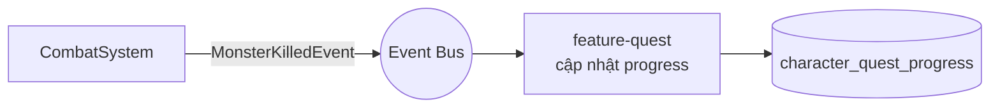
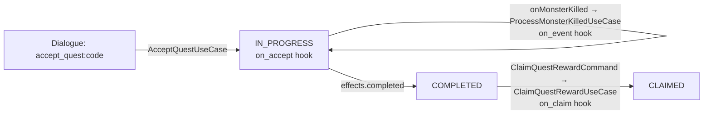

# GAMEPLAY.md

**Hệ thống gameplay phía server**

| | |
|---|---|
| Version | 1.0.0 |
| Status | Draft |
| Liên quan | [GAME-DESIGN-DOCUMENT.md](../13-game-design/GAME-DESIGN-DOCUMENT.md), [ECS.md](../03-engine/ECS.md), [SERVER.md](SERVER.md) |

> **GDD nói game LÀ GÌ. Tài liệu này nói server IMPLEMENT nó THẾ NÀO.**
> Mọi hệ thống ở đây phải map ngược về một mục trong GDD. Không có mục GDD tương ứng → không implement.

---

## 1. Bản đồ: tính năng GDD → module/System

| Tính năng (GDD) | Nơi implement | Kiểu |
|---|---|---|
| Di chuyển, nhảy | `server-world` · `MovementSystem` | ECS |
| Combat, damage | `server-world` · `CombatSystem` | ECS |
| Skill, cooldown | `server-world` · `SkillSystem` | ECS + Script |
| Quái, Boss AI | `server-world` · `AISystem` | ECS + Script |
| Rơi đồ | `server-world` · `LootSystem` → Event | ECS |
| Túi đồ, trang bị | `feature-inventory` | Clean Arch |
| Cường hoá | `feature-inventory` | Clean Arch |
| Nhiệm vụ | `feature-quest` | Clean Arch + Script |
| Bang hội | `feature-guild` | Clean Arch |
| Thư | `feature-mail` | Clean Arch |
| Bạn bè | `feature-friend` | Clean Arch |
| Chat | `feature-chat` | Clean Arch |
| Cửa hàng | `feature-shop` | Clean Arch |

**Nguyên tắc phân chia** (Điều 25):
- **Realtime, chạy mỗi tick, nhiều entity** → ECS trong `server-world`.
- **Giao dịch, nghiệp vụ, gọi theo sự kiện** → Clean Architecture trong `feature-*`.

---

## 2. Character

| Việc | Nơi | Ghi chú |
|---|---|---|
| Tạo nhân vật | `feature-character` | Validate tên (trùng, từ cấm) |
| Chỉ số cơ bản (STR/AGI/INT/VIT) | `character_stat` | Nguồn chân lý ở DB |
| **Chỉ số dẫn xuất** (ATK/DEF/CRIT...) | **Server tính** từ base stat + trang bị + buff | ⚠️ Client **không** tự tính |
| Level up | `feature-character` | Bắn `LevelUpEvent` |
| Chuyển sinh | `feature-character` | Post-MVP |

⚠️ **Chỉ số dẫn xuất phải tính lại ở server mỗi khi**: đổi trang bị · lên cấp · nhận/hết buff. Client nhận kết quả để hiển thị. Client tính lại chỉ để hiện UI mượt — **không** để quyết định gameplay (Điều 15).

Công thức derive nằm ở `CombatConstants` ([CODING-STANDARDS.md §18](../02-coding-standards/CODING-STANDARDS.md)) — **không hardcode rải rác**.

---

## 3. Combat

**Quy tắc số 1**: combat **không** dùng Box2D ([PHYSICS.md §1](../03-engine/PHYSICS.md)).

```
Client: UseSkillCommand(skillId, targetId hoặc hướng)
   ↓
Server (SkillSystem):
   1. Skill có tồn tại? nhân vật đã học chưa?
   2. Cooldown xong chưa?          ← server giữ cooldown, không tin client
   3. Đủ Khí không?
   4. Mục tiêu hợp lệ? trong tầm?  ← server tự kiểm tra hình học
   5. Tính damage (CombatConstants + script)
   6. Áp dụng damage → HealthComponent
   7. Bắn Event nếu chết
   ↓
Response + Event cho các client liên quan (trong AoI)
```

**Server giữ mọi thứ**: cooldown, Khí, vị trí, HP. Client chỉ có bản sao để hiển thị.

**Công thức damage**: đã chốt (placeholder, cần playtest) — xem [GAME-DESIGN-DOCUMENT.md §5–6](../13-game-design/GAME-DESIGN-DOCUMENT.md#5-nhân-vật--tiến-trình). Toàn bộ hệ số derive/damage/Lực Chiến nằm ở `CombatConstants` ([CODING-STANDARDS.md §18](../02-coding-standards/CODING-STANDARDS.md)), không hardcode rải rác trong `CombatSystem`.

⚠️ **Roll ngẫu nhiên** (né/trúng, bạo kích) — như mọi random ảnh hưởng gameplay, **chỉ sinh ở server** ([ENGINE.md §10](../03-engine/ENGINE.md)), không bao giờ ở client dù chỉ để dự đoán UI.

⚠️ **Lực Chiến** (GDD §5) chỉ là giá trị hiển thị/xếp hạng tính SAU khi đã có đủ chỉ số dẫn xuất — không bao giờ dùng ngược lại để tính damage hay bất kỳ quyết định gameplay nào khác (một chiều: stat → Lực Chiến, không có chiều ngược).

---

## 4. Skill

| Phần | Ở đâu | Vì sao |
|---|---|---|
| Cơ chế (cooldown, trừ Khí, kiểm tra tầm) | **Java** — `SkillSystem` | Chạy mỗi tick, phải nhanh |
| **Hiệu ứng cụ thể** (gây bao nhiêu damage, buff gì) | **Script** — `effect_script_ref` | Điều 27 — sửa không rebuild |
| Tham số (cooldown_ms, chi_cost) | **DB** — `skill_template` | Điều 27 |

**Phân định**: Java lo *cơ chế*, Script lo *nội dung*, DB lo *tham số*.

Engine scripting đã chốt: [ADR-016](../01-architecture/adr/ADR-016-Scripting-Engine.md) — GraalJS.

---

## 5. Monster & Spawn

| Việc | Cách |
|---|---|
| Spawn point | Đánh dấu trong map data (HyperLap2D) — [RESOURCE.md §1](../04-client/RESOURCE.md) |
| Tham số quái | `monster_template` |
| AI | FSM ([AI.md §3](../03-engine/AI.md)) |
| Respawn | `SpawnSystem` đếm thời gian trong tick |
| Rơi đồ | `drop_table` → `LootSystem` |

⚠️ **Tỉ lệ rơi đồ tính ở server bằng random của server** ([ENGINE.md §10](../03-engine/ENGINE.md)). Client không bao giờ tự random thứ ảnh hưởng gameplay.

---

## 6. Boss & Dungeon

| Việc | Cách | Trạng thái |
|---|---|---|
| Boss AI nhiều pha | Behavior Tree hoặc Script ([AI.md §4](../03-engine/AI.md)) | Post-MVP |
| Dungeon instance | Mỗi party 1 instance riêng | Post-MVP |
| World Boss | Toàn server, damage ranking | Post-MVP |

✅ **Dungeon instance model đã chốt** ([ADR-026](../01-architecture/adr/ADR-026-Dungeon-Instance-Model.md), Accepted 2026-07-24): cùng process, mỗi instance là 1 World/ECS riêng trong cùng JVM — không phải OS process riêng. Khớp Bước 0 của [ARCHITECTURE.md §14](../01-architecture/ARCHITECTURE.md) (chưa scale ngang khi chưa có số liệu).

---

## 7. Inventory & Equipment

Clean Architecture ([REPOSITORY-STRUCTURE.md §4](../01-architecture/REPOSITORY-STRUCTURE.md)).

| Use case | Ghi chú |
|---|---|
| `AddItemUseCase` | Kiểm tra túi đầy, stack |
| `MoveItemUseCase` | Kiểm tra slot hợp lệ |
| `EquipItemUseCase` | Kiểm tra level/faction yêu cầu → **tính lại chỉ số dẫn xuất** (§2) |
| `EnhanceItemUseCase` | ✅ **Đã code** (2026-07-23) — ⚠️ **Transaction bắt buộc** — tốn gold + đổi enhance_level |

⚠️ **Cường hoá là nơi dễ mất tài sản nhất**: trừ gold thành công nhưng ghi `enhance_level` thất bại = người chơi mất tài sản. **Bắt buộc transaction** ([DATABASE.md §5](DATABASE.md)) + **audit log** (`audit_log`, migration V7).

### 7.1 Cường hoá — tỉ lệ thành công + chi phí gold (+0→+15)

GDD chỉ ghi "tỉ lệ giảm dần, có Bảo Vệ chống rớt cấp từ +10" mà không có số cụ thể — bảng dưới là
**đề xuất khởi điểm đã được chủ dự án duyệt** (2026-07-23), chỉnh cân bằng trực tiếp ở
`EnhancementTable` (feature-inventory) khi cần, không cần đổi `EnhanceItemUseCase`:

| Cấp hiện tại | Tỉ lệ thành công | Gold cost | Thất bại |
|---|---|---|---|
| +0→+1 | 95% | 100 | Không mất cấp |
| +1→+2 | 90% | 200 | Không mất cấp |
| +2→+3 | 85% | 350 | Không mất cấp |
| +3→+4 | 80% | 550 | Không mất cấp |
| +4→+5 | 70% | 800 | Không mất cấp |
| +5→+6 | 60% | 1200 | Không mất cấp |
| +6→+7 | 50% | 1700 | Không mất cấp |
| +7→+8 | 40% | 2300 | Không mất cấp |
| +8→+9 | 30% | 3000 | Không mất cấp |
| +9→+10 | 20% | 4000 | Không mất cấp |
| +10→+11 | 15% | 5500 | **Rớt 1 cấp** |
| +11→+12 | 12% | 7500 | **Rớt 1 cấp** |
| +12→+13 | 10% | 10000 | **Rớt 1 cấp** |
| +13→+14 | 8% | 14000 | **Rớt 1 cấp** |
| +14→+15 | 5% | 20000 | **Rớt 1 cấp** |

**Gold**: cột `character_stat.gold` (migration V7) — đặt ở `character_stat` (không phải
`character`) vì bảng này vốn đã tách riêng do tần suất ghi/đọc cao (DATABASE.md §2.1), và gold đổi
liên tục mỗi lần cường hoá/mua bán. `feature-inventory` trừ gold qua `GoldPort` riêng (không gọi
`CharacterFacade`) vì cần trừ NGUYÊN TỬ trong cùng transaction với đổi `enhance_level` — xem
feature-inventory/CLAUDE.md.

✅ **Protocol/gateway đã nối** (2026-07-23) — `EnhanceItemCommand`/`EnhanceItemResponse` (opcode
505-506, `inventory.proto`), `EnhanceOutcome` enum riêng (7 giá trị) thay vì `bool success` như
Equip/Unequip vì cường hoá có nhiều kết quả có ý nghĩa khác nhau với client (đặc biệt
`FAILED_DROPPED` phải cảnh báo khác `FAILED_NO_DROP`).

✅ **"Bảo Vệ" chống rớt cấp — Đã code (2026-07-23)**. 3 quyết định chốt cùng chủ dự án:
1. **Mua ở shop** — item tiêu hao mới `enhance_protection_charm` (migration V9), seed vào
   `shop_item` (buy 3000/sell 500, PLACEHOLDER giống mọi giá shop khác).
2. **Client chủ động chọn dùng** — `EnhanceItemCommand.use_protection` (bool, field mới, additive)
   thay vì server tự động tiêu Bảo Vệ nếu có — người chơi có thể muốn để dành.
3. **Chỉ tiêu khi THẤT BẠI THẬT** — server roll kết quả trước; nếu thành công hoặc thất bại dưới
   +10, Bảo Vệ KHÔNG bị đụng tới dù client có bật cờ. Chỉ khi roll thất bại VÀ đang ở +10 trở lên
   VÀ còn Bảo Vệ trong túi mới tiêu 1 cái, giữ nguyên cấp thay vì rớt (`EnhanceResult.FAILED_PROTECTED`).

Tra `item_template.id` của Bảo Vệ qua `ItemTemplatePort.findIdByCode("enhance_protection_charm")`
(mới, tổng quát) thay vì hardcode ID số (ID phụ thuộc thứ tự seed). `EnhanceItemUseCase` giờ cần
thêm `ItemTemplatePort` — bundle vào `EnhancePorts` (record) để không vượt 4 tham số constructor
(Checkstyle `ParameterNumber`).

### 7.2 Mua bán (Shop) — ✅ Đã code (2026-07-23)

`feature-shop` — module RIÊNG (không nằm trong feature-inventory) vì NETWORK.md §4 đã chừa dải
opcode riêng (1000-1099 "Shop / Auction") từ Phase 3. Shop TOÀN CỤC, chưa gắn NPC/vị trí — Phase 6
mới có NPC/Dialogue, lúc đó mới ràng buộc "đứng gần NPC mới mua được".

**Quyết định chốt cùng chủ dự án (2026-07-23)**:
- Danh mục lưu ở bảng `shop_item` (migration V8), KHÔNG phải bảng tra cứu tĩnh trong code (khác
  `EnhancementTable`) — catalog có thể vài chục/trăm item, sửa giá không nên cần build lại.
- `buy_price`/`sell_price` ĐỘC LẬP nhau (không phải % cố định của nhau) — tự cân bằng từng item.
- Có bán lại (sell) ở MVP này, không hoãn qua lát cắt sau.

**Kiến trúc**: Y HỆT cường hoá — `feature-shop` tự khai báo `GoldPort`/`InventoryGatewayPort` riêng
(bản sao ý tưởng của `dev.kage.inventory.domain.GoldPort`) vì mua/bán cần đổi gold + đổi item
NGUYÊN TỬ trong CÙNG transaction (DATABASE.md §5 — "trừ tiền nhưng không nhận item = mất tiền"),
`InventoryFacade` không nhận `Transaction` chia sẻ giữa 2 feature nên không gọi qua đó được. Adapter
thật (`server-database`) viết SQL riêng cho `inventory_item` thay vì tái dùng `Inventory` aggregate
của feature-inventory — bắc cầu 2 loại `Transaction` khác nhau tốn hơn trùng lặp 2 câu SQL nhỏ (đếm
số dòng + INSERT/UPDATE/DELETE). Xem feature-shop/CLAUDE.md.

**Mua** (`BuyItemUseCase`): trừ gold TRƯỚC (rẻ, no-op nếu không đủ) → cộng item — túi đầy thì ném
exception nội bộ để rollback CẢ phần gold đã trừ (không được "trừ tiền nhưng không nhận item").
**Bán** (`SellItemUseCase`): bớt item TRƯỚC (điều kiện, khoá dòng bằng `SELECT ... FOR UPDATE`) →
cộng gold — cộng gold không có nhánh thất bại nên không cần rollback thủ công.

✅ **Protocol/gateway đã nối cùng lát cắt** — `ListShopItemsRequest/Response`,
`BuyItemCommand/Response`, `SellItemCommand/Response` (opcode 1000-1005, `shop.proto`).

---

## 8. Trade

⚠️ **Hệ thống nguy hiểm nhất của MMORPG.** Mọi lỗi ở đây = duplicate item = phá kinh tế server.

| Yêu cầu | Vì sao | Cách đạt được (✅ Đã code 2026-07-24, Phase 7 lát cắt 3) |
|---|---|---|
| **Transaction** cho toàn bộ giao dịch | Mất một nửa = mất item | `ConfirmTradeUseCase` — 1 transaction duy nhất chuyển CẢ gold lẫn item 2 chiều |
| **Audit log** mọi giao dịch | Điều tra gian lận | `TRADE_EXECUTED` ghi cho CẢ 2 bên trong CÙNG transaction |
| **Cả hai bên xác nhận** (2-phase confirm) | Chống lừa đảo | Sửa lời chào (`SetTradeOfferCommand`) SAU KHI 1 bên đã confirm sẽ reset CẢ 2 cờ confirmed |
| **Khoá item khi đang trade** | Chống trade cùng item cho 2 người | KHÔNG khoá lúc chào — xác thực lại TOÀN BỘ (khoá dòng FOR UPDATE + kiểm sở hữu/số lượng) NGAY LÚC THI HÀNH, cùng đạt mục đích "không bao giờ duplicate" với ít blast radius hơn (không đụng feature-inventory/feature-shop đã xong) |
| **Idempotency** | Chống retry duplicate ([NETWORK.md §5](NETWORK.md)) | `ConfirmTradeCommand.idempotency_key` (ADR-025), bảng `idempotency_key` dùng chung |

Chi tiết đầy đủ + lý do từng quyết định (kể cả tách stack cho phép, không escrow gold/item lúc
chào, `trade_offer_item.item_id` cố tình KHÔNG có FK): `feature-trade/CLAUDE.md`.

⚠️ **Phát hiện lúc code (2026-07-24)**: ADR-025 nêu tên `BuyItemCommand`/`SellItemCommand`/
`ClaimMailCommand` cần `idempotencyKey` nhưng chỉ `CreateCharacterCommand` thật sự có — đã vá cả
3 Command này trong cùng đợt (xem commit "ADR-025 retrofit").

---

## 9. Quest

| Phần | Ở đâu |
|---|---|
| Cơ chế theo dõi tiến độ | Java — `feature-quest` |
| **Nội dung quest** (điều kiện, thưởng, dialogue) | **Script** — `script_ref` (Điều 27) |
| Lắng nghe sự kiện | `MonsterKilledEvent`, `ItemAcquiredEvent`... → cập nhật `progress_json` |



⚠️ **Hiệu năng**: mỗi lần giết quái → kiểm tra mọi quest đang làm? Với 1000 người chơi × 20 quest = tốn. → Cần index quest theo loại sự kiện, không quét tuyến tính. **Đo ở Phase 6.**

### 9.1 NPC — lát cắt 1: NPC tĩnh hiển thị (✅ Đã code, 2026-07-23)

Chốt cùng chủ dự án trước khi code (CLAUDE.md §4 — không schema/kiến trúc nào có sẵn cho NPC):
thứ tự lát cắt **NPC → Dialogue → Quest → Chat/Friend/Mail**; NPC là **ECS component tĩnh trong
`server-world`** (giống Monster nhưng KHÔNG AI/combat), không phải module Clean Arch riêng.
"1 Bí Cảnh mẫu" GDD từng liệt vào MVP đã xác nhận là **Phase 8** thật (Dungeon), không phải Phase
6 — sửa GDD §11 khớp lại ROADMAP.

**Lát cắt 1** hoàn toàn hardcode (chưa `npc_template` DB, cùng lý do `training_dummy` chưa đọc
`monster_template`): 1 NPC tĩnh (`NpcComponent`/`NpcIdComponent`, chỉ `PositionComponent` — KHÔNG
`VelocityComponent`/`HealthComponent`/AI), hiện qua AoI giống quái/nhân vật
(`NpcSpawnedEvent`/`NpcDespawnedEvent`, opcode 600-601, dải dùng chung với Quest). Chưa có tương
tác/dialogue nào — chỉ chứng minh NPC hiện ra đúng qua AoI.

⚠️ **Bug thật bắt được lúc code** (không phải đoán trước): `AreaOfInterestTracker.visibleTo` dùng
**CHUNG 1 `Set<Long>`** lưu "mọi ID nhân vật này đang thấy" bất kể loại entity (nhân vật/quái/NPC).
NPC id và monster id đều ÂM và ban đầu dùng 2 bộ đếm độc lập cùng bắt đầu ở -1 → **trùng số** →
quái vừa được thêm vào set "đang thấy" thì NPC (trùng ID, ngoài tầm nhìn) xoá luôn ngay trong CÙNG
tick, khiến quái không bao giờ được xem là "đã thấy từ trước" → `MonsterMovedEvent` không bao giờ
phát, phá cả `shouldChaseAndAttackBack_whenCharacterEntersAggroRange` (test đã xanh từ Phase 4).
**Sửa**: DÙNG CHUNG 1 bộ đếm (`nextMonsterOrNpcId`) cho cả quái lẫn NPC — đảm bảo không bao giờ
trùng ID giữa 2 loại entity khác nhau, dù có bao nhiêu loại "entity ÂM" nữa sau này cũng phải dùng
chung bộ đếm này, không tự thêm bộ đếm riêng.

`AreaOfInterestTracker.sync()` thêm cặp (nhân vật, NPC) — bản sao cấu trúc gần giống
(nhân vật, quái) lần thứ 3 (`syncCharacterPair`/`syncCharacterMonsterPair`/`syncCharacterNpcPair`).
CHƯA tổng quát hoá (mỗi loại có payload snapshot khác nhau, tổng quát sớm phải sửa code đã test kỹ)
— tới loại entity thứ 4 cần AoI mới bắt buộc tổng quát hoá (rule of three).

### 9.2 Dialogue — lát cắt 2: hội thoại NPC + mở shop qua dialogue (✅ Đã code, 2026-07-23)

3 quyết định chốt cùng chủ dự án qua `AskUserQuestion` trước khi code: (1) xây cấu trúc node/nhánh
đầy đủ ngay (không chỉ 1 câu chào đơn), (2) thêm bảng `npc_template` thật (id, code, name_key,
`dialogue_script_ref`) — migration V10, (3) gắn luôn "Mở cửa hàng" vào dialogue (tái dùng
`ListShopItemsResponse` có sẵn từ Phase 5, không tạo packet mới cho nhánh này).

**Module mới `feature-dialogue`** (Clean Arch, khác NPC hiển thị thuần — dialogue có DB access +
chạy script nên xứng đáng ranh giới riêng, dù `server-features/README.md` chưa liệt kê module này
trước đó — quyết định cùng chủ dự án, không tự ý thêm module).

**Điều 27 + SCRIPTING.md §2**: "Dialogue NPC" nằm thẳng cột Script — KHÔNG có lựa chọn config/
hardcode nào, kể cả câu chào đơn giản nhất. Script (`town_elder.js`, feature-dialogue resources)
trả về TOÀN BỘ cây node (object literal, key = nodeId); Java trích đúng 1 node cần dùng mỗi lần gọi
qua `GetDialogueNodeUseCase` (không giữ state giữa các lần gọi — script tự chứa dữ liệu).

⚠️ **Bug hạ tầng thật bắt được TRƯỚC khi viết feature-dialogue** (test thật, không đoán trước):
`ScriptSandbox.eval(script, hostApi)` (Phase 4, dùng cho skill damage) trả về `Value` sau khi
`Context` ĐÃ ĐÓNG (try-with-resources đóng context trước khi return) — gọi `getMember`/
`getArrayElement` trên `Value` đó ném `IllegalStateException` NGAY, chỉ scalar (`asDouble`/
`asString`...) sống sót. Dialogue cần trả object có cấu trúc (text + list option) nên bắt buộc
overload mới `ScriptSandbox.eval(script, hostApi, extractor)` — `extractor` chạy TRONG lúc
`Context` còn mở, xác nhận bằng test thật ở `engine-scripting` trước khi dùng (không giả định).

**Protocol** (opcode 602-605, dải Quest/NPC/Dialogue 600-699, `dialogue.proto`):
`TalkToNpcCommand{npc_code}` → `DialogueNodeResponse{node_id, text_key, options[]}`;
`SelectDialogueOptionCommand{npc_code, current_node_id, option_index}` → 1 trong 3: node khác
(`DialogueNodeResponse`), mở shop (`ListShopItemsResponse` tái dùng thẳng, KHÔNG packet mới), hoặc
kết thúc (`DialogueEndedResponse`, rỗng). **`option_index` là VỊ TRÍ, không phải chuỗi `action`** —
server luôn tự tra lại action thật từ script theo index (Điều 24, không tin client tự khai).

⚠️ **Chưa kiểm tra khoảng cách thật** (đứng gần NPC) — client gửi thẳng `npc_code` (đã biết từ
`NpcSpawnedEvent`, npc.proto), server KHÔNG tra vị trí NPC qua ECS (server-world chỉ đọc/ghi trên
tick thread — đọc xuyên thread từ Netty EventLoop/Virtual Thread sẽ vỡ ranh giới đó). Chấp nhận
được ở lát cắt này vì dialogue không có giá trị kinh tế thật (đọc text sớm không phải khai thác),
và mở shop qua dialogue chỉ là lối tắt UX — `BuyItemUseCase`/`SellItemUseCase` (Phase 5) vẫn y
nguyên, KHÔNG thêm ràng buộc vị trí thật. Thêm kiểm tra khoảng cách thật là việc CHỦ ĐỘNG hoãn, ghi
rõ ở đây — cần một cơ chế đọc snapshot vị trí an toàn xuyên thread (chưa có) nếu sau này cần.

`GatewayFacades` đổi `shopFacade` thành `ContentFacades(shopFacade, dialogueFacade)` (thêm
`dialogueFacade` trực tiếp sẽ vượt 4 tham số Checkstyle `ParameterNumber`).

### 9.3 Quest — lát cắt 3: 1 quest DB-driven đầy đủ (✅ Đã code, 2026-07-23)

3 quyết định chốt cùng chủ dự án qua `AskUserQuestion` trước khi code: (1) nối trực tiếp vào
callback `onMonsterKilled` có sẵn (Phase 4, `WorldOutboundSink`/`ConnectedCharacterRegistry`) —
**không** kích hoạt `EventBus`/`Event` (ADR-008, tồn tại từ Phase 0 nhưng chưa dùng ở đâu — vẫn để
yên, quest là consumer thứ 2 gắn thẳng vào cùng callback, không phải lý do để tổng quát hoá pub/sub
sớm); (2) làm trọn 1 quest thật xuyên suốt (nhận → theo dõi → hoàn thành → nhận thưởng), không chỉ
shell; (3) nhận quest bắt buộc qua dialogue NPC (`town_elder`), không thêm packet
`AcceptQuestCommand` riêng.

**Module mới `feature-quest`** (Clean Arch, theo đúng mẫu feature-dialogue/feature-shop): `domain/`
khai `QuestTemplatePort`/`QuestProgressPort`/`ExpPort`/`QuestInventoryGrantPort`/`AuditPort` (Port
riêng của feature-quest, KHÔNG gọi qua Facade feature khác — 2 adapter `ExpPort`/
`QuestInventoryGrantPort` chạy trong `server-database` cùng 1 transaction với ghi `progress_json`,
đúng mẫu `GoldPort` Phase 5 cường hoá).

**Vòng đời quest** (`character_quest_progress`, PK `(character_id, quest_template_id)`, không có
dòng = NOT_STARTED):



**Script gọi NGƯỢC vào Java** (khác dialogue — script quest KHÔNG trả cấu trúc cho Java đọc, script
tự gọi callback `ctx.save_progress(json)`/`ctx.complete()`/`ctx.give_exp(n)`/`ctx.give_item(code,qty)`
truyền qua `ProxyExecutable` trong `hostApi`; Java đọc lại 1 object Java thuần
(`QuestScriptRunner.MutableEffects`) sau khi `eval()` xong — không cần overload extractor của
dialogue vì không đọc `Value` trả về). `progress_json` là **chuỗi đục với Java** — script tự
`JSON.stringify`/`JSON.parse` (GraalJS có sẵn, xác nhận bằng test thật trước khi chọn cách này,
tránh phải thêm thư viện JSON phía Java — sẽ phải dừng hỏi theo CLAUDE.md §4). Chi tiết đầy đủ +
lý do từng quyết định: `feature-quest/CLAUDE.md`.

⚠️ **`ProcessMonsterKilledUseCase.TRACKED_QUEST_CODE` hardcode 1 quest** (`kill_training_dummies`)
— placeholder có chủ đích cho lát cắt này (đúng cảnh báo hiệu năng đã ghi ở đầu §9: "cần index
quest theo loại sự kiện, không quét tuyến tính"). Khi có quest thứ 2 PHẢI tổng quát hoá tra cứu này
trước khi thêm quest mới, không copy-paste thêm hardcode.

**Protocol** (opcode 606-609, dải Quest/NPC/Dialogue 600-699, `quest.proto`): không có
`AcceptQuestCommand` — nhận quest đi qua `SelectDialogueOptionCommand` với action
`accept_quest:<code>` (dialogue resolve thành `SelectOptionResult.AcceptQuest`, gateway gọi
`QuestFacade.acceptQuest`, KHÔNG phải `DialogueFacade` tự gọi — giữ 2 module không biết nhau, cùng
nguyên tắc "open_shop" đã dùng ở §9.2) → `AcceptQuestResponse`.
`QuestStatusChangedEvent{quest_code, status}` phát khi hoàn thành (không phát mỗi lần tick tiến độ).
`ClaimQuestRewardCommand{quest_code}` → `ClaimQuestRewardResponse{outcome, exp_granted, items_granted[]}`.

---

## 10. Chat

| Kênh | Phạm vi | Rate limit |
|---|---|---|
| Thế giới | Toàn server | Nghiêm ngặt (chống spam) |
| Bang hội | Thành viên bang | Vừa |
| Party | Thành viên party | Lỏng |
| Riêng tư | 1-1 | Vừa |
| Khu vực | Trong AoI | Lỏng |

**Bắt buộc**: rate limit ([NETWORK.md §13](NETWORK.md)) · lọc từ cấm · audit log cho chat báo cáo.

⚠️ **Chat là vector tấn công**: XSS (nếu client render HTML), spam, lừa đảo, quảng cáo gold-selling. Xử lý ở [SECURITY.md](../08-security/SECURITY.md).

⚠️ **Quyết định phạm vi lát cắt 6 (2026-07-23, cùng chủ dự án)**: kênh Bang hội/Party **dời sang
Phase 7** cùng lúc `feature-guild`/party thật được code — chưa có dữ liệu thành viên guild/party
thì 2 kênh này không thể chạy đúng. Lát cắt 6 chỉ làm Thế giới/Riêng tư/Khu vực. Xem ROADMAP.md
Phase 6/7 — bảng ở trên vẫn mô tả đích đến cuối cùng (Phase 7), không phải phạm vi lát cắt 6.

✅ **Đã code (2026-07-23)** — `feature-chat` (validate + audit) + định tuyến ở `server-gateway`/
`server-world`: Thế giới = broadcast `ConnectedCharacterRegistry`; Riêng tư = tra tên qua
`CharacterFacade` rồi đẩy 1 kết nối; Khu vực = `WorldFacade.enqueueAreaChatMessage` (phải qua tick
thread vì cần đọc `AreaOfInterestTracker`, không thread-safe ngoài tick). Rate limit + lọc từ cấm
placeholder đã có, xem feature-chat/CLAUDE.md.

✅ **Kênh Bang hội — Đã code (2026-07-24, Phase 7 lát cắt 1)** — `ChatChannel.GUILD` thêm cùng lúc
`feature-guild` thật được code. Định tuyến: gateway gọi `GuildFacade.findMyGuild` để chặn người
gửi chưa vào bang (`SEND_CHAT_MESSAGE_OUTCOME_NOT_IN_GUILD`), sau đó `GuildFacade.listMembers` để
lấy danh sách nhận, broadcast qua `ConnectedCharacterRegistry` — không cần AoI/tick thread (giống
World/Riêng tư, guild membership không phải dữ liệu world-tick).

✅ **Kênh Party — Đã code (2026-07-24, Phase 7 lát cắt 2)** — `ChatChannel.PARTY`, cùng cơ chế Bang
hội (`SEND_CHAT_MESSAGE_OUTCOME_NOT_IN_PARTY` + `PartyFacade.listMembers`).

---

## 11. Guild / Party / Friend / Mail

| Hệ thống | MVP | Ghi chú |
|---|---|---|
| Guild | ✅ Đã code (2026-07-24, Phase 7 lát cắt 1) | `feature-guild` — tạo/xin gia nhập/leader duyệt-từ chối/rời/kick/giải tán + kênh chat Bang hội (xem §10). Kho bang + nhiệm vụ bang dời lát cắt sau (xem feature-guild/CLAUDE.md) |
| Party | ✅ Đã code (2026-07-24, Phase 7 lát cắt 2) | `feature-party` — tạo/mời/chấp nhận-từ chối/rời (leader tự động chuyển cho thành viên vào sớm nhất)/kick + kênh chat Party (xem §10). Sức chứa tối đa 5 (GDD). Chia EXP KHÔNG có ở lát cắt này — chưa có cơ chế cấp EXP từ giết quái solo (xem feature-party/CLAUDE.md) |
| Friend | ✅ Đã code (2026-07-23) | `feature-friend`, trạng thái online qua `ConnectedCharacterRegistry` in-memory (KHÔNG qua Redis — xem feature-friend/CLAUDE.md, quyết định tránh trùng lặp hạ tầng ở single-instance) |
| Mail | ✅ Đã code (2026-07-23) | `feature-mail` — gửi/xem/nhận/xoá; nhận gold+item đính kèm chạy trong 1 transaction (khoá dòng + kiểm `claimed_at` + cấp thưởng + đánh dấu + audit), verify rollback thật bằng Postgres (Testcontainers) |

⚠️ **Mail đính kèm item** là con đường duplicate item kinh điển: nhận item nhưng không đánh dấu mail đã nhận → nhận lại được. **Transaction bắt buộc.**

---

## 12. Anti-Cheat ở tầng gameplay

Chi tiết: [SECURITY.md](../08-security/SECURITY.md). Ở tầng gameplay:

| Hack | Chặn bằng |
|---|---|
| Speed hack | Server kiểm tra khoảng cách di chuyển/tick ≤ tốc độ tối đa |
| Teleport | Như trên — di chuyển quá xa trong 1 tick = từ chối |
| Đi xuyên tường | Server chạy physics ([PHYSICS.md §3](../03-engine/PHYSICS.md)) |
| Cooldown hack | Server giữ cooldown, không tin client |
| Damage hack | Server tính damage |
| Item duplicate | Transaction + audit (§7, §8, §11) |
| Bot | ⚠️ **Khó** — ngoài scope MVP |

---

## 13. Ngân sách hiệu năng

| Hệ thống | Ngân sách/tick (**60Hz = 16.6ms**) | Nguồn |
|---|---|---|
| Movement + Physics | ≤ 2.5ms | [PHYSICS.md](../03-engine/PHYSICS.md) |
| Combat + Skill | ≤ 1.5ms | — |
| AI | ≤ 2.5ms | [AI.md §9](../03-engine/AI.md) |
| Quest event | ≤ 0.5ms | §9 |

⚠️ **Chưa đo.** Là ngân sách đề xuất — đo ở Phase 9 ([SERVER.md §11](SERVER.md)).

---

## Technical Decisions

| # | Quyết định | Lý do | Trạng thái |
|---|---|---|---|
| 1 | Realtime → ECS; nghiệp vụ → Clean Arch | Điều 25 | Accepted |
| 2 | **Chỉ số dẫn xuất server tính**, client chỉ hiển thị | Điều 15 | Accepted |
| 3 | Combat **không** dùng Box2D | Không xác định | Accepted |
| 4 | Java = cơ chế, Script = nội dung, DB = tham số | Điều 27 | Accepted |
| 5 | **Random ảnh hưởng gameplay chỉ ở server** | Điều 15 | Accepted |
| 6 | **Transaction + audit bắt buộc** cho: cường hoá, trade, mail item, shop | Mất/duplicate item = phá kinh tế | Accepted |
| 7 | Inventory phải **chừa chỗ khoá item** cho trade sau này | Thêm sau = refactor lớn | Accepted |
| 8 | Quest index theo loại sự kiện, không quét tuyến tính | Hiệu năng | Accepted — đo Phase 6 |
| 9 | Công thức damage đã chốt (GDD §5-6): giảm giáp/kháng kiểu LMHT (diminishing returns) + `DEF`/`RES` tách vật lý/phép | Là quyết định game design | Accepted (placeholder, playtest) |
| 10 | Dungeon instance: cùng process, World riêng trong 1 JVM | Ảnh hưởng scaling | Accepted (ADR-026) |
| 11 | Chống bot: **ngoài scope MVP** | Trung thực về giới hạn | Accepted |

## ADR cần tạo

| ADR | Nội dung | Ưu tiên |
|---|---|---|
| **ADR-025** | Idempotency — chặn §8 trade | ✅ Accepted |
| **ADR-026** | Dungeon instance model (§6) | ✅ Accepted |

## Tài liệu liên quan

- [GAME-DESIGN-DOCUMENT.md](../13-game-design/GAME-DESIGN-DOCUMENT.md) — **nguồn của mọi thứ ở đây**
- [ECS.md](../03-engine/ECS.md) · [AI.md](../03-engine/AI.md) · [PHYSICS.md](../03-engine/PHYSICS.md)
- [SERVER.md](SERVER.md) · [DATABASE.md](DATABASE.md) · [NETWORK.md](NETWORK.md)
- [SECURITY.md](../08-security/SECURITY.md) — §12
- [SCRIPTING.md](../06-plugin/SCRIPTING.md) — §4, §9

## Việc cần làm tiếp theo

1. ✅ Công thức damage đã chốt (GDD §5-6) — **Phase 4 hết bị chặn**, có thể bắt đầu code `CombatSystem`/`CombatConstants`.
2. ✅ ADR-016 (script engine — GraalJS) đã Accepted.
3. ✅ `UseSkillCommand` thật (2026-07-22) — `SkillSystem` + script GraalJS thật (`fireball.js`), SKILL_DMG/RES derive + tiêu thụ. CHỈ 1 skill hardcode, chưa có `skill_template`/`character_skill` DB (giống `monster_template`) — nối DB thật + nhiều skill là việc lát cắt sau.
4. Phase 5: thiết kế inventory **có chỗ cho khoá item** (§7) dù trade là Post-MVP.
5. Phase 4+: playtest cân bằng toàn bộ hệ số derive/damage/Lực Chiến (GDD §5-6) — hiện là placeholder.
