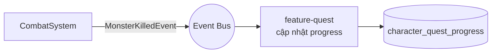

# GAMEPLAY.md

**Hệ thống gameplay phía server**

| | |
|---|---|
| Version | 1.0.0 |
| Status | Draft |
| Liên quan | [GAME-DESIGN-DOCUMENT.md](../13-game-design/GAME-DESIGN-DOCUMENT.md), [ECS.md](../03-engine/ECS.md), [SERVER.md](SERVER.md) |

> **GDD nói game LÀ GÌ. Tài liệu này nói server IMPLEMENT nó THẾ NÀO.**
> Mọi hệ thống ở đây phải map ngược về một mục trong GDD. Không có mục GDD tương ứng → không implement.

---

## 1. Bản đồ: tính năng GDD → module/System

| Tính năng (GDD) | Nơi implement | Kiểu |
|---|---|---|
| Di chuyển, nhảy | `server-world` · `MovementSystem` | ECS |
| Combat, damage | `server-world` · `CombatSystem` | ECS |
| Skill, cooldown | `server-world` · `SkillSystem` | ECS + Script |
| Quái, Boss AI | `server-world` · `AISystem` | ECS + Script |
| Rơi đồ | `server-world` · `LootSystem` → Event | ECS |
| Túi đồ, trang bị | `feature-inventory` | Clean Arch |
| Cường hoá | `feature-inventory` | Clean Arch |
| Nhiệm vụ | `feature-quest` | Clean Arch + Script |
| Bang hội | `feature-guild` | Clean Arch |
| Thư | `feature-mail` | Clean Arch |
| Bạn bè | `feature-friend` | Clean Arch |
| Chat | `feature-chat` | Clean Arch |
| Cửa hàng | `feature-shop` | Clean Arch |

**Nguyên tắc phân chia** (Điều 25):
- **Realtime, chạy mỗi tick, nhiều entity** → ECS trong `server-world`.
- **Giao dịch, nghiệp vụ, gọi theo sự kiện** → Clean Architecture trong `feature-*`.

---

## 2. Character

| Việc | Nơi | Ghi chú |
|---|---|---|
| Tạo nhân vật | `feature-character` | Validate tên (trùng, từ cấm) |
| Chỉ số cơ bản (STR/AGI/INT/VIT) | `character_stat` | Nguồn chân lý ở DB |
| **Chỉ số dẫn xuất** (ATK/DEF/CRIT...) | **Server tính** từ base stat + trang bị + buff | ⚠️ Client **không** tự tính |
| Level up | `feature-character` | Bắn `LevelUpEvent` |
| Chuyển sinh | `feature-character` | Post-MVP |

⚠️ **Chỉ số dẫn xuất phải tính lại ở server mỗi khi**: đổi trang bị · lên cấp · nhận/hết buff. Client nhận kết quả để hiển thị. Client tính lại chỉ để hiện UI mượt — **không** để quyết định gameplay (Điều 15).

Công thức derive nằm ở `CombatConstants` ([CODING-STANDARDS.md §18](../02-coding-standards/CODING-STANDARDS.md)) — **không hardcode rải rác**.

---

## 3. Combat

**Quy tắc số 1**: combat **không** dùng Box2D ([PHYSICS.md §1](../03-engine/PHYSICS.md)).

```
Client: UseSkillCommand(skillId, targetId hoặc hướng)
   ↓
Server (SkillSystem):
   1. Skill có tồn tại? nhân vật đã học chưa?
   2. Cooldown xong chưa?          ← server giữ cooldown, không tin client
   3. Đủ Khí không?
   4. Mục tiêu hợp lệ? trong tầm?  ← server tự kiểm tra hình học
   5. Tính damage (CombatConstants + script)
   6. Áp dụng damage → HealthComponent
   7. Bắn Event nếu chết
   ↓
Response + Event cho các client liên quan (trong AoI)
```

**Server giữ mọi thứ**: cooldown, Khí, vị trí, HP. Client chỉ có bản sao để hiển thị.

**Công thức damage**: đã chốt (placeholder, cần playtest) — xem [GAME-DESIGN-DOCUMENT.md §5–6](../13-game-design/GAME-DESIGN-DOCUMENT.md#5-nhân-vật--tiến-trình). Toàn bộ hệ số derive/damage/Lực Chiến nằm ở `CombatConstants` ([CODING-STANDARDS.md §18](../02-coding-standards/CODING-STANDARDS.md)), không hardcode rải rác trong `CombatSystem`.

⚠️ **Roll ngẫu nhiên** (né/trúng, bạo kích) — như mọi random ảnh hưởng gameplay, **chỉ sinh ở server** ([ENGINE.md §10](../03-engine/ENGINE.md)), không bao giờ ở client dù chỉ để dự đoán UI.

⚠️ **Lực Chiến** (GDD §5) chỉ là giá trị hiển thị/xếp hạng tính SAU khi đã có đủ chỉ số dẫn xuất — không bao giờ dùng ngược lại để tính damage hay bất kỳ quyết định gameplay nào khác (một chiều: stat → Lực Chiến, không có chiều ngược).

---

## 4. Skill

| Phần | Ở đâu | Vì sao |
|---|---|---|
| Cơ chế (cooldown, trừ Khí, kiểm tra tầm) | **Java** — `SkillSystem` | Chạy mỗi tick, phải nhanh |
| **Hiệu ứng cụ thể** (gây bao nhiêu damage, buff gì) | **Script** — `effect_script_ref` | Điều 27 — sửa không rebuild |
| Tham số (cooldown_ms, chi_cost) | **DB** — `skill_template` | Điều 27 |

**Phân định**: Java lo *cơ chế*, Script lo *nội dung*, DB lo *tham số*.

Engine scripting đã chốt: [ADR-016](../01-architecture/adr/ADR-016-Scripting-Engine.md) — GraalJS.

---

## 5. Monster & Spawn

| Việc | Cách |
|---|---|
| Spawn point | Đánh dấu trong map data (HyperLap2D) — [RESOURCE.md §1](../04-client/RESOURCE.md) |
| Tham số quái | `monster_template` |
| AI | FSM ([AI.md §3](../03-engine/AI.md)) |
| Respawn | `SpawnSystem` đếm thời gian trong tick |
| Rơi đồ | `drop_table` → `LootSystem` |

⚠️ **Tỉ lệ rơi đồ tính ở server bằng random của server** ([ENGINE.md §10](../03-engine/ENGINE.md)). Client không bao giờ tự random thứ ảnh hưởng gameplay.

---

## 6. Boss & Dungeon

| Việc | Cách | Trạng thái |
|---|---|---|
| Boss AI nhiều pha | Behavior Tree hoặc Script ([AI.md §4](../03-engine/AI.md)) | Post-MVP |
| Dungeon instance | Mỗi party 1 instance riêng | Post-MVP |
| World Boss | Toàn server, damage ranking | Post-MVP |

⚠️ **Dungeon instance là quyết định kiến trúc chưa giải quyết**: mỗi instance là một "world" riêng trong cùng process, hay process riêng? Ảnh hưởng [ARCHITECTURE.md §14](../01-architecture/ARCHITECTURE.md) scaling. Cần ADR khi tới Phase 8.

---

## 7. Inventory & Equipment

Clean Architecture ([REPOSITORY-STRUCTURE.md §4](../01-architecture/REPOSITORY-STRUCTURE.md)).

| Use case | Ghi chú |
|---|---|
| `AddItemUseCase` | Kiểm tra túi đầy, stack |
| `MoveItemUseCase` | Kiểm tra slot hợp lệ |
| `EquipItemUseCase` | Kiểm tra level/faction yêu cầu → **tính lại chỉ số dẫn xuất** (§2) |
| `EnhanceItemUseCase` | ✅ **Đã code** (2026-07-23) — ⚠️ **Transaction bắt buộc** — tốn gold + đổi enhance_level |

⚠️ **Cường hoá là nơi dễ mất tài sản nhất**: trừ gold thành công nhưng ghi `enhance_level` thất bại = người chơi mất tài sản. **Bắt buộc transaction** ([DATABASE.md §5](DATABASE.md)) + **audit log** (`audit_log`, migration V7).

### 7.1 Cường hoá — tỉ lệ thành công + chi phí gold (+0→+15)

GDD chỉ ghi "tỉ lệ giảm dần, có Bảo Vệ chống rớt cấp từ +10" mà không có số cụ thể — bảng dưới là
**đề xuất khởi điểm đã được chủ dự án duyệt** (2026-07-23), chỉnh cân bằng trực tiếp ở
`EnhancementTable` (feature-inventory) khi cần, không cần đổi `EnhanceItemUseCase`:

| Cấp hiện tại | Tỉ lệ thành công | Gold cost | Thất bại |
|---|---|---|---|
| +0→+1 | 95% | 100 | Không mất cấp |
| +1→+2 | 90% | 200 | Không mất cấp |
| +2→+3 | 85% | 350 | Không mất cấp |
| +3→+4 | 80% | 550 | Không mất cấp |
| +4→+5 | 70% | 800 | Không mất cấp |
| +5→+6 | 60% | 1200 | Không mất cấp |
| +6→+7 | 50% | 1700 | Không mất cấp |
| +7→+8 | 40% | 2300 | Không mất cấp |
| +8→+9 | 30% | 3000 | Không mất cấp |
| +9→+10 | 20% | 4000 | Không mất cấp |
| +10→+11 | 15% | 5500 | **Rớt 1 cấp** |
| +11→+12 | 12% | 7500 | **Rớt 1 cấp** |
| +12→+13 | 10% | 10000 | **Rớt 1 cấp** |
| +13→+14 | 8% | 14000 | **Rớt 1 cấp** |
| +14→+15 | 5% | 20000 | **Rớt 1 cấp** |

⚠️ **"Bảo Vệ" (item/flag chống rớt cấp từ +10) CHƯA CODE** — lát cắt hiện tại (2026-07-23) chỉ có
rớt cấp thật khi thất bại từ +10 trở lên (`EnhanceResult.FAILED_DROPPED`), chưa có cách chống. Chừa
sẵn 2 nhánh fail riêng (`FAILED_NO_DROP`/`FAILED_DROPPED`) để lát cắt sau thêm Bảo Vệ không cần đổi
enum kết quả.

**Gold**: cột `character_stat.gold` (migration V7) — đặt ở `character_stat` (không phải
`character`) vì bảng này vốn đã tách riêng do tần suất ghi/đọc cao (DATABASE.md §2.1), và gold đổi
liên tục mỗi lần cường hoá/mua bán. `feature-inventory` trừ gold qua `GoldPort` riêng (không gọi
`CharacterFacade`) vì cần trừ NGUYÊN TỬ trong cùng transaction với đổi `enhance_level` — xem
feature-inventory/CLAUDE.md.

---

## 8. Trade

⚠️ **Hệ thống nguy hiểm nhất của MMORPG.** Mọi lỗi ở đây = duplicate item = phá kinh tế server.

| Yêu cầu | Vì sao |
|---|---|
| **Transaction** cho toàn bộ giao dịch | Mất một nửa = mất item |
| **Audit log** mọi giao dịch | Điều tra gian lận |
| **Cả hai bên xác nhận** (2-phase confirm) | Chống lừa đảo |
| **Khoá item khi đang trade** | Chống trade cùng item cho 2 người |
| **Idempotency** | Chống retry duplicate ([NETWORK.md §5](NETWORK.md)) |

**Post-MVP**, nhưng ghi ở đây vì thiết kế inventory (§7) phải **chừa chỗ** cho khoá item.

---

## 9. Quest

| Phần | Ở đâu |
|---|---|
| Cơ chế theo dõi tiến độ | Java — `feature-quest` |
| **Nội dung quest** (điều kiện, thưởng, dialogue) | **Script** — `script_ref` (Điều 27) |
| Lắng nghe sự kiện | `MonsterKilledEvent`, `ItemAcquiredEvent`... → cập nhật `progress_json` |



⚠️ **Hiệu năng**: mỗi lần giết quái → kiểm tra mọi quest đang làm? Với 1000 người chơi × 20 quest = tốn. → Cần index quest theo loại sự kiện, không quét tuyến tính. **Đo ở Phase 6.**

---

## 10. Chat

| Kênh | Phạm vi | Rate limit |
|---|---|---|
| Thế giới | Toàn server | Nghiêm ngặt (chống spam) |
| Bang hội | Thành viên bang | Vừa |
| Party | Thành viên party | Lỏng |
| Riêng tư | 1-1 | Vừa |
| Khu vực | Trong AoI | Lỏng |

**Bắt buộc**: rate limit ([NETWORK.md §13](NETWORK.md)) · lọc từ cấm · audit log cho chat báo cáo.

⚠️ **Chat là vector tấn công**: XSS (nếu client render HTML), spam, lừa đảo, quảng cáo gold-selling. Xử lý ở [SECURITY.md](../08-security/SECURITY.md).

---

## 11. Guild / Friend / Mail

| Hệ thống | MVP | Ghi chú |
|---|---|---|
| Guild | Shell (tạo/tham gia) | Chiến tranh lãnh địa: Post-MVP |
| Friend | ✅ | Trạng thái online qua Redis |
| Mail | ✅ | ⚠️ Mail có item = **transaction** khi nhận |

⚠️ **Mail đính kèm item** là con đường duplicate item kinh điển: nhận item nhưng không đánh dấu mail đã nhận → nhận lại được. **Transaction bắt buộc.**

---

## 12. Anti-Cheat ở tầng gameplay

Chi tiết: [SECURITY.md](../08-security/SECURITY.md). Ở tầng gameplay:

| Hack | Chặn bằng |
|---|---|
| Speed hack | Server kiểm tra khoảng cách di chuyển/tick ≤ tốc độ tối đa |
| Teleport | Như trên — di chuyển quá xa trong 1 tick = từ chối |
| Đi xuyên tường | Server chạy physics ([PHYSICS.md §3](../03-engine/PHYSICS.md)) |
| Cooldown hack | Server giữ cooldown, không tin client |
| Damage hack | Server tính damage |
| Item duplicate | Transaction + audit (§7, §8, §11) |
| Bot | ⚠️ **Khó** — ngoài scope MVP |

---

## 13. Ngân sách hiệu năng

| Hệ thống | Ngân sách/tick (**60Hz = 16.6ms**) | Nguồn |
|---|---|---|
| Movement + Physics | ≤ 2.5ms | [PHYSICS.md](../03-engine/PHYSICS.md) |
| Combat + Skill | ≤ 1.5ms | — |
| AI | ≤ 2.5ms | [AI.md §9](../03-engine/AI.md) |
| Quest event | ≤ 0.5ms | §9 |

⚠️ **Chưa đo.** Là ngân sách đề xuất — đo ở Phase 9 ([SERVER.md §11](SERVER.md)).

---

## Technical Decisions

| # | Quyết định | Lý do | Trạng thái |
|---|---|---|---|
| 1 | Realtime → ECS; nghiệp vụ → Clean Arch | Điều 25 | Accepted |
| 2 | **Chỉ số dẫn xuất server tính**, client chỉ hiển thị | Điều 15 | Accepted |
| 3 | Combat **không** dùng Box2D | Không xác định | Accepted |
| 4 | Java = cơ chế, Script = nội dung, DB = tham số | Điều 27 | Accepted |
| 5 | **Random ảnh hưởng gameplay chỉ ở server** | Điều 15 | Accepted |
| 6 | **Transaction + audit bắt buộc** cho: cường hoá, trade, mail item, shop | Mất/duplicate item = phá kinh tế | Accepted |
| 7 | Inventory phải **chừa chỗ khoá item** cho trade sau này | Thêm sau = refactor lớn | Accepted |
| 8 | Quest index theo loại sự kiện, không quét tuyến tính | Hiệu năng | Accepted — đo Phase 6 |
| 9 | Công thức damage đã chốt (GDD §5-6): giảm giáp/kháng kiểu LMHT (diminishing returns) + `DEF`/`RES` tách vật lý/phép | Là quyết định game design | Accepted (placeholder, playtest) |
| 10 | Dungeon instance: cùng process hay riêng? | Ảnh hưởng scaling | ⏳ Chặn Phase 8 |
| 11 | Chống bot: **ngoài scope MVP** | Trung thực về giới hạn | Accepted |

## ADR cần tạo

| ADR | Nội dung | Ưu tiên |
|---|---|---|
| **ADR-025** | Idempotency — chặn §8 trade | ✅ Accepted |
| **ADR-026** | Dungeon instance model (§6) | 🟢 Chặn Phase 8 |

## Tài liệu liên quan

- [GAME-DESIGN-DOCUMENT.md](../13-game-design/GAME-DESIGN-DOCUMENT.md) — **nguồn của mọi thứ ở đây**
- [ECS.md](../03-engine/ECS.md) · [AI.md](../03-engine/AI.md) · [PHYSICS.md](../03-engine/PHYSICS.md)
- [SERVER.md](SERVER.md) · [DATABASE.md](DATABASE.md) · [NETWORK.md](NETWORK.md)
- [SECURITY.md](../08-security/SECURITY.md) — §12
- [SCRIPTING.md](../06-plugin/SCRIPTING.md) — §4, §9

## Việc cần làm tiếp theo

1. ✅ Công thức damage đã chốt (GDD §5-6) — **Phase 4 hết bị chặn**, có thể bắt đầu code `CombatSystem`/`CombatConstants`.
2. ✅ ADR-016 (script engine — GraalJS) đã Accepted.
3. ✅ `UseSkillCommand` thật (2026-07-22) — `SkillSystem` + script GraalJS thật (`fireball.js`), SKILL_DMG/RES derive + tiêu thụ. CHỈ 1 skill hardcode, chưa có `skill_template`/`character_skill` DB (giống `monster_template`) — nối DB thật + nhiều skill là việc lát cắt sau.
4. Phase 5: thiết kế inventory **có chỗ cho khoá item** (§7) dù trade là Post-MVP.
5. Phase 4+: playtest cân bằng toàn bộ hệ số derive/damage/Lực Chiến (GDD §5-6) — hiện là placeholder.
