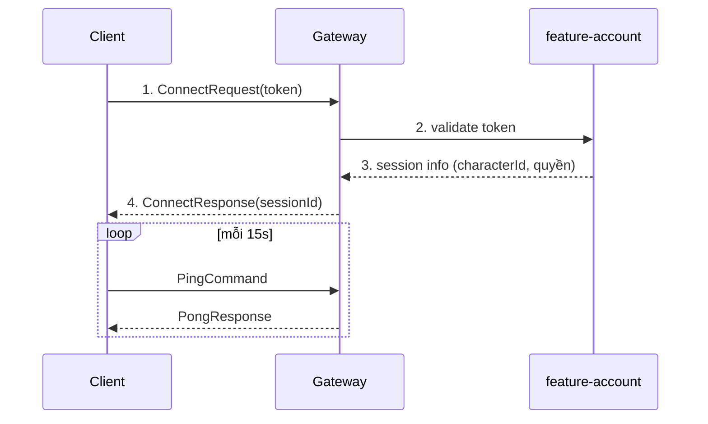

# NETWORK.md

**Giao thức mạng Client ⇄ Server**

| | |
|---|---|
| Version | 1.1.0 |
| Status | Draft |
| Liên quan | [SERVER.md](SERVER.md), [ADR-003](../01-architecture/adr/ADR-003-Why-Netty.md) |

> Không packet nào được thêm vào hệ thống mà không tuân thủ tài liệu này.

---

## 1. Transport

| Hạng mục | Quyết định |
|---|---|
| Giao thức | **TCP** qua Netty |
| Framing | Length-prefixed: 4-byte big-endian length + payload. Dùng `LengthFieldBasedFrameDecoder`/`LengthFieldPrepender` — **không tự viết** |
| Mã hoá | **TLS bắt buộc ở Production**. Dev có thể tắt qua flag tường minh, không mặc định tắt. Cơ chế cụ thể (self-signed+pin cho Closed Beta): [ADR-027](../01-architecture/adr/ADR-027-TLS-Transport-Security.md) ✅ Accepted, code xong 2026-07-31 |
| UDP | ❌ Không ở MVP — xem §11 |

---

## 2. Cấu trúc Packet

```
┌────────────┬──────────────────┬──────────────┬─────────────────┐
│ length (4) │ opcode (2)       │ protoVer (1) │ sequenceId (4)  │  ← Header (11 byte)
├────────────┴──────────────────┴──────────────┴─────────────────┤
│ payload (Protobuf-encoded)                                      │
└─────────────────────────────────────────────────────────────────┘
```

| Field | Kiểu | Mô tả |
|---|---|---|
| `length` | uint32 | Độ dài phần còn lại (Netty xử lý) |
| `opcode` | uint16 | Loại packet — §4 |
| `protocolVersion` | uint8 | Version protocol — §6 |
| `sequenceId` | uint32 | Khớp Request ↔ Response — §5 |
| `payload` | bytes | Protobuf, schema ở `shared-protocol` |

**Header không dùng Protobuf** — để routing không phải parse toàn bộ. Chỉ `payload` là Protobuf.

`PacketCodec` **dùng chung** giữa `server-gateway` và `client-core` (nằm ở `shared-protocol`) — bảo đảm hai bên không bao giờ lệch.

---

## 3. Phân loại Packet

| Loại | Hướng | Cần Response? | Ví dụ |
|---|---|---|---|
| **Command** | Client → Server | ✅ | `MoveCommand`, `UseSkillCommand`, `BuyItemCommand` |
| **Response** | Server → Client | — | `MoveResponse`, `UseSkillResponse` |
| **Event** | Server → Client | ❌ | `MonsterKilledEvent`, `PlayerJoinedEvent` |
| **Heartbeat** | Hai chiều | ✅ | `PingCommand` / `PongResponse` |

**Naming**: `<Domain><Action>Command` · `<Domain><Action>Response` · `<Domain><Fact>Event`

✅ `InventoryAddItemCommand` · ❌ `InventoryPacket`, `Packet01`

**Event dùng thì quá khứ** — `MonsterKilledEvent` ✅, `KillMonsterEvent` ❌ (đó là Command trá hình — [ADR-008](../01-architecture/adr/ADR-008-Why-EventDriven.md)).

```java
// shared-protocol
public sealed interface Packet permits Command, Response, Event {}
```

---

## 4. Opcode Registry

Dải số cố định theo domain — tránh đụng độ khi nhiều người/AI thêm packet song song.

| Dải | Domain |
|---|---|
| 0–99 | System (handshake, heartbeat, error) |
| 100–199 | Account / Login |
| 200–299 | Character |
| 300–399 | Movement / World |
| 400–499 | Combat / Skill |
| 500–599 | Inventory / Equipment |
| 600–699 | Quest / NPC / Dialogue |
| 700–799 | Guild |
| 800–899 | Chat |
| 900–999 | Mail |
| 1000–1099 | Shop / Auction |
| 1100–1199 | Friend |
| 1200–1299 | Ranking (Phase 8: chỉ `GetPvpRating`, chưa có bảng xếp hạng toàn server) |
| 1300–1399 | Party |
| 1400–1499 | Trade |
| 1500–1599 | Dungeon |
| 1600–1699 | Arena (PvP 1v1, Phase 8) |
| 1700+ | Dự trữ — không dùng khi chưa cập nhật bảng này |

**Nguồn chân lý thật**: `shared-protocol/src/main/proto/opcode_registry.proto`. Tài liệu này là bản tóm tắt — **lệch nhau thì file `.proto` thắng**.

Tổng opcode đã cấp phát (không tính `OPCODE_UNSPECIFIED`): **157** (2026-08-27).
Lượt cấp gần nhất — [ADR-035](../01-architecture/adr/ADR-035-Client-State-Sync-Opcodes.md) (Accepted 2026-08-27), 150 → 157:

| Opcode | Số | Dải |
|---|---|---|
| `OPCODE_GOLD_CHANGED_EVENT` | 209 | Character |
| `OPCODE_LIST_INVENTORY_REQUEST` / `_RESPONSE` | 507 / 508 | Inventory |
| `OPCODE_GET_ITEM_CATALOG_REQUEST` / `OPCODE_ITEM_CATALOG_RESPONSE` | 509 / 510 | Inventory |
| `OPCODE_LIST_QUESTS_REQUEST` / `_RESPONSE` | 610 / 611 | Quest |

> **511 để trống có chủ ý** — dành sẵn cho `ITEM_REMOVED_EVENT` (ADR-035 Revisit Trigger #3). Đừng cấp số này cho packet khác.

---

## 5. Request/Response Correlation

- Client sinh `sequenceId` tăng dần **theo từng kết nối** (không cần global unique).
- Server trả Response với **cùng `sequenceId`** → client khớp `CompletableFuture`, **không** đoán theo thứ tự đến.
- Timeout mặc định **5s** → coi là lỗi mạng.

⚠️ **Không tự retry Command có side-effect** (`BuyItemCommand`, trade) khi server chưa có **idempotency**. Retry mù = mua 2 lần, mất tiền thật của người chơi.

→ Command có side-effect cần **idempotency key** ở server. **Chưa thiết kế** — cần làm ở Phase 3.

---

## 6. Versioning & Backward Compatibility

Điều 40.

| Quy tắc | Chi tiết |
|---|---|
| `protocolVersion` tăng | Khi breaking change ở header hoặc cách encode chung |
| Protobuf field | **Chỉ được THÊM field mới.** Không đổi ý nghĩa, không xoá field đang dùng |
| Field bỏ | Đánh dấu `deprecated` trước, xoá sau ≥1 minor release |
| Client cũ | Server chấp nhận **tối thiểu 1 minor version cũ hơn** |
| Client quá cũ | Trả Event "cần cập nhật", **không** ngắt kết nối đột ngột |

**Cấm tuyệt đối**: đổi số field protobuf đang dùng. Client cũ sẽ đọc sai dữ liệu **mà không báo lỗi** — đây là loại bug tệ nhất.

---

## 7. Error Handling

Không trả exception message thô về client.

```protobuf
message ErrorResponse {
  uint32 errorCode = 1;         // mã lỗi domain-specific
  string errorKey = 2;          // key i18n — KHÔNG phải message tiếng Việt cứng
  uint32 relatedSequenceId = 3;
}
```

Client hiển thị theo `errorKey` + ngôn ngữ hiện tại ([UI.md §7](../04-client/UI.md)).

⚠️ **Không** đưa chi tiết kỹ thuật vào error (stack trace, tên bảng DB, câu SQL) — đó là lỗ hổng thông tin ([SECURITY.md](../08-security/SECURITY.md)).

---

## 8. Compression

| Quyết định | Chi tiết |
|---|---|
| **MVP: KHÔNG nén** | Protobuf đã khá nhỏ; nén thêm CPU cho lợi ích chưa rõ (Điều 30 — đo trước) |
| Nếu cần | Nén **có ngưỡng**: chỉ nén packet > N byte (nén packet 20 byte là phản tác dụng) |
| Ứng viên | LZ4 (nhanh) hơn là gzip (nén tốt nhưng chậm) |

**Đo trước ở Phase 9**: băng thông có thật sự là bottleneck không? Nếu AoI + delta compression (§6 SERVER.md) đã giải quyết → không cần nén.

---

## 9. Encryption

| Hạng mục | Quyết định |
|---|---|
| Transport | **TLS** — dùng chuẩn, **không tự viết mã hoá** |
| Payload | Không mã hoá thêm (TLS đã lo) |
| Mật khẩu | ✅ Đã chốt ở [SECURITY.md §3](../08-security/SECURITY.md): **KHÔNG hash ở client**, gửi qua TLS nguyên bản (hash ở client = hash trở thành mật khẩu mới). ⚠️ Chưa áp dụng được — hệ thống hiện CHƯA có password login nào (chỉ username, xem `V1__create_account_table.sql`), quyết định này chờ tới khi có |

⚠️ **Không tự phát minh mã hoá.** Đây là quy tắc tuyệt đối. Tự viết crypto = chắc chắn có lỗ hổng.

---

## 10. Heartbeat & Reconnect

**Heartbeat:**
- Client gửi `PingCommand` mỗi ~15s.
- Server không nhận ping trong ~45s → coi kết nối chết, dọn dẹp.
- Phát hiện kết nối chết là **bắt buộc** — TCP có thể "treo" mà không báo lỗi.

**Reconnect:**

```
Mất kết nối
    ↓
Client thử lại (backoff: 1s, 2s, 4s, 8s... tối đa 30s)
    ↓
Kết nối lại với session token cũ
    ↓
├─ Session còn hạn  → vào lại đúng chỗ, nhận full snapshot
└─ Session hết hạn  → về màn hình Login
```

⚠️ **Backoff bắt buộc** — không có backoff, 1000 client mất kết nối cùng lúc sẽ retry đồng loạt và giết server đang phục hồi (thundering herd).

**Server giữ session bao lâu sau khi mất kết nối?** Chưa chốt — quá ngắn thì mất kết nối 2s là mất nhân vật; quá dài thì nhân vật đứng như bia đỡ đạn trong PvP. **Đề xuất: 30–60s**, cần cân nhắc cùng game design.

---

## 11. UDP — vì sao chưa

| Ủng hộ UDP | Phản đối |
|---|---|
| Không head-of-line blocking | Phải tự làm reliability, ordering, congestion control |
| Latency thấp hơn cho movement | Phức tạp hơn nhiều (Điều 9) |
| | Nhiều firewall/NAT chặn UDP |
| | MMORPG 2D không nhạy latency như FPS |

**Quyết định**: TCP ở MVP. Đánh giá lại **chỉ khi** đo được latency movement không đạt ở Phase 9 (Điều 30).

---

## 12. Validation

Điều 43 — **mọi dữ liệu từ client là không đáng tin.**

| Tầng | Kiểm tra |
|---|---|
| Gateway | Kích thước packet, opcode hợp lệ, session hợp lệ, rate limit |
| Protobuf decode | Sai format → drop, log |
| Feature/World | **Validate nghiệp vụ**: có đủ tiền không? có ở gần NPC không? skill có cooldown xong không? |

⚠️ **Validate ở gateway KHÔNG thay thế validate nghiệp vụ.** Gateway chỉ biết "packet đúng format", không biết "người chơi có đủ tiền".

---

## 13. Rate Limiting

| Loại | Giới hạn (đề xuất — chưa verify) |
|---|---|
| `MoveCommand` | ≤ tick rate (30/giây) |
| `UseSkillCommand` | ≤ 10/giây |
| `ChatCommand` | ≤ 2/giây |
| `BuyItemCommand` | ≤ 5/giây |
| Tổng mọi Command | ≤ 100/giây |

Vượt ngưỡng → drop packet + log. Vượt liên tục → ngắt kết nối + cảnh báo ([SECURITY.md](../08-security/SECURITY.md)).

Đếm bằng Redis (`ratelimit:{characterId}:{opcode}`) hoặc in-memory nếu single instance.

---

## 14. Authentication Handshake



Cơ chế token: session token tự phát hành + Redis, sliding TTL 24h — **ADR-017** ✅ Accepted, xem [SECURITY.md](../08-security/SECURITY.md).

---

## Technical Decisions

| # | Quyết định | Lý do | Trạng thái |
|---|---|---|---|
| 1 | TCP + length-prefixed framing của Netty | Không tự viết thứ đã có | Accepted |
| 2 | Header **không** Protobuf, chỉ payload | Routing không cần parse toàn bộ | Accepted |
| 3 | `PacketCodec` dùng chung client/server ở `shared-protocol` | Hai bên không bao giờ lệch | Accepted |
| 4 | Opcode chia dải theo domain | Tránh đụng độ khi làm song song | Accepted |
| 5 | **Chỉ được THÊM field protobuf**, không đổi/xoá | Client cũ đọc sai mà không báo lỗi | Accepted |
| 6 | Server trả `errorKey`, không trả message | i18n + không lộ thông tin | Accepted |
| 7 | **MVP không nén** | Đo trước (Điều 30) | Accepted |
| 8 | **TLS chuẩn, không tự viết crypto** — cơ chế cụ thể [ADR-027](../01-architecture/adr/ADR-027-TLS-Transport-Security.md) | Tuyệt đối | Accepted |
| 9 | **Reconnect bắt buộc có backoff** | Chống thundering herd | Accepted |
| 10 | **TCP ở MVP**, không UDP | Điều 9; MMORPG 2D không nhạy latency như FPS | Accepted |
| 11 | Validate gateway **không** thay validate nghiệp vụ | Hai việc khác nhau | Accepted |
| 12 | Idempotency cho Command có side-effect — [ADR-025](../01-architecture/adr/ADR-025-Idempotency.md) | Chống retry mua 2 lần | ✅ **7/7 Command có rủi ro double-effect thật đã có `idempotency_key` (2026-08-02)**: `CreateCharacterCommand`, `BuyItemCommand`/`SellItemCommand`, `ClaimMailCommand`, `ConfirmTradeCommand` (đã có từ trước), cộng `EnhanceItemCommand`/`ClaimQuestRewardCommand` (retrofit đợt này — audit hệ thống phát hiện 2 Command này trừ gold/trao thưởng thật nhưng chưa enforce). `EquipItemCommand`/`UnequipItemCommand`/`CreateGuildCommand` và mọi Command của guild/party/friend/chat/dialogue/arena/dungeon KHÔNG cần field này — tự nhiên idempotent (đổi trạng thái thuần, không gold/item/EXP) hoặc đã có guard nghiệp vụ chặn double-effect (VD `CreateGuildCommand` retry gặp `ALREADY_IN_GUILD`). Còn 1 lỗ hổng KHÁC (không phải idempotency) được phát hiện nhưng CHƯA sửa: `SendMailCommand` cho phép đính kèm `gold_amount`/item mà KHÔNG trừ gì từ người gửi (`SendMailUseCase` chỉ có `MailRepositoryPort`) — cần quyết định thiết kế riêng trước khi vá, xem ghi chú ở `feature-mail/CLAUDE.md`. |
| 13 | Session giữ 30–60s sau mất kết nối (đề xuất) | Cân bằng UX vs PvP | ⏳ Chờ game design |
| 14 | Rate limit §13 verify qua socket thật | `SecurityIntegrationTest` (server-gateway) flood `MoveCommand`/chat WORLD thật, xác nhận `kage.ratelimit.rejected` tăng + kết nối bị ngắt sau vi phạm liên tục | ✅ **implemented 2026-08-02** |

## ADR cần tạo

| ADR | Nội dung | Ưu tiên |
|---|---|---|
| **ADR-017** | **Auth token**: session token tự phát hành (§14) | ✅ Accepted |
| **ADR-025** | Idempotency strategy cho Command có side-effect (§5, §12) | ✅ Accepted |

## Tài liệu liên quan

- [SERVER.md](SERVER.md) — §2 luồng Command, §6 state sync
- [SECURITY.md](../08-security/SECURITY.md) — auth, anti-cheat, rate limit
- [CLIENT.md §8](../04-client/CLIENT.md) — network layer phía client
- [DATABASE.md](DATABASE.md) — rate limit counter ở Redis
- [ADR-003](../01-architecture/adr/ADR-003-Why-Netty.md) — vì sao Netty

## Việc cần làm tiếp theo

1. ~~ADR-025 (idempotency)~~ — ✅ Accepted 2026-07-19. Việc còn lại: triển khai `idempotencyKey` thật khi viết Command side-effect ở Phase 3.
2. ~~ADR-017 (auth token)~~ — ✅ Accepted 2026-07-19.
3. Phase 3: dựng `opcode_registry.proto` làm nguồn chân lý thật cho §4.
4. Phase 9: đo băng thông → quyết định §8 (nén) dựa trên số liệu.
