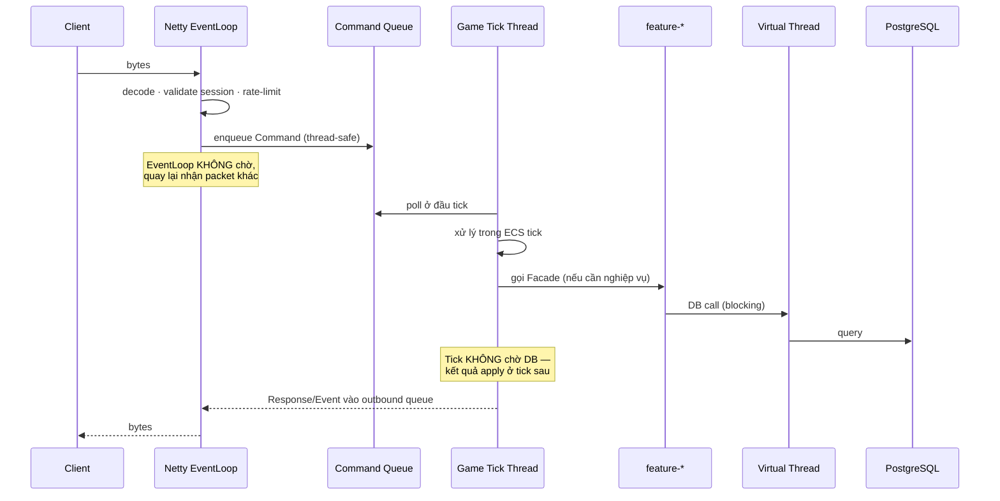

# SERVER.md

**Kiến trúc Server**

| | |
|---|---|
| Version | 1.0.0 |
| Status | Draft |
| Liên quan | [ARCHITECTURE.md](../01-architecture/ARCHITECTURE.md), [ADR-003](../01-architecture/adr/ADR-003-Why-Netty.md), [ADR-009](../01-architecture/adr/ADR-009-Why-No-Spring-Boot.md) |

> **Server là nguồn chân lý duy nhất** (Điều 15). Mọi thứ ở đây phục vụ nguyên tắc đó.

---

## 1. Các thành phần

| Module | Trách nhiệm | Biết Netty? | Biết DB? |
|---|---|---|---|
| `server-gateway` | Accept, auth, session, rate-limit, encode/decode, routing | ✅ **duy nhất** | ❌ |
| `server-world` | ECS simulation: movement, combat, AI, spawn | ❌ | ❌ |
| `server-features/*` | Nghiệp vụ: inventory, guild, quest... | ❌ | ✅ qua Port |
| `server-database` | Adapter PostgreSQL/Redis | ❌ | ✅ **duy nhất** |

**Ranh giới này là kiến trúc, không phải gợi ý** — enforce bằng build (ADR-011).

---

## 2. Luồng một Command



**Ba ranh giới thread bất khả xâm phạm:**

| Thread | Được làm | ❌ Cấm |
|---|---|---|
| Netty EventLoop | decode, validate rẻ, enqueue | Query DB · logic nặng · chờ lock |
| Game Tick (1 thread) | Toàn bộ ECS + gameplay | Blocking I/O · `sleep` · `future.get()` |
| Virtual Thread | Blocking I/O (DB, API ngoài) | Sửa ECS state trực tiếp |

⚠️ **Vi phạm bất kỳ ô "cấm" nào = server giật hoặc chết.** Đây là lỗi nghiêm trọng nhất có thể mắc ở tầng server.

---

## 3. Game Tick — single thread

Quyết định nền tảng ([JAVA-GUIDELINES.md §5.1](../02-coding-standards/JAVA-GUIDELINES.md)).

**Vì sao single-thread:**
- Loại bỏ phần lớn bài toán concurrency trong gameplay → không lock, không race condition trong ECS.
- Xác định, tái hiện được bug.
- Đơn giản (Điều 9).

**Đánh đổi**: 1 core cho gameplay. Hết dư địa → **nhiều world instance** (scale ngang), không phải multi-thread trong 1 world ([ARCHITECTURE.md §14](../01-architecture/ARCHITECTURE.md)).

```java
// Vòng lặp server — fixed timestep (ENGINE.md §4)
while (running) {
    long start = System.nanoTime();

    commandQueue.drainTo(pendingCommands);   // lấy Command từ EventLoop
    engine.update(FIXED_DT);                  // toàn bộ ECS
    outboundQueue.flush();                    // đẩy Response/Event ra

    long elapsed = System.nanoTime() - start;
    long sleepNanos = FIXED_DT_NANOS - elapsed;
    if (sleepNanos > 0) LockSupport.parkNanos(sleepNanos);
    else log.warn("Tick quá hạn: {}ms", elapsed / 1_000_000);   // ⚠️ cảnh báo
}
```

⚠️ **Tick quá hạn phải log WARN** — đây là tín hiệu sớm nhất của vấn đề hiệu năng. Không có nó, ta chỉ biết khi người chơi kêu.

---

## 4. Tick Rate — **60Hz** ([ADR-018](../01-architecture/adr/ADR-018-Tick-Rate.md))

| Tick rate | Ngân sách/tick | Băng thông | Độ mượt |
|---|---|---|---|
| 20Hz | 50ms | Thấp nhất | Đủ cho MMORPG chậm |
| 30Hz | 33ms | Trung bình | Cân bằng |
| **60Hz** | **16.6ms** | Cao (×2 so với 30) | **Mượt nhất — đã chọn** |

**Đã chốt 60Hz** (ADR-018): ưu tiên độ mượt combat/input. Đánh đổi: ngân sách mỗi tick chỉ 16.6ms và băng thông ~2× so với 30Hz → **AoI + delta compression bắt buộc sớm** (§6).

⚠️ **Lưu ý bắt buộc**: tick rate ≠ snapshot rate. Với 60Hz, **nên hạ snapshot rate cho entity xa** (VD gửi 20–30Hz) để cắt băng thông mà vẫn giữ logic mượt — xem §6.

⚠️ Nếu Phase 9 đo thấy không giữ được p99 trong 16.6ms → Revisit Trigger của ADR-018 (hạ về 30Hz).

---

## 5. Gateway

| Trách nhiệm | Chi tiết |
|---|---|
| Accept kết nối | Netty `ServerBootstrap` |
| Xác thực | Kiểm tra token → tạo session ([SECURITY.md](../08-security/SECURITY.md)) |
| Rate limit | Giới hạn Command/giây theo opcode ([NETWORK.md §109](NETWORK.md)) |
| Encode/decode | `PacketCodec` — dùng chung với client |
| Routing | Command → world queue hoặc feature Facade |
| Heartbeat | Ping/Pong, phát hiện kết nối chết |

**Gateway không chứa gameplay logic.** Nó là bưu điện, không phải người đọc thư.

---

## 6. State Sync — gửi gì cho client

Bài toán: 100 người chơi trong 1 map, mỗi tick gửi toàn bộ state cho mọi người = **O(n²)** → chết băng thông.

| Kỹ thuật | Cách |
|---|---|
| **Area of Interest (AoI)** | Chỉ gửi entity **trong tầm nhìn** của người chơi đó |
| **Delta compression** | Chỉ gửi thứ **thay đổi** so với snapshot trước |
| **Tần suất theo khoảng cách** | Entity gần: mỗi tick. Entity xa: mỗi 3–5 tick |
| **Ưu tiên** | Người chơi khác > quái > item rơi > trang trí |

⚠️ **AoI là bắt buộc, không phải tối ưu.** Không có AoI, map đông người sẽ sập băng thông ngay ở Phase 3.

**Chưa chốt**: kích thước AoI (bao nhiêu world unit?) — ảnh hưởng cả gameplay (thấy được ai) lẫn băng thông. Cần đo ở Phase 3.

---

## 7. Scheduler

Không có `@Scheduled` của Spring ([ADR-009](../01-architecture/adr/ADR-009-Why-No-Spring-Boot.md)) → tự làm.

| Loại task | Chạy ở đâu |
|---|---|
| **Trong tick** (respawn quái, hết buff) | ECS System đếm thời gian — không cần scheduler |
| **Định kỳ, nhẹ** (lưu state mỗi 5 phút) | Task queue của tick thread, chạy mỗi N tick |
| **Định kỳ, nặng** (snapshot ranking, dọn mail hết hạn) | **Virtual Thread riêng** — không đụng tick |
| **Theo lịch** (world boss 20h thứ 7) | Scheduler riêng → bắn Event vào tick |

⚠️ **Cấm** task nặng chạy trong tick thread. Snapshot ranking cho 10.000 nhân vật trong tick = tick quá hạn = cả server giật.

---

## 8. Persistence Strategy

Bài toán: mỗi thay đổi (di chuyển, nhận exp) ghi DB ngay = giết DB.

| Dữ liệu | Chiến lược |
|---|---|
| Vị trí nhân vật | **Không ghi liên tục** — ghi khi đổi map / đăng xuất / định kỳ 5 phút |
| HP/Chi | Như trên |
| EXP/Level | Ghi khi thay đổi đáng kể hoặc định kỳ |
| **Item, Gold, Trade** | ⚠️ **Ghi NGAY, trong transaction** — mất = mất tài sản thật của người chơi |
| Quest progress | Ghi khi hoàn thành bước |
| Chat | Không ghi (trừ audit) |

**Nguyên tắc**: dữ liệu **có giá trị** (item/gold) ghi ngay + transaction. Dữ liệu **tái tạo được** (vị trí) ghi định kỳ.

⚠️ **Server crash = mất dữ liệu chưa ghi.** Chấp nhận mất 5 phút vị trí. **Không** chấp nhận mất 1 item.

---

## 9. Fault Tolerance

Chi tiết: [ARCHITECTURE.md §15](../01-architecture/ARCHITECTURE.md).

| Sự cố | Server phải |
|---|---|
| PostgreSQL chết | **Từ chối giao dịch**, không cho chơi tiếp rồi mất dữ liệu (Fail Fast, Điều 16) |
| Redis chết | Tiếp tục chạy — người chơi phải đăng nhập lại, **không mất dữ liệu** |
| Script lỗi | Sandbox bắt, log, quest đó lỗi — **không sập server** |
| Tick quá hạn liên tục | Log WARN → cảnh báo → điều tra |
| 1 world instance chết | Người chơi map đó → trả về hub, không sập toàn server |

---

## 10. Graceful Shutdown

**Bắt buộc** — server không được `kill -9`:

```
1. Ngừng nhận kết nối mới
2. Thông báo người chơi (Event: "server bảo trì trong 30s")
3. Chờ tick hiện tại xong
4. Lưu toàn bộ state chưa ghi
5. Đóng kết nối DB/Redis
6. Thoát
```

Không có bước này → mất toàn bộ dữ liệu chưa ghi ở §8.

---

## 11. Ngân sách tick (**60Hz = 16.6ms** — [ADR-018](../01-architecture/adr/ADR-018-Tick-Rate.md))

| Hạng mục | Ngân sách | Nguồn |
|---|---|---|
| ECS update | ≤ 4ms | [ECS.md §9](../03-engine/ECS.md) |
| Physics | ≤ 2.5ms | [PHYSICS.md §3](../03-engine/PHYSICS.md) |
| AI | ≤ 2.5ms | [AI.md §9](../03-engine/AI.md) |
| State sync + encode | ≤ 2.5ms | §6 |
| Event dispatch | ≤ 1ms | [ADR-008](../01-architecture/adr/ADR-008-Why-EventDriven.md) |
| **Dự phòng** | ~4ms | GC pause, spike |

⚠️ **Ngân sách 60Hz khắt khe hơn 30Hz đúng gấp đôi.** ECS chỉ còn ~4ms → tăng khả năng kích hoạt Revisit Trigger của [ADR-006](../01-architecture/adr/ADR-006-Why-ECS.md) (thay Ashley) sớm.

⚠️ **Toàn bộ con số này CHƯA ĐO** — là ngân sách đề xuất để có mục tiêu, không phải sự thật. Phải đo ở Phase 9 và điều chỉnh ([AI-WORKING-RULES.md §14](../00-governance/AI-WORKING-RULES.md)).

---

## Technical Decisions

| # | Quyết định | Lý do | Trạng thái |
|---|---|---|---|
| 1 | **Game tick single-thread** | Loại bỏ concurrency trong gameplay | Accepted |
| 2 | Ba ranh giới thread (§2) — vi phạm = lỗi nghiêm trọng | EventLoop/tick không được block | Accepted |
| 3 | **Tick quá hạn phải log WARN** | Tín hiệu sớm nhất của vấn đề hiệu năng | Accepted |
| 4 | Scale bằng **nhiều world instance**, không multi-thread 1 world | Giữ Decision #1 | Accepted |
| 5 | **AoI bắt buộc**, không phải tối ưu | Không có = sập băng thông ở Phase 3 | Accepted |
| 6 | Task nặng chạy Virtual Thread riêng, **không** trong tick | Tránh tick quá hạn | Accepted |
| 7 | **Item/Gold ghi ngay + transaction**; vị trí ghi định kỳ | Mất item = mất tài sản thật | Accepted |
| 8 | **Graceful shutdown bắt buộc** | Không mất dữ liệu chưa ghi | Accepted |
| 9 | Tick rate **60Hz** | Ưu tiên độ mượt; ngân sách 16.6ms khắt khe | ✅ [ADR-018](../01-architecture/adr/ADR-018-Tick-Rate.md) |
| 10 | Kích thước AoI chưa chốt | Ảnh hưởng gameplay + băng thông | ⏳ Đo ở Phase 3 |
| 11 | Ngân sách §11 **chưa đo** | Mục tiêu, không phải sự thật | ⏳ Đo Phase 9 |

## ADR cần tạo

| ADR | Nội dung | Ưu tiên |
|---|---|---|
| ✅ **ADR-018** | **Tick rate 60Hz** — §3, §4, §11 | Accepted |
| ✅ **ADR-010** | Single-realm + `realm_id` dự phòng — §9, scale | Accepted |
| ~~**ADR-011**~~ | ✅ **Accepted 2026-08-01** — [ADR-011](../01-architecture/adr/ADR-011-Enforce-Dependency-Rules.md) | Hết chặn |

## Tài liệu liên quan

- [NETWORK.md](NETWORK.md) · [DATABASE.md](DATABASE.md) · [GAMEPLAY.md](GAMEPLAY.md)
- [ARCHITECTURE.md](../01-architecture/ARCHITECTURE.md) — §4, §5, §14, §15
- [ECS.md](../03-engine/ECS.md) — thứ tự System trong tick
- [JAVA-GUIDELINES.md §5](../02-coding-standards/JAVA-GUIDELINES.md) — mô hình thread
- [OBSERVABILITY.md](../07-infrastructure/OBSERVABILITY.md) — đo tick time

## Việc cần làm tiếp theo

1. ✅ ADR-018 đã chốt **60Hz** — ngân sách §11 = 16.6ms/tick.
2. Phase 3: triển khai **AoI ngay từ đầu** (§6) — thêm sau khi đã có state sync là refactor lớn.
3. Phase 3: xác lập §8 (persistence strategy) — sai ở đây là mất tài sản người chơi.
4. Phase 9: đo và cập nhật §11.
