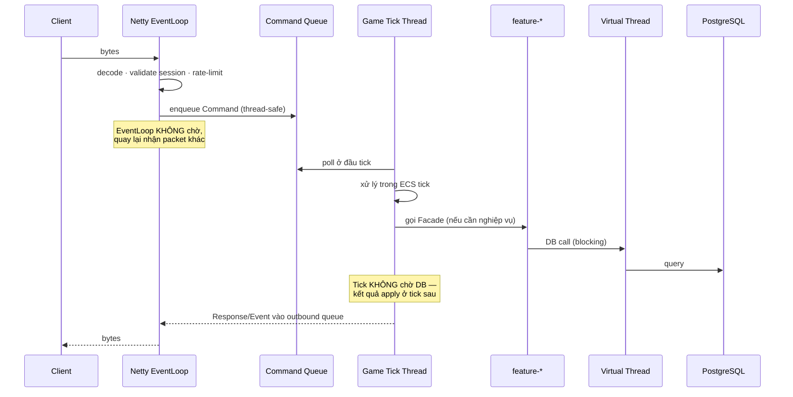

# SERVER.md

**Kiến trúc Server**

| | |
|---|---|
| Version | 1.0.0 |
| Status | Draft |
| Liên quan | [ARCHITECTURE.md](../01-architecture/ARCHITECTURE.md), [ADR-003](../01-architecture/adr/ADR-003-Why-Netty.md), [ADR-009](../01-architecture/adr/ADR-009-Why-No-Spring-Boot.md) |

> **Server là nguồn chân lý duy nhất** (Điều 15). Mọi thứ ở đây phục vụ nguyên tắc đó.

---

## 1. Các thành phần

| Module | Trách nhiệm | Biết Netty? | Biết DB? |
|---|---|---|---|
| `server-gateway` | Accept, auth, session, rate-limit, encode/decode, routing | ✅ **duy nhất** | ❌ |
| `server-world` | ECS simulation: movement, combat, AI, spawn | ❌ | ❌ |
| `server-features/*` | Nghiệp vụ: inventory, guild, quest... | ❌ | ✅ qua Port |
| `server-database` | Adapter PostgreSQL/Redis | ❌ | ✅ **duy nhất** |

**Ranh giới này là kiến trúc, không phải gợi ý** — enforce bằng build (ADR-011).

---

## 2. Luồng một Command



**Ba ranh giới thread bất khả xâm phạm:**

| Thread | Được làm | ❌ Cấm |
|---|---|---|
| Netty EventLoop | decode, validate rẻ, enqueue | Query DB · logic nặng · chờ lock |
| Game Tick (1 thread) | Toàn bộ ECS + gameplay | Blocking I/O · `sleep` · `future.get()` |
| Virtual Thread | Blocking I/O (DB, API ngoài) | Sửa ECS state trực tiếp |

⚠️ **Vi phạm bất kỳ ô "cấm" nào = server giật hoặc chết.** Đây là lỗi nghiêm trọng nhất có thể mắc ở tầng server.

---

## 3. Game Tick — single thread

Quyết định nền tảng ([JAVA-GUIDELINES.md §5.1](../02-coding-standards/JAVA-GUIDELINES.md)).

**Vì sao single-thread:**
- Loại bỏ phần lớn bài toán concurrency trong gameplay → không lock, không race condition trong ECS.
- Xác định, tái hiện được bug.
- Đơn giản (Điều 9).

**Đánh đổi**: 1 core cho gameplay. Hết dư địa → **nhiều world instance** (scale ngang), không phải multi-thread trong 1 world ([ARCHITECTURE.md §14](../01-architecture/ARCHITECTURE.md)).

```java
// Vòng lặp server — fixed timestep (ENGINE.md §4)
while (running) {
    long start = System.nanoTime();

    commandQueue.drainTo(pendingCommands);   // lấy Command từ EventLoop
    engine.update(FIXED_DT);                  // toàn bộ ECS
    outboundQueue.flush();                    // đẩy Response/Event ra

    long elapsed = System.nanoTime() - start;
    long sleepNanos = FIXED_DT_NANOS - elapsed;
    if (sleepNanos > 0) LockSupport.parkNanos(sleepNanos);
    else log.warn("Tick quá hạn: {}ms", elapsed / 1_000_000);   // ⚠️ cảnh báo
}
```

⚠️ **Tick quá hạn phải log WARN** — đây là tín hiệu sớm nhất của vấn đề hiệu năng. Không có nó, ta chỉ biết khi người chơi kêu.

---

## 4. Tick Rate — **60Hz** ([ADR-018](../01-architecture/adr/ADR-018-Tick-Rate.md))

| Tick rate | Ngân sách/tick | Băng thông | Độ mượt |
|---|---|---|---|
| 20Hz | 50ms | Thấp nhất | Đủ cho MMORPG chậm |
| 30Hz | 33ms | Trung bình | Cân bằng |
| **60Hz** | **16.6ms** | Cao (×2 so với 30) | **Mượt nhất — đã chọn** |

**Đã chốt 60Hz** (ADR-018): ưu tiên độ mượt combat/input. Đánh đổi: ngân sách mỗi tick chỉ 16.6ms và băng thông ~2× so với 30Hz → **AoI + delta compression bắt buộc sớm** (§6).

⚠️ **Lưu ý bắt buộc**: tick rate ≠ snapshot rate. Với 60Hz, **nên hạ snapshot rate cho entity xa** (VD gửi 20–30Hz) để cắt băng thông mà vẫn giữ logic mượt — xem §6.

⚠️ Nếu Phase 9 đo thấy không giữ được p99 trong 16.6ms → Revisit Trigger của ADR-018 (hạ về 30Hz).

---

## 5. Gateway

| Trách nhiệm | Chi tiết |
|---|---|
| Accept kết nối | Netty `ServerBootstrap` |
| Xác thực | Kiểm tra token → tạo session ([SECURITY.md](../08-security/SECURITY.md)) |
| Rate limit | Giới hạn Command/giây theo opcode ([NETWORK.md §109](NETWORK.md)) |
| Encode/decode | `PacketCodec` — dùng chung với client |
| Routing | Command → world queue hoặc feature Facade |
| Heartbeat | Ping/Pong, phát hiện kết nối chết |

**Gateway không chứa gameplay logic.** Nó là bưu điện, không phải người đọc thư.

### 5.1 Một nhân vật — một phiên sống (quyết định chủ dự án 2026-09-25)

**Luật**: tại mọi thời điểm một nhân vật chỉ gắn với ĐÚNG MỘT kết nối. Chọn nhân vật đang online từ
kết nối khác thì **phiên MỚI thắng, phiên CŨ bị đá**. Chọn lại đúng nhân vật đang chơi trên CÙNG kết
nối (bấm hai lần) không tự đá mình.

Trước quyết định này gateway không kiểm gì cả, và có ba bug thật: kết nối nào đóng trước thì
`unregister` luôn nhân vật của kết nối kia; khu vực map chính đầu tiên đầy thì cùng một nhân vật có
HAI thực thể ở hai khu vực (cày gấp đôi); gói xác nhận di chuyển muộn của phiên cũ rơi vào kết nối mới.

Trình tự khi kết nối B chọn nhân vật C đang gắn với kết nối A (`GatewayChannelHandler.enterWorldAsOnlySession`):

1. B giữ khoá của C (`CharacterSessionRegistry.lockFor`, chỉ trên Virtual Thread) suốt các bước dưới
   — hai lượt chọn cùng một nhân vật không bao giờ đan xen.
2. B ghi mình làm chủ phiên của C; chủ cũ là A ⇒ B xếp lượt đá lên **EventLoop của A** (để không
   lệnh nào của A còn lọt vào world sau đó) rồi CHỜ A dọn xong (trần 5 giây).
3. Lượt đá trên A: gỡ `boundCharacterId`, dọn y hệt ngắt kết nối thường (§9: unregister có điều kiện
   theo kết nối, rời hầm ngục/đấu trường/world, ghi vị trí lúc thoát §8, báo bạn bè offline), gửi
   `ErrorResponse{error_key="error.logged_in_elsewhere", error_code=409}` rồi đóng kết nối SAU khi gói
   đã ghi ra dây.
4. "Dọn xong" nghĩa là: dòng vị trí đã GHI xuống DB và world đã xử lý hết mọi lệnh xếp trước lệnh
   detach (`WorldFacade.inboxBarrier()`). Chỉ sau mốc này B mới đọc vị trí, gửi
   `SelectCharacterResponse`, đăng ký kết nối và gắn vào world.

Phòng thủ thêm: `ConnectedCharacterRegistry.unregister(characterId, ctx)` chỉ xoá khi nhân vật còn gắn
với đúng kết nối đó; `MainWorldChannelRegistry.attachCharacter` gắn lại nhân vật đã ở một khu vực là
không làm gì. Không đổi protocol (dùng lại `ErrorResponse`), không đổi schema. Client nhận khoá này thì
dừng hẳn kết nối (không tự nối lại vào phiên đã chết) và về màn đăng nhập kèm lý do (CLIENT.md §8).
**Cùng kết nối đổi nhân vật (C → D, cùng account — client hiện tại không làm, server không tin client)**:
C được dọn TRỌN y như ngắt kết nối thường (dưới khoá của C, trên EventLoop của kết nối, chờ mốc "dọn
xong") rồi D mới vào world qua đúng trình tự trên; các lượt chọn của một kết nối chạy tuần tự
(`selectLock`), mỗi lần gắn có cờ dọn riêng (`CharacterBinding`) nên ngắt kết nối vẫn dọn D, và lần
đăng nhập C sau đó không đá kết nối đang chơi D (2026-09-29).
Test: `CharacterSessionTakeoverTest`, `CharacterSwitchOnSameConnectionTest`, `MainWorldChannelRegistryTest`,
`WorldInboxBarrierTest`.

---

## 6. State Sync — gửi gì cho client

Bài toán: 100 người chơi trong 1 map, mỗi tick gửi toàn bộ state cho mọi người = **O(n²)** → chết băng thông.

| Kỹ thuật | Cách |
|---|---|
| **Area of Interest (AoI)** | Chỉ gửi entity **trong tầm nhìn** của người chơi đó |
| **Delta compression** | Chỉ gửi thứ **thay đổi** so với snapshot trước |
| **Tần suất theo khoảng cách** | Entity gần: mỗi tick. Entity xa: mỗi 3–5 tick |
| **Ưu tiên** | Người chơi khác > quái > item rơi > trang trí |

⚠️ **AoI là bắt buộc, không phải tối ưu.** Không có AoI, map đông người sẽ sập băng thông ngay ở Phase 3.

**Hiện thực** (`AreaOfInterestTracker`, server-world): lưới spatial hashing, sync 20Hz, mỗi nhân vật
quét 3×3 ô quanh mình ([BENCHMARK §5.2](../09-performance/BENCHMARK.md)). ⚠️ Vòng quét ô lân cận chỉ
chứng minh được một chiều — "trong tầm ⇒ là ô lân cận", nên không sót lần **vào** tầm — nhưng không
thăm lại cặp đã **rời** 3×3 ô (hai người ở hai mép ô 0/1 rồi một người bước sang ô 2; hay hồi sinh
dịch chuyển về `(0,0)`). Trước 2026-10-03 các cặp đó không bao giờ nhận despawn: client giữ bóng ma
đứng yên, và vì server vẫn ghi "đang thấy" nên lúc quay lại cũng không gửi lại spawn. **Sửa
2026-10-03** (`e53722d`): mỗi lần sync duyệt tập ĐANG THẤY của từng nhân vật trước, despawn mọi id
ngoài 3×3 ô (chắc chắn ngoài tầm); id trong 3×3 ô để vòng quét cũ xử lý nên không event nào phát
hai lần. Test: `AreaOfInterestBoundaryTest`. Chi phí thêm chưa đo lại bằng load test (thêm một lượt
duyệt tập đang thấy + một `Iterator` mỗi nhân vật mỗi lần sync ở 20Hz).

**Kích thước AoI — đang chạy, CHƯA có quyết định chính thức** (rà 2026-10-03): bán kính **15 m** (`WorldConstants.AOI_RADIUS_METERS`, javadoc tự ghi "placeholder"), lưới ô cạnh 15 m quét 3×3, đồng bộ **20 Hz** (`AOI_SYNC_RATE_HZ`). Con số này chạy từ Phase 3 và mọi số đo capacity ([BENCHMARK §5](../09-performance/BENCHMARK.md)) đều gắn với nó, nhưng không ADR hay tài liệu Accepted nào chốt nó — ảnh hưởng cả gameplay (thấy được ai) lẫn băng thông. Chờ chủ dự án: dòng **54** bảng "🔴 ĐANG CHỜ CHỦ DỰ ÁN" ở [docs/README.md](../README.md).

### Kiểm sống 2026-10-03 — AoI "bóng ma" (`e53722d`) và vị trí NaN (`5aab474`)

Server `installDist` thật + Postgres dev + `gameProbe` (TLS thật). Bán kính/cạnh ô AoI = 15 m.

**1. Cặp nhân vật rời 3×3 ô — PASS, và chạy đúng NHÁNH MỚI của bản vá.** B (`Benkei`, id 4) đặt
`pos_x = 0` bằng SQL rồi đứng yên trong `sect_grounds`; A (`Kagemaru`, id 3) đi bộ 0 → −35, đứng 5 s,
quay về 0. Vì B đứng **đúng** ở x = 0 (ô 0) nên lúc khoảng cách vừa vượt 15 m thì A đã ở x < −15, tức
ô −2 — cặp này **chỉ** `dropVisibleOutsideNeighborCells` mới bắt được; trước bản vá nó không bao giờ
được báo despawn. Đo:
- Phía A: `3237 MOVE_RESPONSE x=-15.00` → `3288 CHARACTER_DESPAWNED characterId=4` → `3304 x=-15.33`.
  Lúc quay về: `16352 x=-15.00` → `16403 CHARACTER_SPAWNED characterId=4 x=0.00`.
- Phía B: `11148 CHARACTER_MOVED characterId=3 x=-15.00` → `11200 CHARACTER_DESPAWNED characterId=3`;
  spawn lại `24298 CHARACTER_SPAWNED characterId=3 x=-14.83`. Cả hai chiều đều có, không lặp sự kiện.

**2. Quái — PASS cả hai đường.**
- Đi bộ (nhánh cũ, ô lân cận): hình nộm `-2`@14 despawn khi A qua x = −1,00→−1,33, spawn lại ở
  −1,08→−0,75; hình nộm `-1`@8 despawn ở −7,00, spawn lại ở −7,00→−6,67; `blood_sand_enforcer`
  `-10`@−8 despawn ở −23,00, spawn lại ở −22,67. Ngưỡng khớp 15 m tới từng bước 0,33 m.
- **Dịch chuyển do hồi sinh (nhánh MỚI, đúng ca commit nêu):** B (Lv1) đi tới x = −30, bị hai
  `archive_warden` đánh chết (`8554 … targetHp=0 targetDied=true`), hồi sinh về (0,0)
  (`8557 CHARACTER_RESPAWNED x=0.00`), và **5 ms sau** nhận `8562 MONSTER_DESPAWNED -6` + `-7` — hai con
  đó đang ở x ≈ −28,0 / −31,6 (ô −2/−3, ngoài 3×3 ô quanh ô 0). Trước bản vá chúng sẽ là bóng ma.
  Cùng mốc 8562 server gửi lại spawn `-10`/`-1`/`-2` và NPC quanh làng.

**3. Vị trí NaN — PASS.** Nhân vật `al` (id 2, offline) đặt `pos_x = 'NaN'` bằng SQL. Vào world:
`spawn=(0.00, 0.00)` trong `SelectCharacterResponse` (không còn NaN trên dây), `MOVE_RESPONSE`
đi đều 0,00 → 3,00 trong 0,6 s, AoI thấy đủ 3 quái + 2 NPC. Đăng xuất xong DB ghi lại
`pos_x = 2.9999993` (hữu hạn). Log server: không exception nào ngoài OTLP collector vắng (cổng 4318)
và các dò BouncyCastle của Netty (đều là nhiễu môi trường dev).

Dọn dẹp: `pos_x` của id 2/3/4 trả về giá trị trước khi đo; server và container dev đã tắt. Lưu ý
server tự chạy migration V51 (đã có trên `master`) vào DB dev lúc khởi động.

---

## 7. Scheduler

Không có `@Scheduled` của Spring ([ADR-009](../01-architecture/adr/ADR-009-Why-No-Spring-Boot.md)) → tự làm.

| Loại task | Chạy ở đâu |
|---|---|
| **Trong tick** (respawn quái, hết buff) | ECS System đếm thời gian — không cần scheduler |
| **Định kỳ, nhẹ** (lưu state mỗi 5 phút) | Task queue của tick thread, chạy mỗi N tick |
| **Định kỳ, nặng** (snapshot ranking, dọn mail hết hạn) | **Virtual Thread riêng** — không đụng tick |
| **Theo lịch** (world boss 20h thứ 7) | Scheduler riêng → bắn Event vào tick |

⚠️ **Cấm** task nặng chạy trong tick thread. Snapshot ranking cho 10.000 nhân vật trong tick = tick quá hạn = cả server giật.

---

## 8. Persistence Strategy

Bài toán: mỗi thay đổi (di chuyển, nhận exp) ghi DB ngay = giết DB.

| Dữ liệu | Chiến lược |
|---|---|
| Vị trí nhân vật | **Không ghi liên tục** — ghi khi đổi map / đăng xuất / định kỳ 5 phút |
| HP/Chi | **Không lưu** — đăng nhập lại là đầy máu/Khí (sửa tài liệu theo code 2026-10-17, dòng 76(d) bảng chờ; trước đó dòng này ghi "như trên" nhưng không đường nào ghi máu) |
| EXP/Level | Ghi khi thay đổi đáng kể hoặc định kỳ |
| **Item, Gold, Trade** | ⚠️ **Ghi NGAY, trong transaction** — mất = mất tài sản thật của người chơi |
| Quest progress | Ghi khi hoàn thành bước |
| Chat | Không ghi (trừ audit) |

**Nguyên tắc**: dữ liệu **có giá trị** (item/gold) ghi ngay + transaction. Dữ liệu **tái tạo được** (vị trí) ghi định kỳ.

⚠️ **Server crash = mất dữ liệu chưa ghi.** Chấp nhận mất 5 phút vị trí. **Không** chấp nhận mất 1 item.

---

## 9. Fault Tolerance

Chi tiết: [ARCHITECTURE.md §15](../01-architecture/ARCHITECTURE.md).

| Sự cố | Server phải |
|---|---|
| PostgreSQL chết | **Từ chối giao dịch**, không cho chơi tiếp rồi mất dữ liệu (Fail Fast, Điều 16) |
| Redis chết | Tiếp tục chạy — người chơi phải đăng nhập lại, **không mất dữ liệu** |
| Script lỗi | Sandbox bắt, log, quest đó lỗi — **không sập server** |
| Tick quá hạn liên tục | Log WARN → cảnh báo → điều tra |
| 1 world instance chết | Người chơi map đó → trả về hub, không sập toàn server |

---

## 10. Graceful Shutdown

**Bắt buộc** — server không được `kill -9`:

```
1. Ngừng nhận kết nối mới
2. Thông báo người chơi (Event: "server bảo trì trong 30s")
3. Chờ tick hiện tại xong
4. Lưu toàn bộ state chưa ghi
5. Đóng kết nối DB/Redis
6. Thoát
```

Không có bước này → mất toàn bộ dữ liệu chưa ghi ở §8.

**Hiện thực** (`GatewayBootstrap.shutdownSequence`, chạy bởi shutdown hook `gateway-shutdown`):
`ArenaInstanceRegistry.beginShutdown()` (từ đây rớt kết nối giữa trận là HUỶ trận, không ghi Elo —
quyết định chủ dự án 2026-10-11) → `GatewayServer.stop()` (đóng cổng → `broadcastShuttingDown` → **chờ
30 s đếm ngược bảo trì** → tắt Netty event loop, tức đóng mọi kết nối → tắt `authExecutor`) → `stopAll()` khu vực world chính → hầm ngục → Arena → registry nhân vật →
luồng lưu vị trí (`CharacterPositionPersister`) → máy chủ metrics → tracing → đóng DB.

**Đếm ngược bảo trì là THẬT** (dòng 76(b), chủ dự án duyệt 2026-10-17). Trước đó bước 2 chỉ là lời hứa:
code phát `ServerShuttingDownEvent` rồi đóng kết nối ngay. Nay sau lời báo, kết nối được giữ
`KAGE_SHUTDOWN_NOTICE_SECONDS` giây (mặc định 30, dev đặt 0) — cổng đã đóng nên không ai vào thêm,
người đang chơi vẫn được phục vụ bình thường. `stop_grace_period` của cả hai compose nới 60 → 120 s cho
vừa (dòng 76(c)). Gói không mang số giây (protocol đã chốt), câu báo client nói "khoảng 30 giây". Test:
`GatewayServerIntegrationTest.shouldServeThroughTheShutdownNotice_thenSaveWhereTheRunningCharacterActuallyIs`.

**`WorldFacade.stop()` chờ lần tick dở có trần 5 s** (dòng 56, 2026-10-17): một tick treo (vd script kẹt)
từng kéo cả trình tự tắt treo theo tới SIGKILL. Quá trần thì đi tiếp kèm WARN.

**Khởi động hỏng nay tắt sạch và THOÁT** (sửa 2026-10-03, `52bb46f`). Trước đó, mở cổng thất bại (cổng
bị chiếm, chứng chỉ TLS hỏng) làm `main()` chết nhưng **JVM không bao giờ thoát**: luồng boss của Netty,
luồng lưu vị trí và máy chủ metrics đều KHÔNG daemon và không ai tắt (hook còn chưa đăng ký) — tiến
trình treo mà không phục vụ ai, và restart policy của Docker không bao giờ kích hoạt. Nay:
- `GatewayServer.start()` thất bại thì tự tắt event loop group + `authExecutor` rồi mới ném tiếp
  (`releaseAfterFailedStart`).
- `GatewayBootstrap.startOrShutDown` chạy nguyên trình tự tắt ở trên khi `start()` ném; shutdown hook
  chỉ đăng ký **sau** khi mở cổng thành công, nên trình tự tắt không chạy hai lần.
- Test: `GatewayServerStartFailureTest`.

**Không mở khu vực world chính mới sau khi đã tắt** (sửa 2026-10-03, `52bb46f`). Lúc tắt server, một
lượt chốt trận Arena hay đưa người gục khỏi hầm ngục còn chạy dở có thể gắn người về world chính SAU
`MainWorldChannelRegistry.stopAll()`: bảng khu vực đã rỗng nên bản cũ coi là "cần khu vực mới", dựng
và `start()` một World không ai dừng — nó tick tiếp trong lúc pool DB đóng. Nay registry có cờ
`stopped`: lượt gắn muộn rơi vào khu vực #1 **đã dừng** (lệnh nằm im trong hàng đợi) và
`needsNewChannel()` luôn `false`. Test: `MainWorldChannelRegistryTest`.

**Vị trí lưu lúc tắt là chỗ nhân vật ĐANG ĐỨNG, không phải chỗ bấm phím lần cuối** (sửa 2026-10-10).
Client chỉ gửi `MoveCommand` khi ĐỔI hướng, còn gateway chỉ học vị trí từ lời đáp của lệnh đó — nên mọi
lần ghi vị trí (định kỳ, ngắt kết nối, tắt server) ghi chỗ người chơi bấm phím lần cuối: giữ phím đi
12 m rồi server tắt là đăng nhập lại lùi đúng 12 m. Nay world chính báo vị trí thật của mọi nhân vật
mỗi giây (`WorldOutboundSink.onCharacterPositionSampled`, `WorldConstants.POSITION_SAMPLE_RATE_HZ`);
hầm ngục/đấu trường không báo (toạ độ instance không bao giờ thành vị trí thật). Còn mất nhiều nhất
quãng đi của một giây. Test: `ServerShutdownMidPlayDatabaseTest`, `ConnectedCharacterRegistryPositionTest`.
**Từ 2026-10-17 (dòng 76(a)) không mất gì nữa ở lúc ngắt kết nối/tắt server**: lệnh gỡ khỏi world chính
mang `FinalPositionListener`, World báo vị trí thật đúng tick gỡ, gateway chờ mốc hàng đợi rồi lưu số
đó (World đã dừng thì dùng mẫu 1 Hz). Mẫu 1 Hz vẫn là nguồn của lượt lưu định kỳ. Test:
`GatewayServerIntegrationTest.shouldServeThroughTheShutdownNotice_thenSaveWhereTheRunningCharacterActuallyIs`.

**`ArenaInstanceRegistry.stopAll()` dừng World NGOÀI khoá** (sửa 2026-10-10). Bản cũ gọi `stop()` —
chờ lần tick dở — khi đang giữ monitor của registry, còn lần tick đó nếu vừa có người gục thì xin đúng
monitor ấy (`handleCharacterDefeated`): khoá chết, trình tự tắt đứng lại tới khi Docker giết tiến
trình. Từ 2026-10-11 (dòng 36(ii) đã thi hành: tắt server là huỷ trận) đường này CHẠY THẬT ở mỗi lần
tắt có trận đang dở — trước đó mọi trận đã bị chốt lúc đóng kết nối. Test: `ArenaShutdownDeadlockTest`.

**Kiểm tắt → khởi động lại trên Postgres thật** (`ServerShutdownMidPlayDatabaseTest`, 2026-10-10, chạy
đúng phép lắp + trình tự tắt của production qua `GatewayBootstrap.assemble`): 30 lệnh mua còn đang bay
lúc tắt đều chạy trọn (vàng trừ = giá × số món, mỗi món một dòng audit, không log ERROR); lệnh xác nhận
giao dịch thứ hai bay đúng lúc tắt thì hoặc giao dịch xảy ra trọn hoặc phiên còn nguyên, và sau khởi
động lại phiên còn sót huỷ được, mời lại được.

**Thưởng hạ quái (rơi đồ / tiến độ quest / EXP) lúc tắt và lúc lỗi** (rà 2026-10-10,
`KillRewardDispatcher`). Ba việc chạy trên ba Virtual Thread riêng, vốn đã độc lập — một việc ném không
kéo mất hai việc kia. Hai thứ đã sửa: (1) việc ném thì exception chết trong Virtual Thread, chỉ in
`Exception in thread ""` ra stderr — nay ra một dòng ERROR có `step=`/`characterId=`/`monsterCode=`;
(2) lời báo quái chết tới sau khi registry đã `stop()` ném `RejectedExecutionException` trên tick thread
— nay bị bỏ kèm một dòng WARN (không chạy tại chỗ: tick thread cấm blocking I/O, pool DB sắp đóng).
Đã kiểm trên Postgres thật: quái chết ngay trước khi tắt mà lượt cộng EXP còn chờ DB 3 s thì trình tự
tắt chờ nó (trần 10 s) và cả ba phần thưởng đều vào DB; người chơi ngắt kết nối trước khi phần thưởng
ghi xong thì phần thưởng vẫn vào DB, chỉ mất gói thông báo. Test: `KillRewardIsolationTest`,
`ServerShutdownMidPlayDatabaseTest`. ⚠️ **Không thử lại**: việc hỏng là phần thưởng MẤT hẳn (quái không
được lưu) — có thử lại / có hàng đợi bền hay không là quyết định chưa chốt.

Đã đóng 2026-10-11: tắt server giữa trận Arena nay huỷ trận, không ghi Elo (dòng 36(ii), test
`ArenaSettlementLifecycleTest`); lưu vị trí lúc ngắt kết nối nay thử tối đa 3 lần (dòng 55).

⚠️ **Còn để ngỏ, đã đưa lên bảng chờ chủ dự án** ([README](../README.md)): `WorldFacade.stop()` chờ
`tickLock` không có trần thời gian (dòng 56 — `stop_grace_period: 60s` của Docker là lưới cuối).

---

## 11. Ngân sách tick (**60Hz = 16.6ms** — [ADR-018](../01-architecture/adr/ADR-018-Tick-Rate.md))

| Hạng mục | Ngân sách | Nguồn |
|---|---|---|
| ECS update | ≤ 4ms | [ECS.md §9](../03-engine/ECS.md) |
| Physics | ≤ 2.5ms | [PHYSICS.md §3](../03-engine/PHYSICS.md) |
| AI | ≤ 2.5ms | [AI.md §9](../03-engine/AI.md) |
| State sync + encode | ≤ 2.5ms | §6 |
| Event dispatch | ≤ 1ms | [ADR-008](../01-architecture/adr/ADR-008-Why-EventDriven.md) |
| **Dự phòng** | ~4ms | GC pause, spike |

⚠️ **Ngân sách 60Hz khắt khe hơn 30Hz đúng gấp đôi.** ECS chỉ còn ~4ms → tăng khả năng kích hoạt Revisit Trigger của [ADR-006](../01-architecture/adr/ADR-006-Why-ECS.md) (thay Ashley) sớm.

⚠️ **Toàn bộ con số này CHƯA ĐO** — là ngân sách đề xuất để có mục tiêu, không phải sự thật. Phải đo ở Phase 9 và điều chỉnh ([AI-WORKING-RULES.md §14](../00-governance/AI-WORKING-RULES.md)).

---

## Technical Decisions

| # | Quyết định | Lý do | Trạng thái |
|---|---|---|---|
| 1 | **Game tick single-thread** | Loại bỏ concurrency trong gameplay | Accepted |
| 2 | Ba ranh giới thread (§2) — vi phạm = lỗi nghiêm trọng | EventLoop/tick không được block | Accepted |
| 3 | **Tick quá hạn phải log WARN** | Tín hiệu sớm nhất của vấn đề hiệu năng | Accepted |
| 4 | Scale bằng **nhiều world instance**, không multi-thread 1 world | Giữ Decision #1 | Accepted |
| 5 | **AoI bắt buộc**, không phải tối ưu | Không có = sập băng thông ở Phase 3 | Accepted |
| 6 | Task nặng chạy Virtual Thread riêng, **không** trong tick | Tránh tick quá hạn | Accepted |
| 7 | **Item/Gold ghi ngay + transaction**; vị trí ghi định kỳ | Mất item = mất tài sản thật | Accepted |
| 8 | **Graceful shutdown bắt buộc** | Không mất dữ liệu chưa ghi | Accepted |
| 9 | Tick rate **60Hz** | Ưu tiên độ mượt; ngân sách 16.6ms khắt khe | ✅ [ADR-018](../01-architecture/adr/ADR-018-Tick-Rate.md) |
| 10 | Kích thước AoI: **đang chạy 15 m / ô 15 m quét 3×3 / sync 20 Hz**, chưa có quyết định chính thức | Ảnh hưởng gameplay + băng thông | ⏳ Chờ chủ dự án — [README dòng 54](../README.md) |
| 11 | Ngân sách §11 **chưa đo** | Mục tiêu, không phải sự thật | ⏳ Đo Phase 9 |
| 12 | **Một nhân vật — một phiên sống; phiên mới đá phiên cũ** (§5.1) | Hai phiên = hai thực thể, dọn nhầm phiên của nhau | ✅ Chủ dự án quyết 2026-09-25 |

## ADR cần tạo

| ADR | Nội dung | Ưu tiên |
|---|---|---|
| ✅ **ADR-018** | **Tick rate 60Hz** — §3, §4, §11 | Accepted |
| ✅ **ADR-010** | Single-realm + `realm_id` dự phòng — §9, scale | Accepted |
| ~~**ADR-011**~~ | ✅ **Accepted 2026-08-01** — [ADR-011](../01-architecture/adr/ADR-011-Enforce-Dependency-Rules.md) | Hết chặn |

## Tài liệu liên quan

- [NETWORK.md](NETWORK.md) · [DATABASE.md](DATABASE.md) · [GAMEPLAY.md](GAMEPLAY.md)
- [ARCHITECTURE.md](../01-architecture/ARCHITECTURE.md) — §4, §5, §14, §15
- [ECS.md](../03-engine/ECS.md) — thứ tự System trong tick
- [JAVA-GUIDELINES.md §5](../02-coding-standards/JAVA-GUIDELINES.md) — mô hình thread
- [OBSERVABILITY.md](../07-infrastructure/OBSERVABILITY.md) — đo tick time

## Việc cần làm tiếp theo

1. ✅ ADR-018 đã chốt **60Hz** — ngân sách §11 = 16.6ms/tick.
2. Phase 3: triển khai **AoI ngay từ đầu** (§6) — thêm sau khi đã có state sync là refactor lớn.
3. Phase 3: xác lập §8 (persistence strategy) — sai ở đây là mất tài sản người chơi.
4. Phase 9: đo và cập nhật §11.
