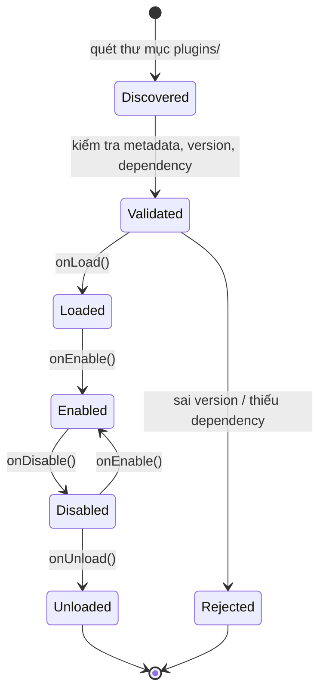

# PLUGIN.md

**Plugin System**

| | |
|---|---|
| Version | 1.0.0 |
| Status | ⛔ **Superseded** — xem [ADR-030](../01-architecture/adr/ADR-030-No-Plugin-System.md) |
| ADR | [ADR-007](../01-architecture/adr/ADR-007-Why-Plugin-System.md) (Superseded) → [ADR-030](../01-architecture/adr/ADR-030-No-Plugin-System.md) (Accepted 2026-08-01) |

> ⚠️ **Đọc [ADR-030](../01-architecture/adr/ADR-030-No-Plugin-System.md) trước.** Quyết định cuối: **không
> xây Plugin System** — `engine-plugin-api` đã bị xoá khỏi codebase (2026-08-01), tính năng lớn tiếp tục
> viết thẳng vào `server-features/<feature>/`. Toàn bộ nội dung bên dưới mô tả một thiết kế **không còn
> được triển khai** — giữ lại để tham khảo lịch sử, không phải việc cần làm. Cần rà soát/rút gọn lại
> file này ở phiên riêng (CLAUDE.md §13 — việc tài liệu lớn cần đề xuất bố cục trước).

---

## 1. Plugin vs Script — phân biệt

| | **Plugin** | **Script** |
|---|---|---|
| Viết bằng | Java (compile) | Lua / JS |
| Ai viết | Lập trình viên | Game designer |
| Nạp lúc | Khởi động server | Runtime, hot-reload |
| Sandbox | ❌ Không (tin cậy) | ✅ **Bắt buộc** |
| Dùng cho | **Tính năng lớn**: Dungeon system, Guild War | **Nội dung**: quest cụ thể, dialogue, boss pha |
| Hiệu năng | Java tốc độ đầy đủ | Chậm hơn |
| Tài liệu | File này | [SCRIPTING.md](SCRIPTING.md) |

**Nguyên tắc phân định**: Plugin thêm **cơ chế mới**. Script thêm **nội dung** dùng cơ chế có sẵn.

---

## 2. Vì sao hoãn

Điều 9 + Điều 10. Plugin System là cái bẫy kinh điển của dự án engine:

> Xây plugin system hoàn hảo → không bao giờ viết plugin thứ hai → tốn 3 tháng cho 0 giá trị.

**Không thể thiết kế API tốt cho nhu cầu chưa quan sát được.** Phải có gameplay thật (hết Phase 6 — MVP) mới biết plugin cần gì.

**Giữ chỗ hiện tại**: `engine-plugin-api` tồn tại như module rỗng để cấu trúc module không phải đổi sau.

---

## 3. Plugin API (thiết kế dự kiến)

```java
public interface KagePlugin {
    PluginMetadata metadata();
    void onLoad(PluginContext context);
    void onEnable();
    void onDisable();
    void onUnload();
}

public record PluginMetadata(
    String id,               // "dev.kage.plugin.dungeon"
    String name,
    Version version,
    Version minEngineVersion,
    List<String> dependencies
) {}
```

**Plugin chỉ được truy cập qua `PluginContext`** — không được với tay vào engine internals:

```java
public interface PluginContext {
    EventBus events();                    // đăng ký listener
    EcsWorld world();                     // thêm System/Component
    ConfigSection config();               // config riêng của plugin
    Logger logger();
    <T> Optional<T> service(Class<T> type);   // chỉ service được export
}
```

---

## 4. Lifecycle



**Thứ tự nạp**: giải dependency graph → nạp theo topological order. Vòng lặp phụ thuộc → **từ chối cả cụm**, log rõ.

⚠️ **`onEnable()` phải fail fast** (Điều 16). Plugin lỗi khi bật → **từ chối bật plugin đó**, không để server chạy với plugin nửa vời.

---

## 5. Events

Plugin tương tác chủ yếu qua Event ([ADR-008](../01-architecture/adr/ADR-008-Why-EventDriven.md)):

```java
public void onEnable() {
    context.events().subscribe(MonsterKilledEvent.class, this::onMonsterKilled);
}
```

⚠️ **Bắt buộc huỷ đăng ký ở `onDisable()`** — không huỷ = listener treo = memory leak + hành vi ma.

---

## 6. Dependencies giữa Plugin

```
Plugin A (Dungeon) ──depends──> Plugin B (Party)
```

| Quy tắc | Chi tiết |
|---|---|
| Khai báo trong metadata | Không tự đoán |
| Version range | `party >= 1.2.0, < 2.0.0` |
| Vòng lặp phụ thuộc | Từ chối, log rõ ràng |
| Plugin B disable → A cũng disable | Không để A chạy thiếu B |

---

## 7. Versioning

Điều 40 — Semantic Versioning.

| Thay đổi | Version |
|---|---|
| Plugin API thêm method vào interface | **MAJOR** của engine (phá plugin cũ) |
| Plugin API thêm method **default** | MINOR (không phá) |
| Plugin sửa bug nội bộ | PATCH của plugin |

⚠️ **Plugin API là public API — mọi thay đổi phá vỡ đều tốn.** Đây là lý do nữa để hoãn: đóng băng API quá sớm = mắc kẹt với thiết kế sai.

`minEngineVersion` trong metadata → engine từ chối plugin không tương thích thay vì crash lúc chạy.

---

## 8. Sandbox — Plugin KHÔNG có

Quyết định quan trọng, dễ hiểu nhầm.

| | Plugin | Script |
|---|---|---|
| Sandbox | ❌ **Không** | ✅ Bắt buộc |
| Vì sao | Plugin là **Java chạy cùng JVM**. Sandbox Java thật sự (SecurityManager) đã deprecated và không đáng tin | Script chạy trong engine có sandbox thật |

**Nghĩa là**: plugin được tin cậy hoàn toàn. Plugin có thể đọc file, mở socket, làm bất cứ gì Java làm được.

→ **Chỉ nạp plugin của đội ngũ, hoặc plugin đã review.** Không nạp plugin từ nguồn không tin cậy.

⚠️ **Nếu muốn cho bên thứ ba viết plugin** → đây là vấn đề bảo mật lớn, cần thiết kế lại hoàn toàn (process riêng? WASM?). Đó là lý do [ADR-007](../01-architecture/adr/ADR-007-Why-Plugin-System.md) hỏi "plugin cho ai?".

---

## 9. ClassLoader Isolation — cần không?

| Nếu **không** isolate | Nếu **có** isolate |
|---|---|
| Đơn giản; plugin chỉ là jar trong classpath | Plugin dùng version thư viện khác nhau được |
| Không hot-reload | Hot-reload được (unload classloader) |
| Xung đột version thư viện | Phức tạp; dễ leak classloader |

**Đề xuất**: **không isolate ở giai đoạn đầu** (Điều 9). Plugin nạp lúc khởi động, đổi plugin = restart server.

**Hot-reload plugin có thật sự cần không?** Nếu chỉ đội ngũ viết plugin và deploy có cửa sổ bảo trì → **không cần**. Đây là câu hỏi trong ADR-007.

⚠️ ClassLoader leak là loại bug rất khó debug. Đừng chuốc lấy nếu không có nhu cầu thật.

---

## 10. Distribution

⏳ **Chưa quyết** — phụ thuộc ADR-007 ("plugin cho ai?").

| Nếu chỉ nội bộ | Nếu bên thứ ba |
|---|---|
| Plugin là module Gradle, build cùng server | Cần: registry, signing, version resolution, review process |
| Deploy = deploy server | Cần hạ tầng phân phối |

**Nếu chỉ nội bộ → plugin gần như không khác gì module Gradle** → và câu hỏi trở thành: *có thật sự cần plugin system không?* Đó là kết quả hợp lệ của ADR-007.

---

## Technical Decisions

| # | Quyết định | Lý do | Trạng thái |
|---|---|---|---|
| 1 | **Hoãn plugin system tới sau Phase 6 (MVP)** | Không thiết kế API cho nhu cầu chưa quan sát được | Accepted — [ADR-007](../01-architecture/adr/ADR-007-Why-Plugin-System.md) |
| 2 | `engine-plugin-api` giữ chỗ dạng module rỗng | Cấu trúc module không phải đổi sau | Accepted |
| 3 | **Plugin KHÔNG có sandbox** — sandbox là việc của Script | Sandbox Java thật sự không khả thi | Accepted |
| 4 | Plugin chỉ truy cập qua `PluginContext`, không với tay vào engine | Điều 21–22 | Accepted |
| 5 | Plugin **bắt buộc huỷ đăng ký listener** ở `onDisable()` | Chống leak | Accepted |
| 6 | **Không ClassLoader isolation** ở giai đoạn đầu | Điều 9; leak khó debug | Accepted có điều kiện |
| 7 | `onEnable()` fail → **từ chối plugin**, không chạy nửa vời | Điều 16 | Accepted |
| 8 | **Plugin cho ai** (nội bộ / bên thứ ba)? | Quyết định phạm vi toàn bộ | ⏳ **Chặn ADR-007** |
| 9 | Hot-reload có cần không? | Quyết định ClassLoader isolation | ⏳ **Chặn ADR-007** |

## ADR cần tạo

| ADR | Nội dung | Ưu tiên |
|---|---|---|
| **ADR-007** | Chốt phạm vi plugin — **hoặc kết luận không cần plugin system** | 🟡 Sau Phase 6 (MVP) |

⚠️ **Kết quả "không cần plugin system, dùng module Gradle" là kết quả hợp lệ và không phải thất bại** (§10).

## Tài liệu liên quan

- [ADR-007](../01-architecture/adr/ADR-007-Why-Plugin-System.md) — **đọc trước tài liệu này**
- [SCRIPTING.md](SCRIPTING.md) — thứ **thật sự** cần sandbox
- [ADR-008](../01-architecture/adr/ADR-008-Why-EventDriven.md) — plugin tương tác qua Event
- [ARCHITECTURE.md](../01-architecture/ARCHITECTURE.md) — vị trí `engine-plugin-api`

## Việc cần làm tiếp theo

1. **Trả lời 2 câu hỏi ở ADR-007** (plugin cho ai? có cần hot-reload?) — trước đó, tài liệu này chỉ là phác thảo.
2. **Không code plugin system ở Phase 0–6.** Nếu thấy mình đang viết plugin loader trước khi có gameplay → dừng lại.
3. Sau Phase 6 (MVP): đánh giá lại dựa trên gameplay thật.
