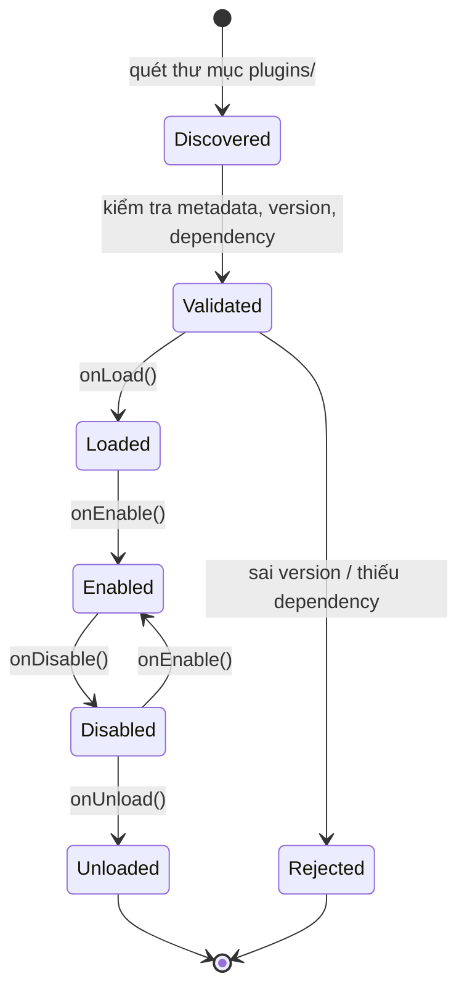

# PLUGIN.md

**Plugin System**

| | |
|---|---|
| Version | 1.0.0 |
| Status | ⛔ **Superseded** — xem [ADR-030](../01-architecture/adr/ADR-030-No-Plugin-System.md) |
| ADR | [ADR-007](../01-architecture/adr/ADR-007-Why-Plugin-System.md) (Superseded) → [ADR-030](../01-architecture/adr/ADR-030-No-Plugin-System.md) (Accepted 2026-08-01) |

> ⚠️ **Đọc [ADR-030](../01-architecture/adr/ADR-030-No-Plugin-System.md) trước.** Quyết định cuối: **không
> xây Plugin System** — `engine-plugin-api` đã bị xoá khỏi codebase (2026-08-01), tính năng lớn tiếp tục
> viết thẳng vào `server-features/<feature>/`. Toàn bộ nội dung bên dưới mô tả một thiết kế **không còn
> được triển khai** — giữ lại để tham khảo lịch sử, không phải việc cần làm. Cần rà soát/rút gọn lại
> file này ở phiên riêng (CLAUDE.md §13 — việc tài liệu lớn cần đề xuất bố cục trước).

---

## 1. Plugin vs Script — phân biệt (ADR-007, 2026-07-16)

Bảng dưới đây là cách phân biệt hai cơ chế mở rộng từng được **đề xuất** trong ADR-007. Cột **Script**
phản ánh đúng hệ thống **thật đang chạy** (GraalJS, [ADR-016](../01-architecture/adr/ADR-016-Scripting-Engine.md),
[SCRIPTING.md](SCRIPTING.md)). Cột **Plugin** mô tả một cơ chế **chưa từng được xây và sẽ không được
xây** — xem [ADR-030](../01-architecture/adr/ADR-030-No-Plugin-System.md). Giữ lại bảng vì phần so sánh
Plugin/Script vẫn có giá trị tham khảo cho câu hỏi "đã từng cân nhắc plugin chưa, vì sao không".

| | **Plugin** (đề xuất, KHÔNG triển khai) | **Script** (thật, đang chạy) |
|---|---|---|
| Viết bằng | Java (compile) | Lua / JS |
| Ai viết | Lập trình viên | Game designer |
| Nạp lúc | Khởi động server | Runtime, hot-reload |
| Sandbox | ❌ Không (tin cậy) | ✅ **Bắt buộc** |
| Dùng cho | **Tính năng lớn**: Dungeon system, Guild War | **Nội dung**: quest cụ thể, dialogue, boss pha |
| Hiệu năng | Java tốc độ đầy đủ | Chậm hơn |
| Tài liệu | File này (lịch sử) | [SCRIPTING.md](SCRIPTING.md) |

**Nguyên tắc phân định đã đề xuất**: Plugin thêm **cơ chế mới**. Script thêm **nội dung** dùng cơ chế có
sẵn. Trên thực tế, mọi "cơ chế mới" của 9 Phase vừa qua (Dungeon, Guild, Trade, Arena...) đều được viết
thẳng vào `server-features/<feature>/` bằng Java thường — không cần một lớp Plugin riêng để làm việc đó.

---

## 2. Vì sao từng đề xuất hoãn (ADR-007) — và vì sao cuối cùng không xây (ADR-030)

Điều 9 + Điều 10. Lý do ADR-007 (2026-07-16) đưa ra để **hoãn** (không phải để hoãn mãi mãi) quyết định
xây Plugin System:

> Xây plugin system hoàn hảo → không bao giờ viết plugin thứ hai → tốn 3 tháng cho 0 giá trị.

**Không thể thiết kế API tốt cho nhu cầu chưa quan sát được.** ADR-007 hẹn đánh giá lại sau Phase 6 (MVP)
khi đã có gameplay thật để biết plugin cần gì.

Phase 6 đóng từ 2026-07-23. Qua hết Phase 7–9 và toàn bộ mảng art, **không một tính năng lớn nào** (Guild,
Party, Trade, Dungeon, Boss AI, Arena, Quest, NPC, Dialogue, Friend, Mail, Chat, Inventory, Equipment,
Shop...) cần tới cơ chế plugin — tất cả viết thẳng vào `server-features/<feature>/`. Ngày 2026-08-01, chủ
dự án chốt qua [ADR-030](../01-architecture/adr/ADR-030-No-Plugin-System.md): **không xây Plugin System**,
và xoá hẳn module giữ chỗ `engine-plugin-api` (đã xoá khỏi `settings.gradle.kts` và filesystem — module
này **không còn tồn tại**, khác với những gì phần dưới của tài liệu này còn nhắc tới).

---

## 3. Plugin API — thiết kế đã được đề xuất, KHÔNG được triển khai

Phác thảo dưới đây **chưa từng có một dòng code thật nào** — không có class, interface nào trong số này
tồn tại trong codebase (kể cả `engine-plugin-api`, module giữ chỗ tương ứng, đã bị xoá). Giữ lại thuần
làm tư liệu lịch sử.

```java
public interface KagePlugin {
    PluginMetadata metadata();
    void onLoad(PluginContext context);
    void onEnable();
    void onDisable();
    void onUnload();
}

public record PluginMetadata(
    String id,               // "dev.kage.plugin.dungeon"
    String name,
    Version version,
    Version minEngineVersion,
    List<String> dependencies
) {}
```

**Plugin chỉ được truy cập qua `PluginContext`** — không được với tay vào engine internals:

```java
public interface PluginContext {
    EventBus events();                    // đăng ký listener
    EcsWorld world();                     // thêm System/Component
    ConfigSection config();               // config riêng của plugin
    Logger logger();
    <T> Optional<T> service(Class<T> type);   // chỉ service được export
}
```

---

## 4. Lifecycle — thiết kế đã được đề xuất, chưa từng vận hành

Vòng đời dưới đây chưa từng được cài đặt (không có plugin loader, không có `plugins/`). Giữ lại làm tư
liệu lịch sử về những gì đã được cân nhắc trước khi ADR-030 kết luận không xây.



**Thứ tự nạp**: giải dependency graph → nạp theo topological order. Vòng lặp phụ thuộc → **từ chối cả cụm**, log rõ.

⚠️ **`onEnable()` phải fail fast** (Điều 16). Plugin lỗi khi bật → **từ chối bật plugin đó**, không để server chạy với plugin nửa vời.

---

## 5. Events — cơ chế tương tác đã được đề xuất, chưa từng triển khai

Ý tưởng ban đầu: plugin tương tác chủ yếu qua Event ([ADR-008](../01-architecture/adr/ADR-008-Why-EventDriven.md)):

```java
public void onEnable() {
    context.events().subscribe(MonsterKilledEvent.class, this::onMonsterKilled);
}
```

⚠️ **Bắt buộc huỷ đăng ký ở `onDisable()`** — không huỷ = listener treo = memory leak + hành vi ma.

---

## 6. Dependencies giữa Plugin — quy tắc đã được đề xuất, chưa từng áp dụng

```
Plugin A (Dungeon) ──depends──> Plugin B (Party)
```

| Quy tắc | Chi tiết |
|---|---|
| Khai báo trong metadata | Không tự đoán |
| Version range | `party >= 1.2.0, < 2.0.0` |
| Vòng lặp phụ thuộc | Từ chối, log rõ ràng |
| Plugin B disable → A cũng disable | Không để A chạy thiếu B |

---

## 7. Versioning — quy ước đã được đề xuất cho một API chưa từng đóng băng

Điều 40 — Semantic Versioning. Vì Plugin API chưa từng được viết ra, bảng dưới đây **chưa từng áp dụng
cho bất kỳ version thật nào** — nó chỉ là quy ước lý thuyết kèm theo đề xuất ban đầu.

| Thay đổi | Version |
|---|---|
| Plugin API thêm method vào interface | **MAJOR** của engine (phá plugin cũ) |
| Plugin API thêm method **default** | MINOR (không phá) |
| Plugin sửa bug nội bộ | PATCH của plugin |

⚠️ **Plugin API là public API — mọi thay đổi phá vỡ đều tốn.** Đây từng là lý do để hoãn: đóng băng API
quá sớm = mắc kẹt với thiết kế sai. Kết cục thực tế (ADR-030) đi xa hơn "hoãn": không đóng băng API này
bao giờ, vì không có API này.

`minEngineVersion` trong metadata — nếu từng được xây — sẽ giúp engine từ chối plugin không tương thích
thay vì crash lúc chạy. Không áp dụng, vì không có plugin nào để tương thích.

---

## 8. Sandbox — quyết định đã đề xuất cho một cơ chế chưa từng tồn tại

Quyết định từng được cân nhắc kỹ vì dễ hiểu nhầm — dù bản thân Plugin không được xây, phần lập luận
"vì sao Plugin không cần sandbox còn Script thì bắt buộc" vẫn đúng và vẫn áp dụng cho Script thật.

| | Plugin | Script |
|---|---|---|
| Sandbox | ❌ **Không** | ✅ Bắt buộc |
| Vì sao | Plugin là **Java chạy cùng JVM**. Sandbox Java thật sự (SecurityManager) đã deprecated và không đáng tin | Script chạy trong engine có sandbox thật |

**Nghĩa là**: plugin được tin cậy hoàn toàn. Plugin có thể đọc file, mở socket, làm bất cứ gì Java làm được.

→ *(nếu Plugin từng được xây)* **chỉ nạp plugin của đội ngũ, hoặc plugin đã review.** Không nạp plugin từ nguồn không tin cậy.

⚠️ **Nếu muốn cho bên thứ ba viết plugin** → đây là vấn đề bảo mật lớn, cần thiết kế lại hoàn toàn (process
riêng? WASM?). Đó từng là câu hỏi mở của ADR-007 ("plugin cho ai?") — câu hỏi đó nay đã có câu trả lời:
[ADR-030](../01-architecture/adr/ADR-030-No-Plugin-System.md) kết luận **không có plugin nào cả**, nên
câu hỏi "cho ai" không còn áp dụng.

---

## 9. ClassLoader Isolation — câu hỏi đã từng để mở, nay đã moot

Đây từng là một câu hỏi mở trong ADR-007, chưa bao giờ cần trả lời vì Plugin System không được xây.

| Nếu **không** isolate | Nếu **có** isolate |
|---|---|
| Đơn giản; plugin chỉ là jar trong classpath | Plugin dùng version thư viện khác nhau được |
| Không hot-reload | Hot-reload được (unload classloader) |
| Xung đột version thư viện | Phức tạp; dễ leak classloader |

**Đề xuất khi đó**: **không isolate ở giai đoạn đầu** (Điều 9). Plugin nạp lúc khởi động, đổi plugin =
restart server.

**Hot-reload plugin có thật sự cần không?** Đây là 1 trong 2 câu hỏi ADR-007 để ngỏ chờ chủ dự án trả
lời. Câu trả lời cuối cùng (ADR-030, 2026-08-01): không cần, vì không xây plugin system.

⚠️ ClassLoader leak là loại bug rất khó debug — lý do tốt để không tự tạo ra nhu cầu này khi chưa có bằng
chứng cần thật.

---

## 10. Distribution — câu hỏi đã từng để mở, nay đã moot

Đây từng là câu hỏi phụ thuộc vào "plugin cho ai" (ADR-007). Vì không có plugin nào được xây, câu hỏi
phân phối plugin không còn đối tượng để áp dụng.

| Nếu chỉ nội bộ | Nếu bên thứ ba |
|---|---|
| Plugin là module Gradle, build cùng server | Cần: registry, signing, version resolution, review process |
| Deploy = deploy server | Cần hạ tầng phân phối |

**Nếu chỉ nội bộ → plugin gần như không khác gì module Gradle** — đây chính là quan sát đã dẫn tới câu
hỏi *"có thật sự cần plugin system không?"*, và câu trả lời cuối cùng của [ADR-030](../01-architecture/adr/ADR-030-No-Plugin-System.md)
là **không**: tính năng lớn dùng thẳng module Gradle (`server-features/<feature>/`), không cần một lớp
Plugin riêng ở trên.

---

## Technical Decisions

Bảng dưới đây ghi lại các quyết định/đề xuất trong quá trình cân nhắc Plugin System (2026-07-16 tới
2026-08-01). Hầu hết không còn "Accepted và đang áp dụng" — chúng là quyết định **đã có hiệu lực bên
trong một thiết kế cuối cùng không được triển khai**. Trạng thái thật duy nhất còn hiệu lực là dòng cuối:
không xây plugin system.

| # | Quyết định (trong thiết kế đề xuất) | Lý do | Trạng thái thật |
|---|---|---|---|
| 1 | Hoãn plugin system tới sau Phase 6 (MVP) | Không thiết kế API cho nhu cầu chưa quan sát được | Lịch sử — ADR-007 Superseded |
| 2 | `engine-plugin-api` giữ chỗ dạng module rỗng | Cấu trúc module không phải đổi sau | Lịch sử — module đã **xoá** (ADR-030) |
| 3 | Plugin KHÔNG có sandbox — sandbox là việc của Script | Sandbox Java thật sự không khả thi | Lịch sử — không áp dụng, không có Plugin |
| 4 | Plugin chỉ truy cập qua `PluginContext`, không với tay vào engine | Điều 21–22 | Lịch sử — `PluginContext` chưa từng tồn tại |
| 5 | Plugin bắt buộc huỷ đăng ký listener ở `onDisable()` | Chống leak | Lịch sử — không áp dụng |
| 6 | Không ClassLoader isolation ở giai đoạn đầu | Điều 9; leak khó debug | Lịch sử — không áp dụng |
| 7 | `onEnable()` fail → từ chối plugin, không chạy nửa vời | Điều 16 | Lịch sử — không áp dụng |
| 8 | Plugin cho ai (nội bộ / bên thứ ba)? | Quyết định phạm vi toàn bộ | **Đã trả lời**: không có plugin nào, câu hỏi hết hiệu lực (ADR-030) |
| 9 | Hot-reload có cần không? | Quyết định ClassLoader isolation | **Đã trả lời**: không cần, vì không xây plugin system (ADR-030) |
| 10 | **Không xây Plugin System, xoá `engine-plugin-api`** | 9 Phase quan sát thật: không tính năng nào cần plugin (Điều 9, 30) | ✅ **Accepted — [ADR-030](../01-architecture/adr/ADR-030-No-Plugin-System.md)** — quyết định thật duy nhất còn hiệu lực |

## ADR cần tạo

Không còn. Câu hỏi mà ADR-007 để ngỏ ("chốt phạm vi plugin, hoặc kết luận không cần") đã được trả lời và
đóng bởi [ADR-030](../01-architecture/adr/ADR-030-No-Plugin-System.md) (Accepted 2026-08-01) — đúng
nhánh "kết luận không cần plugin system, dùng module Gradle" mà ADR-007 đã đặt sẵn làm kết quả hợp lệ.

Theo Revisit Trigger của ADR-030: nếu sau này xuất hiện nhu cầu **thật** (bên thứ ba muốn viết mở rộng,
hoặc một tính năng cụ thể cần nạp/gỡ code lúc runtime không restart server) → tạo **ADR mới** (không phục
hồi ADR-007/`engine-plugin-api` cũ), thiết kế dựa trên nhu cầu cụ thể đã quan sát được.

## Tài liệu liên quan

- [ADR-030](../01-architecture/adr/ADR-030-No-Plugin-System.md) — **đọc trước tài liệu này**, quyết định cuối: không xây Plugin System
- [ADR-007](../01-architecture/adr/ADR-007-Why-Plugin-System.md) — đề xuất gốc (Superseded), bối cảnh lịch sử của toàn bộ nội dung trên
- [SCRIPTING.md](SCRIPTING.md) — thứ **thật sự** cần sandbox
- [ADR-008](../01-architecture/adr/ADR-008-Why-EventDriven.md) — cơ chế Event mà Plugin *lẽ ra* sẽ tương tác qua đó, nếu từng được xây
- [REPOSITORY-STRUCTURE.md](../01-architecture/REPOSITORY-STRUCTURE.md) / [ARCHITECTURE.md](../01-architecture/ARCHITECTURE.md) — cấu trúc module thật hiện tại; **không còn** `engine-plugin-api`

## Việc cần làm tiếp theo

Không còn việc triển khai nào đang chờ — đây là hồ sơ đóng. Chỉ còn:

1. **Đợt rà soát/rút gọn file này** mà ADR-030 đã ghi nhận là cần làm (CLAUDE.md §13 — việc tài liệu lớn
   cần đề xuất bố cục trước khi viết chi tiết); bản sửa hiện tại đã tái khung toàn bộ nội dung thành hồ sơ
   lịch sử, nhưng chưa rút gọn độ dài.
2. Nếu tương lai phát sinh nhu cầu **thật** cho plugin (bên thứ ba viết mở rộng, hoặc hot-reload runtime
   không restart server) → mở **ADR mới**, thiết kế dựa trên nhu cầu quan sát được lúc đó, không phục hồi
   lại thiết kế trong tài liệu này (xem Revisit Trigger của [ADR-030](../01-architecture/adr/ADR-030-No-Plugin-System.md)).
