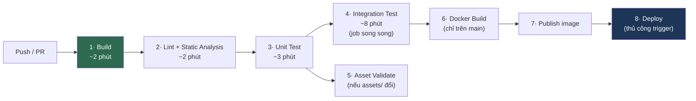

# CI-CD.md

**Pipeline tự động hoá**

| | |
|---|---|
| Version | 1.0.0 |
| Status | Draft |
| Luật gốc | [Hiến pháp Điều 41](../00-governance/KAGE-CONSTITUTION.md#điều-41-automation) |

> Điều 41: mọi công việc lặp lại phải được tự động hoá. **Không phụ thuộc thao tác thủ công.**

---

## 1. Nguyên tắc

| Nguyên tắc | Vì sao |
|---|---|
| **Máy chặn, không dựa vào người nhớ** | Con người/AI quên; CI không quên |
| **Feedback nhanh nhất có thể** | PR chờ 30 phút = không ai chạy CI trước khi push |
| **Fail = dừng, không cảnh báo rồi merge** | Cảnh báo bị bỏ qua sau 2 tuần |
| **Build tái lập được** | Cùng commit = cùng kết quả, hôm nay hay năm sau |

---

## 2. Pipeline



**Thứ tự có chủ đích**: thứ **nhanh và hay fail nhất** chạy trước. Không ai muốn chờ 8 phút integration test rồi mới biết lỗi format.

---

## 3. Gate — cái gì chặn merge

| Bước | Chặn PR? | Thời gian mục tiêu |
|---|---|---|
| Build | ✅ | ~2 phút |
| Spotless (format) | ✅ | < 30s |
| Checkstyle / SpotBugs / PMD / Error Prone | ✅ | ~2 phút |
| **ArchUnit** (dependency rule) | ✅ **quan trọng nhất** | < 30s |
| Unit test | ✅ | ~3 phút |
| Integration test (Testcontainers) | ✅ (job song song) | ~8 phút |
| Asset validate | ✅ (nếu `assets/` đổi) | ~1 phút |
| **Benchmark (JMH)** | ❌ **không** | — |
| **Load test** | ❌ **không** | — |

⚠️ **Benchmark KHÔNG chạy mỗi PR** — quá chậm, và số liệu trên runner CI dùng chung không đáng tin. Chạy **nightly** hoặc thủ công ([BENCHMARK.md](../09-performance/BENCHMARK.md)).

---

## 4. ArchUnit — gate quan trọng nhất

Đây là thứ biến kiến trúc từ "văn bản người ta nên đọc" thành "luật máy thi hành".

```java
@AnalyzeClasses(packages = "dev.kage")
class ArchitectureTest {

    @ArchTest
    static final ArchRule gameplay_khong_duoc_biet_netty =
        noClasses().that().resideInAnyPackage("..engine..", "..client.core..", "..server.world..")
            .should().dependOnClassesThat().resideInAPackage("io.netty..");

    @ArchTest
    static final ArchRule gameplay_khong_duoc_import_ashley_truc_tiep =
        noClasses().that().resideOutsideOfPackage("..engine.ecs..")
            .should().dependOnClassesThat().resideInAPackage("com.badlogic.ashley..");

    @ArchTest
    static final ArchRule domain_khong_duoc_biet_infrastructure =
        noClasses().that().resideInAPackage("..domain..")
            .should().dependOnClassesThat().resideInAPackage("..infrastructure..");

    @ArchTest
    static final ArchRule chi_server_database_duoc_dung_jdbc =
        noClasses().that().resideOutsideOfPackage("..server.database..")
            .should().dependOnClassesThat().resideInAnyPackage("java.sql..", "org.postgresql..");
}
```

**Vì sao đây là gate quan trọng nhất**: [ADR-006](../01-architecture/adr/ADR-006-Why-ECS.md) chỉ đảo ngược được **nếu** không ai import Ashley trực tiếp. Một lần vi phạm không phát hiện = mất khả năng thay ECS. Con người sẽ quên. ArchUnit không quên.

→ Đây là nội dung của **ADR-011**.

---

## 5. GitHub Actions

```yaml
name: CI
on: [push, pull_request]

jobs:
  build-and-verify:
    runs-on: ubuntu-latest
    steps:
      - uses: actions/checkout@v4
      - uses: actions/setup-java@v4
        with:
          java-version: '25'
          distribution: 'temurin'
          cache: 'gradle'
      - run: ./gradlew spotlessCheck            # nhanh nhất trước
      - run: ./gradlew build -x test
      - run: ./gradlew checkstyleMain spotbugsMain pmdMain
      - run: ./gradlew test                      # gồm ArchUnit
      - uses: actions/upload-artifact@v4
        if: failure()
        with:
          name: test-reports
          path: '**/build/reports/'

  integration-test:
    runs-on: ubuntu-latest                       # job SONG SONG — không chặn feedback nhanh
    steps:
      - uses: actions/checkout@v4
      - uses: actions/setup-java@v4
        with: { java-version: '25', distribution: 'temurin', cache: 'gradle' }
      - run: ./gradlew integrationTest           # Testcontainers tự dựng PostgreSQL/Redis
```

⚠️ **Upload report khi fail** — không có nó, CI đỏ mà không biết vì sao, phải chạy lại local.

---

## 6. Caching

| Cache | Hiệu quả |
|---|---|
| Gradle dependency | Build 5 phút → 2 phút |
| Gradle build cache | Task không đổi → skip |
| Docker layer cache | Image build nhanh hơn nhiều |

⚠️ **Cache có thể che lỗi** — build "xanh" nhờ cache cũ. Định kỳ (nightly) chạy **build sạch không cache** để phát hiện.

---

## 7. Docker Build & Publish

| Khi nào | Hành động |
|---|---|
| PR | ❌ Không build image (tốn thời gian, không ai dùng) |
| Merge vào `main` | ✅ Build + push tag `main-<sha>` |
| Tag `v1.2.3` | ✅ Build + push tag `1.2.3` và `latest` |

**Tag `latest` chỉ trỏ tới release chính thức**, không trỏ tới `main` — tránh deploy nhầm bản chưa release.

---

## 8. Deploy

✅ **Chốt** — [ADR-014](../01-architecture/adr/ADR-014-Kubernetes-vs-Docker-Compose.md) (2026-07-26): Docker Compose trên VM đơn, không dùng Kubernetes ([KUBERNETES.md](KUBERNETES.md) giữ Deprecated).

**Nguyên tắc bất kể chọn gì** (Điều 40 + [ROADMAP.md](../11-process/ROADMAP.md)):

| Quy tắc | Vì sao |
|---|---|
| **Không auto-deploy Production** | Deploy game server = đá người chơi. Phải có người bấm nút |
| **Không deploy Production trực tiếp từ nhánh phát triển** | Điều 70 quy trình release |
| Deploy phải **graceful** | [SERVER.md §10](../05-server/SERVER.md) — lưu state trước khi tắt |
| Thông báo người chơi trước | Không đá giữa trận không báo trước |

**Auto-deploy được**: môi trường dev/staging.

---

## 9. Rollback

| Thành phần | Rollback |
|---|---|
| Server code | Deploy lại image tag trước |
| **Database migration** | ⚠️ **Khó nhất** — cần rollback script hoặc kế hoạch tường minh ([DATABASE.md §10](../05-server/DATABASE.md)) |
| Asset | Version trước ([RESOURCE.md §9](../04-client/RESOURCE.md)) |
| Client | ⚠️ **Không rollback được** nếu người chơi đã cập nhật |

⚠️ **Rollback code dễ, rollback dữ liệu khó.** Migration thêm cột → rollback được. Migration xoá cột → dữ liệu **đã mất**. Đây là lý do Điều 40 yêu cầu quy trình Deprecated → Migration → Removal.

---

## 10. Secret

| ❌ Không bao giờ | ✅ Đúng |
|---|---|
| Secret trong repo | GitHub Secrets / secret manager |
| Secret trong Dockerfile | Env var lúc chạy |
| Secret trong log | Redact trước khi log |
| Secret trong CI output | Mask |

**Bắt buộc**: bật **secret scanning** trên repo ([OWASP.md](../08-security/OWASP.md)).

⚠️ **Secret đã commit = coi như đã lộ**, kể cả sau khi xoá commit. Phải **xoay (rotate)** secret đó, không chỉ xoá khỏi lịch sử.

---

## 11. Branch Strategy

Chi tiết: [GIT-WORKFLOW.md](../11-process/GIT-WORKFLOW.md).

| Nhánh | CI chạy gì |
|---|---|
| Feature branch / PR | Build + lint + test |
| `develop` | + Docker build (tag dev) |
| `main` | + Docker build + publish |
| Tag `v*` | + Publish release |

---

## Technical Decisions

| # | Quyết định | Lý do | Trạng thái |
|---|---|---|---|
| 1 | Thứ nhanh + hay fail chạy trước | Feedback nhanh | Accepted |
| 2 | **ArchUnit là gate bắt buộc** | Biến kiến trúc thành luật máy thi hành | Accepted — **ADR-011** |
| 3 | Integration test là **job song song** | Không chặn feedback 3 phút bằng 8 phút | Accepted |
| 4 | **Benchmark/Load test KHÔNG chạy mỗi PR** | Chậm + runner CI không đáng tin cho đo hiệu năng | Accepted |
| 5 | Không build Docker image ở PR | Tốn, không ai dùng | Accepted |
| 6 | `latest` chỉ trỏ release, không trỏ `main` | Tránh deploy nhầm | Accepted |
| 7 | **Không auto-deploy Production** | Deploy = đá người chơi | Accepted |
| 8 | Nightly build **không cache** | Cache che lỗi | Accepted |
| 9 | Secret đã commit → **rotate**, không chỉ xoá | Lịch sử git đọc được | Accepted |
| 10 | Deploy target: Docker Compose + VM đơn | [ADR-014](../01-architecture/adr/ADR-014-Kubernetes-vs-Docker-Compose.md) | Accepted |

## ADR cần tạo

| ADR | Nội dung | Ưu tiên |
|---|---|---|
| **ADR-011** | **ArchUnit rules cụ thể** (§4) — quan trọng nhất | 🔴 **Chặn Phase 0** |

## Tài liệu liên quan

- [DOCKER.md](DOCKER.md) — image build ở §7
- [STATIC-ANALYSIS.md](../10-quality/STATIC-ANALYSIS.md) — chi tiết bước 2
- [TESTING.md](../10-quality/TESTING.md) — chi tiết bước 3, 4
- [GIT-WORKFLOW.md](../11-process/GIT-WORKFLOW.md) — §11
- [BENCHMARK.md](../09-performance/BENCHMARK.md) — vì sao không chạy ở PR
- [KUBERNETES.md](KUBERNETES.md) — ⏳ §8

## Việc cần làm tiếp theo

1. 🔴 **Phase 0: ArchUnit trước tiên** (§4). Đây là hạng mục giá trị cao nhất trong toàn bộ CI — nó bảo vệ [ADR-006](../01-architecture/adr/ADR-006-Why-ECS.md) và Điều 23 khỏi bị bào mòn theo thời gian.
2. Phase 0: pipeline §5 cơ bản (build + lint + test).
3. Bật secret scanning ngay từ commit đầu tiên.
